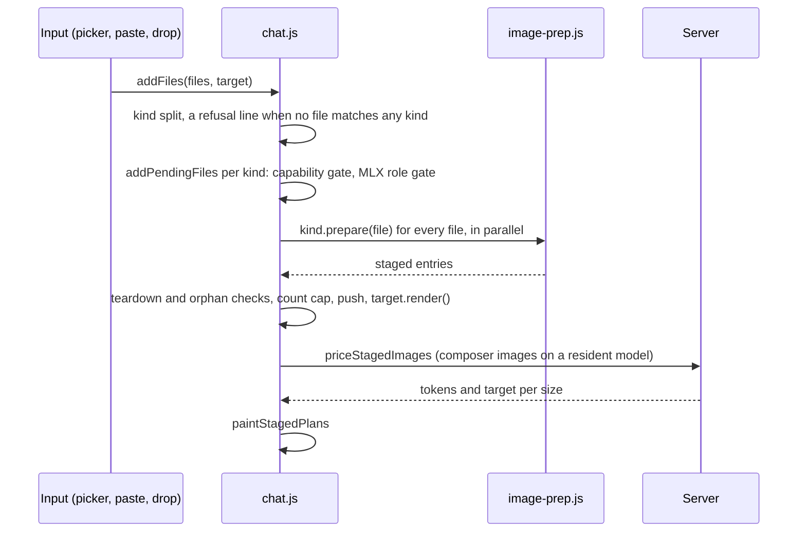
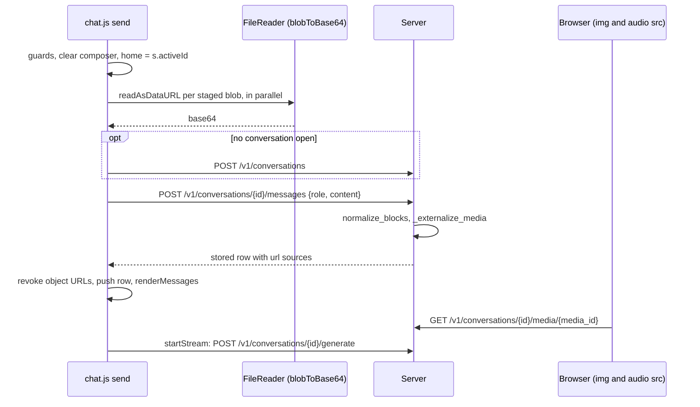

# Chat: attachments

last updated: 2026-11-24

This page maps images and audio on the chat page: how a file gets from the picker, a paste or a drop into the composer's staging strip, what a staged image costs the selected model, how a send turns staged files into content blocks and how the server stores them by reference, how stored media is drawn back into a row with a disclosure when the current model cannot take it, and how the message editor round-trips media. It starts at the attach inputs and stops at the generate request ([chat-generation.md](chat-generation.md)) and at the row reconciler ([chat-messages.md](chat-messages.md)). The overview it sits under is `docs/wiki/frontend_core.md`; the history is in `docs/architecture/sharp_edges.md` under [Attachments and paste](../../architecture/sharp_edges.md#attachments-and-paste), [A send belongs to the conversation it was sent from](../../architecture/sharp_edges.md#a-send-belongs-to-the-conversation-it-was-sent-from) and [Model switching and the config editor](../../architecture/sharp_edges.md#model-switching-and-the-config-editor).

## Files and what each owns

- `frontend/js/pages/chat.js`: everything client-side here. The attach controls (`s.attachBtn`, `s.fileInput`, built in `buildSkeleton`; `refreshAttachBtn`), the three inputs (`s.fileInput`'s `change` listener, `wirePasteAttach`, `wireDropAttach`), the kinds table `ATTACH_KINDS` with `MAX_ATTACH_IMAGES` and `MAX_ATTACH_AUDIO`, the one staging routine (`addFiles`, `composerTarget`, `addPendingFiles`, with helpers `attachableFiles`, `clipboardFiles`, `willStageAny`), the strip (`renderAttachStrip`, `renderMediaStrip`, `paintStagedPlans`, `thumbCost`, `thumbFit`), pricing and Fit (`priceStagedImages`, `fitStagedImage`), `clearPendingAttachments`, the send-side block build (`send`, `buildContentBlocks`, `encodeMediaEntry`), row drawing (`buildMessageEl`, `blockSourceUrl`, `hasBlocks`, `hasMediaBlocks`, `blockFingerprint`), the switch warning's media lines (`switchWarnings`), and the editor's media (`buildEditEl`, `carryEditorDraft`, the exported `editedContentBlocks`).
- `frontend/js/image-prep.js`: `prepareImage` (decode with orientation, cap the longest edge at `MAX_EDGE_PX`, re-encode), `resizeImageTo` (Fit), `blobToBase64` (the only base64 producer), and the private `decode`, `toBlob`, `keepsPng`, `JPEG_QUALITY`.
- `frontend/js/api.js`: the route table entries this area calls (`imagePlan`, `addMessage`, `updateMessage`) and `httpError`, which turns a JSON error body into `err.message` (FastAPI `detail`, or `error.message`).
- `frontend/js/utils.js`: `setStatus` (writes the status line's text and sets its colour to `var(--danger)` for an error) and `createEl`.
- `frontend/css/app.css`: `.chat__attach`, `.attach-thumb` and its `__remove`, `__cost`, `__fit`, `--audio`, `__audio-name` parts, `.message-images`, `.message-image`, `.message-audio-list`, `.message-audio`, `.message-drop-note`, and the drop overlay `.chat__thread--dragover::after`, whose text is `attr(data-drop-label)`.
- `src/heylook_llm/model_ops_api.py`: the `image_plan` route (`POST /v1/models/{model_id:path}/image-plan`, body `ImagePlanRequest`).
- `src/heylook_llm/image_plan.py`: `plan`, `_check`, `_plan_mlx`, `_plan_gguf`, and the bounds `MAX_SIZES` and `MAX_SIDE_PX`.
- `src/heylook_llm/conversation_api.py`: `append_message`, `update_message` and `get_media` routes, and the write gate `_refuse_while_generating`.
- `src/heylook_llm/db.py`: `normalize_blocks`, `_externalize_media`, `_gc_orphans`, `get_media_blob`, `get_media_blobs`, `append_message`, `update_message`, and the media-URL rewrite in `clone_conversation`.
- `src/heylook_llm/conversation_generate_api.py`: `_MEDIA_CAPS`, `_media_ids_for_wire`, `_wire_content`, `_build_chat_request`: the history-media drop at the wire.
- `src/heylook_llm/capabilities.py`: `effective_capabilities`, the one capability answer behind both the `/v1/models` `capabilities` the page reads and the caps the generate route drops by.
- `src/heylook_llm/providers/mlx_provider.py`: the provider's own refusals that the page's staging gates mirror (audio on MLX; `_non_user_image_roles`).

## State

| Name | Where it lives | Written by | Read by | Reset when |
|---|---|---|---|---|
| `s.pendingImages` | `chat.js` page state (`ctx.state`) | `buildSkeleton` (empty array); `addPendingFiles` (push, through `composerTarget`); `renderMediaStrip` remove (splice); `clearPendingAttachments` and `send` (replace with a new array); `send`'s same-conversation failure path (puts the sent array back) | `composerTarget`, `renderAttachStrip`, `paintStagedPlans`, `priceStagedImages`, `send`, `addPendingFiles` (identity check after its await) | `clearPendingAttachments` (teardown, New, a conversation select); `send` |
| `s.pendingAudio` | page state | as `s.pendingImages`, without pricing | `composerTarget`, `renderAttachStrip`, `send` | as `s.pendingImages` |
| Staged image entry | inside `s.pendingImages` (or an editor's `editMedia.image`) | `ATTACH_KINDS.image.prepare`: `{ blob, previewUrl, mediaType, resized, sourceBytes, original, width, height, sourceWidth, sourceHeight }`; `priceStagedImages` adds `plan`; `fitStagedImage` rewrites `blob`, `mediaType`, `width`, `height`, `previewUrl`, `resized` | `renderMediaStrip`, `thumbCost`, `thumbFit`, `fitStagedImage`, `encodeMediaEntry`, `addPendingFiles` (`resized`) | with its array. `sourceBytes` is written and never read. |
| `plan` on a staged image | the entry | `priceStagedImages` | `thumbCost`, `thumbFit`, `fitStagedImage` | replaced on every pricing. Two shapes: `{ note }`, or `{ model, tokens, fit, fitUnknown }` where `fit` is null or `{ w, h, tokens }` |
| Staged audio entry | inside `s.pendingAudio` (or `editMedia.audio`) | `ATTACH_KINDS.audio.prepare`: `{ blob, previewUrl, mediaType, name }` | `renderMediaStrip` (name only), `encodeMediaEntry` | with its array |
| Object URLs (`previewUrl`) | the browser's blob URL store | `URL.createObjectURL` in both `prepare` functions and in `fitStagedImage` | the thumbnail `` in `renderMediaStrip` (an audio entry's URL is created and never displayed) | revoked by: the strip's remove; `clearPendingAttachments`; `send` (after `addMessage` resolves, on teardown, and on the left-conversation failure); `addPendingFiles` (teardown during the read, an orphaned read, entries over the count cap); `fitStagedImage` (the URL it replaces); the editor's `cancel` |
| `s.attachStrip` | DOM, `div.chat__attach`, below the status and switch-warning lines, above the prompt preview and the composer | `renderMediaStrip` (children, `hidden`), `paintStagedPlans` (badge and Fit nodes only) | the user | rebuilt by every `renderAttachStrip` |
| `s.attachBtn`, `s.fileInput.accept`, `s.threadEl.dataset.dropLabel` | DOM | `buildSkeleton` (button hidden, `accept` `'image/*'`, title `Attach images`); `refreshAttachBtn` | the user; the CSS overlay | each `refreshAttachBtn` |
| `chat__thread--dragover` class and `depth` | class on the thread section; `depth` a closure in `wireDropAttach` | the drag listeners in `wireDropAttach` | CSS | `drop`, or `dragleave` back to zero depth |
| `editMedia` `{ image, audio }` | closure in one `buildEditEl` call; also reachable as the editor root's `__editMedia` | `keptOf` (one `{ kept: block }` per stored image or audio block); `addPendingFiles` through the editor's `editTarget`; the editor strip's remove; `__adoptMedia` (replaces both lists) | `renderMediaStrip`, `hasEditMedia`, `editedContentBlocks`, `cancel` | dies with the editor; emptied (lists replaced by empty arrays) when handed to a rebuilt editor |
| `mediaDirty` | closure in `buildEditEl` | `editTarget.render`, the editor strip's `onChange`, `__adoptMedia` (all set it true) | `save` | per editor; the initial strip paint does not set it |
| `__editMedia`, `__adoptMedia` | properties on the editor's root element | `buildEditEl`; `carryEditorDraft` nulls the old editor's `__editMedia` | `carryEditorDraft` | per editor element |
| `content_blocks` on rows in `s.messages` | page state, server rows | a conversation GET (`selectConversation`, `resyncMessages`), `addMessage`'s response in `send`, `updateMessage`'s response in the editor's `save`, `heylook_saved` rows | `buildMessageEl`, `msgSignature`, `switchWarnings`, `keptOf` | per conversation (mapped in [chat-messages.md](chat-messages.md)) |
| `s.loadedIds` | page state | `refreshLoadedIds` ([chat-model-and-settings.md](chat-model-and-settings.md)) | `priceStagedImages` (resident or not) | each residency fetch; empty until the first one lands |

## Entry points

| What the user or browser does | Handler, as file and function | Flow below |
|---|---|---|
| Clicks the image icon in the composer | `chat.js` `buildSkeleton`, `s.attachBtn` click, which calls `s.fileInput.click()` | Picker |
| Chooses files in the picker | `chat.js` `buildSkeleton`, `s.fileInput` `change` listener | Picker, then Staging |
| Pastes anywhere while chat is mounted | `chat.js` `wirePasteAttach` (listener on `document`) | Paste, then Staging |
| Drags a file over, out of, or onto the thread | `chat.js` `wireDropAttach` (`dragenter`, `dragover`, `dragleave`, `drop` on the thread section) | Drag and drop, then Staging |
| Drops a file just outside the thread | `chat.js` `wireDropAttach`, the `swallow` listeners on `window` | Drag and drop |
| Clicks a thumbnail's remove button | `chat.js` `renderMediaStrip`, `removeBtn` then `drop` | Staging strip |
| Clicks Full res or Shrink on a thumbnail | `chat.js` `thumbFit` button, then `fitStagedImage` | Fit |
| Nothing (a staging, a model switch, a residency refresh, a Fit) | `chat.js` `priceStagedImages` | Pricing |
| Presses Send, Enter (non-touch), or Cmd/Ctrl+Enter | `chat.js` `send` (from `s.sendBtn`, the textarea `keydown`, and `registerPageHotkeys` `onSubmit`) | Send |
| Clicks New, opens another conversation, leaves the page | `chat.js` `newConversation`, `selectConversation`, the `ctx.onTeardown` registered in `setup` | Clearing staged attachments |
| Picks another model | `chat.js` `buildSkeleton`, `s.modelSelect` `change` listener, then `switchWarnings` / `commitModelSwitch` | Model switch |
| Opens a row's editor (Edit) | `chat.js` `buildActions` Edit, then `renderMessages` builds `buildEditEl` | Editor: open, attach, remove, cancel |
| Clicks Attach inside an editor and picks files | `chat.js` `buildEditEl`, `editFileInput` `change` listener | Editor: open, attach, remove, cancel |
| Clicks Save, Save & Regenerate or Save & Continue in an editor | `chat.js` `buildEditEl`, `save` | Editor: save |
| A row re-render rebuilds an open editor | `chat.js` `renderMessages`, then `carryEditorDraft` | Editor rebuilt under the user |
| The browser draws a row with media | `chat.js` `buildMessageEl` | Drawing stored media |
| A generate request is built on the server | `conversation_generate_api.py` `_build_chat_request` and `_wire_content` | Server: history media at the wire |

## Flows

### Attach controls follow the model

Trigger: `setup` right after `fillModelSelect`; `commitModelSwitch`; `selectConversation` once its GET has landed and the select has moved to the conversation's model.

Guards: none. The drop label is written only when `s.threadEl` exists (it does from `buildSkeleton` on).

Steps:
1. `refreshAttachBtn` reads `currentCaps(ctx)`: the `capabilities` of the `s.models` row whose id is `s.modelSelect.value`, or an empty list.
2. It hides `s.attachBtn` unless the list holds `vision` or `audio`.
3. It sets `s.fileInput.accept` to `image/*`, `audio/*`, both joined with a comma, or the empty string.
4. It sets the button's `title` and `aria-label` to `Attach images or audio`, `Attach audio` or `Attach images`.
5. It sets `s.threadEl.dataset.dropLabel` to `Drop images or audio to attach`, `Drop audio to attach`, `Drop images to attach`, or `This model takes text only`. The overlay shows it only while the thread carries `chat__thread--dragover`.

Ends when: the function returns (synchronous).

Failure paths: none. It is not called on the select's own `change` event before a switch commits, nor by `refreshLoadedIds` (capabilities come from `/v1/models`, not the admin rows). Until `setup`'s first call the drop label is unset and the overlay has no text.

Awaits: none.

### Picker

Trigger: a click on `s.attachBtn`, which calls `s.fileInput.click()`; the user chooses files.

Guards: the button is hidden for a model with neither capability. The `accept` list only filters the system picker ("All files" bypasses it); the real gates are in `addPendingFiles`.

Steps:
1. The `change` listener calls `addFiles(ctx, s.fileInput.files)`. `addFiles` copies the `FileList` into an array synchronously.
2. The listener then sets `s.fileInput.value = ''`, so choosing the same file again fires `change`.

Ends when: the listener returns. The staging it started runs on (the promise from `addPendingFiles` is not awaited).

Failure paths: see Staging.

Awaits: none in the listener.

### Paste

Trigger: a `paste` event anywhere in the document while chat is mounted. The listener is registered on `document` with `ctx.signal`, so it is removed on teardown.

Guards, in order:
1. The event target is editable (`isContentEditable`, or tag `INPUT`, `TEXTAREA`, `SELECT`) and is not `s.textarea`: return, and the paste goes to that field. This covers the sidebar rename input, the drawer's system-prompt box (outside `#app`) and every message editor textarea, so a paste never stages into an editor.
2. `attachableFiles(clipboardFiles(e))` is empty: return. An ordinary text paste is untouched.
3. `willStageAny(ctx, files)`: `preventDefault` only when some kind's capability is in `currentCaps()` and some file matches that kind.

Steps:
1. `clipboardFiles` reads `e.clipboardData.files`; when that is empty it reads `items` of kind `file` through `getAsFile()`.
2. `attachableFiles` keeps files whose `type` starts with an `ATTACH_KINDS` `mime` (`image/` or `audio/`).
3. If `willStageAny` is true, `e.preventDefault()`. The clipboard's text part is then not inserted either.
4. `addFiles(ctx, files)`, always with the composer as target.

Ends when: the listener returns; staging continues asynchronously.

Failure paths: on a model without the capability no `preventDefault` happens, the text half of the paste lands in the field, and `addPendingFiles` refuses the files with its capability line. Because the files were already filtered, `addFiles`'s "Nothing attachable there" line cannot fire from a paste.

Awaits: none in the listener.

### Drag and drop

Trigger: drag events on the thread section (`s.threadEl`), and `dragover` / `drop` on `window`.

Guards: every listener first checks `isFileDrag(e)`: `e.dataTransfer.types` includes `Files`. A text-selection drag is ignored.

Steps:
1. `dragenter`: `preventDefault`, `depth += 1`, add `chat__thread--dragover`. The overlay paints `data-drop-label` over the thread.
2. `dragover`: `preventDefault`, `dropEffect = 'copy'`.
3. `dragleave`: `depth` down by one (not below zero); at zero remove the class. Counting depth is what stops the overlay flickering as the pointer crosses child elements.
4. `drop`: `preventDefault`, `depth = 0`, remove the class, `addFiles(ctx, e.dataTransfer?.files ?? [])`, always with the composer as target (an open editor does not receive a drop).
5. On `window`, `dragover` and `drop` of a file drag are `preventDefault`ed (registered with `ctx.signal`), so a file dropped just outside the thread does not navigate the tab to the file.

Ends when: the drop listener returns; staging continues asynchronously.

Failure paths: a drop of files of no kind (a PDF, a folder whose `type` is empty) reaches `addFiles`'s "Nothing attachable there" line.

Awaits: none. The thread listeners carry no signal; they die with the chat DOM.

### Staging: addFiles and addPendingFiles

Trigger: any of the inputs above, or the editor's Attach control (which passes its own target).

Guards, in `addFiles`:
1. At least one file, and none matches a kind: show `Nothing attachable there -- ${takes.join(' or ')} only.` where `takes` lists `images` and/or `audio clips` for the capabilities the selected model has, or `This model takes text only.` when it has neither (both as errors), and return.

Guards, in `addPendingFiles` (once per kind, with that kind's files):
1. No files of this kind: return silently.
2. Capability: `currentCaps()` lacks `kind.cap` (`vision` for images, `audio` for audio): error `This model does not take ${kind.label}s -- pick a model that does.` and return. Nothing is staged.
3. Role and provider: the target's `role` is not `user` and `currentProvider(ctx)` is `mlx`: error `This model puts ${kind.label}s on user messages only -- a gguf model can attach one to a ${target.role} message.` and return. The composer target's role is always `user`, so this fires only from an editor on a non-user row. `currentProvider` is null until the admin rows land, and null passes this gate.

Steps:
1. `addFiles` calls `addPendingFiles(ctx, filesOfKind, kind, target)` for `ATTACH_KINDS.image` and then `ATTACH_KINDS.audio`, without awaiting either. Files of no kind in a mixed batch are skipped without a word.
2. `addPendingFiles` records `pendingAtStart = target.list(kind)` (for the composer, `s.pendingImages` or `s.pendingAudio` read at call time).
3. It runs `kind.prepare(f)` for every file in parallel, each with `.catch(() => null)`. For images that is Preparing an image (below) plus `URL.createObjectURL(blob)`, and the entry keeps `original` (the File) for Fit. For audio the File itself is the blob (no transformation), with `name` and an object URL.
4. After the await, if `!ctx.alive`: revoke every new `previewUrl` and return.
5. If `target.list(kind)` is no longer `pendingAtStart` (a `send`, `clearPendingAttachments`, or an editor hand-over replaced the array during the read): revoke every new `previewUrl`, error `Attachment discarded -- the composer was cleared while it was still loading.`, return.
6. Drop the null reads. None usable: return silently.
7. `room = Math.max(kind.max - pending.length, 0)`, read now, so two concurrent stagings of one kind still respect the cap. Entries past `room` have their `previewUrl` revoked.
8. Push the rest into the list and call `target.render()` (the composer's is `renderAttachStrip`; an editor's sets `mediaDirty` and repaints its strip).
9. For images staged into `s.pendingImages`, call `priceStagedImages(ctx)` (not awaited).
10. If any staged image has `resized`, status `` ${shrunk === 1 ? 'Image' : `${shrunk} images`} scaled down to ${MAX_EDGE_PX}px for upload. ``
11. If usable files exceeded `room`, status `${kind.max} ${kind.label} max -- ${usable.length - room} not attached.` This overwrites the line written in step 10.

Ends when: the entries are pushed and painted, or a guard returned.

Failure paths: every refusal is a status-line write; the status line is `role="status"`, so it is also announced. `prepare` effectively never rejects (`prepareImage` catches everything), so the null-read skip in step 6 is close to unreachable. The image and audio calls run concurrently and write the same status line: on a mixed drop onto an image-only model the audio refusal is written synchronously, and the image call's later resize line, if any, replaces it.

Awaits and what is re-checked after each: one await (all `prepare` calls). After it: `ctx.alive`, the list's identity, and the room left. Not re-checked: the capability and the selected model. A switch to a model without the capability during the read still stages; `send` refuses later.

### Preparing an image

Trigger: `ATTACH_KINDS.image.prepare` calls `image-prep.js` `prepareImage(file)` for each image file.

Guards: none; it never throws.

Steps:
1. `decode(file)`: when `createImageBitmap` exists, `createImageBitmap(file, { imageOrientation: 'from-image' })`, so a camera's rotation flag is applied. If that throws, fall back to an `` on a temporary object URL (await `onload`, then `img.decode()` where it exists; the URL is revoked in `finally`).
2. Read width and height (`width`/`naturalWidth`). Zero either way: return the original file with all dimensions zero and `resized: false`.
3. Longest edge at or below `MAX_EDGE_PX`: return the original file untouched (no re-encode), with its decoded dimensions as both staged and source size.
4. Otherwise scale so the longest edge is `MAX_EDGE_PX` (each side rounded, at least one pixel), draw onto an `OffscreenCanvas` (or a `<canvas>`) with `imageSmoothingQuality = 'high'`.
5. Encode with `toBlob`: `image/png` stays PNG (`keepsPng`); every other type becomes `image/jpeg` at `JPEG_QUALITY`.
6. If the encode failed, or the new blob is not smaller than the original file, return the original (`resized: false`).
7. Return `{ blob, mediaType, width, height, sourceWidth, sourceHeight, resized: true }`.
8. `finally`: `bitmap.close()` where the decoded object has one.

Ends when: the entry is returned.

Failure paths: any throw, or no 2D context, returns the original file. An image this browser cannot decode (zero dimensions) is still staged as the original; its thumbnail may not draw, and pricing marks it `size unknown`.

Awaits: the decode, and the encode. Nothing outside the function is re-checked; `addPendingFiles` does its checks after all prepares finish.

### Staging strip

Trigger: `renderAttachStrip(ctx)` from `composerTarget.render`, `clearPendingAttachments`, `send` (clear and restore), `fitStagedImage`, a remove click, or `paintStagedPlans` when the thumbnails no longer match. The editor calls the same `renderMediaStrip` with its own host and lists.

Guards: none.

Steps (`renderMediaStrip(host, media, onChange, onFit)`):
1. `host.hidden` is set when both `media.image` and `media.audio` are empty.
2. One `div.attach-thumb` per image: an `` (`alt` empty, `decoding="async"`) whose `src` is the entry's `previewUrl`, or `blockSourceUrl(entry.kept)` for a kept stored block; a remove `button.attach-thumb__remove` showing `×` with title and `aria-label` `Remove image ${i + 1}`; `thumbCost(img)`; `thumbFit(img, onFit)`.
3. One `div.attach-thumb.attach-thumb--audio` per clip: `span.attach-thumb__audio-name` with `clip.name || 'audio'`, and a remove button labelled `Remove audio ${clip.name || i + 1}`. A clip is not playable from the strip.
4. `host.replaceChildren(...)` with the images first, then the audio chips.
5. Remove: `drop(list, i)` splices the entry out, revokes its `previewUrl` when it has one (a kept entry has none), and calls `onChange`. The composer's `onChange` is `renderAttachStrip` (no re-pricing; each remaining image keeps its plan). The editor's sets `mediaDirty` and repaints.
6. `renderAttachStrip` passes the composer's lists, `onChange = renderAttachStrip`, and `onFit = (img) => fitStagedImage(ctx, img)`. The editor passes no `onFit`, so it never shows a Fit control, and its entries carry no `plan`, so they show no badge.

Ends when: the strip is rebuilt (synchronous). A full rebuild replaces every button, which is why pricing repaints in place instead (next flow).

Failure paths: none.

Awaits: none.

### Pricing staged images

Trigger: `priceStagedImages(ctx)` from `addPendingFiles` (composer images), `commitModelSwitch`, `refreshLoadedIds` (mount, after Load, after every completed generation, after the first delta on a cold model), and `fitStagedImage`. None of these await it except `fitStagedImage`.

Guards:
1. No staged images, or no selected model: return.
2. The selected model is not in `s.loadedIds`: no request (planning never loads a model).

Steps:
1. Capture `imgs = s.pendingImages` and `id = s.modelSelect.value`.
2. `sized` is the images with `width`, `height` and `sourceWidth` above zero. Every other image gets `plan = { note: 'size unknown' }`.
3. If `id` is not in `s.loadedIds`, every sized image gets a `plan` whose `note` is `load ${id} to see what this image costs`, then `paintStagedPlans(ctx)`, return. Before the first residency fetch `s.loadedIds` is empty, so this branch is taken even for a resident model until `refreshLoadedIds` re-prices.
4. Otherwise `POST /v1/models/{id}/image-plan` with `{ sizes }`: for each sized image, its staged `[width, height]` followed by its source `[sourceWidth, sourceHeight]`, with `signal: ctx.signal`.
5. Server side (`model_ops_api.py` `image_plan`, a plain `def` on the threadpool): the provider must be in `router.get_loaded_models()`, else 409 with `detail` `${model_id} is not loaded -- load it to plan image sizes; planning never loads a model`. `image_plan.plan` runs `_check` (between one and `MAX_SIZES` sizes, each side within one to `MAX_SIDE_PX` pixels, else 400). gguf (`_plan_gguf`): needs a projector (`mmproj_path`) or `is_vlm` and a running llama-server (`_base_url`), else 400; it asks llama-server's `/v1/chat/completions/input_tokens` for a text-only message and, per size, the same message with a synthetic PNG of that size, and reports the difference as `tokens` with `target` null. MLX (`_plan_mlx`): needs `is_vlm`, else 400; on a pinned `_executor_pool` thread inside the generation stream it renders the template with no image and with one, runs `vlm_prepare_inputs` on a synthetic image per size, and reports the extra `input_ids` as `tokens` and the processor's resize as `target` (from `image_grid_thw` times the patch size, or a 4-D `pixel_values` shape). The route takes no generation gate. It answers `{ model_id, engine, images: [{ size, tokens, target }], source }`.
6. After the await, if `!ctx.alive`, or `s.pendingImages` is no longer `imgs`, or the select moved off `id`: return and paint nothing.
7. For sized image `k`: `staged = res.images[2k]`, `source = res.images[2k + 1]`, `t = source?.target`. It fits when `t` is null or equals the staged size. `plan = { model: id, tokens: staged?.tokens, fit: fits ? null : { w: t[0], h: t[1], tokens: source.tokens }, fitUnknown: !t }`.
8. `paintStagedPlans(ctx)`.

`paintStagedPlans`: collects the strip's direct children `.attach-thumb:not(.attach-thumb--audio)`. If their count differs from `s.pendingImages.length` it falls back to `renderAttachStrip`. Otherwise, per thumbnail, it removes the old `.attach-thumb__cost` and `.attach-thumb__fit` nodes and appends `thumbCost(img)` and `thumbFit(img, ...)`, leaving the image and its remove button in place.

Badge states (`thumbCost`):
- no `plan`: no badge;
- `plan.note`: `?`, with the note as its `title` (`size unknown`, `load ${id} to see what this image costs`, or `cost unavailable: ${e.message}`);
- priced: `${plan.tokens}t`, title `Adds about ${plan.tokens} tokens to the prompt on ${plan.model}`, plus `. This engine does not report the size it resizes images to, so there is nothing to fit.` when `fitUnknown` (gguf).

Fit control (`thumbFit`): only when `plan.fit` exists and an `onFit` was passed. `up` is `fit.tokens > plan.tokens`. The button reads `Full res` or `Shrink`; its title and `aria-label` are `${up ? 'Full resolution' : 'Shrink'} for ${img.plan.model}: resize to ${fit.w}×${fit.h}, about ${fit.tokens} tokens (now ${img.plan.tokens})`.

Ends when: the badges are painted, or the stale result is dropped.

Failure paths: a rejected request (409 after an eviction, 400 for a model served without images, 422, a network error) gives every sized image `cost unavailable: ${e.message}` and paints. This branch checks only `ctx.alive`. A text-only model that is resident still gets the request, and its 400 reads as `cost unavailable`. With images staged but none sized, the body is `{ sizes: [] }`, which `_check` refuses. One image whose source edge exceeds `MAX_SIDE_PX` makes the whole call fail, so every badge reads `cost unavailable`.

Awaits and what is re-checked: the one `imagePlan` call. Success path: `ctx.alive`, array identity, selected model. Failure path: `ctx.alive` only.

### Fit

Trigger: a click on a thumbnail's Full res or Shrink button (`thumbFit`), which calls `fitStagedImage(ctx, img)`.

Guards: `img.plan.fit` and `img.original` must exist; otherwise return.

Steps:
1. `resizeImageTo(img.original, fit.w, fit.h)`: decode the original (orientation applied), draw it at exactly that size with high-quality smoothing, encode PNG for PNG and JPEG at `JPEG_QUALITY` otherwise. It may exceed `MAX_EDGE_PX`; that is the point of the control.
2. After the await: `!ctx.alive` returns.
3. A null result: error `Could not resize that image here -- it is still attached as it was.`, return. The entry is unchanged.
4. Revoke the entry's old `previewUrl`, then assign the new `blob`, `mediaType`, `width`, `height`, a new `previewUrl`, and `resized: true`. `original`, `sourceWidth` and `sourceHeight` are unchanged.
5. Status `Image resized to ${fit.w}×${fit.h}, the size ${img.plan.model} uses.`
6. `renderAttachStrip(ctx)` (full rebuild), then `await priceStagedImages(ctx)`. The staged size now equals the engine's target, so `fit` comes back null and the control disappears.

Ends when: the re-pricing settles.

Failure paths: step 3. A failed re-pricing paints `cost unavailable` as in the pricing flow.

Awaits and what is re-checked: `resizeImageTo`, then `ctx.alive` only; whether the entry is still staged is not checked. Then `priceStagedImages`, which does its own checks.

### Clearing staged attachments

Trigger: `clearPendingAttachments(ctx)`, called from three places: the `ctx.onTeardown` registered in `setup`; `newConversation`, before its create request (so the attachments go even when the create then fails); `selectConversation`, after the composer draft swap and before the conversation GET (not on its early return for a re-click of the open conversation).

Guards: none.

Steps:
1. Revoke the `previewUrl` of every entry in `s.pendingImages` and `s.pendingAudio`.
2. Replace both with new empty arrays. Replacing rather than emptying is what lets an in-flight `addPendingFiles` notice (its identity check) and discard instead of pushing into an orphan.
3. `renderAttachStrip(ctx)`, which hides the strip.

Ends when: the function returns (synchronous).

Not called by: `send` (it replaces the arrays itself), `commitModelSwitch` (staged media survives a switch), `refreshAfterResume`, and `deleteConversation`'s branch for deleting the last conversation, which clears the composer's text but leaves staged attachments in place.

Awaits: none.

### Send with attachments

Trigger: `send(ctx)`.

Guards, in order:
1. No trimmed text, no staged image and no staged audio: return silently.
2. `refuseWhileStreaming(ctx)`: a select in flight (`This conversation is still loading — try again in a moment.`), a remote run (`This conversation is still generating on the server — press Stop, or wait for it to finish.`), or a local stream (`A response is still streaming — wait for it to finish, or press Stop.`). Staged attachments stay.
3. No model selected: error `No models available.`
4. The select shows a target that was never committed (a pending switch warning): `commitModelSwitch` runs first, so the checks below judge the target.
5. Staged images and `currentCaps()` lacks `vision`: error `This model does not take images -- remove them or switch models.`, return, attachments stay staged. Staged audio without `audio`: error `This model does not take audio -- remove it or switch models.` This is the deliberate asymmetry with history media (which the server drops with a per-row disclosure); both sites carry the comment, and `.claude/rules/frontend.md` records it as an owner rule.

Steps:
1. `title` is the text, or `Audio message` when there is staged audio and no text, or `Image message`, shortened by the `slice` literal in `send`.
2. Clear the composer: textarea emptied, this conversation's draft deleted from `s.composerDrafts`, `s.pendingImages` and `s.pendingAudio` replaced with new arrays, `renderAttachStrip`, status cleared, `closePromptPreview`. The local `images` and `audio` keep the sent entries; their object URLs are still alive.
3. `home = s.activeId ?? null`.
4. With any media, `content = await buildContentBlocks(text, images, audio)`: every image then every audio entry through `encodeMediaEntry` in parallel (a fresh entry becomes `{ type, source: { type: 'base64', media_type: entry.mediaType, data } }` with `data` from `blobToBase64`, which reads the blob with `FileReader.readAsDataURL` and keeps what follows the comma), then a `{ type: 'text', text }` block when there is text. Media precedes text in a new message. Without media, `content` is the text string.
5. After the await: `!ctx.alive` revokes the sent entries' URLs and returns.
6. No conversation open: `api.createConversation` (mapped in [chat-documents.md](chat-documents.md)), then `home` becomes its id. A conversation still titled `New conversation` with no messages gets `PUT /v1/conversations/{id}` `{ title }`, whose failure is swallowed (FB-08).
7. `convId = s.activeId`; `msg = await api.addMessage(convId, { role: 'user', content })`.
8. Revoke the URLs of every sent image and clip (the row will draw from the server's URL).
9. `!ctx.alive`: return. `s.activeId !== convId` (the user opened another conversation during the POST): error `Your message was saved to the conversation you left, but no reply was requested there. Open it, edit that message and use Save & Regenerate.`, return.
10. Push `msg` unless a row with its id is already there, `renderMessages`, `scrollMessages(ctx, true)`, `startStream(ctx, { mode: 'append' })` ([chat-generation.md](chat-generation.md)). The generate request carries no media; the server reads the row it just stored.

Ends when: the stream starts, or a failure path finishes.

Failure paths (the `catch` around steps 4 to 10):
- `!ctx.alive`: revoke the sent entries' URLs, return.
- `s.activeId` no longer equals `home` (another conversation was opened mid-send): the text goes to `home`'s draft (or the no-conversation draft), the sent entries' URLs are revoked, and the error is `Send failed in the conversation you left: ${err.message}.${kept}${lost}` with `kept` = ` Its text is back in that conversation's draft.` when there was text and `lost` = ` Its attachments were not kept.` when there was media.
- Same conversation: the textarea gets the text back, `s.pendingImages = images` and `s.pendingAudio = audio` (the sent arrays, with their plans and live URLs), `renderAttachStrip`, error `Send failed: ${err.message}`. A 409 from the write gate reads `Send failed: A reply is still being generated in this conversation. Wait for it to finish, or stop it first.` The restore assigns the arrays and the textarea outright, so anything staged or typed while the send was in flight is replaced, and the replaced entries' URLs are not revoked. The badges are not re-priced.

Awaits and what is re-checked after each:
- `buildContentBlocks`: `ctx.alive`.
- `createConversation`: `ctx.alive`.
- `addMessage`: `ctx.alive`, then `s.activeId === convId`.
- On a rejection: `ctx.alive`, then `s.activeId` against `home`.

### Server: storing and serving media

Trigger: `POST /v1/conversations/{conv_id}/messages` (`conversation_api.py` `append_message`) and `PUT /v1/conversations/{conv_id}/messages/{msg_id}` (`update_message`); `GET /v1/conversations/{conv_id}/media/{media_id}` (`get_media`).

Guards: `_refuse_while_generating(conv_id)` raises `GenerationInProgress` while the conversation is in `_ACTIVE`, answered 409 with `error.code` `generation_in_progress`. `db.normalize_blocks` raises `ValueError` (400) for a block that is not an object with a string `type`, an image block with no `source` object, a base64 image source missing `media_type` or `data`, a url image source with no `url`, or any other image source type. Audio blocks are not validated there (unknown block types pass through).

Steps (writes):
1. `normalize_blocks`: a string becomes one text block; a list is shallow-copied and validated.
2. Inside the store's write op, `_externalize_media` walks the blocks. An `image` or `audio` block with a base64 source: decode (`ValueError` `${type} block carries invalid base64 data` on failure), `media_id` = the SHA-256 of the bytes, the stored `media_type` is the claimed one only when it starts with the block's own family (`image/` or `audio/`), else `application/octet-stream`; `INSERT OR IGNORE` into `media_blobs` (identical bytes in one conversation are one blob); the block's source becomes `{ type: 'url', url: '/v1/conversations/{conv_id}/media/{media_id}', media_type: <as sent>, media_id }`. A url source carrying `media_id` (a stored block round-tripped by the editor) keeps it only if that blob exists in this conversation; otherwise the marker is stripped.
3. `append_message` inserts the row at the next position and returns `{ id, role, content, content_blocks, thinking, model_id, position, created_at, updated_at }`, where `content` is the text blocks joined by newlines and `content_blocks` are the stored blocks, url sources and `media_id` included.
4. `update_message` writes the new blocks, then runs `_gc_orphans(conn, conv_id)`, which deletes every blob no message in the conversation references (a substring `LIKE` of the blob id against `content_blocks`), and returns the merged row. An edit that sends a string after the last image was removed therefore deletes that image's bytes.
5. Reads (`GET /v1/conversations/{id}`) return the stored blocks unchanged, so the page always receives url sources for media saved since schema v7.
6. `clone_conversation` copies the blobs to the new conversation and rewrites each media url's `/v1/conversations/{old}/media/` prefix to the new id.

Steps (serve): `get_media` reads `(media_type, data)` with `db.get_media_blob` for this conversation only, answers 404 `Media not found` otherwise, and serves the bytes with the stored `media_type`, a private immutable `Cache-Control`, and `X-Content-Type-Options: nosniff`.

Ends when: the response is sent.

Failure paths: 404 `Conversation not found` (append) or `Message not found` (update); 400 for malformed blocks; 409 while generating.

Awaits: the store runs every op on its single writer thread.

### Drawing stored media

Trigger: `renderMessages` builds a row with `buildMessageEl(ctx, msg, modelNote)` when the row is new or its `msgSignature` changed. `msgSignature` includes the current capabilities (`capsKey`) only for rows where `hasMediaBlocks(msg)` is true, so only media rows rebuild when the model's capabilities change. It also includes `blockFingerprint` of every block: `${b.type}:${src.url}` for a url source, `${b.type}:${src.media_type}:${src.data?.length ?? 0}` for a base64 one (the data's length, not its content), and the bare type for a block with no source.

Guards: none.

Steps:
1. The text goes into `div.message-content` (markdown for assistant rows, text for user rows).
2. If the row has image blocks: `div.message-images` with one `img.message-image` per image block, `src` from `blockSourceUrl(b)` (the source's `url` for a url source, else a `data:` URL built from `media_type` and `data`), `alt` `attached image`, `decoding` async, and deliberately no lazy loading (the comment in `buildMessageEl` gives the scroll reason).
3. If the row has audio blocks: `div.message-audio-list` with one `audio.message-audio` per block, `src` from `blockSourceUrl`, `aria-label` `attached audio`, and `controls: true`.
4. The bubble holds images, then audio, then text, whatever order the stored blocks have.
5. Drop disclosure: count image and audio blocks; for images when `currentCaps()` lacks `vision`, for audio when it lacks `audio`. When either is non-zero, append `div.message-drop-note.muted.small` reading `${dropped.join(' and ')} not sent to this model`, where the parts are `${imgCount} image${imgCount === 1 ? '' : 's'}` and `${audCount} audio clip${audCount === 1 ? '' : 's'}`. It shows on rows of either role.
6. The browser fetches each url with `GET /v1/conversations/{id}/media/{media_id}`; the response is cacheable for good, so a re-render costs no transfer.

Ends when: the row node is returned to the reconciler.

Failure paths: a media GET that fails leaves a broken image or a silent player; nothing in the page handles it. `controls` is passed as `true` because `createEl` assigns the property when the element has one, and an empty string is false there (until a fix on 2026-11-24 it was `''`, and stored clips drew with no player).

Awaits: none.

### Model switch: staged and history media

Trigger: the model select's `change` listener (`buildSkeleton`); also `send` with an uncommitted target (step 4 of its guards).

Guards: `switchWarnings(ctx, to)` returns lines only for history media the target cannot take. Staged attachments never produce a warning line.

Steps:
1. `switchWarnings` counts `image` and `audio` blocks across `s.messages`. For images when the target lacks `vision`: `This conversation has ${images} image${images === 1 ? '' : 's'}. They will be dropped from every request to this model — it cannot read them.` For audio when it lacks `audio`: `This conversation has ${audio} audio clip${audio === 1 ? '' : 's'}. They will be dropped from every request to this model — it cannot hear them.`
2. No lines: `commitModelSwitch(ctx, to)`. Lines: `showSwitchWarning` paints `Switching to ${to}:`, the lines, and `Cancel` and `Switch anyway` in `s.switchWarnEl`; Cancel puts the select back and clears the warning; Switch anyway commits.
3. While the warning is pending, the select already shows the target, so `currentCaps()` (and with it the staging gate in `addPendingFiles`) reads the target, while the attach button still reflects the last `refreshAttachBtn`.
4. `commitModelSwitch` (mapped in [chat-model-and-settings.md](chat-model-and-settings.md)), for this area: `refreshAttachBtn` (the button may hide, the `accept` list and drop label change); `priceStagedImages` (every staged image is re-priced for the new model, or noted `load ${id} to see what this image costs` when it is not resident); `renderMessages` (media rows rebuild, so drop notes appear or go; an open editor on a media row is rebuilt through `carryEditorDraft`).
5. Staged attachments are kept as they are. If the new model lacks the capability, the strip stays visible with its thumbnails, and `send` refuses until they are removed or the model is switched back.
6. History media is untouched in the store. The next generate request drops what the new model cannot take (the server flow below), and each row says so.

Ends when: the commit finishes, or Cancel reverts.

Failure paths: none specific to media; the `model_id` save failure is mapped in [chat-model-and-settings.md](chat-model-and-settings.md).

Awaits: none in this area (the pricing it starts runs on its own).

### Editor: open, attach, remove, cancel

Trigger: Edit on a row (`buildActions`, guarded by `refuseWhileStreaming`) sets `s.editingId` and calls `renderMessages`, which builds `buildEditEl(ctx, msg)`.

Guards for the attach control: `editCaps = currentCaps()`; `mediaRoleOk` is true for a user row, or when `currentProvider(ctx)` is not `mlx` (null, before the admin rows land, counts as not `mlx`); `editVision` and `editAudio` need both. With neither, no Attach control is built.

Steps (open):
1. `keptOf('image')` and `keptOf('audio')` wrap each stored block of that type as `{ kept: block }`, in stored order, into `editMedia`.
2. `editStrip` is `div.chat__attach.message-edit__attach`, hidden until it has entries. `repaintEditStrip` calls `renderMediaStrip(editStrip, editMedia, onChange)`, with `onChange` setting `mediaDirty` and repainting. The first paint does not set `mediaDirty`. Kept images draw from the store's url; kept audio shows as a name chip reading `audio`.
3. `editTarget` is `{ role: msg.role, list: (kind) => editMedia[kind.key], render: () => { mediaDirty = true; repaintEditStrip(); } }`.
4. When allowed, a hidden `input[type=file][multiple]` with `accept` from the editor's own capability answer, and a `button.btn.btn--sm.btn--ghost` reading `Attach`, with title and `aria-label` `Attach images or audio`, `Attach audio` or `Attach images`.
5. The buttons row is, in order: `Preview prompt`, `Cancel`, `Save`, `Attach` (when built), `Save & Regenerate` (user rows), `Save & Continue`. The strip sits between the text box and the buttons.
6. The editor root gets `__editMedia = editMedia` and `__adoptMedia` (see Editor rebuilt).

Steps (attach): the input's `change` calls `addFiles(ctx, editFileInput.files, editTarget)` and resets `value`. Staging follows the Staging flow with these differences: the role gate can fire (a non-user row on MLX); the count cap counts kept entries too; no pricing runs (the pricing call is gated on the composer's array), so editor thumbnails carry no badge and no Fit; status lines go to the page's status line.

Steps (remove): `×` on an editor thumbnail splices the entry, revokes its URL if it is a fresh entry, sets `mediaDirty`, repaints.

Steps (cancel): revoke the `previewUrl` of every fresh entry in both lists (kept entries own none), `s.editingId = null`, `renderMessages`, `keepRowInView`.

Ends when: the editor closes through Cancel or Save, or is dropped by a re-render.

Failure paths: see Staging. The object URLs of fresh editor entries are revoked only by Cancel; a successful Save, a conversation switch (which resets `s.editingId` and the node map) and teardown leave them alive.

Awaits: none in open, remove or cancel; attach awaits inside `addPendingFiles`.

### Editor: save

Trigger: Save (`save(false)`), Save & Regenerate (`save(true)`, user rows), Save & Continue (`save(false, true)`, when not disabled).

Guards: `refuseWhileStreaming` for Regenerate and Continue only. `convId = s.activeId` is captured before any await.

Steps:
1. When the text changed (`next !== msg.content`) or `mediaDirty`: `changes.content` is `await editedContentBlocks(msg.content_blocks, next, editMedia.image, editMedia.audio)` when the editor holds any media (`hasEditMedia()`, read at call time), else the plain string `next`. Removing the last attachment therefore sends a string, and the server's GC reclaims the blob.
2. `editedContentBlocks(original, text, images, audio)`:
   1. Count each kept entry by `blockFingerprint(e.kept)` into `keptLeft`. Matching is by fingerprint, never object identity, so entries built from row objects that a resync has since replaced still match.
   2. Walk `original`. The first text block is replaced by `{ type: 'text', text }` when `text` is non-empty (dropped when empty); every later text block is dropped (the editor merges them into one box). A media block whose fingerprint still has a count in `keptLeft` is pushed as the stored block itself (its `media_id` intact) and the count goes down; one with no count left was removed in the editor and is dropped. Any other block type with no match is dropped too.
   3. Append the fresh entries, encoded in parallel through `encodeMediaEntry` (base64 sources).
   4. If the original had no text block and `text` is non-empty, append the text last.
   So stored media keeps its position, newly attached media follows it, and a kept entry the stored row no longer holds is not sent.
3. When the thinking box exists and changed, `changes.thinking` is its value or null.
4. With any change: `await api.updateMessage(convId, msg.id, changes)` (`PUT /v1/conversations/{id}/messages/{msgId}`). After it, `!ctx.alive` returns; the response's `content`, `content_blocks` and `thinking` are written onto the captured `msg` and onto the live row in `s.messages` when that is a different object.
5. `s.activeId !== convId`: return (the edit is saved, nothing destructive runs).
6. `s.editingId = null`. Regenerate and Continue truncate the mirror and call `startStream` ([chat-generation.md](chat-generation.md)); plain Save calls `renderMessages` and `keepRowInView`. The rebuilt view row draws media from the url sources the server returned.

Ends when: the row is re-rendered, or a stream is started.

Failure paths: a rejected PUT shows `Save failed: ${err.message}` and calls `resyncMessages(ctx, convId)`; the editor stays open. A rejection inside `editedContentBlocks` (a blob read failure) is awaited before the `try`, so it surfaces nowhere on screen.

Awaits and what is re-checked: `editedContentBlocks` (nothing re-checked); `updateMessage` (`ctx.alive`, then `s.activeId === convId` after the rows are updated).

The editor's Preview prompt builds its `edits.content` the same way (blocks through `editedContentBlocks` when the editor holds media), so fresh editor media goes out as base64 in that preview request; the preview itself is mapped in [chat-messages.md](chat-messages.md).

### Editor rebuilt under the user

Trigger: `renderMessages` finds the editing row's signature changed (the provider in `edit:${provider}`, `capsKey` on a media row, the row's content, thinking, stats or block fingerprints) and builds a new editor; with a cached old node it calls `carryEditorDraft(cached.node, node)`. A model switch and the first residency fetch are the routine causes.

Guards: in `carryEditorDraft`, the old and new editors must have the same number of textareas, or it returns before touching anything, media included.

Steps:
1. Copy each textarea's value and selection pairwise.
2. If the old root has `__editMedia` and the new one `__adoptMedia`: `new.__adoptMedia(old.__editMedia)`, then `old.__editMedia = null`.
3. `__adoptMedia(prev)`: the new editor's `editMedia.image` and `editMedia.audio` become the old lists (same arrays, same object URLs); `prev.image` and `prev.audio` are replaced with empty arrays, so the old editor's `cancel` closure has nothing to revoke; `mediaDirty = true`; repaint.
4. The new editor's Attach control was computed for the current model and provider, so it may now be absent; the adopted media stays regardless of whether the new model can take it.

Ends when: the new editor is painted.

Failure paths: a staging into the old editor that was still reading when the hand-over happened finds its list replaced and is discarded with the composer's orphan line (`Attachment discarded -- the composer was cleared while it was still loading.`).

Awaits: none.

Because `mediaDirty` is now true, a later Save sends the content as blocks even if nothing changed; the kept blocks pass through verbatim and the server's GC finds every blob still referenced.

### Server: history media at the wire

Trigger: `POST /v1/conversations/{id}/generate` (and the prompt preview route), which build the request from the store. The client never builds this body (mapped in [chat-generation.md](chat-generation.md)); this is what the page's drop disclosure stands for.

Guards: `caps = effective_capabilities(model_config)` for `overrides.model` or the conversation's `model_id`. The page's `currentCaps()` reads `/v1/models` `capabilities`, which `capabilities.derived_model_facts` computes through the same `effective_capabilities`.

Steps:
1. `_media_ids_for_wire(prompt_rows, caps)` collects the `media_id` of every url-sourced block whose type's capability (`_MEDIA_CAPS`: `image` to `vision`, `audio` to `audio`) is in `caps`; `db.get_media_blobs` fetches those bytes before any stream starts. Excluded media is never fetched.
2. `_wire_content`, per row: text blocks become text parts. An image block without `vision` in `caps` adds one to `dropped["images"]` and is skipped; otherwise a url source with `media_id` becomes an `image_url` part carrying a `data:` URL of the stored bytes, a url without `media_id` is passed as that url, and a base64 source becomes a `data:` URL. An audio block without `audio` adds to `dropped["audio"]`; otherwise it becomes an `input_audio` part with base64 `data` and a `format` from the media type's subtype (or the url). A row left with no media travels as a plain string.
3. A referenced blob missing from the fetched set raises (a 500 before any stream), never a silent drop.
4. `dropped` is reported as `heylook_saved.dropped_media` and as the preview's `dropped_media`. The chat page does not read `dropped_media` from `heylook_saved`; its per-row disclosure is computed from the capabilities. `frontend/js/prompt-preview.js` paints the preview's `dropped_media` and `unrendered_media`.
5. Downstream, the MLX provider refuses audio parts and refuses an image on a non-user turn (`_non_user_image_roles`, naming gguf), which is what the staging role gate mirrors.

Ends when: the request is built.

Failure paths: as step 3; the provider's refusals surface through the generation flow.

Awaits: the blob fetch.

## Requests this area makes

| When | Method and path | Body | Response fields used | On failure |
|---|---|---|---|---|
| A composer staging of images, a committed model switch, every residency refresh, after a Fit, when the selected model is resident | `POST /v1/models/{id}/image-plan` | `{ sizes: [[width, height], [sourceWidth, sourceHeight], ...] }`, one pair per sized staged image | `images[2k].tokens`, `images[2k + 1].tokens`, `images[2k + 1].target` | every sized image's badge becomes `?` titled `cost unavailable: ${e.message}` |
| Send, when no conversation is open | `POST /v1/conversations` (mapped in [chat-documents.md](chat-documents.md)) | the create body, with `title` from the text or `Image message` / `Audio message` | `id`, `applied_preset_id`, `system_prompt` | the send's failure path |
| Send, when the open conversation is still titled `New conversation` and empty | `PUT /v1/conversations/{id}` | `{ title }` | none | swallowed (FB-08) |
| Send | `POST /v1/conversations/{id}/messages` | `{ role: 'user', content }`: blocks (base64 sources) when anything is staged, else the text | the whole row; `id` to avoid a duplicate, `content_blocks` (url sources) to draw it | same conversation: composer restored and `Send failed: ${err.message}`; another conversation open: text to its draft, attachments dropped, `Send failed in the conversation you left: ...` |
| Editor Save, Save & Regenerate, Save & Continue | `PUT /v1/conversations/{id}/messages/{msgId}` | `{ content?, thinking? }`: content as blocks (kept url blocks verbatim, fresh base64 ones) when the editor holds media, else a string | `content`, `content_blocks`, `thinking` | `Save failed: ${err.message}`, then `resyncMessages` (one GET) |
| Editor Preview prompt | `POST /v1/conversations/{id}/prompt` (mapped in [chat-messages.md](chat-messages.md)) | `edits.content` built as for Save | painted by `prompt-preview.js` | painted by `paintPromptPreviewError` |
| A row with media is drawn, and a kept entry in an editor strip | `GET /v1/conversations/{id}/media/{media_id}` (the browser, through `img` and `audio` `src`) | none | the bytes | a broken image or a silent player; no handler |

## What the user sees

All status lines go through `showStatus` to `.chat__status` (`role="status"`), errors in the danger colour. A status line stays until the next status write: `send` clears it (an empty write) once its guards pass, `selectConversation` clears it before its GET, `commitModelSwitch` overwrites it with its notes (an empty string when it has none), and `startStream` writes its wait line.

| String | Set in | Cleared or replaced by |
|---|---|---|
| Attach button title and `aria-label`: `Attach images or audio`, `Attach audio`, `Attach images` | `refreshAttachBtn` (initially `Attach images`, hidden) | the next `refreshAttachBtn` |
| Drop overlay: `Drop images or audio to attach`, `Drop audio to attach`, `Drop images to attach`, `This model takes text only` | `refreshAttachBtn`, shown by `.chat__thread--dragover::after` | the class removal on `dragleave` to zero or `drop` |
| `Nothing attachable there -- ${takes.join(' or ')} only.` / `This model takes text only.` (error) | `addFiles` | the next status write |
| `This model does not take ${kind.label}s -- pick a model that does.` (error) | `addPendingFiles` capability gate | the next status write |
| `This model puts ${kind.label}s on user messages only -- a gguf model can attach one to a ${target.role} message.` (error) | `addPendingFiles` role gate | the next status write |
| `Attachment discarded -- the composer was cleared while it was still loading.` (error) | `addPendingFiles` orphan check | the next status write |
| `` ${shrunk === 1 ? 'Image' : `${shrunk} images`} scaled down to ${MAX_EDGE_PX}px for upload. `` | `addPendingFiles` | the count-cap line in the same call, or the next write |
| `${kind.max} ${kind.label} max -- ${usable.length - room} not attached.` | `addPendingFiles` | the next status write |
| Thumbnail remove buttons: `×`, labelled `Remove image ${i + 1}` / `Remove audio ${clip.name \|\| i + 1}`; audio chip text `clip.name` or `audio` | `renderMediaStrip` | the next strip render |
| Badge `?` titled `size unknown`, `load ${id} to see what this image costs` or `cost unavailable: ${e.message}`; badge `${plan.tokens}t` titled `Adds about ${plan.tokens} tokens to the prompt on ${plan.model}` (plus the gguf sentence) | `priceStagedImages` writes `plan`; `thumbCost` draws it | the next `paintStagedPlans` or strip render |
| Fit button `Full res` / `Shrink`, labelled `${up ? 'Full resolution' : 'Shrink'} for ${img.plan.model}: resize to ${fit.w}×${fit.h}, about ${fit.tokens} tokens (now ${img.plan.tokens})` | `thumbFit` | re-pricing after a Fit removes it |
| `Image resized to ${fit.w}×${fit.h}, the size ${img.plan.model} uses.` | `fitStagedImage` | the next status write |
| `Could not resize that image here -- it is still attached as it was.` (error) | `fitStagedImage` | the next status write |
| `This model does not take images -- remove them or switch models.` / `This model does not take audio -- remove it or switch models.` (error) | `send` | the next status write |
| `Send failed: ${err.message}` (error) | `send` failure, same conversation | the next status write |
| `Send failed in the conversation you left: ${err.message}.` plus ` Its text is back in that conversation's draft.` and/or ` Its attachments were not kept.` (error) | `send` failure after a switch | the next status write |
| `Your message was saved to the conversation you left, but no reply was requested there. Open it, edit that message and use Save & Regenerate.` (error) | `send` success after a switch | the next status write |
| Row media: `img` with `alt` `attached image`; `audio` with `aria-label` `attached audio` | `buildMessageEl` | the row's next rebuild |
| `${dropped.join(' and ')} not sent to this model` | `buildMessageEl` | a rebuild after the capabilities change |
| `Switching to ${to}:` with the image and audio lines from `switchWarnings`, `Cancel`, `Switch anyway` | `showSwitchWarning` | `clearSwitchWarning` (Cancel, a commit, a conversation select) |
| Editor `Attach` button, labelled `Attach images or audio` / `Attach audio` / `Attach images` | `buildEditEl` | the editor's rebuild or close |
| `Save failed: ${err.message}` (error) | the editor's `save` | the next status write |

## Invariants and where each is enforced

- Every attach surface stages through one routine. The picker, paste, drop and the editor's Attach all call `addFiles`, which calls `addPendingFiles` with a target. Enforced by structure; no check found that would fail if a new input bypassed it.
- Media a model cannot take is refused at staging (`addPendingFiles`) and again at send (`send`), while history media is dropped at the wire (`conversation_generate_api.py` `_wire_content`) and disclosed per row (`buildMessageEl`). The asymmetry is an owner rule (`.claude/rules/frontend.md`) and is commented at `send` and `buildMessageEl`. Server drop and counting are covered by `test_cap_dropped_media_is_counted_not_fetched` in `tests/unit/test_conversation_generate.py`.
- On MLX, media sits on user turns only: the client withholds the editor's control (`buildEditEl` `mediaRoleOk`) and refuses at staging (`addPendingFiles`); the provider refuses outright (`mlx_provider.py`, `_non_user_image_roles`).
- A staged file is held as a blob, never base64; base64 exists only while a request body is built (`encodeMediaEntry`, `image-prep.js` `blobToBase64`). By structure.
- Base64 never persists: every message write relocates it (`db.py` `_externalize_media`). Covered by `tests/unit/test_db_blocks.py` (`test_base64_image_externalizes_to_blob_backed_url`, `test_same_bytes_dedupe_to_one_blob`).
- A served media type is the block's own family or `application/octet-stream`, always with `nosniff` (`_externalize_media`, `get_media`). Covered by `test_off_family_media_type_degrades_to_octet_stream` and `test_media_endpoint_404s_across_conversations` in `tests/unit/test_conversation_generate.py`.
- A round-tripped stored block keeps its blob only within its own conversation (`_externalize_media`). Covered by `test_round_tripped_stored_block_keeps_its_media_id` and `test_foreign_media_id_is_stripped` in `tests/unit/test_db_blocks.py`.
- An edit that drops the last reference to a blob deletes it; an edit that passes kept blocks verbatim keeps it (`db.update_message`, `_gc_orphans`; client side `encodeMediaEntry`'s kept passthrough and `editedContentBlocks`' fingerprint match). Covered by `test_blob_lifecycle` in `tests/unit/test_db_blocks.py` and by the browser check `kept media survives its row objects being replaced under the editor` in `tests/e2e/run.mjs`, which calls the exported `editedContentBlocks` directly.
- The count cap per kind is `MAX_ATTACH_IMAGES` / `MAX_ATTACH_AUDIO`, applied after the read (`addPendingFiles`). The worst case fits one plan call: `tests/contract/test_model_load.py` `TestImagePlan.test_the_chat_page_fits_its_worst_case_in_one_call` reads `MAX_ATTACH_IMAGES` out of `chat.js` and asserts twice it is within `image_plan.MAX_SIZES`.
- Pricing never loads a model: the client asks only when the model is in `s.loadedIds` (`priceStagedImages`), and the route answers 409 otherwise (`model_ops_api.image_plan`). Covered by `TestImagePlan.test_an_unloaded_model_is_a_409_and_stays_unloaded`.
- A priced result applies only to the images, model and page it was asked for (`priceStagedImages`, success path only).
- Pricing repaints badges in place, never the whole strip, unless the thumbnails no longer match (`paintStagedPlans`).
- Staged attachments belong to the conversation they were picked in: `clearPendingAttachments` in `selectConversation` and `newConversation`; `send`'s failure path drops them when another conversation is open (`home`). The browser check `a send that fails after a switch returns to its own draft` in `tests/e2e/run.mjs` sends text only, so the attachment half is not exercised there.
- A staging read that outlives its list is discarded, not pushed into an orphan (`addPendingFiles` identity check). It depends on `send`, `clearPendingAttachments` and `__adoptMedia` replacing lists rather than emptying them.
- Capability-gated chrome is refreshed after the select moves, never before (`selectConversation` order, `commitModelSwitch`). Recorded in `.claude/rules/frontend.md`.
- A paste is cancelled only when something will stage (`wirePasteAttach`, `willStageAny`), and a paste aimed at another editable is left alone.
- A file dropped outside the thread does not navigate the tab (`wireDropAttach`, the `window` listeners).
- Preparing an image cannot lose it: `prepareImage` returns the original file on any failure, and passes an in-cap image through without re-encoding.
- Only rows that carry media rebuild on a capability change (`msgSignature`, `hasMediaBlocks`).
- An open editor's media survives a rebuild, and ownership of its object URLs moves with it (`carryEditorDraft`, `__adoptMedia`).

## Calls into other areas

- `createPage` and its `ctx.signal`, `ctx.alive`, `ctx.onTeardown`: [shell-and-lifecycle.md](shell-and-lifecycle.md).
- `refuseWhileStreaming`, `startStream`, `finishGenerate` (adopts the saved rows), the generate request: [chat-generation.md](chat-generation.md).
- `renderMessages`, `msgSignature`, `reconcileChildren`, `buildActions`, `keepRowInView`, `resyncMessages`, `mergeServerRows`, the editor's non-media buttons and its Preview prompt: [chat-messages.md](chat-messages.md).
- `selectConversation`, `newConversation`, `deleteConversation`, `cloneConversation`, `api.createConversation` inside `send`, `stashComposerDraft` / `restoreComposerDraft`: [chat-documents.md](chat-documents.md).
- `commitModelSwitch`, `switchWarnings` and `showSwitchWarning` beyond their media lines, `refreshLoadedIds`, `currentCaps`, `currentProvider`, `isCold`: [chat-model-and-settings.md](chat-model-and-settings.md).
- `frontend/js/prompt-preview.js` `paintPromptPreview` (it paints `dropped_media` and `unrendered_media`): [chat-messages.md](chat-messages.md) for the editor's preview, [chat-generation.md](chat-generation.md) for the composer's.

## Open bugs touching this area

From `docs/project/frontend_open_bugs.md`:

- FB-08: the first-title save in `send` (whose title is `Image message` or `Audio message` for a message without text) is swallowed on failure.
- FB-09: `carryEditorDraft` carries a local draft over newer text without saying so; the same function hands an editor's media to its rebuilt replacement.
- FB-04: the message editor's height cap on a phone; the editor's Attach control sits in the buttons row it affects.
- FB-05 is adjacent but not this area: it concerns images inside a reply's markdown (`.message-content img`), while attached images are `.message-image` and carry their own size rule.
- FB-26 points at `image-prep.js` as the reference for EXIF orientation that `embed-kit.js` lacks.

## Not mapped, or not sure

- Another session has uncommitted changes in `src/heylook_llm/db.py` (the store moving from DuckDB to SQLite). The media functions this page cites (`normalize_blocks`, `_externalize_media`, `_gc_orphans`, `get_media_blob`, `get_media_blobs`, `append_message`, `update_message`) sit outside the changed hunks; this page maps what is on disk.
- The comment in `buildEditEl` names `_gc_media`; the function on disk is `db._gc_orphans`.
- EXIF orientation for images within the cap: `prepareImage` reports orientation-corrected dimensions but passes the original bytes, rotation flag included. Whether each engine applies that flag (and so whether the priced size and the model's view agree) was not checked.
- Before the admin rows land, `currentProvider` is null, so the editor offers Attach on a non-user row and the staging role gate passes even if the model turns out to be MLX. The rebuild when residency lands removes the control but keeps any media already adopted.
- A stored image on an assistant row (attached on gguf) in a conversation later switched to MLX: neither `switchWarnings` nor the drop disclosure mentions it (the model has `vision`), and the provider refuses the request. How that refusal reaches the screen was not traced.
- A model switch committed during `send`'s `addMessage` await: `startStream` reads the select at launch, so media just sent becomes history for a model that may drop it.
- `carryEditorDraft` returns before the media hand-over when the old and new editors have different textarea counts (a row that gained or lost thinking between builds); the old editor's fresh entries are then lost and their URLs never revoked.
- A staging into an editor that is cancelled during the read pushes into the dead editor's list (URLs never revoked); one saved during the read is not in what was saved.
- `selectConversation` moves the select without calling `priceStagedImages`; images staged during its GET keep the previous model's plan until the next residency refresh.
- `_externalize_media` accepts `image/svg+xml` as an image family type and `get_media` serves it same-origin. An SVG can carry script when opened directly; not checked in a browser.
- New with no conversation open keeps the typed text (adopted from the no-conversation draft) but clears staged attachments; deleting the last conversation does the reverse. Whether either is intended was not settled here.
- The composer's Preview prompt (`previewNextPrompt`, mapped elsewhere) sends only the typed text as `user_content`. Staged attachments are not in that preview and nothing says so, although the preview route accepts block content and the editor's preview includes media for exactly this reason.
- The role refusal in `addPendingFiles` interpolates the role after a fixed `a`, so on an assistant row it reads `a assistant message`.
- `message-edit__attach` has no CSS rule of its own (the editor strip is styled by `chat__attach`).
- The sibling pages were being written at the same time as this one; the assignment of functions to them above is by area and was not checked against their contents.
