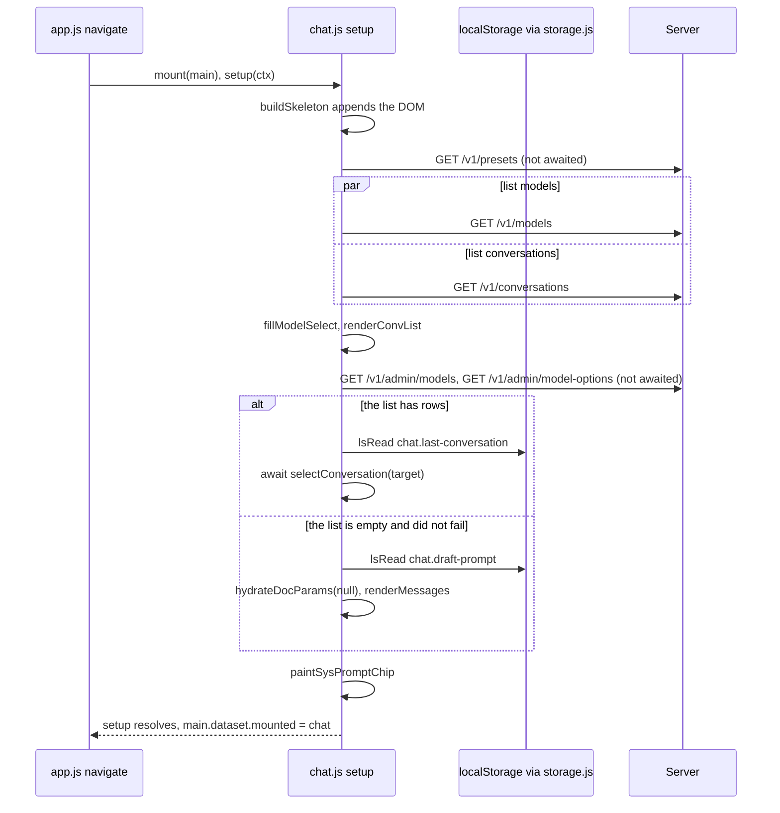
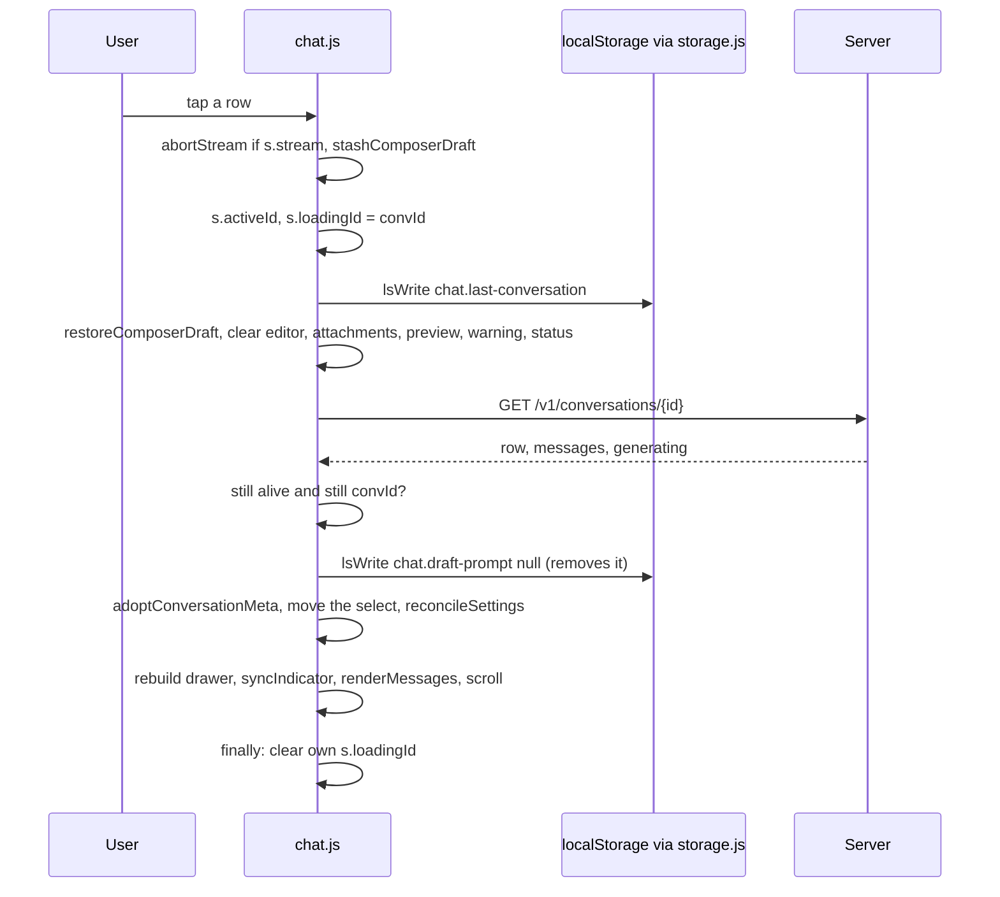
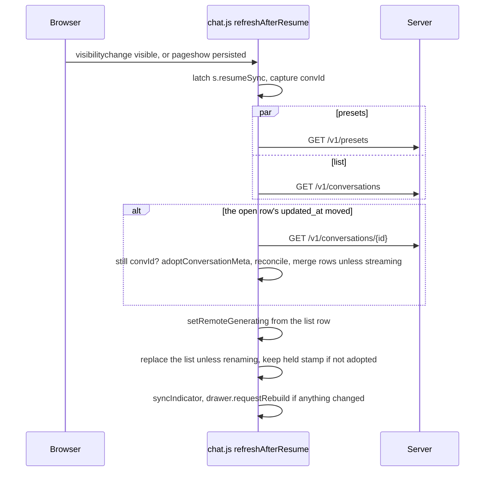

# Chat: conversations as documents

last updated: 2026-11-24

This page maps the document side of the chat page (`frontend/js/pages/chat.js`): what runs from the first line of `setup` until the page shows a conversation, the conversation list and its row controls, opening, creating, cloning, renaming and deleting a conversation, the resume re-adoption, per-conversation composer drafts, the two browser-stored keys, and the no-conversation state up to the point where the first Send hands off to generation. It sits below [frontend_core.md](../frontend_core.md), which explains the store-mirror model in general; it does not repeat that. Generation, the message list, the model bar and settings, and attachments are mapped on their sibling pages and named here only where a flow calls into them.

## Files and what each owns

| File | What it owns for this area |
|---|---|
| `frontend/js/pages/chat.js` | `setup`; `buildSkeleton` (the sidebar, the New button, the `Chats` toggle, the status line); `renderConvList`, `startRename`, `newConversation`, `cloneConversation`, `deleteConversation`, `selectConversation`; `adoptConversationMeta`; `refreshAfterResume` and `convListFingerprint`; `stashComposerDraft`, `restoreComposerDraft` and the `NO_DOC` key; `readDraftPrompt`, `writeDraftPrompt` and `DRAFT_PROMPT_KEY`; `LAST_CONV_KEY`; `setSystemPrompt`, `setAppliedPreset`, `putSystemPrompt`, `buildPromptSection`; `refuseWhileStreaming`; `paintSysPromptChip`; the first-create branch of `send`. |
| `frontend/js/document-writer.js` | `createDocumentWriter`: the serialised system-prompt PUT chain (`putSystemPrompt`, with a `keepalive` write dispatched ahead of the chain) and the unchained stamp write (`setAppliedPreset`). Shared with notebook. |
| `frontend/js/storage.js` | `STORAGE_KEYS` (`CHAT_DRAFT_PROMPT`, `CHAT_LAST_CONVERSATION`), `STORAGE_REGISTRY`, `lsRead` and `lsWrite` under `LS_PREFIX` (`heylook.`), `assertRegisteredKey`, and `sweepRetiredStorage` (its `MOVED_KEYS` entry moves the old `heylook.v3.chat.draft-prompt` key). |
| `frontend/js/api.js` | The `ROUTES` entries this area calls (`listConversations`, `createConversation`, `getConversation`, `cloneConversation`, `updateConversation`, `deleteConversation`, `listModels`, `listPresets`), `request`, and `httpError` (the error's `message`, `status`, `code`). |
| `frontend/js/streaming.js` | `stopGenerate`, which `deleteConversation` awaits. |
| `src/heylook_llm/conversation_api.py` | The conversation routes, the `generating` field on the list and on a single conversation, and `_refuse_while_generating`. |
| `src/heylook_llm/conversation_generate_api.py` | `is_generating`, `active_conversation_ids`, `GenerationInProgress` and `generation_in_progress_response` (the 409 envelope). |
| `src/heylook_llm/db.py` | The row shapes: `_CONV_NAMES`, `_CONV_LIST_NAMES` (the list leaves out `system_prompt` and `params`), the dict `create_conversation` returns, and the "Copy of" title in `clone_conversation`. |

Called from here and mapped elsewhere: `frontend/js/preset-bar.js`, `frontend/js/prompt-section.js`, `frontend/js/settings.js`, `frontend/js/settings-drawer.js`, `frontend/js/utils.js` (`armedConfirm`, `setStatus`), `frontend/js/page.js`, `frontend/js/app.js`.

## State

| Name | Where it lives | Written by | Read by | Reset when |
|---|---|---|---|---|
| `s.conversations` | page state; list-shaped rows from `GET /v1/conversations`, plus any create response unshifted | `setup`; `newConversation` and `send` (unshift the create response); `cloneConversation` (re-list, else unshift); `deleteConversation` (filter); `refreshAfterResume` (replace, unless a rename is open); `startRename` (a row's `title`); `noteRunState` (a row's `generating`); `commitModelSwitch` (a row's `model_id`) | `renderConvList`, `notifyChatActivity`, `refreshAfterResume` (the held `updated_at`), `selectConversation` (the leaving title), `send` (the `New conversation` title check) | each mount |
| `s.activeId` | page state | `selectConversation`; `send`'s first-create branch; `deleteConversation` (null) | nearly everything; `null` is the no-conversation state | each mount starts `null` |
| `s.loadingId` | page state | `selectConversation` sets it to the id it is loading and clears it in `finally` only if it still holds that id | `refuseWhileStreaming` | the end of the select that set it |
| `s.messages` | page state | `selectConversation` (on success the fetched rows, on failure `[]`); `deleteConversation` (`[]`); `mergeServerRows` (resume); `send`'s create branch (`[]`); the generation and message flows | `renderMessages`, the select guard, `switchWarnings` | replaced on every select |
| `s.systemPrompt` | page state | `adoptConversationMeta` (unless `keepPrompt`); `setSystemPrompt`; the prompt section's `set`; `setup` (the parked draft); `deleteConversation` (null); `send`'s create branch | the preset bar's `getPrompt`, the prompt section's `get`, `newConversation` and `send` (the create body), `paintSysPromptChip` | replaced on every select |
| `s.appliedPresetId` | page state | `adoptConversationMeta`; `setAppliedPreset` (the preset bar's `setStamp`); `deleteConversation` (null, last-conversation branch); `send`'s create branch (from the response) | the preset bar's `getStamp` (so `presetForNewDoc`, `promptState`, provenance); `newConversation` and `send` (the create body) | replaced on every select |
| `s.composerDrafts` | page state, a `Map` keyed by conversation id or by the `NO_DOC` symbol; never stored | `stashComposerDraft`; `restoreComposerDraft` (deletes the `NO_DOC` entry it adopts); `deleteConversation`; `send` (deletes on send, sets on a failure after a switch) | `restoreComposerDraft` | each mount; not touched by resume |
| `s.newInFlight`, `s.cloneInFlight` | page state | `newConversation`, `cloneConversation` (set on entry, cleared in `finally`) | the same functions, as re-entry guards | the end of the create or clone |
| `s.resumeSync` | page state | `refreshAfterResume` (set on entry, cleared in `finally`) | `refreshAfterResume` | the end of the resume |
| `s.remoteGenerating` | page state | `setRemoteGenerating` (called by `adoptConversationMeta`, `refreshAfterResume`, `resyncMessages`, `stopRemote`); `startStream` (false) | `refuseWhileStreaming`, the Send button's click handler, the page hotkeys, `notifyChatActivity` | re-derived when a fetched conversation is adopted |
| `s.committedModelId` | page state | `setup`, `selectConversation`, `commitModelSwitch` | the model select's change handler, `send` | on every select |
| `s.editingId`, `s.msgNodes` | page state | `selectConversation` resets both | `renderMessages` | on every select |
| `s.promptSection` | page state; one live prompt section | `buildPromptSection` (once per drawer render, after `release()`ing the previous one) | `startStream`'s pre-launch flush | each drawer render |
| `s.docWriter` | page state; its PUT chain is a closure in `createDocumentWriter` | `setup` | `putSystemPrompt`, `setAppliedPreset` | each mount |
| `s.paramsBinder` | page state; the owed write (`pending`: id and bag) is a closure in `bindDocumentParams` | `setup`; any settings change while a conversation is open | its own timer, its hide hook, teardown, `startStream`'s flush | each mount |
| the sampler panel values | `frontend/js/settings.js` module `cache`, shared with notebook | `hydrateDocParams` (silent), `reconcileSettings` (fires listeners), the drawer controls, preset Apply | `snapshotSettings`, `samplerParams`, the drawer | replaced on every select; cleared on entering the no-conversation state |
| the preset list | `frontend/js/preset-bar.js` closure `presets` | `load` (via `refresh`) | `stamped`, `presetForNewDoc`, `promptState` | each mount |
| `heylook.chat.draft-prompt` | `localStorage`, through `storage.js` (`STORAGE_KEYS.CHAT_DRAFT_PROMPT`) | `writeDraftPrompt`: the prompt section's `set` and `setSystemPrompt` while no conversation is open (value), and `newConversation`, `send`'s create branch and a successful `selectConversation` (null, which removes the key) | `readDraftPrompt`, only in `setup`'s no-conversation branch | removed when a conversation is created or one loads |
| `heylook.chat.last-conversation` | `localStorage`, through `storage.js` (`STORAGE_KEYS.CHAT_LAST_CONVERSATION`) | `selectConversation` (before its fetch), `send`'s create branch | `setup` | never removed by this page; a stale id falls back |
| `.conv-item--active` | DOM, on the active row | `renderConvList` | the reader | each list render |
| `.conv-item__rename` | DOM, the rename input | `startRename` | `refreshAfterResume` (skips the list while one exists) | its blur |
| `.chat--convs-open` | DOM class on `s.rootEl` (the phone slide-in pane) | the `Chats` toggle; removed by a row click, `newConversation`, `cloneConversation`, `dismissPaneOnOutsideClick` | CSS | on those actions |

## Entry points

| What the user or browser does | Handler, as file and function | Flow below |
|---|---|---|
| Opens `#/chat` (or any unknown route) | `frontend/js/app.js` `navigate` -> `page.mount` -> `chat.js` `setup` | Boot |
| Taps a conversation row | the row's click listener in `chat.js` `renderConvList` -> `selectConversation` | Select |
| Taps New | the listener in `buildSkeleton` -> `newConversation` | New |
| Double-clicks a row title, or taps the pencil | `renderConvList` -> `startRename` | Rename |
| Taps the copy icon | `renderConvList` -> `cloneConversation` | Clone |
| Taps the bin, then taps it again while it reads `Confirm?` | `utils.js` `armedConfirm` -> `deleteConversation` | Delete |
| The tab becomes visible, or a bfcache `pageshow` | `page.js` `onResume` -> `ctx.guard(refreshAfterResume)` | Resume |
| The tab hides, or `pagehide` | `page.js` `onHide` -> the prompt section's and `bindDocumentParams`' own flushes | Parked draft, and the hide note under Resume |
| Types in the composer, then opens another conversation | `selectConversation` -> `stashComposerDraft`, `restoreComposerDraft` | Composer drafts |
| Types in the drawer's system-prompt box with no conversation open | `prompt-section.js` `edited` -> chat's adapter `set` -> `writeDraftPrompt` | Parked draft |
| Applies a preset with no conversation open | `preset-bar.js` -> `setPrompt` (`setSystemPrompt`) and `setStamp` (`setAppliedPreset`) | Parked draft, No-conversation state |
| Sends (button, Enter on a non-touch device, Cmd or Ctrl+Enter) with no conversation open | `send` | No-conversation state and the first Send |
| Taps the eye (prompt preview) with no conversation open | `previewNextPrompt` | No-conversation state |
| Taps `Chats` | the listener in `buildSkeleton` toggles `chat--convs-open` | (no flow) |

## Flows

### Boot: setup to first paint

Trigger: `app.js` `navigate` unmounts the previous page, empties `main`, imports the chat module and awaits `currentPage.mount(main)`, which runs `createPage`'s `mount` and awaits `setup(ctx)`. `sweepRetiredStorage` ran once at module load of `app.js`, before any page. Shell behaviour is mapped in [shell-and-lifecycle.md](shell-and-lifecycle.md).

Guards: none refuse. `if (!ctx.alive) return` after the first await ends setup quietly when the user has already navigated away.

Steps:

1. Initialise page state: `s.conversations = []`, `s.models = []`, `s.activeId = null`, `s.messages = []`, `s.systemPrompt = null`, `s.appliedPresetId = null`, `s.stream = null`, `s.editingId = null`, `s.msgNodes = new Map()`, `s.composerDrafts = new Map()`.
2. `buildSkeleton` builds the whole DOM and appends `s.rootEl` to `ctx.el`. The list pane holds an `h2` `Conversations`, the `New` button and an empty `.chat__convs-list`; the thread holds the bar, an empty `.chat__messages-inner`, the status line `.chat__status` (`role="status"`), the switch-warning host, the attachment strip, the prompt preview host and the composer with the Send button painted as Send (`setSendButton(s, false)`). This is the first frame the browser can paint: an empty list and an empty thread.
3. `createPresetBar` with the chat adapter. `s.presetBar.refresh()` starts `GET /v1/presets` and, when it settles and the page is alive, calls `syncIndicator()`, which paints the preset chip and the system-prompt chip. Not awaited.
4. `createDocumentWriter({ update: api.updateConversation, onError })`; the stream painter; `createUnloadGuard`.
5. `drawer.registerSettings(...)` with `scope: () => documentScopeNote('conversation', Boolean(s.activeId))` and `sections: () => [s.presetBar.buildSection(), buildPromptSection(ctx).element]`; the unregister goes to `ctx.onTeardown`.
6. `bindDocumentParams` with `activeId: () => ctx.state.activeId` and `updateDoc` = `api.updateConversation`; registered for teardown. `ctx.onTeardown(() => clearPendingAttachments(ctx))`. `registerPageHotkeys`.
7. `ctx.onResume(ctx.guard(() => refreshAfterResume(ctx)))` and `ctx.onTeardown(() => stopRemoteWatch(ctx))`.
8. Await `Promise.all` of `GET /v1/models` (a failure becomes `{ data: [] }`, silently) and `GET /v1/conversations` (a failure shows `Could not load conversations: <message>` in error colour and becomes `{ conversations: [], failed: true }`).
9. Re-check `ctx.alive`.
10. `s.models` = the models without `engine.embedding`; `s.conversations` = the list. `fillModelSelect`, `s.committedModelId = s.modelSelect.value || null`, `refreshThinkBtn`, `refreshAttachBtn`, `renderConvList` (the list paints here), `notifyChatActivity`.
11. Start, not awaited, `refreshLoadedIds` (`GET /v1/admin/models`) and `refreshLoadFields` (`GET /v1/admin/model-options`); [chat-model-and-settings.md](chat-model-and-settings.md) maps them.
12. Branch on the list:
    - The list has rows: `lsRead(LAST_CONV_KEY)`; the target is that id if a row has it, else `s.conversations[0].id` (the newest by `updated_at`, the server's order). Await `selectConversation(ctx, target)` (see Select).
    - The list is empty and did not fail: `s.systemPrompt = readDraftPrompt()`; `hydrateDocParams(null)` clears the sampler panel shared with notebook; `refreshThinkBtn`; `renderMessages`, which with no `activeId` paints the empty state `Send a message below to start a new conversation.`
    - The list failed: neither branch runs. See the no-conversation flow and the last section.
13. `paintSysPromptChip` paints the system-prompt chip from whatever is in `s.systemPrompt` now, because the preset-fed repaint in step 3 may not have run yet (or may never, if presets failed).
14. `setup` resolves; `navigate` sets `main.dataset.mounted = 'chat'`. With rows, that is after the remembered conversation's rows were adopted (or its load failed).

Ends when: `setup` resolves.

Failure paths: a failed model list leaves the select empty with no message (Send later says `No models available.`). A failed conversation list shows `Could not load conversations: <message>`, renders `No conversations yet.` in the list pane, leaves the thread empty, and does not read the parked draft or clear the panel. A failed preset list shows `Could not load presets: <message>` (from `preset-bar.js` `refresh`); if it lands before `selectConversation` runs, the select's status reset clears it. A failed conversation fetch inside the select is handled there.

Awaits and what is re-checked after each: the `Promise.all` is followed by `ctx.alive`. The `selectConversation` await is followed by nothing; `paintSysPromptChip` after a teardown writes to a detached chip. The unawaited preset refresh re-checks `ctx.alive` before `syncIndicator`.

### Conversation list: renderConvList and its row controls

Trigger: called by `setup`, `selectConversation` (before its fetch), `newConversation` through its select, `cloneConversation`, `deleteConversation`, `startRename`'s successful commit, `refreshAfterResume` (only when `convListFingerprint` changed), and `send` (first create, and the first-title rename of a conversation made by New).

Guards: none.

Steps:

1. With no rows, replace the list with `div.empty-state` `No conversations yet.` and return.
2. Otherwise rebuild every row from `s.conversations`, in that array's order (which is the client's locally mutated order, not necessarily the server's). Each row is `div.conv-item` (plus `conv-item--active` when `conv.id === s.activeId`) with `dataset.id = conv.id` and four children:
   - `span.conv-item__title` with the title as text and `title` attribute; its `dblclick` stops propagation and calls `startRename(ctx, conv, title)`.
   - `button.conv-item__edit` (pencil icon, `title` `Rename`, `aria-label` `Rename conversation`): stops propagation, `startRename`.
   - `button.conv-item__clone` (copy icon, `Clone conversation`): stops propagation, `cloneConversation(ctx, conv.id)`. Not armed (owner call; history in the code comment).
   - `button.conv-item__delete` (bin icon, `Delete conversation`) wrapped by `armedConfirm`: the first tap arms it (adds `btn--armed`, text `Confirm?`, starts the disarm timer in `utils.js` `armedConfirm`); a second tap while armed calls `deleteConversation(ctx, conv.id)`. `armedConfirm`'s own listener stops propagation, so neither tap selects the row.
3. The row's click calls `selectConversation(ctx, conv.id)` (not awaited) and removes `chat--convs-open` from the root.

Ends when: the list is replaced. Any rebuild drops an armed Delete (the new button is unarmed) and removes an open rename input (see the last section).

Failure paths: none in the render itself.

Awaits: none.

### Select a conversation: selectConversation

Trigger: a row click, `setup`, `newConversation`, `cloneConversation`, `deleteConversation` (next row).

Guards: `if (s.activeId === convId && s.messages.length) return`: re-clicking the open conversation does nothing, unless it holds no rows (then it refetches, which is also how a failed load is retried). There is no refusal while streaming or while another select is loading.

Steps:

1. `leaving`: if `s.stream` exists, the title of the row whose id is `s.stream.targetConvId`, or `'That conversation'` when that title is empty or the row is missing; else null. (FB-06 is about this read.)
2. If `s.stream`, `abortStream(ctx, ABANDON.CONVERSATION)`: it records the abandon reason by `ABANDON_RANK` (the stronger reason wins) and aborts the stream's controller. That ends the page's subscription only; the server run continues and commits the whole reply. The unwind (`releaseStream`, `finishGenerate`) runs later and returns early because `activeId` has moved; [chat-generation.md](chat-generation.md) maps it.
3. `stashComposerDraft(ctx)` parks the textarea under the outgoing id (or `NO_DOC`).
4. `s.activeId = convId`; `s.loadingId = convId`; `lsWrite(LAST_CONV_KEY, convId)`.
5. `restoreComposerDraft(ctx)` fills the textarea for the incoming conversation (see Composer drafts).
6. `s.editingId = null`; `s.msgNodes = new Map()`; `clearPendingAttachments` ([chat-attachments.md](chat-attachments.md)); `closePromptPreview`; `clearSwitchWarning`; `showStatus(ctx, '')`; `renderConvList` (the highlight moves now).
7. Await `GET /v1/conversations/{id}` with `ctx.signal`.
8. Re-check `ctx.alive && s.activeId === convId`; return if either moved (a newer select owns the page).
9. `writeDraftPrompt(null)`: a conversation owns the prompt now, so the parked draft is dropped (not adopted).
10. `s.messages = conv.messages ?? []`.
11. `adoptConversationMeta(ctx, conv)` (see below): prompt, stamp, sampler panel (silent), `generating`.
12. If `conv.model_id` names a model in `s.models`, `s.modelSelect.value = conv.model_id`; otherwise the select keeps what it showed.
13. `refreshThinkBtn`, `refreshAttachBtn` (both read the select, so they run after it moves); `s.committedModelId = s.modelSelect.value || null` (a restore never runs the switch warning).
14. `removed = droppedNote(reconcileSettings(currentModel(ctx)))`: settings the selected model cannot use leave the panel; `reconcileSettings` fires settings listeners, so `bindDocumentParams` schedules a `params` PUT to this conversation when anything was removed.
15. `refreshLoadBtn`; `drawer.requestRebuild({ force: true })` (an open drawer rebuilds, and `buildPromptSection` releases the old section, flushing any pending write to the conversation it was built for); `s.presetBar.syncIndicator()`; `renderMessages`; `scrollMessages(ctx, true)` (to the bottom).
16. Status, last so step 6's reset cannot swallow it: `removed` and, if `leaving`, `"<title>" keeps generating — it will finish on the server and be there when you come back.`, joined by a space. Written only when at least one exists, so a line set by step 11 (the generating line, or the unrepresentable-settings line) survives otherwise.
17. `finally`: `if (s.loadingId === convId) s.loadingId = null`.

What is cleared: the editor, the per-row node cache, staged attachments, the prompt preview, a pending model-switch warning, the status line, and on success the rows, prompt, stamp and panel. What is carried until the fetch lands: the previous conversation's rows on screen (actions on them are refused by `s.loadingId`), its prompt and sampler panel (a settings change in this gap is written to the new conversation with the previous panel's bag; see [the known boundary](../../architecture/sharp_edges.md#a-typed-value-and-a-debounced-write-each-belong-to-one-moment)), `s.remoteGenerating` and the Send or Stop button as they were. What is carried past it: the model select when the conversation's `model_id` is null or not a listed model, and the left conversation's server run.

Ends when: the fetched conversation is on screen, or the failure state below.

Failure paths: the fetch rejects (network, 404 `Conversation not found`). If the page is alive and `s.activeId === convId`: `Could not load conversation: <message>` in error colour; `s.messages = []`; `adoptConversationMeta(ctx, {})` (prompt null, stamp null, an empty panel, `generating` false); `refreshThinkBtn`; `renderMessages` (an empty thread, not the no-conversation text, because `activeId` is set); `drawer.requestRebuild({ force: true })`; `s.presetBar.syncIndicator()`. `s.activeId` stays on the failed id, the remembered key already names it, and the parked draft is not touched. Re-clicking retries because `s.messages` is empty. An abort from teardown lands here with `ctx.alive` false and does nothing.

Awaits and what is re-checked after each: the one fetch, then `ctx.alive` and conversation identity. `finally` checks the loading mark is still this select's.

### adoptConversationMeta

Trigger: `selectConversation` (success, and failure with `{}`), `refreshAfterResume` (with `keepPrompt` when the prompt box has focus).

Guards: none; callers do the identity checks.

Steps:

1. Unless `keepPrompt`, `s.systemPrompt = conv.system_prompt ?? null`.
2. `s.appliedPresetId = conv.applied_preset_id ?? null`.
3. `hydrateDocParams(conv)` loads `conv.params` into the shared panel without firing listeners (no PUT back). What it could not take goes through `unrepresentableNote(..., 'conversation')`; if non-null it is shown in error colour: `This conversation stores settings this panel cannot show (<keys>). Changing a setting here will drop them.`
4. `setRemoteGenerating(ctx, Boolean(conv.generating))`. It first writes the flag onto the active row (`noteRunState`), then returns if a local stream owns this conversation; on a change it sets `s.remoteGenerating`, calls `notifyChatActivity`, repaints the Send button (Stop, with the title `Stop the run finishing on the server for this conversation`, when true), and writes `Still generating on the server — the reply will appear here when it finishes. Stop ends it and keeps the partial.` (true) or clears a line that starts with `GENERATING_PREFIX` (false). Then it starts `watchRemoteRun` (true) or `stopRemoteWatch` (false); [chat-generation.md](chat-generation.md) maps the watch.

Rows, scroll and the model select are the caller's: select moves the select, resume does not. A new stored field is added here or it is missing on one path.

Ends when: it returns (synchronous).

Failure paths: none.

Awaits: none.

### New conversation: newConversation

Trigger: the New button.

Guards: `if (s.newInFlight) return` (a second tap while a create is in flight does nothing). No refusal while streaming or loading.

Steps:

1. `s.newInFlight = true`; `clearPendingAttachments(ctx)`.
2. `draft = !s.activeId`; `preset = s.presetBar.presetForNewDoc()`, which is the open conversation's stamped preset from the live list, or null (always null with no conversation open).
3. Await `POST /v1/conversations` with `title: 'New conversation'`, `model_id: s.modelSelect.value || undefined`, and:
   - from the no-conversation state (`draft`): `system_prompt: s.systemPrompt || undefined`, `params: snapshotSettings()`, `applied_preset_id: s.appliedPresetId || undefined`, so the drawer is the new conversation;
   - from an open conversation: the stamped preset's `system_prompt`, a copy of its `params` (or `{}`), and its id as `applied_preset_id`; with no stamped preset, blank. The open conversation's own prompt and panel never seed it.
4. Re-check `ctx.alive`.
5. `writeDraftPrompt(null)`; `s.conversations.unshift(conv)` (the full create response: it carries `system_prompt`, `params` and `messages: []`, and no `generating`).
6. Await `selectConversation(ctx, conv.id)`, which fetches the conversation again and adopts it. From the no-conversation state its stash puts the composer text under `NO_DOC` and its restore adopts it, so typed text follows into the new conversation; from an open one the text stays with the conversation being left.
7. Remove `chat--convs-open`; `s.textarea.focus()`.
8. `finally`: `s.newInFlight = false`.

Ends when: the new conversation is open and the composer focused.

Failure paths: a rejected create shows `Create failed: <message>` in error colour (if alive). The staged attachments were already cleared in step 1; the composer text, the parked draft and the open conversation are untouched. A failure inside the select is the select's.

Awaits and what is re-checked after each: the create is followed by `ctx.alive`; the select by nothing (the two DOM writes after it are harmless on a detached page).

### Clone: cloneConversation

Trigger: the copy icon on a row.

Guards: if `s.stream?.targetConvId === convId`, show `Cannot clone while generation is in progress` in error colour and return. `if (s.cloneInFlight) return`: page-wide, so a second clone of any row is ignored while one is in flight. A run the page is not subscribed to is refused by the server instead (409).

Steps:

1. `s.cloneInFlight = true`; status `Cloning conversation…`.
2. Await `POST /v1/conversations/{id}/clone` with no body (the route's body is optional). The server copies the row, its messages and media, names it `Copy of <title>`, and keeps `model_id`, `system_prompt`, `params` and `applied_preset_id`.
3. Re-check `ctx.alive`.
4. Await `GET /v1/conversations` with `ctx.signal`; a failure becomes null.
5. Re-check `ctx.alive`.
6. If the list arrived, `s.conversations = listed.conversations` (list-shaped rows, so the clone's full message list is not kept in memory); otherwise `s.conversations.unshift(cloned)`.
7. `renderConvList`; await `selectConversation(ctx, cloned.id)`; remove `chat--convs-open`.
8. Status `Conversation cloned.`
9. `finally`: `s.cloneInFlight = false`.

Ends when: the clone is open and the status says so.

Failure paths: a rejected clone shows `Clone failed: <message>`; for the 409 that message is the server's `A reply is still being generated in this conversation. Wait for it to finish, or stop it first.` A failed re-list falls back to the unshift. The list replacement in step 6 does not check for an open rename.

Awaits and what is re-checked after each: the clone and the re-list are each followed by `ctx.alive`; the select by nothing.

### Rename: startRename

Trigger: a double-click on a row title, or the pencil.

Guards: none before editing. The commit returns early when the trimmed value is empty or unchanged. Renaming is a metadata PUT, which the server accepts during a generation.

Steps:

1. Build `input.input.conv-item__rename` with the current title; its click stops propagation (so it does not select the row); replace the title span with it; focus and select its text.
2. Enter blurs the input. Escape calls `preventDefault` (so the page hotkey does not read it as Stop), restores the original title and blurs.
3. On blur, the commit (wrapped in `ctx.guard`): put the title span back; if the trimmed value is empty or unchanged, stop.
4. Await `PUT /v1/conversations/{id}` with `{ title }`.
5. Re-check `ctx.alive`; set `conv.title` on the row object the rename started on; `renderConvList`.

Ends when: the input is gone and, on success, the list shows the new title. The row's `updated_at` is not updated locally, so the next resume refetches this conversation once if it is the open one.

Failure paths: `Rename failed: <message>` in error colour; the span still shows the old title.

Awaits and what is re-checked after each: the PUT is followed by `ctx.alive`. Nothing checks that `s.conversations` still holds the same row object; a list replaced in the meantime (a clone) leaves the new title on an orphaned object until the next list fetch.

### Delete: deleteConversation

Trigger: the second tap on an armed bin.

Guards: none refuse on the client. The server refuses with 409 while the conversation has a run (`_refuse_while_generating`).

Steps:

1. If a local stream targets this conversation: await `stopGenerate(convId)` (`DELETE /v1/conversations/{id}/generate`, resolving to the HTTP status, or null when the request failed). Then `abortStream(ctx, status === null ? ABANDON.TEARDOWN : ABANDON.DELETE)`.
2. Await `DELETE /v1/conversations/{id}`. On a 409, wait (the inline delay in `deleteConversation`) and await the DELETE once more.
3. Re-check `ctx.alive`.
4. `s.conversations` without the row; `s.composerDrafts.delete(convId)`.
5. If it was the open conversation:
   1. `abortStream(ctx, ABANDON.DELETE)` (a no-op without a stream; with one, the stronger reason is kept).
   2. Empty the textarea, `autoGrow`, and delete the `NO_DOC` entry, before `activeId` goes, so the next select cannot stash the deleted conversation's text as an orphan and hand it to another conversation.
   3. `s.activeId = null`, `s.messages = []`, `s.systemPrompt = null`.
   4. With rows left: await `selectConversation(ctx, s.conversations[0].id)` (the first row of the local array).
   5. With none left, entering the no-conversation state: `s.appliedPresetId = null`; `hydrateDocParams(null)`; `refreshThinkBtn`; `drawer.requestRebuild({ force: true })`; `s.presetBar.syncIndicator()` (the preset chip hides); `renderMessages` (the empty-state text).
6. If alive, `renderConvList`.

Ends when: the row is gone and either another conversation or the no-conversation state is on screen.

Failure paths: any other error, or a second 409, shows `Delete failed: <message>` and returns with nothing removed locally. With a live stream that the stop could not reach (status null), the local subscription is dropped anyway (step 1's abort), the run continues on the server, the DELETE and its retry both answer 409, and the line is `Delete failed: A reply is still being generated in this conversation. Wait for it to finish, or stop it first.` The remembered key is not cleared; a stale id falls back at the next boot.

Awaits and what is re-checked after each: the stop is followed by nothing. The DELETE (and the retry) re-checks `ctx.alive` only before writing a failure line; after the try, `ctx.alive`. `s.activeId === convId` is read after the awaits, so a switch made during the request is respected. The final `renderConvList` is guarded by `ctx.alive`.

### Resume: ctx.onResume to refreshAfterResume

Trigger: `page.js` `onResume`: `visibilitychange` to visible, or `pageshow` with `persisted`. On desktop that includes every return to the tab. Wrapped in `ctx.guard`.

Guards: `if (s.resumeSync) return`, so a burst of events is one resume. Why this exists at all: [sharp_edges.md, Store mirror and resume](../../architecture/sharp_edges.md#store-mirror-and-resume).

Steps:

1. `s.resumeSync = true`; `convId = s.activeId` (captured).
2. Await `Promise.all` of `s.presetBar.refresh()` (`GET /v1/presets`; resolves true when the fingerprint of ids, names and `updated_at` changed) and `GET /v1/conversations` with `ctx.signal` (a failure becomes null).
3. Re-check `ctx.alive`.
4. If the list arrived:
   1. `held` = the `updated_at` on the page's own row for `convId`; `fresh` = the list's. `unchanged` = both present and equal; `adopted = unchanged`.
   2. If `convId` and not unchanged: await `GET /v1/conversations/{id}` (a failure becomes null); re-check `ctx.alive`; if the fetch succeeded and `s.activeId === convId`:
      - `docChanged = true`; `typingPrompt` = focus is on `.sysprompt-input`;
      - `adoptConversationMeta(ctx, conv, { keepPrompt: typingPrompt })`;
      - `droppedNote(reconcileSettings(currentModel(ctx)))`, shown if non-null (the model select is not moved);
      - `refreshThinkBtn`;
      - if no local stream exists, `mergeServerRows(ctx, conv.messages)` ([chat-messages.md](chat-messages.md); it keeps an editor's row the server no longer has and says so);
      - `adopted = !typingPrompt && rowsMerged`.
   3. If the list's row for `convId` has a `generating` key, `setRemoteGenerating(ctx, Boolean(activeRow.generating))`, whether or not the body was fetched (a run that produced nothing never moves `updated_at`).
   4. Unless a `.conv-item__rename` input exists: `s.conversations` = the list, except that the open conversation's row keeps `held` as its `updated_at` when the body was not adopted (so the next resume tries again); `renderConvList` only if `convListFingerprint` (ids and titles in order) changed.
   5. `notifyChatActivity`.
5. If presets changed or the body was adopted: `s.presetBar.syncIndicator()` and `drawer.requestRebuild()` (not forced: it skips while focus is in the drawer body).
6. `finally`: `s.resumeSync = false`.

What it refuses to touch: a live stream's rows (`!s.stream`); the system prompt while its box has focus (`keepPrompt`); the sidebar while a rename input exists; the composer text and drafts; the model select; the scroll position. It does not auto-open a conversation when the list gains rows while none is open.

Ends when: the latch is released.

Failure paths: a failed list does nothing and says nothing (beyond the preset bar's own `Could not load presets: <message>`). A failed body fetch leaves `adopted` false, so the held stamp is kept and the next resume retries. If the open conversation was deleted elsewhere, the body fetch 404s, the list no longer has the row, and the page keeps showing it with no message; a later Send fails with the 404.

Awaits and what is re-checked after each: the `Promise.all` is followed by `ctx.alive`; the body fetch by `ctx.alive` and `s.activeId === convId` (body adoption only). The `generating` adoption in step 4.3 and the list replacement are not re-checked against `s.activeId` (see the last section).

Hide, for completeness: nothing in this area runs on hide except the writers' own flushes (`createPromptSection`'s `onHide` hook and `bindDocumentParams`' `onHide` argument, both with `keepalive`); `document-writer.js` dispatches a `keepalive` prompt write ahead of its chain. Composer drafts are in memory and do not survive a reload by design (the comment at `s.composerDrafts` in `setup`).

### Composer drafts: stashComposerDraft, restoreComposerDraft, NO_DOC

Trigger: `selectConversation` calls both, stash before `activeId` moves and restore right after. `deleteConversation` and `send` edit the map directly.

Guards: both return when `s.textarea` does not exist.

Steps:

1. `stashComposerDraft`: key = `s.activeId ?? NO_DOC`; a non-empty textarea is stored under it, an empty one deletes it.
2. `restoreComposerDraft`: `own` = the entry for `s.activeId` (none when `activeId` is null). Only when there is no `own`, the `NO_DOC` entry is taken and deleted (an orphan is adopted by exactly one conversation). The textarea becomes `own ?? orphan ?? ''`; `autoGrow`.
3. `send` deletes the active conversation's entry once its text leaves the composer. On a send failure after the user opened another conversation, it stores the text under its home conversation, or under `NO_DOC` when the send was the first one and created nothing.
4. `deleteConversation` deletes the deleted conversation's entry and, when it was open, empties the textarea and deletes `NO_DOC` before nulling `activeId`.

Ends when: the textarea holds the incoming conversation's text.

Failure paths: none. The map is never stored and nothing reaches the server.

Awaits: none.

### The remembered last conversation

Trigger: read in `setup`; written by `selectConversation` and by `send`'s create branch.

Guards: `storage.js` `assertRegisteredKey` throws for a key not in `STORAGE_REGISTRY`; `lsRead` and `lsWrite` swallow storage errors (private mode, quota) and return null or do nothing.

Steps:

1. `selectConversation` writes the id it is opening before its fetch, so a conversation whose load fails is still remembered.
2. `send`'s create branch writes the new id, because it moves `activeId` without going through `selectConversation`.
3. `setup` reads it only when the list has rows, and uses it only if a row has that id; otherwise it opens `s.conversations[0]`.

Ends when: n/a. Nothing removes the key; a missing, evicted or stale id degrades to the newest conversation. History: [sharp_edges.md, Browser storage](../../architecture/sharp_edges.md#browser-storage-one-wrapper-eviction-one-sweep).

Failure paths: storage unavailable means every boot opens the newest conversation.

Awaits: none.

### The parked draft system prompt

Trigger: the drawer's system-prompt box, or a preset Apply, while `s.activeId` is null.

Guards: only the no-conversation condition. `lsWrite` removes the key for null, undefined or `''`.

Steps:

1. Typing: `prompt-section.js` `edited` normalises the value (trimmed, empty becomes null) and calls the adapter's `set` because the owner (null) equals `builtFor` (null). Chat's `set` writes `s.systemPrompt` and, with no conversation, `writeDraftPrompt(v)` on every keystroke. The section's debounced persist is a no-op while `builtFor` is null.
2. Apply: `preset-bar.js` `apply` loads the preset's params into the panel, then calls `setPrompt` (`setSystemPrompt`) only when the preset carries a prompt; with no conversation that sets `s.systemPrompt` and parks it. It always calls `setStamp` (`setAppliedPreset`), which with no conversation only sets `s.appliedPresetId` (the stamp is never stored in the browser, so a reload loses it while the parked prompt survives).
3. Clear in the prompt section (armed, `Clear prompt?`) writes null through the same `edited` path, which removes the key.
4. Read back: only `setup`'s branch for a successful, empty list.
5. Dropped: `newConversation` and `send`'s create branch after their create (the conversation now holds it), and a successful `selectConversation` (an existing conversation owns the prompt; the draft is not adopted into it).

Ends when: a conversation is created or opened.

Failure paths: storage errors are swallowed; the draft then lives in page state only.

Awaits: none. History: [sharp_edges.md, Presets and the system prompt](../../architecture/sharp_edges.md#presets-and-the-system-prompt).

### The no-conversation state and the first Send

Trigger: entered by `setup` with an empty list that loaded, and by `deleteConversation` removing the last conversation. Left by New, by the first Send, or by opening a conversation that a resume brought into the list.

Guards and what the state shows:

- `renderMessages` paints `Send a message below to start a new conversation.`; the list pane says `No conversations yet.`
- The drawer's scope line reads `The next conversation you start is created with these. Not saved until then.` (`documentScopeNote`); the preset chip is hidden (`indicatorInfo` returns null without a document); the system-prompt chip states what `s.systemPrompt` holds, or `No system prompt`.
- Entering it cleared the panel (`hydrateDocParams(null)`) and, on the delete path, the stamp. Sampler changes stay in the panel only: `bindDocumentParams` ignores a change with no active id.
- The composer's text is stashed under `NO_DOC` if a conversation is opened.
- `previewNextPrompt` refuses with `Start a conversation to preview its prompt.` in error colour.
- A model switch writes no `model_id` (`commitModelSwitch` PUTs only with an active id).

Steps of the first Send, up to the hand-off:

1. `send` reads the trimmed text and the staged attachments; returns silently when all are empty. Its guards (`refuseWhileStreaming`, `No models available.`, committing a pending model switch, the capability checks on staged media) are mapped on [chat-generation.md](chat-generation.md).
2. The title is the text, or `Audio message` or `Image message`, cut by the `slice` in `send`. The composer, the staged arrays and the attachment strip are emptied, the status is cleared and the prompt preview closed. `home = s.activeId ?? null` (null here).
3. With media, await `buildContentBlocks` ([chat-attachments.md](chat-attachments.md)); re-check `ctx.alive`.
4. `promptBeforeCreate = s.systemPrompt`; await `POST /v1/conversations` with `title`, `model_id`, `system_prompt: s.systemPrompt || undefined`, `params: snapshotSettings()`, `applied_preset_id: s.appliedPresetId || undefined`. Re-check `ctx.alive`.
5. `writeDraftPrompt(null)`; `s.appliedPresetId = conv.applied_preset_id ?? null`; `s.conversations.unshift(conv)`; `s.activeId = conv.id`; `home = conv.id`; `lsWrite(LAST_CONV_KEY, conv.id)`; `s.messages = []`.
6. If `s.systemPrompt` changed while the create was in flight, `putSystemPrompt(ctx, conv.id, s.systemPrompt)`; else `s.systemPrompt = conv.system_prompt ?? null`.
7. `drawer.requestRebuild({ force: true })` (an open drawer's prompt section was built for no owner); `s.presetBar.syncIndicator()`; `renderConvList`.
8. Hand-off: `send` continues with `api.addMessage` and `startStream(ctx, { mode: 'append' })`, mapped on [chat-generation.md](chat-generation.md). No `selectConversation` runs, so there is no second fetch and no `s.loadingId`.

A conversation opened with New from this state carries the composer text but not the staged attachments (`newConversation` clears them first). One already in the list and opened by a tap gets the composer text and drops the parked prompt.

Ends when: `s.activeId` is set.

Failure paths: a rejected create, with `activeId` still null, puts the text and attachments back and shows `Send failed: <message>`; the parked draft is untouched. If the user opened a conversation while the create was in flight and the create failed, the text goes to `NO_DOC`, the attachments are dropped, and the line is `Send failed in the conversation you left: <message>. Its text is back in that conversation's draft. Its attachments were not kept.` (the last two sentences only when there was text, or attachments). History: [sharp_edges.md, A send belongs to the conversation it was sent from](../../architecture/sharp_edges.md#a-send-belongs-to-the-conversation-it-was-sent-from).

Awaits and what is re-checked after each: `buildContentBlocks` and the create are each followed by `ctx.alive` only. Nothing re-checks that `s.activeId` is still null after the create (see the last section).

## Requests this area makes

| When | Method and path | Body | Response fields used | On failure |
|---|---|---|---|---|
| Boot, resume | `GET /v1/presets` | none | `presets` (id, name, updated_at, system_prompt, params) | `Could not load presets: <message>`; the old list is kept |
| Boot | `GET /v1/models` | none | `data[]`: `id`, `capabilities`, `engine`, `thinking_default`, `sampler_defaults`, `sampler_sources` | treated as an empty list, silently |
| Boot | `GET /v1/conversations` | none | `conversations[]`: `id`, `title`, `model_id`, `applied_preset_id`, `created_at`, `updated_at`, `generating` (list rows carry no `system_prompt` or `params`) | `Could not load conversations: <message>` |
| Select; New and Clone through select; resume when `updated_at` moved | `GET /v1/conversations/{id}` | none | `messages`, `system_prompt`, `applied_preset_id`, `params`, `generating`, `model_id` | select: `Could not load conversation: <message>` and an empty document; resume: silent, retried next resume |
| New | `POST /v1/conversations` (201) | `title`, `model_id`, `system_prompt`, `params`, `applied_preset_id` (absent ones omitted) | the whole object, unshifted; `id` | `Create failed: <message>` |
| First Send | `POST /v1/conversations` (201) | the same fields, from the draft | `id`, `applied_preset_id`, `system_prompt` | `Send failed: <message>`, composer restored |
| Clone | `POST /v1/conversations/{id}/clone` (201) | none | `id`; the whole object only if the re-list fails | `Clone failed: <message>`; 409 while generating |
| Clone | `GET /v1/conversations` | none | `conversations` | falls back to unshifting the clone |
| Rename | `PUT /v1/conversations/{id}` | `{ title }` | none | `Rename failed: <message>` |
| First title of a conversation made by New | `PUT /v1/conversations/{id}` | `{ title }` | none | swallowed (FB-08) |
| Prompt edits, preset Apply, first-Send prompt race | `PUT /v1/conversations/{id}` via `document-writer.js` `putSystemPrompt` | `{ system_prompt }`; `keepalive` on a hide flush | none | `System prompt save failed: <message>` |
| Preset stamp | `PUT /v1/conversations/{id}` via `setAppliedPreset` | `{ applied_preset_id }` | none | `Preset stamp save failed: <message>` |
| A settings change, including a reconcile after select | `PUT /v1/conversations/{id}` via `bindDocumentParams` (debounced by its `delay` default in `settings.js`) | `{ params }` with the id and bag captured at the change | none | `Settings save failed: <message>` |
| Delete of a conversation with a local stream | `DELETE /v1/conversations/{id}/generate` via `streaming.js` `stopGenerate` | none | the HTTP status (200 stopping, 404 nothing active); null on a network failure | read as above, no message |
| Delete | `DELETE /v1/conversations/{id}` | none | none (`{status, id}` is ignored) | 409: one retry after the inline wait; then `Delete failed: <message>` |

Only the reads carry `ctx.signal`; the writes are not aborted by leaving the page. Every error message comes from `api.js` `httpError`: the server's `error.message`, else a string `detail` (or a structured detail's `error`), else `error.code`, else the status text. Server behaviour the page relies on, from `src/heylook_llm/conversation_api.py`: the list orders by `updated_at` descending and adds `generating` to every row from `active_conversation_ids()`; a single conversation adds `generating` from `is_generating`; create, clone and update responses carry no `generating`; `PUT /v1/conversations/{id}` is open during a generation and answers 400 `No fields to update` for an empty body and 404 `Conversation not found`; `DELETE /v1/conversations/{id}` and the clone route call `_refuse_while_generating`, which raises `GenerationInProgress`, answered as 409 `{ error: { message, type: 'invalid_request_error', code: 'generation_in_progress' } }` by `generation_in_progress_response`. The message writes (append, update, truncate, delete) carry the same gate; the generation page maps how `send` handles it.

## What the user sees

All lines below are on the status line `.chat__status` (`role="status"`) unless named otherwise. `setStatus` sets the text and the danger colour for errors. Every line stays until the next status write; `selectConversation` and `send` clear it on entry, and `setRemoteGenerating(false)` clears only a line starting with `GENERATING_PREFIX`.

| String | Set by | Cleared by |
|---|---|---|
| `Could not load conversations: <message>` (error) | `setup` | the next status write |
| `Could not load presets: <message>` (error) | `preset-bar.js` `refresh` | the next status write |
| `Could not load conversation: <message>` (error) | `selectConversation` failure | the next status write |
| `This conversation is still loading — try again in a moment.` | `refuseWhileStreaming` while `s.loadingId` is set | the next status write |
| `"<title>" keeps generating — it will finish on the server and be there when you come back.` (`<title>` falls back to `That conversation`) | `selectConversation`, last | the next status write; `cloneConversation` overwrites it |
| `Removed settings this model can't use: <items>.` | `selectConversation` and `refreshAfterResume`, through `settings.js` `droppedNote` | the next status write |
| `This conversation stores settings this panel cannot show (<keys>). Changing a setting here will drop them.` (error) | `adoptConversationMeta` | the next status write |
| `Still generating on the server — the reply will appear here when it finishes. Stop ends it and keeps the partial.` | `setRemoteGenerating(true)` | `setRemoteGenerating(false)`, or any later write |
| `Create failed: <message>` (error) | `newConversation` | the next status write |
| `Cannot clone while generation is in progress` (error) | `cloneConversation` | the next status write |
| `Cloning conversation…` | `cloneConversation` | the select's reset, then `Conversation cloned.` |
| `Conversation cloned.` | `cloneConversation` | the next status write |
| `Clone failed: <message>` (error) | `cloneConversation` | the next status write |
| `Rename failed: <message>` (error) | `startRename` | the next status write |
| `Delete failed: <message>` (error) | `deleteConversation` | the next status write |
| `The message you are editing was deleted elsewhere — your draft is kept until you cancel or save.` (error) | `mergeServerRows`, from resume | the next status write |
| `System prompt save failed: <message>`, `Preset stamp save failed: <message>`, `Settings save failed: <message>` (errors) | `document-writer.js`, `bindDocumentParams` | the next status write |
| `Start a conversation to preview its prompt.` (error) | `previewNextPrompt` with no conversation | the next status write |
| `Send failed: <message>`, `Send failed in the conversation you left: <message>. ...` (errors) | `send`'s catch | the next status write |

Other surfaces:

- List pane: `Conversations` heading, `New` button, `No conversations yet.` (`renderConvList`), the active row's `conv-item--active`, the row buttons' names `Rename` / `Rename conversation`, `Clone conversation`, `Delete conversation`, and the armed label `Confirm?` (cleared by the second tap, by the `armedConfirm` timer, or by any list rebuild). The phone toggle reads `Chats`.
- Thread: `Send a message below to start a new conversation.` when no conversation is open (`renderMessages`).
- Send button: Send, or Stop with the title `Stop the run finishing on the server for this conversation` while `s.remoteGenerating` (`setSendButton`).
- System-prompt chip (`paintSysPromptChip`): `No system prompt`, `System prompt: custom`, or `System prompt: <preset>` with ` (modified)`; its title with no prompt is `No system prompt is in force — click to write one`. Preset chip (`paintPresetChip`): `<preset>` or `<preset> (modified)`, hidden with no conversation.
- Drawer: the scope line `Applies to this conversation — changes save as you make them.` or `The next conversation you start is created with these. Not saved until then.`; the prompt box label `System prompt for this conversation` and placeholder `Optional system prompt for this document…`.
- Composer placeholder: `Message…` on a touch device, `Message… (Enter to send)` otherwise.

## Invariants and where each is enforced

| Invariant | Enforced in |
|---|---|
| While a select is in flight the rows on screen are the previous conversation's, so Send and the message actions are refused. Conversation-level actions (New, Clone, Delete, Rename, a model switch) are not barred. | `selectConversation` sets `s.loadingId`; `refuseWhileStreaming` reads it first. Checked by the e2e check `nothing is sent while a conversation is still loading` in `tests/e2e/run.mjs`. |
| A select's response lands only on the conversation it was for. | `selectConversation`: `s.activeId !== convId` after the fetch; `finally` clears only its own loading mark. |
| Re-clicking the open conversation does not refetch, unless it holds no rows. | the guard at the top of `selectConversation`. |
| Per-conversation state reaches the page through one adopter. | `adoptConversationMeta`, called by select (success and failure) and resume. |
| The page is a mirror with invalidation at select and resume only (plus the remote-run watch). | `selectConversation`, `refreshAfterResume`; the watch is `watchRemoteRun`. Rule: `.claude/rules/frontend.md`. |
| Resume commits a new `updated_at` only after the body is adopted, and never touches a live stream's rows, a prompt being typed, the sidebar during a rename, the composer or the model select. | `refreshAfterResume` (`adopted`, the `held` stamp, `!s.stream`, `keepPrompt`, the `.conv-item__rename` check). |
| Composer text belongs to the conversation it was typed in; an orphan is adopted once; a deleted conversation's text goes with it. | `stashComposerDraft`, `restoreComposerDraft`, `deleteConversation` (clears the textarea and `NO_DOC` before nulling `activeId`), `send`. |
| Staged attachments belong to the conversation they were picked in. | `clearPendingAttachments` in `selectConversation` and `newConversation` (not in `deleteConversation`'s last-conversation branch; see below). |
| A new conversation made from an open one starts as its stamped preset or blank; with none open it is created from exactly what the drawer shows. | `preset-bar.js` `presetForNewDoc`; the `draft` branch in `newConversation`; `send`'s create body. History: [Presets and the system prompt](../../architecture/sharp_edges.md#presets-and-the-system-prompt). |
| Entering the no-conversation state clears the panel and the stamp. | `setup`'s empty-list branch; `deleteConversation`'s last-conversation branch. |
| The parked prompt exists only while nothing owns a prompt. | `writeDraftPrompt(null)` in `newConversation`, `send`'s create branch and a successful `selectConversation`. |
| One create and one clone at a time. | `s.newInFlight`, `s.cloneInFlight` (page-wide). Checked by `a double tap on New creates one conversation` in `tests/e2e/run.mjs`. |
| Deleting the streaming conversation stops its run before the DELETE, and a reason that says the run ended is never weakened by a later abort. | `deleteConversation` awaits `stopGenerate`; `abortStream` with `ABANDON_RANK`. |
| A debounced write goes to the document it was made on. | `createPromptSection` (`builtFor`, `release()` on each drawer render); `bindDocumentParams` (`pending` captured at the change). History: [A typed value and a debounced write each belong to one moment](../../architecture/sharp_edges.md#a-typed-value-and-a-debounced-write-each-belong-to-one-moment). |
| System-prompt writes land in order; a hide flush is sent at once with `keepalive`. | `document-writer.js` `putSystemPrompt`. |
| All browser storage goes through one module and registered keys. | `storage.js` `assertRegisteredKey`; `tests/unit/test_frontend_storage_guard.py`. |
| Message mutations wait for a run to end; metadata writes do not. | `conversation_api.py` `_refuse_while_generating` on delete, clone and the message routes; `update_conversation` has no gate. |
| The send's failure path returns text to its own conversation. | `send`'s `home`. Checked by `a send that fails after a switch returns to its own draft` in `tests/e2e/run.mjs`. |

## Calls into other areas

| Function | Mapped on |
|---|---|
| `app.js` `navigate`, `page.js` `createPage` (`ctx.onResume`, `ctx.onHide`, `ctx.guard`, `ctx.signal`), `settings-drawer.js` open, close and modality, `hotkeys.js` `registerPageHotkeys`, `storage.js` `sweepRetiredStorage`, the nav dot fed by `notifyChatActivity` | [shell-and-lifecycle.md](shell-and-lifecycle.md) |
| `abortStream` (its unwind: `releaseStream`, `finishGenerate`, `handleStreamError`), `setRemoteGenerating`, `watchRemoteRun`, `stopRemoteWatch`, `stopRemote`, `resyncMessages`, `streaming.js` `stopGenerate`, `send` after the create (`api.addMessage`, `startStream`) and its guards | [chat-generation.md](chat-generation.md) |
| `renderMessages`, `mergeServerRows`, `scrollMessages`, `carryEditorDraft` | [chat-messages.md](chat-messages.md) |
| `fillModelSelect`, `refreshLoadedIds`, `refreshLoadFields`, `refreshLoadBtn`, `refreshThinkBtn`, `refreshAttachBtn`, `commitModelSwitch`, `clearSwitchWarning`, `settings.js` (`hydrateDocParams`, `reconcileSettings`, `droppedNote`, `snapshotSettings`, `bindDocumentParams`, `documentScopeNote`), `preset-bar.js` (`refresh`, `syncIndicator`, `presetForNewDoc`, `promptState`, `buildSection`), `prompt-section.js` `createPromptSection`, `drawer.requestRebuild` | [chat-model-and-settings.md](chat-model-and-settings.md) |
| `clearPendingAttachments`, `buildContentBlocks` | [chat-attachments.md](chat-attachments.md) |
| `closePromptPreview`, `previewNextPrompt` | not assigned in this set's brief; [chat-model-and-settings.md](chat-model-and-settings.md) is the likeliest |
| The resume skeleton shared with `notebook.js` `refreshAfterResume`, and notebook's prompt draft | [notebook.md](notebook.md) |

## Open bugs touching this area

From [frontend_open_bugs.md](../../project/frontend_open_bugs.md):

- FB-06: `selectConversation`'s `leaving` claims a run keeps generating when the stream has not launched.
- FB-07: the nav dot after leaving Chat mid-reply; `notifyChatActivity`, which `setup` and resume call, is one end of it.
- FB-08: the first-title PUT in `send` (a conversation made by New) is swallowed.
- FB-09: a resume's `mergeServerRows` can rebuild an open editor and carry the local draft over newer text.
- FB-02: preset messages from the drawer (Apply, Save) land on the chat status line, including in the no-conversation state.
- FB-35 (not re-checked): `document-writer.js` `putSystemPrompt`'s hide flush goes ahead of an older in-flight write.
- FB-22: notebook's counterpart of the parked prompt is not stored; chat's is the model it would follow.

## Not mapped, or not sure

State of the tree: mapped from the working tree at HEAD `7181110f`. `frontend/js/pages/chat.js`, `document-writer.js`, `storage.js`, `api.js` and `src/heylook_llm/conversation_api.py` had no uncommitted changes when read. `src/heylook_llm/db.py` and `tests/e2e/run.mjs` did (another session); the `db.py` hunks are in the store's connection and schema code, not in the conversation functions whose shapes this page cites, and the e2e check names above are as on disk.

Not sure:

- Whether an open rename survives a list rebuild in each browser. Only `refreshAfterResume` checks for one; `selectConversation`, `cloneConversation`, `deleteConversation`, `send` and a successful rename all call `renderConvList`, which removes the input. The resume comment says WebKit removes it without a blur, which would drop the rename silently. Not tested in a browser.
- The comment in `cloneConversation` says an unshifted clone made `refreshAfterResume`'s `'generating' in activeRow` test answer differently. As the code stands, `activeRow` is read from the fresh list, not from `s.conversations`, so that difference cannot come from the local row. `newConversation` and `send` still unshift create responses (full shape, no `generating`) until the next re-list.
- Boot order between the preset fetch and the select's status reset depends on the network, so a preset failure line may or may not survive boot.

Suspected defects, read from the code and not in the open-bugs file:

- `chat.js` `send`, first-create branch: after the create resolves it sets `s.activeId = conv.id` without checking that `activeId` is still null. A conversation opened (or made with New) during the create is overridden: its rows leave the mirror, and if its prompt differs from `promptBeforeCreate` that prompt is PUT onto the new conversation.
- `chat.js` `setup`, failed-list branch: the panel is not cleared and the parked prompt is not read, and the thread shows no empty-state text. The first Send then creates a conversation without the parked prompt, seeded from the shared sampler cache, and `writeDraftPrompt(null)` deletes the parked prompt.
- `chat.js` `refreshAfterResume`: `setRemoteGenerating(ctx, Boolean(activeRow.generating))` uses the captured `convId`'s list row but writes about `s.activeId`. A conversation switch during the resume's awaits gives the new conversation the old one's flag (a wrong true is corrected by the watch; a wrong false is not, until a send 409s).
- `chat.js` `selectConversation`: `s.remoteGenerating` and the Stop button stay as they were until the fetch lands. Stop or Escape in that window calls `stopRemote` on the new id, which 404s and ends on `Stopped.` while the previous conversation's run continues.
- `chat.js` `deleteConversation`, last-conversation branch: staged attachments, the prompt preview, a pending switch warning and the status line are not cleared (the other branch clears them through `selectConversation`), so the next Send creates a conversation carrying the deleted one's attachments.
- `chat.js` `newConversation` from the no-conversation state: the composer text follows into the new conversation through `NO_DOC`, but `clearPendingAttachments` drops the staged attachments without a word. These are the two halves of one unsent message that the comment at `s.composerDrafts` says must not disagree.
- `chat.js` `cloneConversation`: `Conversation cloned.` is written after `selectConversation` and overwrites its leaving line and any `droppedNote`.
- The create window: a sampler change or a preset Apply made while the first create is in flight is not stored (`bindDocumentParams` ignores a change with no active id; `send` overwrites `s.appliedPresetId` from the response). `newConversation` has no equivalent of `promptBeforeCreate`, so prompt text typed during its create is cleared by `writeDraftPrompt(null)` and the drawer rebuild.
- `chat.js` `refreshAfterResume`: an open conversation deleted on another device stays on screen with no message; its row leaves the list and the next write 404s.
