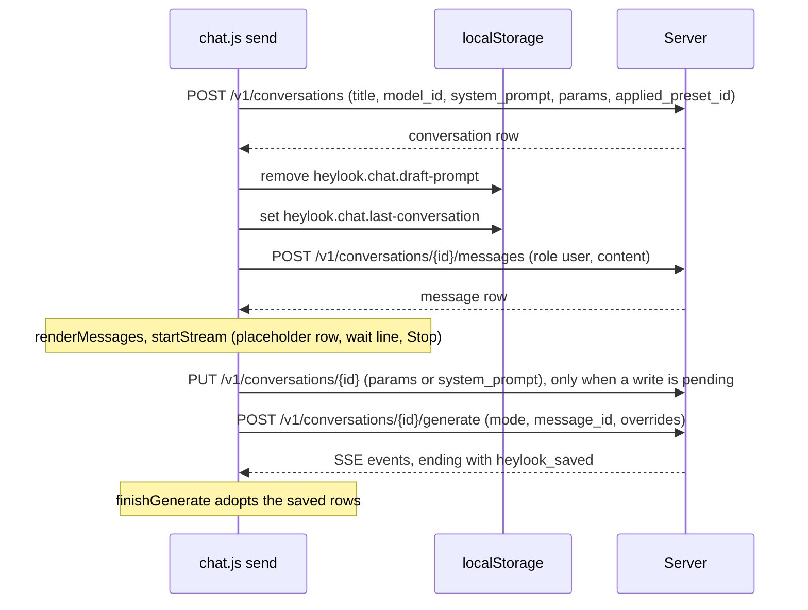

# Chat: from Send to a saved reply

last updated: 2026-11-24

This page maps one chat message from the moment Send is pressed to the moment the server's saved reply is on screen, and every way a run can end on the way. It starts at `chat.js` `send` (and the other callers of `startStream`), follows the generate request through `streaming.js` and the server route, and stops when the run's saved rows are adopted into `s.messages` and `renderMessages` has run, or when a run the page lost hold of has been resynced. It sits below the overview in [frontend_core.md](../frontend_core.md) (its `MarkdownStream` section says why incremental rendering exists) and the rules in [.claude/rules/frontend.md](../../../.claude/rules/frontend.md). The history is in [sharp_edges.md, Frontend](../../architecture/sharp_edges.md#frontend).

## Files and what each owns

| File | What it owns here |
|---|---|
| `frontend/js/pages/chat.js` | `send`, `startStream`, `paintStream`, `finishGenerate`, `handleStreamError`, `releaseStream`, `stopStream`, `stopRemote`, `resyncUntilSettled`, `abortStream` with `ABANDON` and `ABANDON_RANK`, `adoptSavedRows`, `resyncMessages`, `mergeServerRows`, `setRemoteGenerating`, `watchRemoteRun`, `stopRemoteWatch`, `setSendButton`, `paintSendBtn`, `refuseWhileStreaming`, `notifyChatActivity`, `noteRunState`, `abandonNote`, `isCold`, the scroll helpers `followingTail`, `pinToTail` and `scrollMessages`, and `buildThinkingEl` (the placeholder's thinking box). Constants: `PAINT_INTERVAL_MS`, `REMOTE_WATCH_MIN_MS`, `REMOTE_WATCH_MAX_MS`, `STICK_SLACK_PX`, `GENERATING_PREFIX`. |
| `frontend/js/streaming.js` | `streamTypedSSE` (the POST, the busy retry, the SSE parser), `streamGenerate` (the generate event dispatch), `stopGenerate`, `endReasoningGenerate`, `MAX_BUSY_RETRIES`. `streamMessages` is notebook's and is not used here. |
| `frontend/js/markdown-stream.js` | `MarkdownStream` (incremental render of the reply text), `appendPlainText` (the thinking box). |
| `frontend/js/markdown.js` | `renderMarkdown`, the one text-to-HTML path (marked, then DOMPurify), and `escapeHtml`. |
| `frontend/js/utils.js` | `throttleToInterval` (the painter's throttle), `setStatus` (the status line), `createUnloadGuard` (the leave-site dialog), `debounce` (whose `.flush` the pre-launch flush reaches). |
| `frontend/js/page.js` | `ctx.throttleTime`, `ctx.linkedController`, `ctx.signal`, `ctx.alive`. |
| `frontend/js/api.js` | `request`, `httpError` (`status`, `code`, `retryAfter`, `message`), `requestId`, and the `ROUTES` entries this area calls. |
| `frontend/js/settings.js`, `frontend/js/prompt-section.js`, `frontend/js/document-writer.js` | `bindDocumentParams` and its `.flush`, the prompt section's `flush`, `putSystemPrompt`: what the pre-launch flush awaits. |
| `frontend/js/app.js` | The `heylook:chat-activity` listener that toggles `.nav-item--busy` on the Chat nav link. |
| `src/heylook_llm/conversation_generate_api.py` | The generate, status, stop and reasoning-end routes; `_Run`, `_ACTIVE`, `_pump`, `_subscribe`, `_stream_generate`, `_persist_result`, the `heylook_saved` payload. |
| `src/heylook_llm/messages_api.py`, `src/heylook_llm/streaming_utils.py` | `translate_stream` and `StreamingEventTranslator` (the event grammar); `async_generator_with_abort`, `control_frame`, `KEEPALIVE_INTERVAL_S` (the `ping` and `heylook_progress` frames). |
| `src/heylook_llm/conversation_api.py` | `_refuse_while_generating` (the 409 on message writes) and the `generating` field on the list and get routes. |

## State

| Name | Where it lives | Written by | Read by | Reset when |
|---|---|---|---|---|
| `s.stream` | chat page state | `startStream` sets it; `releaseStream` nulls it | `refuseWhileStreaming`, the Send button click, the page hotkeys, `renderMessages`, `paintStream`, `stopStream`, `setRemoteGenerating`, `resyncMessages`, `finishGenerate`, `resyncUntilSettled`, `watchRemoteRun`, `notifyChatActivity`, `selectConversation`, `deleteConversation`, `cloneConversation`, `commitModelSwitch`, `loadModelNow`, `refreshAfterResume` | `releaseStream`, on every ending; nothing else nulls it |
| `s.remoteGenerating` | chat page state | `setRemoteGenerating`; `startStream` writes `false` directly | `refuseWhileStreaming`, the Send button click, the page hotkeys, `releaseStream`, `notifyChatActivity`, `watchRemoteRun`, `loadModelNow` | `startStream`; `setRemoteGenerating(ctx, false)` |
| `s.remoteWatch` (`{ convId, timer, delay }`) | chat page state | `watchRemoteRun` | its own `tick` | `stopRemoteWatch` (teardown, `setRemoteGenerating(ctx, false)`, a new watch); `tick` nulls it when its question no longer holds, the tab is hidden, or the answer is false |
| `s.paint` | chat page state, built in `setup` with `ctx.throttleTime` | `setup` | `onToken`, `onThinking` in `startStream` | cancelled at teardown by `page.js` |
| `s.loadingId` | chat page state | `selectConversation` | `refuseWhileStreaming` | `selectConversation`'s `finally`, for its own id only |
| `s.activeId` | chat page state | `send` (first send), `selectConversation`, `deleteConversation` | every identity check below | conversation select or delete |
| `s.messages` | chat page state | `send` (pushes the user row), `adoptSavedRows`, `mergeServerRows`, `regenerate` and the editor's save (hide the tail visually) | `renderMessages`, `adoptSavedRows`, `paintReadout` | conversation select or delete |
| `s.conversations[i].generating` | list rows in page state | `noteRunState`; every list fetch | `notifyChatActivity`, for rows other than the open one | the next list fetch |
| `s.pinnedTop` | chat page state | `scrollMessages`, `pinToTail` | `followingTail` | overwritten at every pin |
| `s.textarea.value`, `s.pendingImages`, `s.pendingAudio`, `s.composerDrafts` | composer DOM and page state | `send` clears them, and restores them (or the draft of the conversation left) on failure | `send`, `renderAttachStrip`, `restoreComposerDraft` | a successful send |
| `s.systemPrompt`, `s.appliedPresetId` | chat page state | first send, from the create response | first send's create body | conversation select |
| status line text and colour | `s.statusEl` (`.chat__status`, `role="status"`) | `showStatus`, which calls `utils.js` `setStatus` | `releaseStream`, `resyncUntilSettled`, `finishGenerate`'s retry, `setRemoteGenerating` (through `isGeneratingNote`) | any later `showStatus` |
| Send button label, icon and title | `s.sendBtn` | `paintSendBtn`, through `setSendButton` and from `startStream` | the user | `releaseStream`, `setRemoteGenerating` |
| leave-site dialog | `window` `beforeunload`, refcounted in `utils.js` | `s.setUnloadGuard(true)` in `startStream`, `(false)` in `releaseStream` | the browser | teardown disarms it (`createUnloadGuard`) |
| Chat nav busy dot | `.nav-item--busy` on the chat nav link | `app.js`, on `heylook:chat-activity` | the user | the next event |
| `heylook.chat.draft-prompt` | localStorage | first send removes it (`writeDraftPrompt(null)`) | `setup`, when there are no conversations | |
| `heylook.chat.last-conversation` | localStorage | first send (`lsWrite(LAST_CONV_KEY, conv.id)`); `selectConversation` | `setup` | |
| `_ACTIVE[conv_id]` | server process (`conversation_generate_api.py`) | the generate route, which claims before it reads the rows | the generate 409, `_refuse_while_generating`, the status and stop routes, `generating` on the list and get routes | `_release_claim`: `_stream_generate`'s `finally`, a failure before the stream starts, the busy return, and for a stream that never started the response cleanup or the watchdog |

The stream object, `s.stream`, built by `startStream`:

| Field | Set by | Read by |
|---|---|---|
| `controller` | `startStream` (`ctx.linkedController()`) | `streamGenerate` (as the signal), `abortStream`, `stopStream`, `releaseStream` |
| `targetConvId` | `startStream` (`s.activeId` at start) | the generate request, the stop request, every identity check |
| `continueMsg` | `startStream` options | `renderMessages` (hides that row while the stream runs) |
| `baseContent`, `baseThinking` | `startStream` (a continuation's existing text) | `paintStream`; `finishGenerate` (`baseContent`, reasoning-only branch) |
| `content`, `thinking` | `onToken`, `onThinking` (the run's full text so far) | `paintStream` |
| `contentDirty`, `thinkingDirty` | set by `onToken` and `onThinking`, cleared by `paintStream` | `paintStream` |
| `md` | `startStream` (`new MarkdownStream(contentEl)`) | `paintStream` |
| `thinkingWritten` | `startStream`, then `paintStream` from `appendPlainText` | `paintStream` |
| `waiting` | `true` at start; `false` in `firstDelta` | `onProgress`, `releaseStream` |
| `waitStatus` | `startStream`; replaced by `onProgress` | `releaseStream` (clears the line only while it still matches) |
| `sawEvent` | `onToken`, `onThinking`, `onSaved` | `stopStream` (the 404 rule) |
| `inBandError` | `onError`, for an in-band error | `finishGenerate` |
| `userStopped` | `stopStream`, only on a 404 with no events | `finishGenerate` |
| `abandonReason` | `abortStream` | `releaseStream`, in its `!ctx.alive` branch only |
| `els` (`msgEl`, `contentEl`, `thinkingBody`, `thinkingEl`, `endThinkingBtn`) | `startStream` | `renderMessages` (carries `msgEl`), `paintStream`, `releaseStream` |

## Entry points

| What the user or browser does | Handler, as file and function | Flow below |
|---|---|---|
| Clicks Send with no run going | `chat.js` `buildSkeleton`, the `s.sendBtn` click handler, then `send` | Send |
| Presses Enter in the composer on a non-touch device (no Shift, not composing) | `chat.js` `buildSkeleton`, the textarea `keydown` handler, then `send` | Send |
| Presses Cmd or Ctrl+Enter with focus in the composer or in no field | `hotkeys.js` `registerPageHotkeys`, the `onSubmit` set in `chat.js` `setup`; calls `send` only when neither `s.stream` nor `s.remoteGenerating` is set | Send |
| Regenerate on an assistant row; Save & Regenerate or Save & Continue in the message editor | `chat.js` `regenerate`; `buildEditEl` `save` (mapped in [chat-messages.md](chat-messages.md)) | startStream |
| Clicks the button while it reads Stop and the page holds the stream | the `s.sendBtn` click handler, then `stopStream` | Stop while the page holds the stream |
| Clicks the button while it reads Stop for a run the page is not subscribed to | the `s.sendBtn` click handler, then `stopRemote` | Stop a run the page is not subscribed to |
| Presses Escape with no modal open | `chat.js` `setup`, the `onEscape` hotkey: `stopStream` when `s.stream`, else `stopRemote` when `s.remoteGenerating` | either Stop flow |
| Clicks End thinking in the streaming row | `chat.js` `startStream`, the callback passed to `buildThinkingEl` | Ending a thinking block early |
| An SSE event arrives | `streaming.js` `streamGenerate`, `onEvent` | streamGenerate and streamTypedSSE |
| Opens another conversation mid-run | `chat.js` `selectConversation`, which calls `abortStream(ctx, ABANDON.CONVERSATION)` ([chat-documents.md](chat-documents.md)) | abortStream |
| Deletes the conversation that is streaming | `chat.js` `deleteConversation`: awaits `stopGenerate`, then `abortStream` ([chat-documents.md](chat-documents.md)) | abortStream |
| Leaves the Chat page | `page.js` `unmount` aborts `ctx.signal`; the stream's linked controller aborts with it ([shell-and-lifecycle.md](shell-and-lifecycle.md)) | Every ending |
| Switches model mid-reply | `chat.js` `commitModelSwitch`, which leaves the stream alone ([chat-model-and-settings.md](chat-model-and-settings.md)) | Every ending |
| The tab comes back | `chat.js` `refreshAfterResume` via `ctx.onResume`, which calls `setRemoteGenerating` with the list row's flag ([chat-documents.md](chat-documents.md)) | A run the page is not subscribed to |
| The remote watch timer fires | `chat.js` `watchRemoteRun`, `tick` | A run the page is not subscribed to |
| Reloads or closes the tab mid-run | `utils.js` `createUnloadGuard` (armed by `startStream`) | none: the browser's leave-site dialog |

## Flows

### Send

Trigger: the Send button, Enter in the composer, or Cmd or Ctrl+Enter (see Entry points).

Guards, in order:
1. The trimmed composer text is empty and nothing is staged: returns, and nothing on screen changes.
2. `refuseWhileStreaming(ctx)` returns true: returns. It wrote the reason (see its flow).
3. `s.modelSelect.value` is empty: `No models available.` (error colour).
4. Not a refusal: when `s.committedModelId` is set and the select shows another model (a switch warning still waiting), `commitModelSwitch(ctx, s.modelSelect.value)` commits it ([chat-model-and-settings.md](chat-model-and-settings.md)). That writes its own status line and sends a `PUT` of `model_id`. It runs before the next guard, so a send refused for its attachments has still committed the switch.
5. Images are staged and `currentCaps(ctx)` lacks `vision`: `This model does not take images -- remove them or switch models.` Audio is staged and the caps lack `audio`: `This model does not take audio -- remove it or switch models.` Each is in error colour, and the attachments stay staged.

Steps:
1. `title` is the text, or `Audio message` or `Image message`, cut to a literal length in `send`.
2. The composer is cleared: textarea value emptied, `s.composerDrafts.delete(s.activeId)`, `autoGrow`, `s.pendingImages` and `s.pendingAudio` replaced by new empty arrays (the staged arrays stay in the locals `images` and `audio`), `renderAttachStrip`, `showStatus(ctx, '')`, `closePromptPreview`.
3. `home = s.activeId ?? null`: the conversation this message belongs to (see [A send belongs to the conversation it was sent from](../../architecture/sharp_edges.md#a-send-belongs-to-the-conversation-it-was-sent-from)).
4. Inside the `try`: `content` is `await buildContentBlocks(text, images, audio)` when anything is staged ([chat-attachments.md](chat-attachments.md)), else the plain text. If the page is gone after the await, the staged previews' object URLs are revoked and `send` returns.
5. No open conversation: the first-send flow below creates one and sets `s.activeId` and `home`. An open conversation whose list row is titled `New conversation` while `s.messages` is empty: the row's title becomes `title`, `api.updateConversation(s.activeId, { title })` is sent without waiting (a failure is swallowed, FB-08), and `renderConvList` runs.
6. `convId = s.activeId`, then `await api.addMessage(convId, { role: 'user', content })`: `POST /v1/conversations/{id}/messages`.
7. The staged previews' object URLs are revoked.
8. The page is gone: return. `s.activeId !== convId` (another conversation was opened during the POST): `Your message was saved to the conversation you left, but no reply was requested there. Open it, edit that message and use Save & Regenerate.` (error colour), and `send` returns. No generate request goes out.
9. The returned row is pushed onto `s.messages` unless a row with its id is already there (a resume merge can have brought it in).
10. `renderMessages(ctx)` ([chat-messages.md](chat-messages.md)), `scrollMessages(ctx, true)`, `startStream(ctx, { mode: 'append' })`.

Ends when: `startStream` returns, which is before the generate request is sent.

Failure paths (the `catch`, for any throw from step 4 on):
- The page is gone: revoke the previews and return.
- `(s.activeId ?? null) !== home` (the user switched conversation during the send): the text goes into `s.composerDrafts` under `home`, or under the no-conversation key `NO_DOC`; the previews are revoked and the attachments dropped; the line is `` `Send failed in the conversation you left: ${err.message}.${kept}${lost}` ``, where `kept` is `` ` Its text is back in that conversation's draft.` `` when there was text and `lost` is `` ` Its attachments were not kept.` `` when anything was staged.
- Otherwise the composer is put back as it was: the textarea value, `autoGrow`, `s.pendingImages = images` and `s.pendingAudio = audio` (the same arrays, their previews still live), `renderAttachStrip`, and `` `Send failed: ${err.message}` `` in error colour. A message POST while a run holds the conversation answers 409 and reads `Send failed: A reply is still being generated in this conversation. Wait for it to finish, or stop it first.` (the message is `_refuse_while_generating`'s).

Awaits and what is re-checked after each:

| Await | Re-checked after |
|---|---|
| `buildContentBlocks` | `ctx.alive` |
| `api.createConversation` (first send) | `ctx.alive` only |
| `api.addMessage` | `ctx.alive`, then `s.activeId === convId` |
| the `catch` | `ctx.alive`, then `s.activeId` against `home` |

### Send: the first message creates the conversation

Trigger: `send` with `s.activeId` null (no conversation exists, or the last one was deleted).

Guards: those of Send.

Steps:
1. `promptBeforeCreate = s.systemPrompt`.
2. `await api.createConversation({ title, model_id, system_prompt, params, applied_preset_id })`: `POST /v1/conversations`. `model_id` is the select's value, `system_prompt` is `s.systemPrompt`, `applied_preset_id` is `s.appliedPresetId`, each sent only when non-empty; `params` is `snapshotSettings()`, the drawer's sampler panel ([chat-model-and-settings.md](chat-model-and-settings.md)).
3. The page is gone: return.
4. `writeDraftPrompt(null)` removes `heylook.chat.draft-prompt` from localStorage.
5. `s.appliedPresetId` takes the response's `applied_preset_id`; the response is unshifted onto `s.conversations`; `s.activeId = conv.id`; `home = conv.id`; `lsWrite(LAST_CONV_KEY, conv.id)` writes `heylook.chat.last-conversation` (this is the one `activeId` move that does not go through `selectConversation`, which writes that key otherwise); `s.messages = []`.
6. If the prompt changed while the create was in flight, `putSystemPrompt(ctx, conv.id, s.systemPrompt)` is sent without waiting (`document-writer.js` chains it); otherwise `s.systemPrompt` takes the response's `system_prompt`.
7. `drawer.requestRebuild({ force: true })` (an open drawer's prompt box was built for no conversation), `s.presetBar.syncIndicator()`, `renderConvList(ctx)`.
8. Send continues at its step 6.

Ends when: Send's step 6 begins.

Failure paths: a failed create goes to Send's `catch` with `home` still null, so if a conversation was opened meanwhile the text goes to the `NO_DOC` draft.

Awaits: the create, after which only `ctx.alive` is checked. Nothing checks whether `s.activeId` moved off null during the POST; see the last section.

### startStream: placeholder, stream object, pre-launch flush, launch

Trigger: `send` (`{ mode: 'append' }`); `regenerate` (`{ mode: 'regenerate', messageId }`); the message editor's save in `buildEditEl`: Save & Regenerate sends `regenerate` from the row after the edited one, or `append` when the edited row is last, and Save & Continue sends `{ mode: 'continue', messageId, continueMsg }`. The callers other than `send` are mapped in [chat-messages.md](chat-messages.md).

Guards: `s.stream` already set, or no `s.activeId`: returns without a word. Callers refuse aloud first, through `refuseWhileStreaming`.

Steps:
1. `controller = ctx.linkedController()`: it aborts when the page signal does.
2. The placeholder: `contentEl` (`div.message-content`) with a `MarkdownStream` over it; a continuation seeds it with `md.render(baseContent)`. `canEndThinking` is whether `currentCaps(ctx)` includes `thinking_budget`. `buildThinkingEl(continueMsg?.thinking ?? '', true, …)`, passed the End thinking callback when `canEndThinking` and null otherwise, builds an open `details.thinking` whose summary reads `Thinking` and, when `canEndThinking`, carries the `End thinking` button (`.thinking__end`). The box is hidden unless the continuation already has thinking. `msgEl` is `div.message.message--${role}.message--streaming` holding the thinking box and a `div.message-bubble` around `contentEl`; `role` is the anchor's role for a continuation, else `assistant`.
3. The stream object (fields in the table above) is built and assigned to `s.stream`.
4. `renderMessages(ctx)`: it appends `stream.els.msgEl` after the rows and, for a continuation, leaves out the anchor's own row. Then `scrollMessages(ctx, true)`.
5. `s.remoteGenerating = false`, written directly rather than through `setRemoteGenerating` (a watch still running drops itself at its next tick, because its question no longer holds). `notifyChatActivity(ctx)` reports busy. `paintSendBtn(s.sendBtn, true, 'Stop this run and keep what has been generated so far')`. `s.setUnloadGuard(true)`.
6. The wait line: `isCold(ctx, modelId)` chooses between `` `Loading ${modelId}… (the first token follows the load — this can take a while)` `` and `Waiting for the first token…`. It is stored as `stream.waitStatus` and shown.
7. `overrides = { model: s.modelSelect.value, ...samplerParams(currentModel(ctx)) }`, computed now, before the flush ([chat-model-and-settings.md](chat-model-and-settings.md)).
8. `launch` is defined as `streamGenerate(stream.targetConvId, { mode, message_id: messageId, overrides }, { … })`, with these callbacks in the last argument:
   - `onToken(_, full)`: `firstDelta()`, `sawEvent = true`, `content = full`, `contentDirty = true`, then `s.paint()` if the page is alive.
   - `onThinking(_, full)`: the same for `thinking`.
   - `onSaved`: `sawEvent = true`.
   - `onProgress({ processed, total })`: only while `waiting`, alive and current, replaces `waitStatus` with the reading line and shows it.
   - `onRetryWait(wait)`: if alive and current, `` `Server busy -- retrying in ${wait}s…` ``. This line is not stored as `waitStatus`.
   - `onComplete(result)`: `finishGenerate(ctx, stream, result)` (not awaited), then `refreshLoadedIds(ctx)` if alive, because a run can load its model and evict another ([chat-model-and-settings.md](chat-model-and-settings.md)).
   - `onError(err)`: with `err.inBand`, `stream.inBandError = err` and, if alive and current, `` `Generation failed: ${err.message}` `` in error colour; the stream keeps reading. Without it, `handleStreamError(ctx, stream, err)`.
   `firstDelta` does its work once: `waiting = false`, clears the status line if alive and current, and calls `refreshLoadedIds` when the model was cold. A thinking delta counts. Current means `isCurrent()`: `s.stream === stream && s.activeId === stream.targetConvId`.
9. The pre-launch flush: `Promise.allSettled([s.paramsBinder.flush(), s.promptSection.flush()])`, each wrapped so a missing one resolves. The params flush sends the pending `PUT /v1/conversations/{id}` with `{ params }`, captured when the setting changed, or resolves at once. The prompt flush sends the pending `{ system_prompt }` through `putSystemPrompt`, or returns nothing; `s.promptSection` exists only once the drawer has been built. Each writer reports its own failure (`` `Settings save failed: ${err.message}` ``, `` `System prompt save failed: ${err.message}` ``), and a failure does not stop the launch. The server builds the request from the store, so this is what makes a setting changed just before Send reach the run.
10. When the flush settles: `launch()` runs only if `ctx.alive && s.stream === stream`.

Ends when: `launch()` runs. If Stop or a conversation switch aborted the controller during the flush, `s.stream` is still this stream, so `launch()` still runs; its `fetch` rejects at once as aborted and the run ends through `finishGenerate` with `aborted: true`.

Failure paths: none of its own; the callbacks route every failure. If the page is torn down during the flush, `launch` is skipped and nothing releases the stream (the page is gone).

Awaits: the flush only. Re-checked after it: `ctx.alive`, `s.stream === stream`.

### streamGenerate and streamTypedSSE: the request, the busy retry, the events

Trigger: `launch()`.

Steps:
1. `streamGenerate` calls `streamTypedSSE` with the URL `/v1/conversations/${convId}/generate`, the body, and `{ signal, onRetryWait, onEvent }`.
2. `fetch`, method `POST`, headers `Content-Type: application/json` and `X-Request-ID` (`requestId()`), the JSON body, the stream's signal. An ok answer leaves the retry loop.
3. A non-ok answer: `httpError(res)` builds the error (`message` from `error.message` or `detail`, `status`, `code` from `error.code`, `retryAfter` from the `Retry-After` header). A 503 with code `model_overloaded` while `attempt <= MAX_BUSY_RETRIES`: `onRetryWait(wait, attempt)` with `wait` from `retryAfter` or a literal fallback in `streamTypedSSE`, then `sleep(wait * 1000, signal)`, which resolves early on abort; aborted during the sleep returns `{ aborted: true }`; otherwise the POST is sent again. Any other non-ok answer, including a 503 past the retries, is thrown.
4. The read loop: `res.body.getReader()` and a streaming `TextDecoder`. An event ends at the first blank line (`\n\n` or `\r\n\r\n`, whichever comes first). Inside it, an `event:` line sets the type and each `data:` line is parsed as JSON (a parse failure gives null; a later `data:` line replaces an earlier one); other lines are ignored. An event with a type and non-null data goes to `onEvent`.
5. The reader reports done: return `{ aborted: false }`.
6. The `catch`: `reader.cancel()` (errors ignored), then an `AbortError` returns `{ aborted: true }` and anything else is thrown again.
7. `streamGenerate` calls `onComplete({ content, thinking, usage, aborted, saved })`. A throw out of `streamTypedSSE` (an HTTP error, a failed fetch or read, or a throw inside a callback) goes to `onError(err)` with no `inBand`.

| Event | `streamGenerate` does | Becomes, in `startStream` |
|---|---|---|
| `content_block_delta`, delta type `thinking_delta`, non-empty `text` | appends to `thinking` | `onThinking(delta, full)` |
| `content_block_delta`, delta type `text_delta`, non-empty `text` | appends to `content` | `onToken(delta, full)` |
| `message_delta` | keeps `data.usage` | `usage` in `onComplete`; `finishGenerate` reads `output_tokens` in one line and uses `usage` as a sign the run finished |
| `heylook_saved` | keeps the payload as `saved` | `onSaved`, then `finishGenerate` reads `saved.messages` and `saved.end_reason` |
| `heylook_progress` with `prefill` | passes `data.prefill` | `onProgress({ processed, total })` |
| `error` | builds an `Error` (message from `error.message`, else `Generation failed`; `code` from `error.type`), sets `inBand = true`, keeps reading | the in-band branch of `onError` |
| `message_start`, `content_block_start`, `content_block_stop`, `message_stop`, `ping`, any other | ignored | nothing |

The delta text is read from `text`; the server sends a `thinking_delta`'s text under `thinking` and again under `text`. Never read from `heylook_saved`: `timing`, `dropped_media`, `mode`, `conversation_id`, `error`. The per-message drop disclosure is rendered client-side instead (`buildMessageEl`, [chat-messages.md](chat-messages.md)).

Ends when: the body ends (`onComplete`), the signal aborts (`onComplete` with `aborted: true`), or something throws (`onError`).

Awaits: `fetch` (an abort makes it an aborted ending); `httpError`; `sleep`, after which `signal.aborted` is checked; `reader.read` for each chunk; `reader.cancel` in the `catch`.

### The painter

Trigger: `s.paint()`, called by `onToken` and `onThinking`. `s.paint` is `ctx.throttleTime(() => paintStream(ctx), PAINT_INTERVAL_MS)`, one per mount; it reads `s.stream` when it runs, so it needs no per-stream state.

The throttle (`utils.js` `throttleToInterval`): each call marks a run as pending. If no timer and no frame is scheduled, it sets a timeout for what is left of `PAINT_INTERVAL_MS` since the last run (none, if that much time has passed), then asks for an animation frame, and the frame runs `paintStream` once if a run is still pending. So there is at most one paint per interval, and each lands on a frame. `ctx.throttleTime` registers its `cancel` for teardown. `ctx.throttle` (one run per frame, `throttleToFrame`) is not used for this painter; why is in [Incremental streaming render](../../architecture/sharp_edges.md#incremental-streaming-render).

Steps of `paintStream(ctx)`:
1. `stream = s.stream`; return if there is none or `s.activeId !== stream.targetConvId`. Deltas still accumulate on the object while it is not painted.
2. `following = followingTail(ctx)`, measured before anything is written. It is true when `s.pinnedTop` is set and `scrollTop` is still where the last pin left it (within a literal tolerance), else when the distance from the bottom is under `STICK_SLACK_PX`.
3. `contentDirty`: cleared; once `stream.content` is non-empty the End thinking button is hidden; then `stream.md.render(stream.baseContent + stream.content)`.
4. `thinkingDirty`: cleared; the thinking box is unhidden; `stream.thinkingWritten = appendPlainText(thinkingBody, baseThinking + thinking, thinkingWritten)`.
5. When `following`: `pinToTail(ctx)` sets `scrollTop` to `scrollHeight` and records where it landed in `s.pinnedTop`.

`MarkdownStream.render(text)`, where `text` is the whole reply so far:
1. The same text as last time: return.
2. Remember `prevBoundary`, store the text, and unless the message is already `unsafe`, `scan(text)`.
3. `unsafe`: the whole text goes through `renderMarkdown` into `el.innerHTML`, and the prefix and boundary reset. Once unsafe, every later render of this message is a whole render.
4. If `boundary` moved past `prevBoundary`: `text.slice(prevBoundary, boundary)` is rendered once, parsed in the module's shared `<template>` (`parseNodes`), placed with `replaceTail`, and its node count added to `prefixNodes`. Those nodes are never touched again.
5. The tail, `text.slice(boundary)`, is rendered and placed with `replaceTail`, which removes every child after the first `prefixNodes` and appends the new nodes.

`scan(text)` advances from `scanPos` over completed lines only (an unfinished last line waits for its newline), strips a trailing `\r`, and calls `consumeLine(line, start)`:
- Inside a fence, a line that `closesFence` (the same character, at least as long, no info string) closes it; the line counts as non-blank.
- A blank line sets `prevBlank`.
- A line matching `LINK_DEF` (a link-reference or footnote definition) or `HTML_BLOCK_OPEN` (HTML block types 1 to 5) sets `unsafe`.
- After a blank line, a line for which `isHardBlockStart` holds (not indented, not a list marker per `LIST_ITEM`, not starting with `>`) moves `boundary` to that line's start.
- A line matching `FENCE_OPEN` opens a fence and records its character and length.

`appendPlainText(el, full, writtenLen)`: when the first child of `el` is a text node exactly `writtenLen` long and `full` has not shrunk, it appends `full.slice(writtenLen)` with `appendData`; otherwise it replaces `el.textContent`. It returns `full.length`. `buildThinkingEl` seeds the body with a text node, so the append path holds from the first delta.

`renderMarkdown(text)`: `DOMPurify.sanitize(marked.parse(text ?? ''))`, with marked set for GFM and `breaks`, raw HTML escaped by the `html` renderer, and link and image URLs checked against `SAFE_LINK_SCHEMES` and `SAFE_IMAGE_SCHEMES` after entity decoding; a throw falls back to `escapeHtml(text)`. The security reasoning is in frontend_core.md.

Ends when: the stream is released. A paint still pending then finds `s.stream` null, or a newer stream, and does nothing for the old one. The final text on screen is the saved row rendered by `renderMessages` and `buildMessageEl`, not the last paint.

Failure paths: none; `renderMarkdown` cannot throw out.

Awaits: none.

### The wait, progress and retry lines

| Line | Written by | When | Cleared by |
|---|---|---|---|
| `` `Loading ${modelId}… (the first token follows the load — this can take a while)` `` | `startStream` | `isCold` is true: residency is known and the model is not loaded | `firstDelta`; `releaseStream` while it is still the line on screen; any later status write |
| `Waiting for the first token…` | `startStream` | otherwise | the same |
| `` `Reading the prompt… ${processed.toLocaleString()} / ${total.toLocaleString()} tokens` `` | `onProgress` | each `heylook_progress` before the first delta, while the stream is current; it becomes `waitStatus` | the same |
| `` `Server busy -- retrying in ${wait}s…` `` | `onRetryWait` | each 503 `model_overloaded` retry, while current | `firstDelta`, or the ending's own line; `releaseStream` leaves it, since it is not `waitStatus` |

The server sends `heylook_progress` on each change in prefill progress, and `ping` after `KEEPALIVE_INTERVAL_S` without any frame (`streaming_utils.py` `async_generator_with_abort`). The page ignores `ping`.

### finishGenerate

Trigger: `onComplete({ content, thinking, usage, aborted, saved })`. `content` and `thinking` are this run's text only, without a continuation's base.

Guards: after `releaseStream`, the page is gone or `s.activeId !== stream.targetConvId`: return. This is how a conversation switch and a page leave end without anything shown.

Steps:
1. `releaseStream(ctx, stream)`.
2. The guard above.
3. The rows:
   - `saved.messages` is non-empty: `noteRunState(ctx, stream.targetConvId, false)`, `adoptSavedRows(ctx, saved.messages)`, `renderMessages(ctx)`. No network. The same render that inserts the saved rows drops the stream's node, because `s.stream` is null now.
   - Otherwise (no `heylook_saved`, or one with no rows because nothing was generated): `serverState = await resyncMessages(ctx, stream.targetConvId)`, then return if the page is gone, the conversation moved, or `s.stream` is set: a second run can have started during the GET ([Generation lifecycle and stream identity](../../architecture/sharp_edges.md#generation-lifecycle-and-stream-identity)).
4. `scrollMessages(ctx)`: follows only if the reader was at the tail.
5. The status line; the first matching row wins. `ended` is true when `saved` is present or `serverState === 'idle'`.

   | Condition | Status line |
   |---|---|
   | `saved.end_reason` is `error`, or `stream.inBandError` is set | not written: the in-band `` `Generation failed: ${err.message}` `` stands |
   | `end_reason` is `aborted`, or `ended` and `stream.userStopped` | `Stopped -- partial response saved.` when `content` is non-empty, else `Stopped.` |
   | `serverState === 'generating'` | `abandonNote()`: `Still generating on the server — the reply will be saved to this conversation and will appear here when it finishes.` |
   | `aborted`, no `saved`, and `serverState` is not `idle` | `abandonNote()` |
   | `content` empty, `thinking` present, no `baseContent` | `` `Reasoning used the whole ${usage?.output_tokens ?? ''} token budget, so there is no answer text. Raise Max tokens and send again.` `` (error colour) |
   | `usage` or `saved` present | cleared |
   | none of these | not written |

6. Recovery, when there was no `heylook_saved`, no abort, some streamed `content` or `thinking`, and no in-band error: `The stream ended without a save confirmation — recovering…` (error colour), then `retry(...)` on a timer whose first delay, growth factor and attempt count are literals in the `retry(...)` call in `finishGenerate`. Each attempt: return if the page is gone, the conversation moved, or `s.stream` is set; `await resyncMessages`; return if the page is gone or the conversation moved; `generating` stops the retries (the watch takes over); `unknown` tries again while attempts remain and never announces; `idle` tries again while attempts remain, and on the last attempt writes `Recovered what the server saved.` if the status line still contains `recovering`.

Ends when: the status line is written, or the last retry resolves.

Failure paths: a failed GET makes `resyncMessages` answer `unknown`. The stream's last painted node then stays on screen, its streaming class already removed, until the next adoption.

Awaits: the resync in step 3, after which `ctx.alive`, `s.activeId` and `s.stream` are re-checked; each retry's timer, after which the same are re-checked; each retry's resync, after which `ctx.alive` and `s.activeId` are re-checked.

### adoptSavedRows, resyncMessages, mergeServerRows

`adoptSavedRows(ctx, rows)`: `minPos` is the smallest `position` among the saved rows. `s.messages` becomes the rows below `minPos` whose ids are not among the saved ones, followed by the saved rows. It is pure assignment and does not render; the caller does. Chat never sends `user_content`, so in every mode the saved rows are the reply alone: a fresh assistant row for append and regenerate, or the anchor row with the same id and the merged text for continue.

`resyncMessages(ctx, convId)`: `GET /v1/conversations/{id}` with the page signal. A throw answers `unknown`. After the await, a gone page, a moved conversation or a live `s.stream` answers `unknown` and touches nothing. Otherwise `mergeServerRows(ctx, conv.messages ?? [])`, `setRemoteGenerating(ctx, Boolean(conv.generating))`, and the answer is `generating` or `idle`. Callers must treat `unknown` as no answer, never as idle. Callers: `finishGenerate` and its retry, `handleStreamError`, `resyncUntilSettled`, `watchRemoteRun`, and the editor-save and message-delete failure paths ([chat-messages.md](chat-messages.md)).

`mergeServerRows(ctx, serverRows)`: if an editor is open on a row the server no longer has, that local row is kept (sorted by `position` among the server rows) and the line is `The message you are editing was deleted elsewhere — your draft is kept until you cancel or save.` (error colour). Otherwise `s.messages` becomes a copy of the server rows. Then `renderMessages(ctx)`; unchanged rows keep their nodes, so a clean resync repaints nothing.

### handleStreamError

Trigger: `onError` without `inBand`: the generate POST answered non-ok (a 503 only after the retries), the fetch or a read failed with anything but an abort, or a callback threw.

Guards: after `releaseStream`, the page is gone or the conversation moved: return.

Steps:
1. `releaseStream(ctx, stream)`.
2. The guard above.
3. `renderMessages(ctx)`: the stream's node goes; a continuation's anchor row comes back with its earlier text; rows a regenerate hid stay hidden until the resync.
4. `` `Generation failed: ${err.message}` `` (error colour). Messages the route can produce here include `A reply is already being generated in this conversation. Wait for it to finish, or stop it first.` (409), `Conversation has no model; pick one` and `Anchor message not found`.
5. `resyncMessages(ctx, stream.targetConvId)`, not awaited. If the server still holds a run (a read that failed while the run goes on, or another client's run behind a 409), `setRemoteGenerating(ctx, true)` replaces the failure line with the generating line and starts the watch.

Ends when: step 5 is sent.

Awaits: none, and there must be none between `releaseStream` and the writes; that is the only reason this path needs no `s.stream` re-check.

### Stop while the page holds the stream (stopStream)

Trigger: the button reading Stop while `s.stream` is set; Escape in the same state.

Guards: no `s.stream`: return.

Steps:
1. `stopGenerate(stream.targetConvId)`: `DELETE /v1/conversations/{id}/generate`, resolving to the HTTP status, or null when the request failed. Nothing is written to the status line yet, and the button stays Stop.
2. On the answer:
   - 200: nothing client-side. The server set the run's abort event; the open stream goes on to `heylook_saved` with `end_reason: 'aborted'`, and `finishGenerate` writes `Stopped -- partial response saved.` or `Stopped.`.
   - 404, the stream still current, and no event seen (`!stream.sawEvent`): the run is in a phase only the client has (the pre-launch flush, the busy-retry sleep, a POST the route has not claimed yet). `stream.userStopped = true`, then `stream.controller.abort()`. The fetch resolves aborted, and `finishGenerate` resyncs and writes `Stopped.` once the server answers idle.
   - 404 after events: the server has already finished and released its claim while the tail is still arriving; nothing is done and the run ends normally.
   - null, the stream still current: `Could not reach the server to stop it — still generating.` (error colour); the stream keeps painting.

Ends when: the answer is handled.

Awaits: the DELETE; re-checked after it: `s.stream === stream`.

### Stop a run the page is not subscribed to (stopRemote, resyncUntilSettled)

Trigger: the button reading Stop while `s.remoteGenerating` is set and there is no stream; Escape in the same state.

Guards: no `s.activeId`: return.

Steps:
1. `convId = s.activeId`; the line is `Stopping…`.
2. `stopGenerate(convId)`. On the answer, return if the page is gone or the conversation moved.
3. null: `Could not reach the server to stop it — still generating.` (error colour); the flag stays on.
4. Any status (200, or 404 for a run that had already finished): `setRemoteGenerating(ctx, false)` (the button goes back to Send and the watch stops; `Stopping…` stays, because it is not a generating line), then `resyncUntilSettled(ctx, convId)`.

`resyncUntilSettled(ctx, convId, delay, attemptsLeft)`, with defaults in its signature: after `delay`, return if the page is gone, the conversation moved, or a stream is live; `await resyncMessages`; return if the page is gone or the conversation moved; on `idle`, write `Stopped.` if the line still reads `Stopping…`, and return; otherwise, while attempts remain, schedule itself again with the delay doubled. A resync that lands while the server is still unwinding calls `setRemoteGenerating(ctx, true)`, which writes the generating line and restarts the watch; a later `idle` clears that line, and since the line no longer reads `Stopping…`, `Stopped.` is not written.

Ends when: an `idle` answer, or the attempts run out (the watch may still be running).

Awaits: the DELETE (re-checked: `ctx.alive`, `s.activeId`); each timer (re-checked: `ctx.alive`, `s.activeId`, `s.stream`); each resync (re-checked: `ctx.alive`, `s.activeId`).

### abortStream and the ABANDON reasons

`abortStream(ctx, reason = ABANDON.TEARDOWN)`: no stream: return. The reason is written to `stream.abandonReason` only when its `ABANDON_RANK` is at least the rank already held, so the strongest claim wins and equal ranks take the later call. Then `stream.controller.abort()`, which ends the page's subscription, not the server's run.

| Reason | Rank | What it claims about the run | Passed by |
|---|---|---|---|
| `ABANDON.TEARDOWN` (`'teardown'`) | lowest | nothing is known | the default; `deleteConversation` when the stop DELETE returned null |
| `ABANDON.CONVERSATION` (`'switch-conversation'`) | middle | the run detaches and finishes on the server | `selectConversation`, whenever a stream exists |
| `ABANDON.DELETE` (`'delete'`) | highest | the run really ended on the server | `deleteConversation` after the stop DELETE answered with a status, and again after the conversation DELETE succeeds for the open conversation |

Leaving the page does not call `abortStream`: `page.js` aborts `ctx.signal` and the linked controller aborts the stream with no reason recorded. A model switch does not touch the stream at all. The only reader of `abandonReason` is `releaseStream`'s `!ctx.alive` branch; `finishGenerate` decides its line from the server's answer instead.

### releaseStream

Trigger: the first line of `finishGenerate` and of `handleStreamError`.

Steps:
1. `stream.controller.abort()`. Harmless after a normal end; it removes the linked controller's listener from `ctx.signal`.
2. Not the current stream (`s.stream !== stream`): return.
3. `s.stream = null`, `s.setUnloadGuard(false)`, and the `message--streaming` class comes off the row (it drives the caret in `app.css`, `.message--streaming .message-content::after`).
4. The page is gone: dispatch `heylook:chat-activity` with `busy: true` only when `abandonReason` is `TEARDOWN`, and return.
5. `notifyChatActivity(ctx)`.
6. `setSendButton(s, s.remoteGenerating)`: Send, or Stop for a remote run on the conversation now open.
7. Still waiting for the first delta, on the stream's own conversation, with the status line still equal to `waitStatus`: clear it. Anything else on the line belongs to whatever wrote it, and the callers write their ending after this.

### A run the page is not subscribed to (setRemoteGenerating, watchRemoteRun, stopRemoteWatch)

`setRemoteGenerating(ctx, on)`:
1. `noteRunState(ctx, s.activeId, on)`: the list row takes the answer, whoever owns the button.
2. A stream on the open conversation owns the button and the line: return without recording the flag.
3. On a change: `s.remoteGenerating = on`, `notifyChatActivity`, `setSendButton(s, on)`. On writes `` `${GENERATING_PREFIX} — the reply will appear here when it finishes. Stop ends it and keeps the partial.` ``, that is `Still generating on the server — the reply will appear here when it finishes. Stop ends it and keeps the partial.`; off clears the line only if it starts with `GENERATING_PREFIX` (`isGeneratingNote`).
4. On every call, changed or not: on starts `watchRemoteRun`, off calls `stopRemoteWatch`.

Callers: `resyncMessages`, `adoptConversationMeta` (on select and on resume), `refreshAfterResume` (the open conversation's list row), `stopRemote`.

`watchRemoteRun(ctx)`: return if no conversation is open or a watch for it is already running; stop any other watch; start `{ convId, timer, delay: REMOTE_WATCH_MIN_MS }`. Each `wait()` sets a timer for `delay` and then doubles `delay`, up to `REMOTE_WATCH_MAX_MS`. Each `tick`:
1. Not this watch any more, or the page is gone: return.
2. The question no longer holds (`s.activeId === convId && s.remoteGenerating && !s.stream` is false) or the tab is hidden: drop the watch and return.
3. `await api.generationStatus(convId)`: `GET /v1/conversations/{id}/generate`, reading `generating`. A throw counts as no answer.
4. Re-check the watch and the question.
5. Not `false` (true, or no answer): wait again.
6. `false`: drop the watch, then `await resyncMessages`, which clears the flag, the generating line and the Stop button when it lands. If the answer was not `idle` and the question still holds, start a fresh watch.

`stopRemoteWatch(ctx)`: clears the timer and nulls `s.remoteWatch`. Callers: teardown (`ctx.onTeardown` in `setup`), `setRemoteGenerating(ctx, false)`, and `watchRemoteRun` before it starts a new watch.

A hidden tab drops the watch at its next tick; on return, `refreshAfterResume` re-states the flag from the list, and that restarts it ([chat-documents.md](chat-documents.md)). Why this is the one poll: [A model switch leaves the reply alone, and a lost run is watched](../../architecture/sharp_edges.md#a-model-switch-leaves-the-reply-alone-and-a-lost-run-is-watched).

Awaits in `tick`: the status GET (re-checked: the watch is still `s.remoteWatch`, `ctx.alive`, the question); the resync (re-checked: `ctx.alive`, the question).

### The Send and Stop button

`paintSendBtn(btn, stopping, title)` sets `aria-label` to `Stop` or `Send`, the inner HTML to the stop or send icon followed by `` with the same word, and `title`.

| State | Written by | Label | Title | A click runs |
|---|---|---|---|---|
| No run | `setSendButton(s, false)`: at build, from `releaseStream`, from `setRemoteGenerating(ctx, false)` | Send | empty | `send` |
| The page holds the stream | `startStream` | Stop | `Stop this run and keep what has been generated so far` | `stopStream` |
| A run the page is not subscribed to | `setSendButton(s, true)`: from `setRemoteGenerating(ctx, true)`, or from `releaseStream` while `s.remoteGenerating` | Stop | `Stop the run finishing on the server for this conversation` | `stopRemote` |

The click handler in `buildSkeleton` reads state, not the label: `s.stream` first, then `s.remoteGenerating`, else `send`. The button reads Stop from `startStream` on, which includes the pre-launch flush and any busy-retry wait.

### refuseWhileStreaming

Checks in order; each writes its line in normal colour and returns true:
1. `s.loadingId` is set: `This conversation is still loading — try again in a moment.`
2. No stream and `s.remoteGenerating`: `This conversation is still generating on the server — press Stop, or wait for it to finish.`
3. `s.stream` is set: `A response is still streaming — wait for it to finish, or press Stop.`

Otherwise it returns false. Callers: `send`, the Edit button, the editor's Save & Regenerate and Save & Continue, `regenerate`, `deleteMessage`.

Not barred, on purpose: a send in the window after `releaseStream` while a resync GET is in flight, when neither flag is set. The server's 409 and the send's restore handle that ([Generation lifecycle and stream identity](../../architecture/sharp_edges.md#generation-lifecycle-and-stream-identity)). A Cmd or Ctrl+Enter that reaches the page hotkey (focus in no field, or the composer on a touch device) calls `send` only when neither flag is set, so it is silent during a run; Enter in the composer on a non-touch device goes to `send`, which refuses aloud.

### The busy signal (notifyChatActivity, noteRunState)

`notifyChatActivity(ctx)`: busy is `s.stream`, or `s.remoteGenerating`, or any list row other than the open conversation with `generating` set. It dispatches `heylook:chat-activity` with `{ detail: { busy } }` on `window`. `app.js` toggles `.nav-item--busy` on the chat nav link and sets its `title` to `Chat · generation running on server`, removing the title when not busy. Callers: `setup`, `startStream`, `releaseStream`, `setRemoteGenerating` (on a change), `refreshAfterResume`.

`noteRunState(ctx, convId, generating)`: sets `generating` on that conversation's list row, if the row is there. Callers: `setRemoteGenerating` (for the open conversation) and `finishGenerate` (the saved-rows branch, with `false`). Nothing marks a row as generating when a local stream starts; see the last section.

### Ending a thinking block early

Trigger: `End thinking` in the streaming row's thinking summary. It is built only when `currentCaps(ctx)` includes `thinking_budget` at `startStream`, shows only once the thinking box is unhidden, and is hidden by `paintStream` once reply text arrives.

Steps:
1. The click calls `preventDefault` and `stopPropagation`, so the `details` does not toggle.
2. Already disabled: return. Otherwise the button is disabled and labelled `Ending…`.
3. `endReasoningGenerate(s.activeId)`: `POST /v1/conversations/{id}/generate/reasoning-end`. The id is the open conversation at click time, not `stream.targetConvId`. The result is discarded (FB-03).
4. The server answers 404 `No active generation for this conversation` when no run holds the claim; otherwise it calls `run.abort_event.end_reasoning()` and answers `{ signalled: 1, conversation_id }`. The run closes its thinking at the next token boundary and goes on to reply text, which the page sees only as `text_delta` events starting.

Ends when: the request is sent; the button stays disabled until the stream's node is replaced.

### Server: the generate route as the page relies on it

Read in `conversation_generate_api.py`, with the shared loop in `messages_api.py` and `streaming_utils.py`.

`POST /v1/conversations/{conv_id}/generate`:
1. The body is `GenerateRequest`: `mode` (`append`, `regenerate`, `continue`), `message_id`, `user_content`, `overrides`, `stop_sequences`. Chat sends `mode`, `message_id` (null for append) and `overrides` (`model` plus the panel's set sampler values). It never sends `user_content` or `stop_sequences`.
2. A claim already in `_ACTIVE`: 409, `error.code` `generation_in_progress`, message `A reply is already being generated in this conversation. Wait for it to finish, or stop it first.`
3. The route claims `_ACTIVE[conv_id]` before it reads the conversation, so a message write that arrives later 409s rather than being destroyed by the commit.
4. The conversation is read (404 `Conversation not found`). The model is `overrides.model`, else the stored `model_id` (400 `Conversation has no model; pick one`, or 400 for an unknown model). The rows used: append takes them all (400 when there are none); regenerate takes the rows before the anchor (400 for the first message); continue takes the rows up to the anchor. A missing anchor is 404 `Anchor message not found`. History media the model cannot take is dropped at the wire and counted in `dropped_media`.
5. The request is built from the stored system prompt, the stored `params` with `overrides` over them (keys from `REQUEST_SAMPLER_FIELDS` only, cap-gated keys removed), and the rows. A value out of range is 400 `Invalid sampler setting: …`.
6. `router.get_provider` (a cold model loads here; this is the wait the `Loading …` line names) and `check_capacity`. A `ModelBusyError` releases the claim and returns `model_busy_response` (503, code `model_overloaded`, a `Retry-After` header), which the client retries.
7. A task (`_pump`) drives `_stream_generate`, and the response is `_subscribe(run)` as `text/event-stream`. Any failure before this point releases the claim.

The event grammar from `_stream_generate`, in order: `message_start`; `ping` after `KEEPALIVE_INTERVAL_S` of silence and `heylook_progress` on each prefill change; content blocks (`content_block_start`, `content_block_delta` with `thinking_delta` or `text_delta`, `content_block_stop`); an `error` event on a request guard at the first step (`invalid_request_error`, after which the stream ends with no `heylook_saved`) or on an engine failure mid-stream (`api_error`); the translator's flush; `message_delta` (stop reason, `usage`) and `message_stop` (`performance`) unless the run failed; then the persist and `heylook_saved`. An exception that escapes the generator is turned by `_pump` into an `error` event (`api_error`) before the stream ends.

`heylook_saved` carries `{ type, conversation_id, mode, end_reason, messages, dropped_media, timing }`, plus `error` when there is an error message. `end_reason` is `complete`, `aborted` (the abort event was set and no stop sequence matched), or `error`. `messages` holds the rows the commit wrote: the user row when `user_content` was sent (never, from chat) and the reply row when anything was generated, with its `stats`. `_persist_result` writes the reply through `db.replace_tail_with_message` (append, regenerate) or `db.replace_tail_with_update` (continue, merging onto the anchor), each committing the truncation together with the row; when nothing was generated there is no row and the thread is untouched. The claim is released in `_stream_generate`'s `finally`, right after `heylook_saved` has been queued.

A client disconnect: this route passes `abort_on_disconnect=False`, so a disconnect never sets the abort event. `_subscribe`'s `finally` marks the run `detached` and empties its queue; `_pump` keeps driving the generation and drops the events; the run completes and commits the whole reply. If the generator is closed before its persist runs, its `finally` schedules `_persist_after_disconnect`.

`GET /v1/conversations/{conv_id}/generate` answers `{ conversation_id, generating }` from `_ACTIVE` alone, with no store read; an unknown id answers false. `GET /v1/conversations/{id}` and the list carry `generating` from the same source.

`DELETE /v1/conversations/{conv_id}/generate` answers 404 `No active generation for this conversation`, or sets the run's abort event and answers `{ status: 'stopping', conversation_id }`. The run then ends as `aborted` and persists the partial.

While a claim is held, `conversation_api._refuse_while_generating` answers 409 (`generation_in_progress`, message `A reply is still being generated in this conversation. Wait for it to finish, or stop it first.`) to message append, update, delete and truncate, and to conversation delete and clone. The conversation metadata `PUT` (title, prompt, params, model) stays open, which is why the pre-launch flush and a model switch can write during a run.

### Every ending, side by side

| How the run ended | What the page knows | What it does | What the status line says |
|---|---|---|---|
| Completed with a reply | `heylook_saved`, `end_reason: complete`, a row | adopts the rows, renders, scrolls if following | cleared |
| Completed with thinking only, not a continuation of text | as above, `content` empty | adopts the rows | `Reasoning used the whole … token budget, so there is no answer text. Raise Max tokens and send again.` |
| Completed with nothing generated | `heylook_saved` with no rows | resyncs, which brings back a tail a regenerate or continue hid | cleared |
| Stop, the server answered 200 | `end_reason: aborted` | adopts the partial, or resyncs when there is none | `Stopped -- partial response saved.` or `Stopped.` |
| Stop before the server held a run (the flush, the busy sleep, an unclaimed POST) | 404 and no events; `userStopped`; local abort | resyncs | `Stopped.` when the server answers idle; `abandonNote()` when the GET fails |
| Stop after the server finished | 404 after events | nothing; the stream ends normally | as a completed run |
| Stop that never reached the server | null | keeps streaming | `Could not reach the server to stop it — still generating.` |
| Engine failure mid-stream | in-band `error`, then `heylook_saved` with `end_reason: error` and any partial | adopts the rows, or resyncs | `Generation failed: …` stands |
| Refused at the first step, or the pump raised | in-band `error`, no `heylook_saved` | resyncs; no recovery | `Generation failed: …` stands |
| Refused before streaming (409, 400, 404, 500, or 503 past the retries) | `onError` without `inBand` | `handleStreamError`: renders, resyncs | `Generation failed: …`, replaced by the generating line if the resync finds a run |
| A read failed mid-stream | `onError` without `inBand` | `handleStreamError` | as above |
| The body ended with neither `heylook_saved` nor `error` | `saved` null, not aborted | resyncs, then the recovery retries | the matching branch, then `The stream ended without a save confirmation — recovering…`, then `Recovered what the server saved.` |
| Switched to another conversation | aborted with `ABANDON.CONVERSATION` | `finishGenerate` returns after `releaseStream`; the run finishes and commits on the server | `selectConversation` writes `` `"${leaving}" keeps generating — it will finish on the server and be there when you come back.` `` ([chat-documents.md](chat-documents.md)) |
| Left the Chat page | the page signal aborted the linked controller | nothing shown; the run finishes and commits | none; the nav dot stays on (FB-07) |
| Deleted the conversation | the stop DELETE was awaited; aborted with `ABANDON.DELETE` or `ABANDON.TEARDOWN` | `finishGenerate` runs while `s.activeId` is still that conversation; the rest is `deleteConversation`'s ([chat-documents.md](chat-documents.md)) | the matching branch |
| Model switched mid-reply | nothing; the stream is untouched | an ordinary ending | an ordinary ending; the switch wrote its own line when it committed |

## Requests this area makes

| When | Method and path | Body | Response fields used | On failure |
|---|---|---|---|---|
| First send | `POST /v1/conversations` | `title`, `model_id`, `system_prompt`, `params`, `applied_preset_id` | `id`, `applied_preset_id`, `system_prompt`; the row joins `s.conversations` | `Send failed: …`, composer restored |
| Send into an empty conversation still titled `New conversation` | `PUT /v1/conversations/{id}` | `title` | none | swallowed (FB-08) |
| First send, prompt edited during the create | `PUT /v1/conversations/{id}` via `putSystemPrompt` | `system_prompt` | none | `System prompt save failed: …` |
| Every send | `POST /v1/conversations/{id}/messages` | `role: 'user'`, `content` (a string, or blocks when media is staged) | the whole row, pushed onto `s.messages` | `Send failed: …` with the composer restored, or the left-conversation line |
| Before launch, a settings write pending | `PUT /v1/conversations/{id}` (`bindDocumentParams` flush) | `params` | none | `Settings save failed: …`; the launch goes ahead |
| Before launch, a prompt write pending | `PUT /v1/conversations/{id}` (`putSystemPrompt`) | `system_prompt` | none | `System prompt save failed: …`; the launch goes ahead |
| Launch, and each busy retry | `POST /v1/conversations/{id}/generate`, SSE, with `X-Request-ID` | `mode`, `message_id`, `overrides` | the events above; `heylook_saved.messages` and `.end_reason`; `message_delta.usage` | 503 `model_overloaded`: retried; anything else: `handleStreamError` |
| Stop | `DELETE /v1/conversations/{id}/generate` | none | the status code only | null: `Could not reach the server to stop it — still generating.` |
| End thinking | `POST /v1/conversations/{id}/generate/reasoning-end` | none | none; the result is discarded | nothing shown (FB-03) |
| Resync after an ending, a Stop, or a watch's false | `GET /v1/conversations/{id}` | none | `messages`, `generating` | `unknown`; callers retry or leave the state as it is |
| Remote watch tick | `GET /v1/conversations/{id}/generate` | none | `generating` | no answer; asks again |
| First delta on a cold model; every completion | `GET /v1/admin/models` (`refreshLoadedIds`) | none | residency rows ([chat-model-and-settings.md](chat-model-and-settings.md)) | ignored |

## What the user sees

Status line strings, unless the row says otherwise. Error colour is `setStatus`'s `var(--danger)`.

| String | Set in | Cleared by |
|---|---|---|
| `No models available.` (error) | `send` | the next status write |
| `This model does not take images -- remove them or switch models.` (error) | `send` | the next status write |
| `This model does not take audio -- remove it or switch models.` (error) | `send` | the next status write |
| `This conversation is still loading — try again in a moment.` | `refuseWhileStreaming` | the next status write |
| `This conversation is still generating on the server — press Stop, or wait for it to finish.` | `refuseWhileStreaming` | the next status write |
| `A response is still streaming — wait for it to finish, or press Stop.` | `refuseWhileStreaming` | the next status write |
| `Your message was saved to the conversation you left, but no reply was requested there. Open it, edit that message and use Save & Regenerate.` (error) | `send` | the next status write |
| `` `Send failed in the conversation you left: ${err.message}.${kept}${lost}` `` (error) | `send` | the next status write |
| `` `Send failed: ${err.message}` `` (error) | `send` | the next status write |
| the wait, progress and retry lines | `startStream` | see their table |
| `` `Generation failed: ${err.message}` `` (error) | `startStream`'s `onError` (in-band); `handleStreamError` | the generating line from a resync; the next status write |
| `Stopped -- partial response saved.`, `Stopped.` | `finishGenerate` | the next status write |
| `Stopping…`, then `Stopped.` | `stopRemote`, then `resyncUntilSettled` | the generating line if a resync finds the run still unwinding |
| `Could not reach the server to stop it — still generating.` (error) | `stopStream`, `stopRemote` | the next status write |
| `Still generating on the server — the reply will be saved to this conversation and will appear here when it finishes.` | `finishGenerate` (`abandonNote`) | `setRemoteGenerating(ctx, false)` (it starts with `GENERATING_PREFIX`) |
| `Still generating on the server — the reply will appear here when it finishes. Stop ends it and keeps the partial.` | `setRemoteGenerating(ctx, true)` | `setRemoteGenerating(ctx, false)` |
| `` `Reasoning used the whole ${usage?.output_tokens ?? ''} token budget, so there is no answer text. Raise Max tokens and send again.` `` (error) | `finishGenerate` | the next status write |
| `The stream ended without a save confirmation — recovering…` (error) | `finishGenerate` | `Recovered what the server saved.` from the last retry; the next status write |
| `The message you are editing was deleted elsewhere — your draft is kept until you cancel or save.` (error) | `mergeServerRows` | the next status write |
| Send button: `Send` or `Stop` (`aria-label` and `.sr-only`), titles `Stop this run and keep what has been generated so far` and `Stop the run finishing on the server for this conversation` | `paintSendBtn` | `releaseStream`, `setRemoteGenerating` |
| The streaming row: thinking summary `Thinking`; button `End thinking` (title `Close the thinking block and start the final response`), then `Ending…`, disabled | `buildThinkingEl`, `startStream` | `paintStream` hides the button when reply text arrives; the row is replaced by the saved row |
| The streaming caret (`.message--streaming .message-content::after`) | `startStream` adds the class | `releaseStream` removes it |
| The Chat nav link's busy dot and its title `Chat · generation running on server` | `app.js`, from `notifyChatActivity` and `releaseStream` | the next `heylook:chat-activity` with `busy: false` |
| The browser's leave-site dialog on reload or close | `createUnloadGuard`, armed by `startStream` | `releaseStream`; teardown |

## Invariants and where each is enforced

- Only `renderMessages` changes the message list's structure. The painter writes inside the stream's node, and `startStream`, `finishGenerate` and `handleStreamError` never add or remove a list node by hand. Enforced by construction: `renderMessages` appends `s.stream.els.msgEl` whenever the stream belongs to the open conversation, so a render mid-stream (a model switch, a residency refresh) carries the node; stated in the header comment of `chat.js`.
- The page's state after a run is assignment from `heylook_saved.messages` (`adoptSavedRows`) or one GET (`resyncMessages`), never position arithmetic. `adoptSavedRows`.
- A terminal path that awaits re-checks `s.stream`, not only the conversation: `finishGenerate` after its resync and in each retry, `resyncMessages`, `resyncUntilSettled`. `handleStreamError` is exempt only because it has no await between `releaseStream` and its writes.
- One run per conversation: on the server, `_ACTIVE` and the 409 on a second POST; on the page, `startStream`'s `if (s.stream)` and `refuseWhileStreaming`.
- Message writes during a run are refused by the server, not the page: `_refuse_while_generating`, with `send`'s `catch` restoring the composer.
- A local stream owns the button and the status line: `setRemoteGenerating` returns before recording when the stream belongs to the open conversation, and `startStream` sets `s.remoteGenerating = false`.
- A wait line never outlives its stream, and the stream's end never erases a line something else wrote: `releaseStream` compares the line with `stream.waitStatus`.
- `Stopped` is said only when the server ended the run as aborted, or after a local abort that the server confirms as idle: the branch order in `finishGenerate`, and `userStopped` set only in `stopStream`'s 404-without-events branch.
- An abandon reason only gets stronger: `abortStream` with `ABANDON_RANK`.
- Scroll-follow is measured before the paint writes: `paintStream` calls `followingTail` first, and `pinToTail` records `s.pinnedTop`.
- Committed markdown is rendered once and never touched: `MarkdownStream.replaceTail` removes only nodes past `prefixNodes`, and a link-reference or footnote definition or an HTML block of types 1 to 5 switches the message to whole renders. Checked as a property in `tests/e2e/run.mjs`.
- The painter runs at most once per `PAINT_INTERVAL_MS`: `ctx.throttleTime`, `throttleToInterval`.
- The store is current before the server builds the request: the pre-launch flush in `startStream`.
- The page polls only while a run it does not hold is going on the open conversation and the tab is visible: `watchRemoteRun`'s question and visibility check.
- A model switch never aborts the stream: `commitModelSwitch` (owner, 2026-11-24).
- The streaming caret goes on every ending: `releaseStream`.
- The leave-site dialog is armed exactly while a stream is held: `s.setUnloadGuard` in `startStream` and `releaseStream`, and `createUnloadGuard`'s per-page boolean.

## Calls into other areas

| Function | Sibling page |
|---|---|
| `renderMessages`, `buildMessageEl`, `msgSignature`, `regenerate`, `buildEditEl` (its `save`), `deleteMessage` | [chat-messages.md](chat-messages.md) |
| `selectConversation`, `deleteConversation`, `cloneConversation`, `newConversation`, `refreshAfterResume`, `adoptConversationMeta`, `renderConvList`, `stashComposerDraft`, `restoreComposerDraft`; the no-conversation state before the first Send | [chat-documents.md](chat-documents.md) |
| `commitModelSwitch`, `refreshLoadedIds` (which feeds `isCold`), `currentCaps`, `currentModel`, `samplerParams`, `snapshotSettings`, `bindDocumentParams` and its params write, `buildPromptSection`, the prompt section's `flush`, `putSystemPrompt` and `createDocumentWriter`, `paintReadout`, `loadModelNow`, `closePromptPreview`, `drawer.requestRebuild`, `s.presetBar.syncIndicator` | [chat-model-and-settings.md](chat-model-and-settings.md) |
| `buildContentBlocks`, `renderAttachStrip`, `clearPendingAttachments` | [chat-attachments.md](chat-attachments.md) |
| `createPage` (`ctx.throttleTime`, `ctx.linkedController`, unmount), `createUnloadGuard`, `registerPageHotkeys`, the `app.js` `heylook:chat-activity` listener, `api.js` `request` and `httpError` | [shell-and-lifecycle.md](shell-and-lifecycle.md) |
| `streamMessages` (the stateless wire) | [notebook.md](notebook.md) |

## Open bugs touching this area

From [frontend_open_bugs.md](../../project/frontend_open_bugs.md):

- FB-02: messages from the settings drawer go to this same status line, which the drawer covers on a phone.
- FB-03: End thinking can stay on `Ending…`, because the result of `endReasoningGenerate` is discarded.
- FB-06: a switch before `launch()` runs says the conversation "keeps generating", since `s.stream` is set before the pre-launch flush and the busy-retry wait.
- FB-07: leaving Chat mid-reply leaves the nav busy dot on after the run ends.
- FB-08: the first-title `PUT` in `send` swallows its failure.
- FB-12: nothing limits overscroll, so a pull on the phone can reload the page mid-generation.
- FB-16: `.nav-item--busy` changes the sidebar link's box while a reply generates.

## Not mapped, or not sure

- Files changing under this page: `src/heylook_llm/messages_api.py` and `tests/e2e/run.mjs` have uncommitted changes from another session, and `src/heylook_llm/tool_calling.py` is new and untracked. This page maps what was on disk on 2026-11-24. The translator can now emit `tool_use` content blocks with `input_json_delta` deltas; `streamGenerate` ignores them, and what a chat reply carrying a tool call looks like was not traced.
- A body that ends with neither `heylook_saved` nor an `error` event: from the route as written, only a cancelled `_pump` task produces one (`_pump` catches `Exception`, and its `finally` still ends the stream). The comment in `finishGenerate` says the e2e check drives this ending; that check was not read.
- Phone backgrounding: whether a frozen tab's fetch fails (to `handleStreamError`) or ends cleanly, and when, is the browser's behaviour; nothing in the code decides it.
- `stopStream`'s local abort on a 404 without events assumes the POST has not reached the route. If it was already on its way, the route claims and the run continues detached (`abort_on_disconnect=False`), while the page may already have said `Stopped.`; the page learns otherwise only at a later select, resume or watch. Reasoned from the code, not run.
- `releaseStream`'s `!ctx.alive` branch dispatches busy only when `abandonReason` is `TEARDOWN`. Page teardown records no reason, so on a page leave the branch does nothing; the dot is already on from `startStream`.
- The internals of `db.replace_tail_with_message` and `db.replace_tail_with_update` (the position the new row gets) were not read; the page relies only on the saved row's `id` and `position`.
- Suspected defects, not in the open bugs list:
  - `chat.js` `send`, first-send branch: after `await api.createConversation`, only `ctx.alive` is checked. A conversation opened from the sidebar during the POST is overridden (`s.activeId = conv.id`), its `selectConversation` returns at its identity check, and the composer is left holding the clicked conversation's draft under the new conversation.
  - `chat.js` `startStream` never marks the target's list row `generating`. After a switch away from a live run, `releaseStream`'s `notifyChatActivity` can dispatch `busy: false` while the run goes on, unless a resume's list fetch marked the row.
  - `chat.js` `startStream`, the End thinking callback: it posts to `s.activeId` at click time, not `stream.targetConvId`. The abandoned stream's node stays on screen until the next conversation's rows arrive, so a click in that window aims at the other conversation.
  - `chat.js` `finishGenerate`, the recovery block does not skip `serverState === 'generating'`: it overwrites `abandonNote()` with the red recovering line, its retry returns on `generating`, and `setRemoteGenerating(ctx, false)` later clears only `GENERATING_PREFIX` lines, so the recovering line outlives the reply. The comment at that return says the honest line is already on screen. Latent, given the item on a body ending with neither event.
  - `chat.js` `stopRemote` on a 404 still ends with `Stopped.` through `resyncUntilSettled`, while its own comment says a 404 is not a stop.
  - `chat.js` `send`: the `!ctx.alive` return right after the create does not revoke the staged previews' object URLs, unlike its other early returns.
