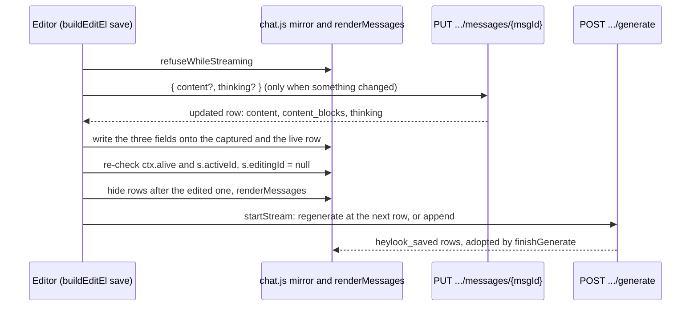

# Chat: the message list and editing

last updated: 2026-11-24

This page maps the chat thread once its rows are on screen: how `renderMessages` turns `s.messages` into DOM, what one row is made of, how the list scrolls, and every action on a message that already exists (Copy, Edit and its three saves, the editor's prompt preview, Regenerate, Delete), down to the two server routes those actions write through. It starts where a conversation's rows have arrived (`selectConversation`, in [chat-documents.md](chat-documents.md)). It stops at `startStream` for anything that generates ([chat-generation.md](chat-generation.md)), at `addFiles` for anything staged into an editor ([chat-attachments.md](chat-attachments.md)), and at the composer. It sits below [frontend_core.md](../frontend_core.md) and does not repeat it. The rules this area obeys are in [.claude/rules/frontend.md](../../../.claude/rules/frontend.md); the history is in [sharp_edges.md](../../architecture/sharp_edges.md) "Frontend".

## Files and what each owns

| File | What this area uses from it |
|---|---|
| `frontend/js/pages/chat.js` | `renderMessages`, `msgKey`, `msgSignature`, `blockFingerprint`, `reconcileChildren`, `carryEditorDraft`, `buildMessageEl`, `buildThinkingEl`, `formatStats`, `buildActions`, `buildEditEl` (with its inner `cancel`, `save`, preview handler, `growCap`, `thinkCap`), `editedContentBlocks`, `encodeMediaEntry`, `renderMediaStrip` (shared with the composer), `hasBlocks`, `hasMediaBlocks`, `blockSourceUrl`, `scrollMessages`, `followingTail`, `pinToTail`, `keepRowInView`, `regenerate`, `deleteMessage`, `mergeServerRows`, `refuseWhileStreaming`, `showStatus`, the constant `STICK_SLACK_PX` |
| `frontend/js/markdown.js` | `renderMarkdown` (assistant content only), `escapeHtml` |
| `frontend/js/utils.js` | `createEl`, `autoGrow`, `armedConfirm` (Delete's two-tap arm), `setStatus`, `formatTokens`, `causeWords` |
| `frontend/js/api.js` | `ROUTES` entries `updateMessage`, `deleteMessage`, `previewPrompt`, `getConversation`; `request` and `httpError` (an error's `message` is the envelope's `error.message`, else FastAPI's `detail`) |
| `frontend/js/prompt-preview.js` | `paintPromptPreview`, `paintPromptPreviewError`, `highlightSpecials` |
| `frontend/js/image-prep.js` | `blobToBase64`, which `encodeMediaEntry` calls for media attached in an editor |
| `frontend/js/hotkeys.js` | `registerPageHotkeys`: what Escape and Cmd/Ctrl+Enter do while focus is in an edit box |
| `frontend/css/app.css` | `.chat__messages`, `.chat__messages-inner`, `.message`, `.message--user`, `.message--assistant`, `.message-bubble`, `.message-content`, `.message-images`, `.message-image`, `.message-audio-list`, `.message-audio`, `.message-drop-note`, `.message-model-note`, `.message-stats`, `.thinking`, `.thinking__body`, `.thinking__end`, `.message__actions`, `.message-edit`, `.message-edit__buttons`, `.message-edit__label`, `.message-edit__thinking`, `.prompt-preview`, the `@supports (field-sizing: content)` block, the `(hover: none)` and `(pointer: coarse)` blocks |
| `src/heylook_llm/conversation_api.py` | `update_message` (PUT), `delete_message` (DELETE), `_refuse_while_generating`, `get_media` (serves the url sources images and audio render from) |
| `src/heylook_llm/db.py` | `update_message`, `delete_message`, `_updatable`, `_UPDATABLE_MESSAGE_FIELDS`, `normalize_blocks`, `flatten_blocks`, `_externalize_media`, `_gc_orphans`, `_touch_conversation` |
| `src/heylook_llm/conversation_generate_api.py` | as relied on: `GenerationInProgress` and its handler (the 409 envelope), `preview_prompt` and `PromptPreviewRequest`/`PromptPreviewResponse`, the mode anchoring in the generate route, `_persist_result` |

## State

| Name | Where it lives | Written by | Read by | Reset when |
|---|---|---|---|---|
| `s.messages` | page state (`ctx.state`), the mirror of the stored rows in position order | `selectConversation` (fetched rows); `send` (its user row); editor `save` (writes `content`, `content_blocks`, `thinking` onto the saved row in place, and filters the tail for Save & Regenerate and Save & Continue); `regenerate` and `deleteMessage` (filter); `mergeServerRows` and `adoptSavedRows` (assign); `deleteConversation` | `renderMessages`; `save` and the editor preview (`nextMsg`, the live row); `switchWarnings`; `paintReadout` | replaced on every conversation select; emptied when the open conversation is deleted or fails to load |
| `s.msgNodes` | page state: `Map` of message id to `{ node, sig }` | `renderMessages` (a new Map every pass); `selectConversation` (a new empty Map) | `renderMessages` (as `prev`); `keepRowInView` | every conversation select; any render with no conversation open |
| `s.editingId` | page state: the id of the one row shown as an editor, or null | setup (null); the Edit handler in `buildActions` (the row's id); editor `cancel` (null); editor `save` once past its PUT (null); `selectConversation` (null) | `renderMessages`; `mergeServerRows` | conversation select, Cancel, a Save that got past its PUT. Not on a failed Save. Not when the last conversation is deleted (stale id, matches no row) |
| `s.pinnedTop` | page state: the `scrollTop` the last tail pin landed on | `scrollMessages`, `pinToTail` | `followingTail` | never cleared; the forced scroll after the next select overwrites it |
| `s.stream` (read here) | page state, owned by [chat-generation.md](chat-generation.md) | `startStream`, `releaseStream` | `renderMessages` (`targetConvId`, `continueMsg.id`, `els.msgEl`); `refuseWhileStreaming` | |
| `s.loadingId`, `s.remoteGenerating` (read here) | page state | `selectConversation`; `setRemoteGenerating` | `refuseWhileStreaming` | |
| `s.activeId` (read here) | page state, owned by [chat-documents.md](chat-documents.md) | `selectConversation`, `send`, `deleteConversation` | every flow here, captured as `convId` before its first await | |
| `s.models`, `s.modelSelect.value`, `s.adminRows` (read here) | page state, owned by [chat-model-and-settings.md](chat-model-and-settings.md) | residency and model-switch code | `renderMessages` (caps key, provider), `buildMessageEl` (drop note), `buildEditEl` (Attach, Save & Continue, preview overrides) | |
| `editMedia`, `mediaDirty`, the editor's textareas, `previewHost` | the closure of one `buildEditEl` call; `editMedia` is also on the editor's root node as `__editMedia`, beside the `__adoptMedia` hand-off function | `buildEditEl`; a strip remove (`renderMediaStrip`'s `drop`); `editTarget.render`; `__adoptMedia` | `save`, the preview handler, `cancel`, `carryEditorDraft` | they die with the editor node |
| status line text | DOM, `s.statusEl` (`.chat__status`, `role="status"`) | `showStatus`, which calls `utils.js` `setStatus` (sets `textContent`, and `color: var(--danger)` for an error) | the user and assistive tech | the next `showStatus` from anywhere |

Nothing in this area reads or writes browser storage. Copy writes to the system clipboard.

## Entry points

| What the user or browser does | Handler (file and function) | Flow below |
|---|---|---|
| Anything that changes rows, the open editor, the model or residency | `chat.js` `renderMessages`, from its callers (listed in the first flow) | Rendering the list |
| Click Copy on a row | `chat.js` `buildActions`, the Copy button | Copy |
| Click Edit on a row | `chat.js` `buildActions`, the Edit button | Open the editor |
| Type in an edit box | `buildEditEl`, the `input` listeners calling `utils.js` `autoGrow` | Editor anatomy, sizing and focus |
| Click Attach in an editor, pick files | `buildEditEl`, `editAttachBtn` then `editFileInput`'s `change` calling `addFiles(ctx, files, editTarget)` | Editor anatomy (staging itself: [chat-attachments.md](chat-attachments.md)) |
| Click the × on an editor thumbnail | `renderMediaStrip`, `drop` calling the editor's `onChange` | Editor anatomy |
| Residency lands, or a model switch commits, with an editor open | `refreshLoadedIds` or `commitModelSwitch` calling `renderMessages` | Carrying an open editor across a rebuild |
| Click Cancel | `buildEditEl` `cancel` | Cancel |
| Click Save | `buildEditEl` `save(false)` | Save |
| Click Save & Regenerate (user rows) | `buildEditEl` `save(true)` | Save & Regenerate |
| Click Save & Continue | `buildEditEl` `save(false, true)` | Save & Continue |
| Click Preview prompt in an editor; Close on its panel | `buildEditEl`, the `previewBtn` listener; `close` | The editor's prompt preview |
| Click Regenerate (assistant rows) | `chat.js` `regenerate` | Regenerate |
| Click Delete, then Confirm? | `utils.js` `armedConfirm` wrapping the button, then `chat.js` `deleteMessage` | Delete |
| Click a Thinking summary | native `
` toggle, no handler | Row anatomy |
| A resync or resume lands with an editor open | `resyncMessages` or `refreshAfterResume` calling `mergeServerRows` | A resync under an open editor |
| A streaming paint tick | `paintStream` (through `s.paint`) calling `followingTail` then `pinToTail` | Scrolling |
| Escape with focus in an edit box | `hotkeys.js` `registerPageHotkeys` calling chat's `onEscape` | Open the editor (keyboard note) |
| Cmd/Ctrl+Enter with focus in an edit box | `registerPageHotkeys` calling chat's `onSubmit`, which returns at once | Open the editor (keyboard note) |

## Flows

### Rendering the list (`renderMessages`)

Trigger. Called from: setup (no conversations and the list fetch did not fail); `refreshLoadedIds` (when a conversation is open); `commitModelSwitch`; `deleteConversation` (when no conversation remains); `selectConversation` (on success and on failure); the Edit handler; editor `cancel`; editor `save` (each of its three endings); `mergeServerRows`; `regenerate`; `deleteMessage`; `send`; `startStream`; `finishGenerate` (when `heylook_saved` carried rows); `handleStreamError`. It is the only code that adds, removes or moves list nodes (the invariant in the `chat.js` header comment).

Guards. None refuse. With no `s.activeId` it renders the empty state instead of rows.

Steps.

1. No `s.activeId`: `s.msgNodes` becomes an empty Map, `s.messagesInner` gets one `.empty-state` reading `Send a message below to start a new conversation.`, `paintReadout(ctx)` runs, and it returns. With a conversation open and no rows, the list is simply empty.
2. `prev = s.msgNodes`; a new Map `next` starts.
3. Once per pass: `capsKey = currentCaps(ctx).join('|')`; `provider = s.adminRows.get(s.modelSelect.value)?.provider ?? '?'` (`'?'` until the residency fetch lands); `mixedModels` is true when the rows carry more than one distinct `model_id`.
4. The live stream is `s.stream` only when `s.stream.targetConvId === s.activeId`. `continued` is that stream's `continueMsg.id` when it is a continuation.
5. For each row of `s.messages`, skipping the `continued` row:
   1. `key = msgKey(msg)`, which is `msg.id`. Every row comes from the server with an id.
   2. `editing = s.editingId != null && msg.id === s.editingId`.
   3. `modelNote = mixedModels && msg.model_id ? msg.model_id : ''`.
   4. `sig = msgSignature(msg, { editing, capsKey, provider, modelNote })`: the fields `role`, `position`, `edit:<provider>` or `view`, `capsKey` only when `hasMediaBlocks(msg)`, `modelNote`, `thinking`, `content`, `JSON.stringify(stats)`, and each content block's `blockFingerprint` (type, plus url or media type and data length; never the bytes), joined with NUL so one field's tail cannot read as the next field's head.
   5. If `prev.get(key).sig === sig`, the cached node is reused untouched. Otherwise a new node is built: `buildEditEl(ctx, msg)` when editing, else `buildMessageEl(ctx, msg, modelNote)`. When the new node is an editor and a cached node existed, `carryEditorDraft(cached.node, node)` runs.
   6. `next.set(key, { node, sig })`.
6. The live stream's `els.msgEl` is pushed last. It is not keyed and is never in `s.msgNodes`.
7. `s.msgNodes = next`; `reconcileChildren(s.messagesInner, nodes)`; `paintReadout(ctx)` (the phone readout, which reads the last assistant row's stats: [chat-model-and-settings.md](chat-model-and-settings.md)).

`reconcileChildren(parent, nodes)` first removes every child that is not in `nodes` (including a stale `.empty-state`), then walks `nodes` and calls `insertBefore` for each one not already at its index. Removing first is deliberate: placing first walks a stale node down the list and detaches everything after it (the comment at `reconcileChildren`).

What is not in the signature, so does not rebuild a row: the id (it is the key), `updated_at`, `model_id` while the thread is single-model, the model's caps for a row without media, the provider for a view row. Two consequences:

- A reused node's button closures hold the row object the node was built from. A resync replaces every row object, so after one the closures can hold an older object than `s.messages` does. Equal signatures mean the fields the handlers read (`id`, `position`, `role`, `content`) are equal. The editor's `save` looks the live row up for this reason.
- DOM state lives on the node: a `
` the reader opened or closed, an armed Delete, focus. A rebuilt row comes back at its defaults.

How a live stream's row is carried. `startStream` builds the stream node and calls `renderMessages` ([chat-generation.md](chat-generation.md)). Every pass while the stream targets the open conversation pushes that node at the end; for a continuation the anchor's own row is left out, so the stream node stands in for it. `releaseStream` removes `message--streaming` from the node on every ending. The first pass after `s.stream` is null drops it through `reconcileChildren`, and in `finishGenerate` that same pass inserts the saved rows, so there is no frame with the reply missing.

Ends when. `s.messagesInner` holds exactly the nodes for `s.messages` (minus a continuation anchor) plus any live stream node, in that order.

Failure paths. None of its own. A builder that throws leaves the list as the previous pass left it and propagates to the caller.

Awaits. None. It is synchronous.

### Row anatomy (`buildMessageEl`)

Trigger. `renderMessages`, when a view row's signature moved or the row is new.

Guards. None.

Steps. The row is `div.message.message--<role>`, children in this order:

1. Thinking: only for an assistant row with `msg.thinking`. `buildThinkingEl(msg.thinking, !msg.content)` returns `details.thinking`, open when the row has no content (so a reply that spent its budget thinking is not an empty bubble), with `summary` text `Thinking` and a `div.thinking__body` holding the text as a text node. A saved row never gets the `End thinking` button; only the live stream passes `onEndThinking`.
2. `div.message-bubble`, holding in order: `div.message-images` with one `img.message-image` per image block (`src` from `blockSourceUrl`, `alt` `attached image`, `decoding` async, deliberately no `loading="lazy"`); `div.message-audio-list` with one `audio.message-audio` per audio block (`controls`, `aria-label` `attached audio`); `div.message-content`. An assistant row's content is `innerHTML = renderMarkdown(msg.content)`; every other role gets `textContent`, so user text is never parsed as markdown.
3. Drop note, `div.message-drop-note.muted.small`, when the row holds images and the current model lacks `vision`, or audio and it lacks `audio`: `${dropped.join(' and ')} not sent to this model`, each item spelled `N image`/`N images` or `N audio clip`/`N audio clips`. The server drops the same media at the wire; this line is the disclosure ([sharp_edges.md, model switching](../../architecture/sharp_edges.md#model-switching-and-the-config-editor)).
4. Model note, `div.message-model-note.muted.small`, holding the row's `model_id`, only while the thread mixes models.
5. Stats, `div.message-stats.muted.small`, for an assistant row with `stats`: `formatStats` joins, with ` · `, whichever of these the stats carry (angle-bracket placeholders below are this page's shorthand; the exact template literals are in `formatStats`): `${stats.output_tokens} tokens`; `${stats.generation_tps.toFixed(1)} tok/s`; the cache part (`cache <cached>/<prompt>` with ` (<cause words>)` when reused, else `cache miss` or `cache not used` with `: <cause words>`, counts through `formatTokens`, causes through `causeWords`); the draft part (`draft <pct>% (<accepted>/<drafted>)`, or `<pct>% from draft (<accepted>/<emitted>)`); `${stats.peak_memory_gb.toFixed(1)} GB peak`.
6. `div.message__actions` from `buildActions`: `Copy` (only when `msg.content` is non-empty), `Edit`, `Regenerate` (assistant rows only), `Delete` (wrapped by `armedConfirm`). All are `btn btn--sm btn--ghost`.

`renderMarkdown(text)` is `DOMPurify.sanitize(marked.parse(text ?? ''))`, falling back to `escapeHtml(text)` if either throws. Raw HTML in the text is escaped by the `html` renderer, and link and image URLs are scheme-checked after one entity decode; [frontend_core.md](../frontend_core.md) section 5 has the detail.

What the CSS does with a row:

- `.message` spaces rows; `.message--user` is a right-aligned flex column.
- `.message-bubble` is capped in width (wider inside the phone breakpoint), on `--surface`, with `white-space: pre-wrap` so user newlines show. `.message--assistant .message-bubble` drops the cap, the background and the padding, and wraps normally.
- `.message-content pre` scrolls sideways. Nothing styles a table or an image inside `.message-content` (FB-05).
- `.message-image` is capped by `max-width` and `max-height`, `.message-audio` by `max-width`, both in `app.css`.
- `.thinking` is a bordered, muted, small-text box; its summary is a flex row with the native marker hidden; `.thinking__body` keeps line breaks.
- `.message__actions` is `visibility: hidden` (it keeps its space, so nothing shifts) and becomes visible on `.message:hover`, on `:focus-within`, and while it holds an armed button (`:has(.btn--armed)`). Under `(hover: none)` it is always visible, and each `.btn--sm` in it gets an invisible `::after` box reaching `--ctrl-h-touch` above and below without growing the button.
- `.message--streaming .message-content::after` is the caret on the live row ([chat-generation.md](chat-generation.md)).
- There is no `content-visibility` on rows, on purpose: the comment above `.message--user` in `app.css` and [sharp_edges.md, incremental streaming render](../../architecture/sharp_edges.md#incremental-streaming-render).

Ends when. The node is returned to `renderMessages`, which places it.

Failure paths and awaits. None.

### Scrolling

Trigger. The callers named below. There is no scroll, resize, focus or viewport listener in the page.

Guards. `scrollMessages` without `force` returns when `followingTail` is false.

Steps, per function:

1. `scrollMessages(ctx, force)`, the structural scroll (a row was added, removed or rebuilt): unless `force`, return when `followingTail(ctx)` is false; set `s.messagesEl.scrollTop = scrollHeight`; store the landed value in `s.pinnedTop`. One write, no second frame. Forced callers: `selectConversation` (after its render), `regenerate`, `send`, `startStream`. Unforced: `finishGenerate`, after it adopts the saved rows.
2. `followingTail(ctx)`: true when `s.pinnedTop` is set and `scrollTop` still equals it within the tolerance literal in `followingTail` (growth and a viewport resize move `scrollHeight` and `clientHeight`; only the reader moves `scrollTop`). Otherwise true when `scrollHeight - scrollTop - clientHeight` is under `STICK_SLACK_PX`. Callers: `scrollMessages` (unforced) and `paintStream`, which calls it before it mutates the live row.
3. `pinToTail(ctx)`: the same write as `scrollMessages`, without the check, also storing `s.pinnedTop`. Only `paintStream` calls it, and only when its pre-mutation `followingTail` read was true.
4. `keepRowInView(ctx, msg)`: after an editor closes. It looks the row's node up in `s.msgNodes` by `msgKey(msg)` at call time and calls `scrollIntoView({ block: 'nearest' })`, once on the next animation frame and once from a timer set in `keepRowInView`; each run checks `ctx.alive`. `nearest` never moves a row that is already fully visible. Callers: editor `cancel` and plain Save.

Not followed by any scroll: opening the editor (only the browser's own focus scroll from `textarea.focus()`), `deleteMessage`, `mergeServerRows`, `commitModelSwitch`, `handleStreamError`. Save & Regenerate and Save & Continue get the forced scroll inside `startStream`.

CSS: `.chat__messages` is the scroller (`overflow-y: auto`) and carries `overflow-anchor: none`, and `html, #main, textarea` carry it too, so `chat.js` is the only thing that moves `scrollTop` ([sharp_edges.md, scroll anchoring](../../architecture/sharp_edges.md#scroll-anchoring)). Why the measurement happens before the paint and why there is no cached flag: [sharp_edges.md, incremental streaming render](../../architecture/sharp_edges.md#incremental-streaming-render) and [frontend_core.md](../frontend_core.md) section 4.3.

Ends when. The write is made, or skipped.

Failure paths. None. `keepRowInView` does nothing if the row is no longer in `s.msgNodes`.

Awaits. None; `keepRowInView`'s frame and timer re-check `ctx.alive` and re-read `s.msgNodes`.

### Copy

Trigger. Click Copy.

Guards. The button exists only when `msg.content` is non-empty (an image-only row has none).

Steps.

1. `navigator.clipboard?.writeText(msg.content).catch(() => {})`. `msg.content` is the server's flattened text (`db.flatten_blocks`: the text blocks joined by newlines), so an assistant row copies its markdown source, not the rendered text, and never its thinking.

Ends when. The promise settles. Nothing on screen changes (FB-11).

Failure paths. A rejected write is swallowed. Without `navigator.clipboard` (a page not served over HTTPS or loopback) the optional chain short-circuits and nothing happens.

Awaits. None the page waits on.

### Open the editor (Edit)

Trigger. Click Edit.

Guards. `refuseWhileStreaming(ctx)`, which checks in this order and shows one line:

- `s.loadingId` set: `This conversation is still loading — try again in a moment.`
- no `s.stream` and `s.remoteGenerating`: `This conversation is still generating on the server — press Stop, or wait for it to finish.`
- `s.stream` set: `A response is still streaming — wait for it to finish, or press Stop.`

Nothing checks for an editor already open on another row.

Steps.

1. `s.editingId = msg.id`.
2. `renderMessages(ctx)`. This row's signature moves from `view` to `edit:<provider>`, so `buildEditEl(ctx, row)` builds the editor from the row object now in `s.messages`. The `carryEditorDraft` call that follows is a no-op, because a view row has no textarea. Any other row that was an editor goes back to a view row through `buildMessageEl` with no carry: its typed text is dropped, and the object URLs of media staged in it are never revoked.
3. `reconcileChildren` puts the editor where the view row was.
4. On the next animation frame (`requestAnimationFrame` inside `buildEditEl`): `autoGrow(thinkArea, thinkCap())` when there is a thinking box, `autoGrow(textarea, growCap())`, then `textarea.focus()`.

Ends when. The editor is on screen with the response box focused.

Failure paths. Only the refusals above.

Awaits. None. The frame callback does not re-check `ctx.alive`; it touches only the editor's own nodes.

Keyboard inside an edit box: Enter is a newline (no handler). Cmd/Ctrl+Enter is prevented by `registerPageHotkeys` and chat's `onSubmit` returns, because focus is in a field other than the composer. Escape does not cancel the editor: it reaches chat's `onEscape`, which stops a local stream, else stops a remote run, else closes the engine panel, else closes the composer's preview.

### Editor anatomy, sizing and focus (`buildEditEl`)

Trigger. `renderMessages`, for the row whose id is `s.editingId`, when its signature moved.

Guards. None. What it offers depends on the row and the model at build time.

Steps (what it builds, in DOM order):

1. Root `div.message.message--<role>` holding `div.message-edit`. An editor row has no `.message__actions`.
2. When the row is an assistant row with `msg.thinking`: a caption `div.message-edit__label` reading `Thinking`, the thinking box (`textarea.message-edit__thinking`, `aria-label` `Edit thinking`, seeded with `msg.thinking`), and a caption reading `Response`. A row without thinking gets no thinking box, so the editor cannot add thinking.
3. The response box (`textarea`, `aria-label` `Edit message`, seeded with `msg.content`, the saved text).
4. The media strip, `div.chat__attach.message-edit__attach`, hidden while empty. `editMedia` starts as `{ image, audio }` lists of `{ kept: <stored block> }` entries taken from `msg.content_blocks`, so a save sends the stored blocks back verbatim ([sharp_edges.md, kept media](../../architecture/sharp_edges.md#a-send-belongs-to-the-conversation-it-was-sent-from)). It is painted by `renderMediaStrip(editStrip, editMedia, onChange)` with no `onFit`, and nothing prices editor media, so editor thumbnails carry no cost badge and no Fit. A kept entry renders from its stored url; a newly staged one from its object URL. The × on a thumb (`Remove image ${i + 1}`, `Remove audio ${clip.name || i + 1}`) splices it out, revokes a staged entry's object URL, sets `mediaDirty` and repaints. The first paint does not set `mediaDirty`.
5. When the model takes media for this role, a hidden `input[type=file]` and an `Attach` button. Offered when `currentCaps(ctx)` includes `vision` or `audio` and the row is a user row or `currentProvider(ctx)` is not `mlx` (mlx-vlm puts media markers on user turns only). The input's `accept` and the button's `title`/`aria-label` (`Attach images or audio`, `Attach audio`, `Attach images`) follow the same caps. A pick calls `addFiles(ctx, files, editTarget)`, where `editTarget` is `{ role: msg.role, list: (kind) => editMedia[kind.key], render: () => { mediaDirty = true; repaintEditStrip(); } }`, then clears the input's value so the same file can be picked again. Staging itself (cap gate, the MLX role refusal, the count cap, the orphan check) is `addPendingFiles`, in [chat-attachments.md](chat-attachments.md).
6. `div.message-edit__buttons`, in this order: `Preview prompt` (ghost), `Cancel`, `Save` (primary), `Attach` (ghost, when offered), `Save & Regenerate` (primary, user rows only), `Save & Continue` (primary). The Preview prompt and Save & Continue blocks are guarded by `if (msg.id)`, which is always true now.
7. The preview host, `div.prompt-preview.message-edit__preview`, hidden.
8. The hand-off points for a rebuild: `el.__editMedia = editMedia` and `el.__adoptMedia(prev)`.

Save & Continue's state is decided here from `s.adminRows.get(s.modelSelect.value)?.provider`. For an assistant row it is always enabled. For a user row it is disabled, with the reason as its `title` only (FB-10): `Checking what this model supports…` while the provider is unknown, and `Continuing your own message is not supported on ${s.modelSelect.value} — that needs an MLX model.` on gguf. Enabled, its title is `Save, drop everything after, and let the model finish this message` and it gets its click listener; disabled, it gets none.

Only the Attach button stages into an editor. A paste aimed at an edit box is left alone by `wirePasteAttach` (it ignores any editable other than the composer), and a drop on the thread goes to the composer through `addFiles`'s default target.

Sizing. Both boxes call `utils.js` `autoGrow` on every `input`, with `growCap()` for the response box and `thinkCap()` for the thinking box. Each cap is the larger of a floor and a share of `window.innerHeight`; the literals are in `growCap` and `thinkCap` inside `buildEditEl`, and the thinking cap is the smaller. `autoGrow` returns at once where `CSS.supports('field-sizing', 'content')` is true, and the `@supports (field-sizing: content)` block in `app.css` then does the sizing: `field-sizing: content` on both boxes, `.message-edit textarea` capped with growCap's expression in `dvh`, `.message-edit__thinking` capped with thinkCap's. Where it is false, `autoGrow` sets `style.height` to the smaller of `scrollHeight` and the cap. Past its cap a box scrolls inside itself. Outside the `@supports` block, `.message-edit textarea` gives both boxes full width, a minimum height and `resize: vertical`. Under `(pointer: coarse)` `.message-edit textarea` gets a font-size floor that stops iOS zooming on focus, and under `(hover: none)` the editor's buttons get the full touch height. The cap follows the layout viewport, which a software keyboard does not shrink (FB-04).

A specificity catch in those rules: `.message-edit textarea` (a class and a type) outranks `.message-edit__thinking` (a class), and the thinking box is a textarea inside `.message-edit`. So the thinking box's own `min-height`, and inside the `@supports` block its own `max-height`, never apply; it takes the response box's values. The CSS comment beside `.message-edit__thinking` notes the outranking for its size. This was read from the rules, not rendered.

Focus. Only the response box is focused, once, on the frame after the build.

Ends when. The node is returned to `renderMessages`.

Failure paths. None here; staging failures belong to `addPendingFiles`.

Awaits. None in the build. The handlers are below.

### Carrying an open editor across a rebuild (`carryEditorDraft`)

Trigger. `renderMessages` rebuilds the open editor because its signature moved: the residency fetch landing (`provider` goes from `'?'` to a real one; `refreshLoadedIds` re-renders for exactly this), a model switch to another provider, a media row whose model caps changed, or a resync whose row differs (content, thinking, stats, position, model note).

Guards. It returns without doing anything when the old node has no textareas or the two nodes have different textarea counts. The counts differ when the row gained or lost thinking in between, and then nothing is carried: the new editor shows the saved text, and anything staged in the old one is neither moved nor revoked.

Steps.

1. Pairwise, old box to new box: `value`, `selectionStart`, `selectionEnd`.
2. When the old node has `__editMedia` and the new one `__adoptMedia`: `to.__adoptMedia(from.__editMedia)`. The new editor takes the `image` and `audio` lists, the old object's lists are replaced with empty ones (so the old editor's `cancel`, which closes over that object, cannot revoke URLs the new editor renders from), the new editor's `mediaDirty` is set to true, and its strip repaints. Then `from.__editMedia = null`.
3. On the next frame the new editor's own `requestAnimationFrame` sizes both boxes to the carried text and focuses the response box, which moves focus away from a thinking box that was being typed in.

Because `__adoptMedia` sets `mediaDirty` on every hand-off, the next Save sends `content` even when nothing was changed.

Ends when. The new editor holds the old one's text, carets and media.

Failure paths. None raised. The draft wins over newer text from another device without a word (FB-09).

Awaits. None.

### Cancel

Trigger. Click Cancel.

Guards. None.

Steps.

1. For every entry in `editMedia.image` and `editMedia.audio` with a `previewUrl` (only newly staged entries have one), `URL.revokeObjectURL`.
2. `s.editingId = null`.
3. `renderMessages(ctx)`: the row's signature moves back to `view` and `buildMessageEl` rebuilds it from the row in `s.messages`, which holds the saved text.
4. `keepRowInView(ctx, msg)`.

Ends when. The row is a view row again, nudged into view.

Failure paths. None. For an orphan editor (a row deleted elsewhere and kept by `mergeServerRows`), the local row is still in `s.messages`, so Cancel turns it into an ordinary view row of a message the server no longer has; it stays until the next resync or select, and its actions then 404.

Awaits. None.

### Save

Trigger. Click Save: `save(false)`.

Guards. None on the client for a plain Save. A write while a generation claim is held for this conversation is refused by the server with 409 (below). Edit is refused while a reply streams, but an editor opened before a reply started stays open (a Send from the composer does not close it), so this case is reachable. There is no in-flight guard: the buttons stay enabled while the PUT is out, and a second press sends a second PUT.

Steps.

1. `convId = s.activeId`, captured before any await.
2. `next = textarea.value`; `changes = {}`.
3. When `next !== msg.content` or `mediaDirty`: `changes.content` is `await editedContentBlocks(msg.content_blocks, next, editMedia.image, editMedia.audio)` when the editor holds any media, else the string `next`. Removing the last attachment therefore sends a string, and the blob loses its last reference. `editedContentBlocks` walks the stored blocks in order: the first text block becomes the edited text (dropped when the text is empty) and later text blocks are dropped; each media block is kept while a kept entry with the same `blockFingerprint` remains (counted, so identical twins are each kept once); then newly staged entries are appended, base64-encoded by `encodeMediaEntry` through `blobToBase64`; a text block is appended last when the row had none. This await sits before the `try`.
4. When there is a thinking box and its value differs from `msg.thinking`: `changes.thinking = thinkArea.value || null` (empty clears the column rather than storing an empty string).
5. Inside the `try`, when `changes` is non-empty: `updated = await api.updateMessage(convId, msg.id, changes)`, a `PUT /v1/conversations/{convId}/messages/{msg.id}`. Then `if (!ctx.alive) return`. Then `updated.content`, `updated.content_blocks` and `updated.thinking` are written onto the captured `msg` and onto the row with that id now in `s.messages`, when that is a different object (a resync between opening and saving replaces row objects).
6. `if (s.activeId !== convId) return`: the edit is saved and nothing else happens. `selectConversation` already cleared `s.editingId`.
7. `s.editingId = null`.
8. `renderMessages(ctx)`: the row is rebuilt as a view row (its signature moved from `edit:` to `view`, and its content if it changed).
9. `keepRowInView(ctx, msg)`.

With nothing changed, the PUT in step 5 is skipped: no request goes out and the editor just closes.

Ends when. The row shows the saved text. The status line is not written on success, so an earlier `Save failed: …` stays on screen after a successful retry.

Failure paths.

- The PUT rejects (409, 404, 400, network): `Save failed: ${err.message}` in the error colour, then `resyncMessages(ctx, convId)` without waiting. `s.editingId` is not cleared, so the editor stays open with its text. The 409 reads `Save failed: A reply is still being generated in this conversation. Wait for it to finish, or stop it first.` A 404 reads `Save failed: Message not found`, and the resync that follows replaces it with `mergeServerRows`'s orphan line (below).
- `editedContentBlocks` rejects (a `FileReader` error in `blobToBase64` for newly attached media): the await is outside the `try`, so nothing is caught, no status is shown, and the click handler drops the rejected promise.

Awaits and what is re-checked after each.

- After `editedContentBlocks`: nothing. `convId` was captured before it; `s.activeId` is read later.
- After the PUT: `ctx.alive`, then `s.activeId === convId`. Not re-checked: `s.stream` and `s.editingId`. An editor opened on another row during the PUT is closed by step 7 without a carry.

### Save & Regenerate

Trigger. Click Save & Regenerate, offered on user rows only: `save(true)`.

Guards. `refuseWhileStreaming(ctx)`, the three lines listed under Open the editor, before anything else.

Steps.

1. Steps 1 to 7 of Save (capture, build `changes`, the PUT when there are changes, the two re-checks, `s.editingId = null`).
2. `nextMsg` is the first row in `s.messages` whose `position` is greater than the edited row's.
3. The mirror hides the tail: `s.messages` keeps only rows at or before the edited row's position. Nothing is deleted on the client or the server yet.
4. `renderMessages(ctx)`: the edited row as a view row, the rows after it gone from view.
5. `startStream(ctx, nextMsg ? { mode: 'regenerate', messageId: nextMsg.id } : { mode: 'append' })`. From here the flow belongs to [chat-generation.md](chat-generation.md): `startStream` returns silently if `s.stream` is set or no conversation is open; otherwise it appends the stream node, scrolls with `force`, flushes the pending params and prompt writes, then sends `POST /v1/conversations/{id}/generate` with `{ mode, message_id, overrides }` and adopts the `heylook_saved` rows at the end.

What the server truncates (the generate route in `conversation_generate_api.py`, as relied on). Regenerate anchored at `nextMsg`: the prompt is every stored row before it, which ends with the edited row, and the commit deletes rows at `nextMsg`'s position and after, in the same transaction that appends the new reply (`_persist_result`, `db.replace_tail_with_message`). Append with no `user_content`: the prompt is every stored row and nothing is deleted. A generation that produces no text and no thinking commits nothing, so the thread is untouched and the end-of-stream resync brings the hidden rows back. The edit itself is already saved by the PUT whatever the generation does.

Ends when. `startStream` has taken over (or returned silently).

Failure paths. As for Save: a failed PUT shows `Save failed: ${err.message}`, resyncs, leaves the editor open and starts no stream. A failure inside `startStream` or the generation is [chat-generation.md](chat-generation.md)'s.

Awaits and re-checks. As for Save. `s.stream` is not re-checked after the PUT: a reply started from the composer while the PUT is out makes step 5 a silent no-op, after step 3 has already hidden the tail.

### Save & Continue

Trigger. Click Save & Continue, enabled for assistant rows and, on an MLX model, for user rows: `save(false, true)`.

Guards. `refuseWhileStreaming(ctx)`. For a user row, the button itself is disabled (no listener) while the provider is unknown or is gguf.

Steps.

1. Steps 1 to 7 of Save.
2. The mirror keeps only rows at or before the edited row's position.
3. `renderMessages(ctx)`: the edited row as a view row, the tail gone from view.
4. `startStream(ctx, { mode: 'continue', messageId: msg.id, continueMsg: msg })`. `msg` is the captured row, which step 5 of Save updated from the PUT response, so the stream node is seeded with the saved text and thinking. On the next `renderMessages` inside `startStream` the anchor's own row is left out and the stream node takes its place.

What the server does. Continue anchored at the edited row: the prompt is the stored rows up to and including it, with the anchor rendered as an unfinished turn; the commit deletes rows after it and writes the stored text plus the continuation back onto the same row, with thinking joined the same way (`_persist_result`, `db.replace_tail_with_update`). The row keeps its original model stamp. A run that produces nothing commits nothing.

Ends when. `startStream` has taken over.

Failure paths and awaits. As for Save & Regenerate.

### The editor's prompt preview

Trigger. Click Preview prompt in an editor.

Guards. None. The server refuses a model that is not loaded (409).

Steps.

1. Build `edits`: `message_id` is the row's id; `content` is `await editedContentBlocks(...)` when the editor holds media, else the response box's text; `thinking` is the thinking box's value or null, when there is a thinking box. These are the unsaved boxes as they are now.
2. `nextMsg` as in Save & Regenerate. The shape is `{ mode: 'continue', message_id: msg.id }` for an assistant row (what Save & Continue would send); for a user row it is `{ mode: 'regenerate', message_id: nextMsg.id }`, or `{ mode: 'append' }` when the row is last (what Save & Regenerate would send).
3. `body = await api.previewPrompt(s.activeId, { ...shape, edits, overrides: { model: s.modelSelect.value, ...samplerParams(currentModel(ctx)) } })`, a `POST /v1/conversations/{id}/prompt`. Nothing is saved.
4. `if (!ctx.alive) return`; `paintPromptPreview(previewHost, body, close)`.

`paintPromptPreview` fills the host with a head (`What the model will see`; a line `${body.model_id} · ${body.provider} · ${body.char_count.toLocaleString()} chars · ${what}`, where `what` is `Resumes inside the open thinking block` for `continuation: 'thinking'`, `Continues the response after the closed thinking block` for `'content'`, else `The next reply generates after this`; a `Close` button), a note when `unrendered_media` counts anything (`${missing.join(' and ')} will be sent but cannot be shown here — ` followed by `MLX renders the text template only` when the provider is `mlx`, else `this engine has no text render for media`, then a full stop), a note when `dropped_media` counts anything (`${lost.join(' and ')} not sent — this model cannot read them.`), and `pre.prompt-preview__text` with the model's own markers (`body.markers`) wrapped in `mark.prompt-preview__tok`. It unhides the host. `close` hides and empties it.

Ends when. The panel shows under the editor's buttons, until Close, a rebuild of the editor (the panel is part of the node), or the editor closing.

Failure paths. The request rejects: `paintPromptPreviewError(previewHost, err.message, close)`, a head reading `Prompt preview` with the message in `.error-note` and `Close`. The 409 message is `{model_id} is not loaded -- load it to preview its exact prompt` (`preview_prompt`, which renders resident models only). An `editedContentBlocks` rejection is outside the `try` and is not caught.

Awaits and re-checks. After `editedContentBlocks`: nothing; `s.activeId` and the model select are read after it. After the request: `ctx.alive` only. Unlike the composer's `previewNextPrompt`, there is no check that the conversation or the model is still the one asked about: after a conversation switch the editor node is detached and painting into it is invisible; after a model switch that does not rebuild the editor, the panel describes the previous model (its head names `body.model_id`). `commitModelSwitch`'s `closePromptPreview` closes only the composer's panel.

The panel's CSS: `.prompt-preview` is a bordered box on `--surface`; `.prompt-preview__text` wraps, scrolls inside itself and is height-capped in `vh` (FB-14).

### Regenerate

Trigger. Click Regenerate, offered on assistant rows only.

Guards. `refuseWhileStreaming(ctx)`. Nothing checks `s.editingId`.

Steps.

1. `s.messages` keeps only rows before the clicked row's position: the clicked row and everything after it leave the view. Nothing is deleted on the client.
2. `renderMessages(ctx)`.
3. `scrollMessages(ctx, true)`.
4. `startStream(ctx, { mode: 'regenerate', messageId: msg.id })`, mapped in [chat-generation.md](chat-generation.md).

What the server does. The prompt is every stored row before the anchor; the commit deletes the anchor and everything after it together with appending the new reply. With nothing before the anchor (the row is first, say after its user turn was deleted) the route answers 400 `Cannot regenerate the first message: nothing precedes it`, which reaches the page through the stream's error path ([chat-generation.md](chat-generation.md)), and the resync there brings the hidden rows back.

Ends when. `startStream` has taken over.

Failure paths. The refusals above; everything later is the stream's. An editor open on a row after the clicked one leaves the view in step 1 with its draft, and `s.editingId` keeps pointing at it.

Awaits. None in `regenerate` itself.

### Delete (`deleteMessage`)

Trigger. Click Delete, then click again while it reads `Confirm?`.

Guards.

1. `utils.js` `armedConfirm`: the first click calls `stopPropagation`, adds `btn--armed` and relabels the button `Confirm?` (the CSS keeps the actions row visible while armed); a timer in `armedConfirm` disarms it. A click while armed disarms and runs `deleteMessage(ctx, msg)`. No `target` is passed, so the arm does not re-check anything. The arm lives on the node: a rebuild of the row loses it.
2. `refuseWhileStreaming(ctx)`, the three lines under Open the editor.

Steps.

1. `convId = s.activeId`.
2. `await api.deleteMessage(convId, msg.id)`, a `DELETE /v1/conversations/{convId}/messages/{msg.id}` with no body. The response is not read.
3. `if (!ctx.alive || s.activeId !== convId) return`.
4. `s.messages` drops the row with that id. Later rows keep their positions; gaps are fine by design (the route's own description).
5. `renderMessages(ctx)`: `reconcileChildren` removes the node and moves nothing else. No scroll call follows.

Ends when. The row is gone from the store and the view. Only that row: nothing after it is deleted (the `chat.js` header invariant, v1.73.0).

Failure paths. The DELETE rejects: `Delete failed: ${err.message}` in the error colour (the 409 and 404 messages are those under Save), then `resyncMessages(ctx, convId)` without waiting. The success path writes no status, so a `Delete failed: …` from an earlier attempt stays after a later success.

Awaits and re-checks. After the DELETE: `ctx.alive` and `s.activeId === convId`. `s.stream` is not re-checked, which is harmless here: `renderMessages` carries a live stream's node.

### A resync under an open editor (`mergeServerRows`)

Trigger. `resyncMessages` (after a failed Save or Delete, after a stream ending without saved rows, from the remote-run watch) and `refreshAfterResume` when the conversation body was refetched and no stream is live. Both are mapped elsewhere ([chat-generation.md](chat-generation.md), [chat-documents.md](chat-documents.md)); this is the part that touches the editor.

Guards. `resyncMessages` gives up before merging when `ctx.alive` is false, the conversation moved, or `s.stream` is set.

Steps.

1. If `s.editingId` is set and the server rows have no row with that id, the local row is kept as `orphanEditor` and the line `The message you are editing was deleted elsewhere — your draft is kept until you cancel or save.` is shown in the error colour.
2. `s.messages` becomes the server rows, plus the orphan sorted in by position when there is one.
3. `renderMessages(ctx)`. Unchanged rows keep their nodes. The open editor keeps its node when its signature is unchanged; when the row changed on the server it is rebuilt and `carryEditorDraft` carries the draft over the newer text (FB-09).

Ends when. The mirror matches the store, apart from a kept orphan.

Failure paths. None of its own. A Save on an orphan gets 404, shows `Save failed: Message not found`, resyncs, and lands back in step 1. A Cancel on it leaves a view row (see Cancel).

Awaits. None in `mergeServerRows`.

## Requests this area makes

| When | Method and path | Body | Response fields used | On failure |
|---|---|---|---|---|
| Save, Save & Regenerate, Save & Continue, when something changed | `PUT /v1/conversations/{id}/messages/{msgId}` (`api.updateMessage`) | `content`: a string, or a block list when the editor holds media; `thinking`: a string or null, only when there is a thinking box and it changed. Either key may be absent; an empty `changes` sends no request | `content`, `content_blocks`, `thinking` | `Save failed: ${err.message}`, then `resyncMessages`; editor stays open |
| Delete, after the arm | `DELETE /v1/conversations/{id}/messages/{msgId}` (`api.deleteMessage`) | none | none | `Delete failed: ${err.message}`, then `resyncMessages` |
| Preview prompt in an editor | `POST /v1/conversations/{id}/prompt` (`api.previewPrompt`) | `mode`, `message_id` (absent for append), `edits: { message_id, content, thinking? }`, `overrides: { model, ...samplerParams }` | `prompt`, `markers`, `model_id`, `provider`, `char_count`, `continuation`, `unrendered_media.images/audio`, `dropped_media.images/audio` | error panel with the message |
| After a failed Save or Delete | `GET /v1/conversations/{id}` (`api.getConversation`, through `resyncMessages`, with the page signal) | none | `messages`, `generating` | returns `'unknown'` and changes nothing |
| Rendering a row with media | `GET /v1/conversations/{id}/media/{mediaId}`, by the browser, from an `img` or `audio` `src` | none | the bytes | a broken image or an unplayable clip; nothing in the page notices |
| Save & Regenerate, Save & Continue, Regenerate (handed off) | `POST /v1/conversations/{id}/generate` through `startStream` | `{ mode, message_id, overrides }` | mapped in [chat-generation.md](chat-generation.md) | mapped in [chat-generation.md](chat-generation.md) |

None of the writes passes the page's abort signal, so a PUT or DELETE in flight when the page is left still completes on the server; the page checks `ctx.alive` when it returns. The preview passes none either.

### The two message routes, as the page relies on them

`PUT /v1/conversations/{conv_id}/messages/{msg_id}` (`conversation_api.update_message`):

- Refuses first with 409 while a generation claim is held for the conversation (`_refuse_while_generating`, raising `GenerationInProgress`). The app handler answers `{"error": {"message": "A reply is still being generated in this conversation. Wait for it to finish, or stop it first.", "type": "invalid_request_error", "code": "generation_in_progress"}}`; the page shows `error.message`.
- Takes only the keys the body actually set, narrowed to `content` and `thinking` (`body.model_fields_set`, then `db._updatable` with `_UPDATABLE_MESSAGE_FIELDS`). A body with neither is a 400, as is a malformed block list (`db.normalize_blocks` raises `ValueError`). A string becomes one text block.
- 404 `Message not found` when no row has that id in that conversation.
- In one write op (`db.update_message`): base64 media in the new blocks is moved into `media_blobs` and replaced by url sources (`_externalize_media`; a url source's `media_id` is honoured only while that blob exists in this conversation), the row is updated, the conversation's `updated_at` is touched, and when content changed `_gc_orphans` deletes blobs and stats rows nothing references any more. This is why the editor sends kept blocks back verbatim and why removing the last attachment frees its blob.
- Returns the updated row, with `content` re-flattened from the stored blocks and `content_blocks` as stored.

`DELETE /v1/conversations/{conv_id}/messages/{msg_id}` (`conversation_api.delete_message`):

- The same 409 first.
- 404 `Message not found` when no such row is in that conversation.
- Deletes exactly that row; later rows keep their positions (`db.delete_message`). Touches the conversation's `updated_at`, then `_gc_orphans`.
- Returns `{"deleted": 1, "id": msg_id}`, which the page does not read.

A local write bumps the server's `updated_at` without updating the page's copy, which costs one extra body fetch at the next resume (the comment at `refreshAfterResume`).

## What the user sees

| String (exact) | Set by | Cleared by |
|---|---|---|
| `Send a message below to start a new conversation.` | `renderMessages`, no conversation open | the next render with one open |
| `Thinking` (summary); `End thinking` (live stream only) | `buildThinkingEl` | row rebuild |
| `Ending…` (live stream only) | the `onEndThinking` callback `startStream` passes to `buildThinkingEl` | the stream's end (FB-03) |
| `${dropped.join(' and ')} not sent to this model` | `buildMessageEl` drop note | a rebuild after the caps change |
| the model id (model note) | `buildMessageEl`, while the thread mixes models | a rebuild once it no longer mixes |
| the stats line, pieces joined with ` · ` (each piece is listed under Row anatomy) | `formatStats` | row rebuild |
| `Copy`, `Edit`, `Regenerate`, `Delete` | `buildActions` | |
| `Confirm?` | `armedConfirm`, first Delete click | second click, or the arm's timer |
| `Thinking`, `Response` (captions); `Edit thinking`, `Edit message` (accessible names) | `buildEditEl` | editor closes |
| `Preview prompt`, `Cancel`, `Save`, `Attach`, `Save & Regenerate`, `Save & Continue` | `buildEditEl` | editor closes |
| `Show the exact text the model would be sent by Save & Continue, from these boxes as they are now` / `Show the exact text the model would be sent by Save & Regenerate, with this box as it is now` (Preview prompt title) | `buildEditEl` | |
| `Save, drop everything after, and let the model finish this message` / `Checking what this model supports…` / `Continuing your own message is not supported on ${s.modelSelect.value} — that needs an MLX model.` (Save & Continue title) | `buildEditEl` | an editor rebuild when the provider changes |
| `Attach images or audio` / `Attach audio` / `Attach images` (Attach title and accessible name) | `buildEditEl` | |
| `Remove image ${i + 1}`, `Remove audio ${clip.name \|\| i + 1}`, `×` | `renderMediaStrip` | |
| `This conversation is still loading — try again in a moment.` | `refuseWhileStreaming` (status line) | the next status write |
| `This conversation is still generating on the server — press Stop, or wait for it to finish.` | `refuseWhileStreaming` | the next status write |
| `A response is still streaming — wait for it to finish, or press Stop.` | `refuseWhileStreaming` | the next status write |
| `Save failed: ${err.message}` (error colour) | editor `save` catch | the next status write; not by a later successful Save |
| `Delete failed: ${err.message}` (error colour) | `deleteMessage` catch | the next status write; not by a later successful Delete |
| `A reply is still being generated in this conversation. Wait for it to finish, or stop it first.` | the server's 409, inside the two lines above | |
| `Message not found` | the server's 404, inside the two lines above | |
| `The message you are editing was deleted elsewhere — your draft is kept until you cancel or save.` (error colour) | `mergeServerRows` | the next status write |
| `What the model will see`, `${body.model_id} · ${body.provider} · ${body.char_count.toLocaleString()} chars · ${what}`, the three `what` phrases, the two media notes, `Close` | `prompt-preview.js` `paintPromptPreview` | Close, or the editor closing or rebuilding |
| `Prompt preview` with the error message | `paintPromptPreviewError` | the same |
| `{model_id} is not loaded -- load it to preview its exact prompt` | the server's 409 on the preview route (`preview_prompt`) | |
| `Cannot regenerate the first message: nothing precedes it` | the generate route's 400, shown by the stream's error path ([chat-generation.md](chat-generation.md)) | |

Staging refusals inside an editor (`This model does not take ${kind.label}s -- pick a model that does.`, `This model puts ${kind.label}s on user messages only -- a gguf model can attach one to a ${target.role} message.`, `Attachment discarded -- the composer was cleared while it was still loading.` and the rest) are `addFiles`/`addPendingFiles` lines; [chat-attachments.md](chat-attachments.md) lists them.

## Invariants and where each is enforced

| Invariant | Enforced by |
|---|---|
| Only `renderMessages` adds, removes or moves list nodes; the stream painter writes inside the live node only | convention, stated in the `chat.js` header comment; no check (the server-free chat checks were not ported: `tests/e2e/README.md`) |
| A row node is reused exactly when its signature is unchanged, and the list is reconciled, never rebuilt | `msgSignature`, `renderMessages`, `reconcileChildren`; no check (same README section) |
| Model-dependent chrome reaches only the rows that carry it: caps only into media rows' signatures, provider only into the open editor's | `msgSignature` |
| Rows are keyed by the server's id, and node reuse never crosses a conversation | `msgKey`; `selectConversation` resetting `s.msgNodes` |
| A live stream's node survives every render while it targets the open conversation, and a continuation's anchor row is hidden meanwhile | `renderMessages` |
| An open editor's text, carets and staged media survive a rebuild of that editor | `carryEditorDraft`, `__adoptMedia`; no check |
| Kept media goes back verbatim and is matched by fingerprint, not by object | `editedContentBlocks`; `tests/e2e/run.mjs` checks "kept media survives its row objects being replaced under the editor" and "saving an edited image message keeps its image" |
| User text is never parsed as markdown; assistant text goes only through `renderMarkdown` | `buildMessageEl`; the markdown checks in `tests/e2e/run.mjs` cover `renderMarkdown` itself |
| Regenerate, Save & Regenerate and Save & Continue delete nothing on the client; the server deletes only together with the row it produced | `regenerate` and `save` (mirror filter only); `conversation_generate_api` `persist` and `_persist_result` |
| No message write lands while a generation claim is held | server: `conversation_api._refuse_while_generating`; client: `refuseWhileStreaming` for Edit, Regenerate, Delete, Save & Regenerate and Save & Continue (plain Save relies on the server) |
| Delete removes exactly one row | `db.delete_message` |
| A mutation is anchored to the conversation captured before its first await | `save` and `deleteMessage` (`convId`) |
| `chat.js` is the only thing moving `scrollTop` in the chat chain | `overflow-anchor: none` on `.chat__messages`, `html`, `#main`, `textarea` in `app.css`; `tests/e2e/run.mjs` "touch: fields clear the zoom floor and the chat chain opts out of anchoring" |
| The editor's JS caps and CSS caps agree | the comment above `autoGrow` in `utils.js` and the `@supports (field-sizing: content)` block in `app.css`; no check, and the thinking box's CSS cap is outranked (see the editor flow) |
| Message actions take a touch-height tap without growing | the `(hover: none)` `.btn--sm::after` rule; `tests/e2e/run.mjs` "touch: a message action takes a tap above and below its visible edge, at its old size" |

## Calls into other areas

| Function | Maps it |
|---|---|
| `startStream`, `paintStream`, `finishGenerate`, `adoptSavedRows`, `handleStreamError`, `releaseStream`, `stopStream`, `resyncMessages`, `setRemoteGenerating`, `watchRemoteRun` | [chat-generation.md](chat-generation.md) |
| `send` and the composer, `previewNextPrompt`, `closePromptPreview` | [chat-generation.md](chat-generation.md) (with the composer) |
| `selectConversation`, `refreshAfterResume`, `adoptConversationMeta`, `deleteConversation` | [chat-documents.md](chat-documents.md) |
| `addFiles`, `addPendingFiles`, `composerTarget`, `wirePasteAttach`, `wireDropAttach`, `renderAttachStrip`, `priceStagedImages` | [chat-attachments.md](chat-attachments.md) |
| `currentCaps`, `currentProvider`, `currentModel`, `refreshLoadedIds`, `commitModelSwitch`, `paintReadout`, `settings.js` `samplerParams` | [chat-model-and-settings.md](chat-model-and-settings.md) |
| `createPage`, `ctx.alive`, `hotkeys.js` `registerPageHotkeys` | [shell-and-lifecycle.md](shell-and-lifecycle.md) |
| `markdown-stream.js` `MarkdownStream` (the live row's renderer) | [chat-generation.md](chat-generation.md) |

## Open bugs touching this area

From [docs/project/frontend_open_bugs.md](../../project/frontend_open_bugs.md):

- FB-01: focusing an editor in a very long thread on an iPhone scrolls the view without stopping (the anchoring trial).
- FB-03: `End thinking` can stay on `Ending…` (the `buildThinkingEl` callback in `startStream`).
- FB-04: the editor's height cap follows the layout viewport, so Save and Cancel can sit under the keyboard.
- FB-05: no rule for a table or an image inside `.message-content`.
- FB-09: a rebuilt editor carries the draft over newer text without saying so.
- FB-10: Save & Continue's disabled reason exists only as its `title`.
- FB-11: Copy gives no sign it worked and does nothing without the clipboard API.
- FB-12: no `overscroll-behavior` on the message list.
- FB-14: `.prompt-preview__text` caps its height in `vh`.

## Not mapped, or not sure

- Which caps apply on the phone depends on whether its Safari supports `field-sizing: content`; I did not establish that, so I cannot say whether the JS caps or the CSS caps (with the thinking-box outranking) are the live path there.
- The thinking-box outranking is read from selector specificity, not from a rendered page.
- The sibling page each boundary function lives on is my reading of the page list; the composer's preview and `MarkdownStream` in particular may be mapped elsewhere.
- Whether Escape inside an edit box stopping a running reply (and never cancelling the editor) is intended was not settled by anything I read.
- Whether `__adoptMedia` setting `mediaDirty` on every hand-off is intended: the effect is one redundant content write on the next Save.
- When a staged read in an editor is overtaken by an editor rebuild, `addPendingFiles` reports `Attachment discarded -- the composer was cleared while it was still loading.`, naming the composer; I did not trace whether any other path produces that case for an editor.
- The comment above the media lists in `buildEditEl` names `_gc_media`; the store function is `db._gc_orphans`, and no `_gc_media` exists. The Edit handler's comment ("renderMessages would orphan the stream placeholder") predates `renderMessages` carrying the stream node; the refusal still stands for its own reasons.
- I did not read `db.replace_tail_with_message` or `db.replace_tail_with_update` past their delete-and-write docstrings, nor what `heylook_saved` carries beyond what `adoptSavedRows` assumes.
- Files under edit by another session: `src/heylook_llm/db.py` had uncommitted changes before and during this mapping (`git diff src/heylook_llm/db.py`). They are in the module header, the schema text and the `Store` class, not in the message functions above. `frontend/`, `conversation_api.py` and `conversation_generate_api.py` showed no changes while I read them.
