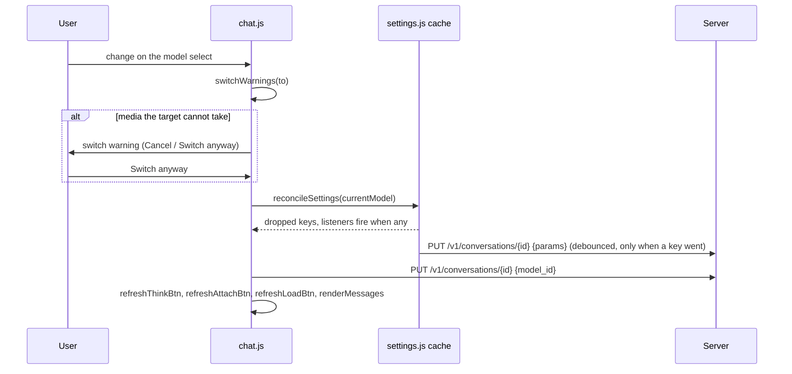
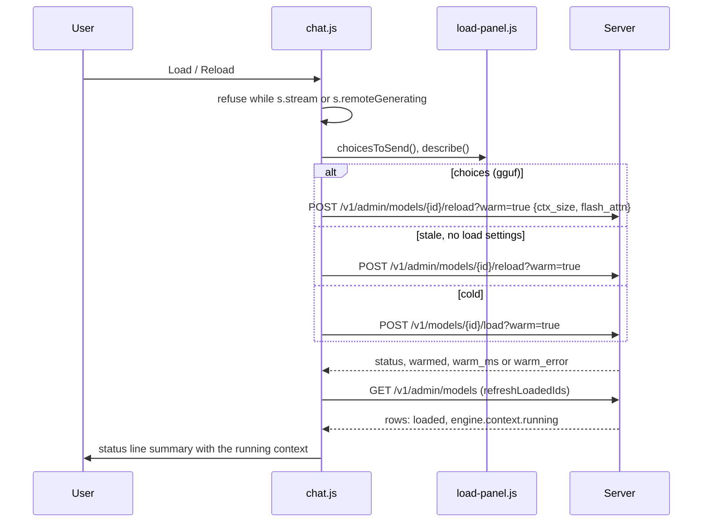
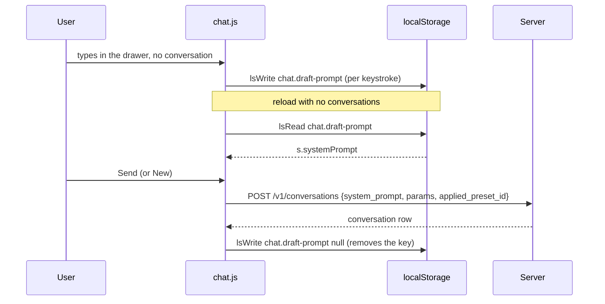
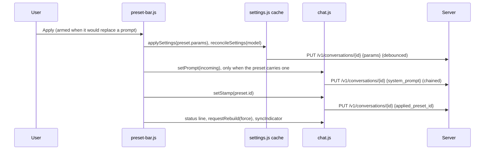

# Chat: model, load, settings and presets

last updated: 2026-11-24

This page maps, on the chat page, which model a conversation uses, how that model gets loaded, and which sampler settings and system prompt ride on a request. It starts at the model select, the load controls, the engine chip and readout, the thinking button, the settings drawer's preset, prompt and sampler sections, and the composer's prompt preview. It stops at the generate request itself ([chat-generation.md](chat-generation.md)), conversation select, create and delete ([chat-documents.md](chat-documents.md)), message rows and their drop notes ([chat-messages.md](chat-messages.md)), staged media and its pricing ([chat-attachments.md](chat-attachments.md)), and the model config editor and the inside of `engine.js` rendering ([models-and-config.md](models-and-config.md)). The overview this page sits below is [frontend_core.md](../frontend_core.md); the mechanisms and settled owner decisions are in `.claude/rules/frontend.md` and `.claude/rules/engine-contract.md`.

## Files and what each owns

| File | What it owns in this area |
|---|---|
| `frontend/js/pages/chat.js` | The model bar (`buildSkeleton`, `fillModelSelect`, the select's `change` listener), residency (`refreshLoadedIds`, `isCold`), the option schema (`refreshLoadFields`), the Load control (`refreshLoadBtn`, `loadModelNow`), the switch flow (`switchWarnings`, `showSwitchWarning`, `clearSwitchWarning`, `commitModelSwitch`), the engine chip, panel and phone readout (`paintEngineChip`, `paintEnginePanel`, `paintReadout`, `setBarPanelOpen`), the thinking button (`refreshThinkBtn`, `effectiveThinking`), the model-row readers (`currentModelRow`, `currentModel`, `currentThinking`, `currentThinkingDefault`, `currentCaps`, `currentProvider`), the drawer contribution (`drawer.registerSettings` in `setup`), the system-prompt adapters (`buildPromptSection`, `setSystemPrompt`, `putSystemPrompt`, `setAppliedPreset`, `readDraftPrompt`, `writeDraftPrompt`, `paintSysPromptChip`), the preset bar's adapter, and the composer preview (`previewNextPrompt`, `closePromptPreview`). |
| `frontend/js/settings.js` | `PARAM_META`; the module-level sampler `cache` and its listeners (`getSetting`, `setSetting`, `setSettings`, `applySettings`, `resetSettings`, `onSettingsChange`, `snapshotSettings`); the one model rule (`rowModel`, `inapplicable`, `withoutInapplicable`, `reconcileSettings`, `droppedNote`, `samplerParams`, `depthOffered`, `thinkingChoice`, `rowThinking`); the per-document binding (`bindDocumentParams`, `hydrateDocParams`, `unrepresentableNote`, `documentScopeNote`); the drawer's sampler panel (`buildSettingsPanel`, `bindControl`, `bindThinkingControl`, `bindDepthControl`, `commitAsTyped`). |
| `frontend/js/preset-bar.js` | `createPresetBar`: the preset list cache, `provenance`, `promptState`, `presetForNewDoc`, `syncIndicator`, `updateProvenance`, the drawer section (`buildSection`: the provenance line, the Apply sheet, the Save sheet), `apply`, `saveAsNew`, `updateStamped`; and `paintPresetChip`. |
| `frontend/js/prompt-section.js` | `createPromptSection`: the drawer's system-prompt textarea, its debounced persist, `flush`, `release`, Clear, and its own teardown and hide hooks. |
| `frontend/js/prompt-preview.js` | `paintPromptPreview`, `paintPromptPreviewError`, `highlightSpecials`: rendering a `POST /v1/conversations/{id}/prompt` answer into a host chat owns. |
| `frontend/js/document-writer.js` | `createDocumentWriter`: the serialized system-prompt PUT chain (`putSystemPrompt`, keepalive dispatch ahead of the chain) and the unchained stamp write (`setAppliedPreset`). |
| `frontend/js/settings-drawer.js` | The singleton drawer chat contributes to: `registerSettings`, `requestRebuild` (and its focus guard `isEditingInDrawer`), `openSettings` (`open`), `close`, `render`. |
| `frontend/js/load-panel.js` | `createLoadPanel`: one control per `load_setting` field, `changed`, `choicesToSend`, `describe`, `setEnabled`. |
| `frontend/js/context-select.js` | `createContextSelect` and `ctxStepsFor`: the gguf context ladder, Custom entry, `changed`, `choiceToSend`. |
| `frontend/js/engine.js` | What chat reads from it: `readFact`, `contextCeiling`, `contextRunning`, `renderEngineCompact`. |
| `frontend/js/storage.js` | `STORAGE_KEYS.CHAT_DRAFT_PROMPT`, `lsRead`, `lsWrite` (a null, undefined or empty value removes the key). |
| `frontend/js/utils.js` | `armedConfirm` (arm, `target()` re-check, `disarm`), `debounce` (`flush` returns the wrapped function's value), `setStatus`, `formatTokens`. |
| `frontend/js/api.js` | The route table these flows call (`ROUTES`), `request` (the `keepalive` option), `httpError` (what `err.message` holds). |
| `frontend/js/hotkeys.js` | `registerPageHotkeys`: chat's Escape handler is what closes the engine panel and hides the preview. |
| `src/heylook_llm/model_ops_api.py` | `GET /v1/models` (`list_models`), `POST /v1/models/{id}/load` (`load_model`, `load_and_warm`). |
| `src/heylook_llm/admin_api.py` | `GET /v1/admin/models` (`list_model_configs`, `_model_config_to_response`), `POST /v1/admin/models/{id}/reload` (`reload_model`), `GET /v1/admin/model-options` (`get_model_options`, `_field_options`). |
| `src/heylook_llm/preset_api.py` | `GET`, `POST /v1/presets`, `PUT /v1/presets/{id}`. |
| `src/heylook_llm/conversation_api.py` | `PUT /v1/conversations/{id}` (`update_conversation`), which stays open while a run is held. |
| `src/heylook_llm/conversation_generate_api.py` | `POST /v1/conversations/{id}/prompt` (`preview_prompt`), and `_build_chat_request`, which turns the stored prompt and params plus `overrides` into the request. |

## State

| Name | Where it lives | Written by | Read by | Reset when |
|---|---|---|---|---|
| `s.models` | chat page state | `setup` from `GET /v1/models`, embedding rows removed (`engine.embedding`) | `fillModelSelect`, `currentModelRow`, `currentCaps`, `switchWarnings`, `selectConversation` (is `conv.model_id` listed) | Never refetched during a mount. |
| `s.modelSelect.value` | DOM `<select title="Model">` in `.chat__bar` | the user; `fillModelSelect` (restores the previous value when still listed); `selectConversation` (to `conv.model_id` when listed); the switch warning's Cancel (back to `from`) | everything that asks "the selected model": `currentModelRow`, `currentCaps`, `currentProvider`, `refreshLoadBtn`, `paintEngineChip`, `paintReadout`, `loadModelNow`, `previewNextPrompt`, the drawer getters, `send` and `startStream` | Rebuilt with the options by `fillModelSelect`. |
| `s.committedModelId` | chat page state | `setup` (after the first fill), `selectConversation` on success, `commitModelSwitch` | the select's `change` listener (`from`), `send` (commits a pending target) | Starts null in `buildSkeleton`. |
| `s.loadedIds` | chat page state (`Set`) | `refreshLoadedIds` on success | `fillModelSelect` (dots), `isCold`, `priceStagedImages` | Kept on a failed fetch. |
| `s.adminRows` | chat page state (`Map` id to admin row) | `refreshLoadedIds` on success | `load-panel.js` and `context-select.js` through `adminRow`, `refreshLoadBtn` (`stale_reload_fields`), `paintEngineChip`, `paintEnginePanel`, `paintReadout`, `currentProvider`, the drawer's `requestFields` getter | Kept on a failed fetch. |
| `s.loadedKnown` | chat page state | `refreshLoadedIds` on its first success | `fillModelSelect` (dots or plain ids), `isCold` | Never goes back to false. |
| `s.loadFields` | chat page state (provider to fields with `load_setting`) | `refreshLoadFields` on success | `load-panel.js` through `loadFields(provider)` | Set once per mount. |
| `s.loadNowBtn.dataset.busy` | DOM attribute on `.chat__load-btn` | `loadModelNow` (set before the request, deleted in `finally`) | `loadModelNow` (re-entry), `refreshLoadBtn` (hides the button while set) | Each load's `finally`. |
| Context select `pending`, `beforeCustom`, `element.dataset.sig` | `context-select.js` closure and DOM | `commitCustom`, the select's `mousedown`/`keydown`/`focus`, `refresh` | `refresh`, `changed`, `choiceToSend` | `pending` clears on a model change inside `refresh` or when the model is not gguf. |
| Load panel `selects`, `extras.dataset.sig` | `load-panel.js` closure and DOM | `refresh` | `changed`, `choicesToSend`, `setEnabled` | Rebuilt when the signature (model, stored value, `setting.value`, `setting.auto`) moves. |
| `s.switchWarnEl` content and `hidden` | DOM `.chat__status.chat__switch-host` | `showSwitchWarning` | the user | `clearSwitchWarning`: its own Cancel, any `commitModelSwitch`, `selectConversation`. |
| `chat__bar--load-offered`, `chat__bar--panel-open` | classes on `.chat__bar` | `refreshLoadBtn`; `setBarPanelOpen` | `frontend/css/app.css` phone rules (`max-width: 767px`); the readout's click handler | Re-derived on every call. |
| `s.enginePanelEl.hidden` | DOM `#chat-engine-panel` | `setBarPanelOpen` | engine chip click, Escape, `paintEngineChip` | Starts hidden. |
| `s.systemPrompt` | chat page state | `adoptConversationMeta`; the prompt section's `set` (per keystroke); `setSystemPrompt` (preset apply); `setup` (parked draft); `send` (after a create); `deleteConversation` (null) | the prompt section's `get`, the preset bar's `getPrompt`, `newConversation` and `send` (draft create) | Null when the active conversation is deleted. |
| `s.appliedPresetId` | chat page state | `adoptConversationMeta`, `setAppliedPreset`, `send` (from the created row), `deleteConversation` (null when none left) | the preset bar's `getStamp`, `newConversation` and `send` (draft create) | Cleared on entering the no-document state after a delete. |
| `s.promptSection` | chat page state | `buildPromptSection` (one per drawer render) | `startStream` (flush), `buildPromptSection` (release) | Replaced on every drawer render; the previous one is released. |
| Prompt section `builtFor`, debounce timer | `prompt-section.js` closure | construction (`adapter.owner()`), `setValue` (chat never calls it) | `edited`, the debounced persist | The section is dropped at `release`. |
| `s.docWriter` chain | `document-writer.js` closure | `putSystemPrompt` | the next `putSystemPrompt` | Per mount. |
| `s.paramsBinder` pending `{id, params}`, timer | `settings.js` `bindDocumentParams` closure | its `onSettingsChange` listener | `flush` (timer, hide, teardown, `startStream`) | Cleared on each flush. |
| `cache` | `settings.js` module scope, shared with notebook | `setSetting`, `setSettings`, `applySettings` (replaces the object), `reconcileSettings`, `hydrateDocParams` | `getSetting`, `snapshotSettings`, `samplerParams`, `thinkingChoice`, the panel | `hydrateDocParams(null)` on entering the no-document state. Not persisted. |
| `samplerListeners` | `settings.js` module scope | `onSettingsChange` (chat registers, in order: the think button in `buildSkeleton`, the preset bar in `createPresetBar`, the params binder in `bindDocumentParams`) | `fireSettingsChange` | Each unsubscribes at teardown. |
| `advancedOpen` | `settings.js` module scope | the Advanced `
` `toggle` | `buildSettingsPanel` | Page session only. |
| `presets`, `provEl`, `syncUpdate` | `preset-bar.js` closure | `load` (`refresh`, `updateStamped`), `saveAsNew`, `updateStamped`, `buildSection` | `provenance`, `promptState`, `presetForNewDoc`, the sheets | `provEl` and `syncUpdate` drop when the line is detached at the next settings change. |
| Parked draft prompt | `localStorage` key `heylook.chat.draft-prompt` (`LS_PREFIX` plus `STORAGE_KEYS.CHAT_DRAFT_PROMPT`) | `writeDraftPrompt` from the prompt section's `set` and from `setSystemPrompt`, both only with no active conversation | `readDraftPrompt` in `setup` | `writeDraftPrompt(null)` after a successful `selectConversation`, `newConversation` or first-send create. |
| `current`, `isOpen` | `settings-drawer.js` module scope | `registerSettings`, `open`, `close` | `render`, `requestRebuild` | Unregistered at chat teardown. |
| `s.promptPreviewEl` | DOM `.prompt-preview.chat__prompt-preview` | `paintPromptPreview`, `paintPromptPreviewError` | the user | `closePromptPreview` (send, conversation select, model commit, its Close); Escape hides it without clearing. |

## Entry points

| What the user or browser does | Handler (file and function) | Flow |
|---|---|---|
| Chat mounts | `chat.js` `setup` | Mount: models, residency, schema, presets |
| Picks a model in the select | `chat.js` `buildSkeleton`, the select's `change` listener | A user model change |
| Presses "Switch anyway" / "Cancel" | `chat.js` `showSwitchWarning` buttons | A user model change |
| Presses Load or Reload | `chat.js` `loadModelNow` | Load now |
| Picks a context size, Custom…, or another load setting | `context-select.js` `createContextSelect`, `load-panel.js` `refresh` select listeners, then `chat.js` `refreshLoadBtn` | Load panel choices |
| Taps the engine chip | `chat.js` `buildSkeleton`, engine chip `click` then `setBarPanelOpen` | Engine chip, panel and readout |
| Taps the readout line (phone) | `chat.js` `buildSkeleton`, readout `click` then `setBarPanelOpen` | Engine chip, panel and readout |
| Presses the thinking button | `chat.js` `buildSkeleton`, `thinkBtn` `click` | Thinking button |
| Opens the drawer (bar gear, nav gear, preset chip, system-prompt chip) | `settings-drawer.js` `open` via `drawer.openSettings`; chat's `onOpen` is `presetBar.onDrawerOpen` | Drawer render for chat; Preset list refresh |
| Types in, resets or clears a sampler control | `settings.js` `bindControl`, `commitAsTyped`, the row reset and "Clear all overrides" in `buildSettingsPanel` | Sampler edit and the params write |
| Types in the system-prompt box, or presses Clear | `prompt-section.js` `edited`, the Clear `armedConfirm` | System prompt edit |
| Opens the Apply sheet, presses Apply | `preset-bar.js` `buildSection` (`pickBtn`), `buildOption` (`armedConfirm`), `apply` | Preset list refresh; Apply a preset |
| Opens the Save sheet, presses "Save as a new preset" or Enter | `preset-bar.js` `buildSection`, `saveAsNew` | Save as a new preset |
| Presses "Overwrite X with this conversation's prompt and settings" | `preset-bar.js` `buildSection` (`armedConfirm`), `updateStamped` | Overwrite the stamped preset |
| Presses the eye button in the composer | `chat.js` `previewNextPrompt` | Composer prompt preview |
| Presses Escape | `hotkeys.js` `registerPageHotkeys`, chat's `onEscape` in `setup` | Engine chip, panel and readout; Composer prompt preview |
| Hides the tab (visibilitychange hidden, pagehide) | `page.js` `onHide`, registered by `bindDocumentParams` and `createPromptSection` | Sampler edit and the params write; System prompt edit |
| Returns to the tab | `chat.js` `refreshAfterResume` (owned by [chat-documents.md](chat-documents.md)) | Resume: this area's part |
| Leaves the page | `page.js` `unmount` running chat's teardown hooks | Sampler edit and the params write; System prompt edit |

## Flows

### Mount: models, residency, schema, presets

Trigger: the router mounts chat and `page.js` runs `chat.js` `setup`.

Guards: `ctx.alive` after the parallel fetch.

Steps:
1. `buildSkeleton` builds the bar: the model select with its `change` listener, `s.loadNowBtn` (hidden, text "Load"), `s.loadFields = {}`, `s.loadPanel = createLoadPanel({ currentModelId, adminRow, loadFields, onChange: refreshLoadBtn })`, the status line `s.statusEl`, the hidden `s.switchWarnEl`, the hidden thinking button, the preview button and host, the hidden engine panel and chip, the readout button, the hidden preset chip and the system-prompt chip. It sets `s.loadedIds = new Set()`, `s.adminRows = new Map()`, `s.loadedKnown = false`, `s.committedModelId = null`, and registers `onSettingsChange(ctx.guard(refreshThinkBtn))`.
2. `createPresetBar(ctx, adapter)` (adapter below, in "Apply a preset") registers the bar's own settings listener.
3. `s.presetBar.refresh()` sends `GET /v1/presets`, not awaited; its `.then` calls `syncIndicator` when alive.
4. `createDocumentWriter({ update: api.updateConversation, onError })`.
5. `drawer.registerSettings(contribution)`; the returned unregister goes to teardown.
6. `bindDocumentParams({ activeId, updateDoc: api.updateConversation, onError, onHide: ctx.onHide })`; the returned teardown goes to teardown.
7. `registerPageHotkeys` and `ctx.onResume(refreshAfterResume)`.
8. `await Promise.all([api.listModels(), api.listConversations()])`. A failed `GET /v1/models` resolves to `{ data: [] }`.
9. `s.models` is `data` without rows whose `engine.embedding` is set.
10. `fillModelSelect`: with `s.loadedKnown` false the labels are plain ids. The select shows the first option.
11. `s.committedModelId = s.modelSelect.value || null`, then `refreshThinkBtn`, `refreshAttachBtn`.
12. `refreshLoadedIds` and `refreshLoadFields` start, not awaited.
13. With conversations, `await selectConversation(...)` ([chat-documents.md](chat-documents.md)) moves the select and commits it. With none and a list fetch that did not fail: `s.systemPrompt = readDraftPrompt()`, `hydrateDocParams(null)`, `refreshThinkBtn`, `renderMessages`.
14. `paintSysPromptChip` paints the chip whatever the preset fetch does.

Ends when: `setup` returns; residency, the schema and the preset list land later and repaint.

Failure paths: `GET /v1/models` failure is silent; the select is empty and the first word about it is "No models available." from `send`. `GET /v1/presets` failure writes `Could not load presets: ${err.message}` (error). Residency and schema failures are silent.

Awaits and what is re-checked after each: the `Promise.all` is followed by `if (!ctx.alive) return`. The preset refresh's `.then` checks `ctx.alive`.

### Filling the model select and programmatic selection

Trigger: `fillModelSelect` runs at mount and after every successful residency fetch.

Guards: none.

Steps:
1. Remember `prev = s.modelSelect.value`.
2. Replace the options from `s.models`. With `s.loadedKnown` the label is `● ${m.id}` (resident) or `○ ${m.id}`, the title `${m.id} — loaded` or `${m.id} — not loaded`; before that both are the bare id.
3. Put `prev` back when it is still listed.

Programmatic writes to `s.modelSelect.value` never fire `change`: the restore in step 3, `selectConversation` (to `conv.model_id` when `s.models` lists it), and the switch warning's Cancel. `s.committedModelId` is the last model the page treats as the conversation's. It is written only by `setup`, a successful `selectConversation` ("Programmatic selection IS the committed model", so a restore never runs the warning flow) and `commitModelSwitch`. While a warning is pending the select shows an unconfirmed target and `s.committedModelId` still holds the previous one; `send` reads the difference and commits the target (`commitModelSwitch(ctx, s.modelSelect.value)`).

Ends when: the options are in place.

Failure paths: when `conv.model_id` is not in `s.models`, `selectConversation` leaves the select where it was, commits that model, sends no `model_id` PUT and says nothing.

Awaits: none.

### A user model change

Trigger: `change` on `s.modelSelect` (user only).

Guards: `if (!to || to === from) return`, where `from = s.committedModelId`. When `to === from` it first calls `clearSwitchWarning`: a warning still on screen was about another target.

Steps:
1. `switchWarnings(ctx, to)` counts `image` and `audio` blocks across `s.messages` and checks the target row's `capabilities` from `s.models`. Lines: `This conversation has ${images} image(s). They will be dropped from every request to this model — it cannot read them.` when `vision` is missing, and the audio twin ending `it cannot hear them.` when `audio` is missing. Settings the target cannot use and a cold target are not warnings ("only loss gates"; why: [sharp_edges.md, Model switching and the config editor](../../architecture/sharp_edges.md#model-switching-and-the-config-editor)).
2. No lines: `commitModelSwitch(ctx, to)`.
3. Lines: `showSwitchWarning` fills `s.switchWarnEl` with `div.chat__switch-warning`: `Switching to ${to}:`, one `.chat__switch-line` per line, and `.chat__switch-actions` holding "Cancel" and "Switch anyway". It unhides the element. "Switch anyway" runs `commitModelSwitch(ctx, to)`; "Cancel" sets `s.modelSelect.value = from` and `clearSwitchWarning`. The element is not the status line, so status writes do not remove it (why: [sharp_edges.md, A model switch leaves the reply alone](../../architecture/sharp_edges.md#a-model-switch-leaves-the-reply-alone-and-a-lost-run-is-watched)).

`commitModelSwitch(ctx, to)`:
1. `clearSwitchWarning`.
2. `droppedNote(reconcileSettings(currentModel(ctx)))`, judged against the model the select shows. When a key goes, `fireSettingsChange` runs the listeners in registration order: `refreshThinkBtn`, the preset bar's `updateProvenance` (both chips repaint), and the params binder, which schedules `PUT /v1/conversations/{id}` `{ params }` for the active conversation.
3. `midReply = Boolean(s.stream) && s.stream.targetConvId === s.activeId`. Nothing aborts the stream: its request named its model at launch (owner, 2026-11-24).
4. `s.committedModelId = to`; `closePromptPreview`.
5. `cold = isCold(ctx, to)`. Notes: with `midReply`, `The reply in progress finishes on the previous model. Your next message ${cold ? 'loads' : 'uses'} ${to}.`; otherwise when cold, `${to} is not loaded — your first message loads it, or press Load to do it now.`; then the removal note. `showStatus(notes.join(' '))` runs when there is a note, and also with none unless the line on screen is the `Still generating on the server` note (`isGeneratingNote`), which it leaves alone. So an empty result clears an earlier switch's line and never the explanation for a Stop button.
6. With an active conversation: `PUT /v1/conversations/{id}` `{ model_id: to }`, not awaited, and the local list row's `model_id` set to `to`.
7. `drawer.requestRebuild({ force: true })`, `refreshThinkBtn`, `refreshAttachBtn`, `refreshLoadBtn`, `priceStagedImages` ([chat-attachments.md](chat-attachments.md)), `renderMessages` ([chat-messages.md](chat-messages.md)).

Ends when: the status line holds the notes (or nothing), and the bar, drawer and rows describe the new model.

Failure paths: the `model_id` PUT failing writes `The model choice was not saved (${err.message}). This conversation may reopen on its previous model.` (error), only when alive and the same conversation is still open. A failing params PUT writes `Settings save failed: ${err.message}` (error).

Awaits and what is re-checked after each: none in the commit; the PUT's `.catch` checks `ctx.alive && s.activeId === convId`.

### Residency refresh and the dots

Trigger: `refreshLoadedIds` runs at mount, at the end of `loadModelNow` (awaited), at a cold stream's first delta and at every stream's `onComplete` (both in `startStream`, [chat-generation.md](chat-generation.md)). It does not run on resume.

Guards: `ctx.alive` after the fetch.

Steps:
1. `GET /v1/admin/models` with the page signal.
2. `s.loadedIds` = ids of rows with `loaded`; `s.adminRows` = every row by id; `s.loadedKnown = true`.
3. `fillModelSelect` (dots), `refreshLoadBtn`, `refreshThinkBtn`, `priceStagedImages`, and `renderMessages` when a conversation is open (rows whose signature moved rebuild; an open editor catches up its Save & Continue).

`isCold(ctx, id)` is `s.loadedKnown && id && !s.loadedIds.has(id)`: unknown residency is never cold. `commitModelSwitch`, `startStream`'s wait line, `refreshLoadBtn`, `loadModelNow` and `paintReadout` all ask it.

Ends when: the dots and the load controls describe the fetched rows.

Failure paths: a failed fetch returns before any repaint; the last known state stays ("the UI never guesses residency").

Awaits and what is re-checked after each: the fetch, then `ctx.alive`.

### Load field schema

Trigger: `refreshLoadFields`, once at mount.

Guards: `ctx.alive` after the fetch.

Steps:
1. `GET /v1/admin/model-options`.
2. `s.loadFields` = for each provider in `providers`, its `fields` with `load_setting` set. In the server's provider config classes (`src/heylook_llm/config.py`) those are gguf's `ctx_size` and `flash_attn`; MLX has none.
3. `refreshLoadBtn`.

Ends when: the load panel can build its non-context selects.

Failure paths: silent. The context select still works because it gates itself on `provider === 'gguf'` from the admin row, not on the schema.

Awaits: the fetch, then `ctx.alive`.

### Load button state and the phone load strip

Trigger: `refreshLoadBtn`, from `refreshLoadFields`, `refreshLoadedIds`, `commitModelSwitch`, a successful `selectConversation`, and the load panel's `onChange`.

Guards: none.

Steps:
1. `s.loadPanel.refresh()`: `context-select.js` `refresh` (hidden unless the admin row's provider is `gguf`; options rebuilt only when the signature of id, stored `ctx_size`, ceiling and running context moved), then the load panel's other selects (rebuilt only when their signature moved).
2. `cold = isCold`, `changed = s.loadPanel.changed()`, `stale = cold ? [] : (admin row's stale_reload_fields ?? [])`.
3. Text "Load" when cold, else "Reload". Title: `Load this model now so the first message does not pay for it` (cold), `Restart this model with the chosen load settings` (changed), or `Restart this model to apply saved changes (${stale.join(', ')})`.
4. `hidden = !((cold || changed || stale.length) && !dataset.busy)`.
5. `.chat__bar` gets `chat__bar--load-offered` while the button shows. On a phone (`app.css`, `max-width: 767px`) that class shows the `.chat__bar-detail` strip, which holds the load group, without a tap on the readout.
6. `paintEngineChip`.

Before the first residency fetch nothing is cold and no admin row exists, so the button stays hidden.

Ends when: the button and the strip state match the selected model.

Failure paths: none of its own.

Awaits: none.

### Load panel choices

Trigger: a pick in the context select, Enter or a change in its Custom box, or a pick in another load-setting select.

Guards: `context-select.js` returns early from `changed` and treats the `custom` sentinel as no choice.

Steps:
1. Context select `change` to a size or Auto: close the Custom box and call `onChange` (chat's `refreshLoadBtn`).
2. Choosing "Custom…": open the number box with `min` `CTX_ABS_MIN`, `max` the ceiling (`contextCeiling` or `CTX_FALLBACK_MAX`), prefilled from the stored `ctx_size`, else the running context, else `CTX_MIN`; focus it. No `onChange` yet.
3. Commit (`change` or Enter, `commitCustom`): an unparseable entry restores `beforeCustom`; otherwise the value is clamped to `[CTX_ABS_MIN, ceiling]`, kept as `pending`, inserted as a real option and selected, and `onChange` runs. Escape restores `beforeCustom` and closes the box.
4. Another load-setting select (`chat__load-select`, labelled `${label}: default (${setting.auto})` or `${label}: default`, then `${label}: ${v}` per enum value): `change` calls `onChange`.

`changed()` compares each choice with the admin row's stored `config`; `choicesToSend()` returns `{ ctx_size: N | null, <field>: value | null }` for a gguf model (Auto and the default send null) and null for a model with no load settings; `describe()` joins `${formatTokens(v)} context` and `${label} ${v}` phrases with commas, skipping null values, or returns an empty string when everything is the default.

Ends when: `refreshLoadBtn` has shown or hidden Load/Reload.

Failure paths: none.

Awaits: none.

### Load now

Trigger: a press on Load or Reload (`loadModelNow`).

Guards, in order: no selected id, or `dataset.busy` set: silent return. A local stream or `s.remoteGenerating`: `A reply is still being generated — load after it finishes.` and return (owner rule: loading or restarting can evict or kill the generating model).

Steps:
1. Set `dataset.busy`, disable the button, the model select and the load panel (`setEnabled(false)`).
2. `choices = s.loadPanel.choicesToSend()`; `stale` = resident with a non-empty `stale_reload_fields`; `restarting = !cold && (choices != null || stale)`; `chosen = s.loadPanel.describe(choices)`.
3. Status: `Loading ${id}…` (not restarting), `Restarting ${id} with ${chosen || 'auto settings'}…` (choices), or `Restarting ${id} to apply saved changes…`.
4. Request, awaited: with choices, `POST /v1/admin/models/{id}/reload?warm=true` with the choices as the body (this is every gguf model, cold or not); else when stale, the same route with no body; else `POST /v1/models/{id}/load?warm=true`.
5. On an answer with `warm_error`: `Loaded, but the warm-up generation failed: ${result.warm_error}` (error). Otherwise `summary` = `${id} loaded and warmed in ${(warm_ms / 1000).toFixed(1)}s.` when `warm_ms` is present, else `${id} loaded.`, shown.
6. `finally`: delete `dataset.busy`, enable the button, the select and the panel.
7. `await refreshLoadedIds(ctx)`.
8. When there was a summary and the refreshed row reports `contextRunning`: `${summary} Context ${formatTokens(running)}.`

Server side, as the page relies on it: the reload route persists any choice that differs from the stored config through the model config writer, answers a plain load (no restart) when nothing changed and the model is resident with nothing stale, refuses a key that is not a load setting with a 400, refuses with a 409 while a load of that model is in flight or while it is generating, and otherwise unloads and loads. Both routes return the `load_and_warm` dict (`status`, `model_id`, `warmed`, `warm_ms` or `warm_error`), a 503 busy envelope when room cannot be made, 400 for an unknown id and 500 for a failed load.

Ends when: the status line holds the summary (or the error), the controls are enabled, and the dots describe the refreshed residency.

Failure paths: any HTTP error (400, 409, 500, 503 busy) writes `Load failed: ${err.message}` (error), where `err.message` is the server's `error.message` or `detail` (`api.js` `httpError`). A failed residency refresh after the load leaves the last state and skips step 8.

Awaits and what is re-checked after each: the load request, then `ctx.alive` (the `finally` still runs); `refreshLoadedIds`, then `ctx.alive` for the context line. Neither await re-checks the open conversation or the select: the status names the captured id in whatever conversation is open. While `dataset.busy` is set, anything that calls `refreshLoadBtn` hides the button until the post-load refresh repaints it.

### Engine chip, engine panel and the phone readout

Trigger: `paintEngineChip` at the end of every `refreshLoadBtn`; a tap on the engine chip (`setBarPanelOpen(ctx, s.enginePanelEl.hidden)`) or the readout (`setBarPanelOpen(ctx, !barEl.classList.contains('chat__bar--panel-open'))`); Escape while the panel is open.

Guards: Escape reaches the panel only when there is no local stream and no remote run (`onEscape` stops those first) and no modal is open (`hotkeys.js` `isModalOpen`).

Steps:
1. `paintEngineChip`: `runtime = readFact(adminRow.engine.runtime)`. The chip (`.chat__engine-chip`, title `What runs this model, and with what`) is hidden without one and otherwise reads the runtime. With no runtime on a desktop width (`matchMedia('(max-width: 767px)')` false) the panel is closed, since the chip is its only opener there. An open panel is repainted. Then `paintReadout`.
2. `setBarPanelOpen(ctx, open)`: toggles `chat__bar--panel-open`, sets `#chat-engine-panel` `hidden`, sets `aria-expanded` on the chip and the readout, and paints the panel when opening.
3. `paintEnginePanel` puts `engine.js` `renderEngineCompact(adminRow.engine)` in the panel: rows for runtime, context, template origin, cache reuse, spec decode, distributed state, and the link `Every setting and why: Models page` (`#/models`), or `This server reports no engine description.` (the rows' rendering is [models-and-config.md](models-and-config.md)'s).
4. `paintReadout` builds one ` · `-joined line: the runtime; `ctx ${formatTokens(n)}` where n is the visible context select's value, else the running context of a loaded model, else the stored `ctx_size`, else the ceiling; `cold` when `isCold`; the last assistant message with `stats`: `cache ${cached}/${prompt}` when reused, else `cache miss` or `cache not used`, or with no such message `cache ${reuse}` from `engine.cache` (`reuse_class`, `reuse_mode`, `reuse`); `${generation_tps.toFixed(1)} tok/s`; `preset: ${chip text}` while the preset chip shows; the system-prompt chip's text, or `No system prompt`. The `aria-label` is the line plus `. Tap to toggle load controls and engine details.` CSS hides `.chat__readout` above the phone width.

`paintReadout` also runs from `paintSysPromptChip` and `renderMessages`.

Ends when: the chip, panel and line describe the selected model's admin row.

Failure paths: none; missing facts are left out of the line.

Awaits: none.

### Thinking button

Trigger: `refreshThinkBtn` runs at mount, after residency, on every settings change (its listener), on a model commit, after `selectConversation` (both outcomes), after resume, and when the last conversation is deleted. A press runs the button's `click`.

Guards: the button is hidden unless `currentCaps` includes `PARAM_META.enable_thinking.requiresCap` (`thinking`), the same gate as the drawer row.

Steps (`refreshThinkBtn`):
1. `hidden` from the cap.
2. `on = effectiveThinking(ctx)`: false when `thinkingChoice(currentThinking, { enable_thinking, reasoning_effort })` is `off` (an explicit false, or a stored level in `depth.off`); true when `enable_thinking` is true; otherwise the `/v1/models` row's `thinking_default === true`.
3. `aria-pressed` from `on`; title `Thinking: on|off (model default)` when `enable_thinking` is unset, else `Thinking: on|off`.

Steps (press):
1. Effective on: `setSetting('enable_thinking', false)`.
2. Effective off because of an off level, with `enable_thinking` not false: `setSettings({ enable_thinking: true, reasoning_effort: null })`.
3. Otherwise `setSetting('enable_thinking', true)`; any stored level is kept.
4. The setting change fires the listeners: the button repaints, both chips repaint, and the params binder schedules the PUT.

Ends when: the button shows the new effective state.

Failure paths: a failed params PUT writes `Settings save failed: ${err.message}` (error).

Awaits: none.

### Sampler cache, hydrate and reconcile

Trigger: a document load (`adoptConversationMeta` calls `hydrateDocParams(conv)`), entering the no-document state (`hydrateDocParams(null)`), a model commit, a preset apply, a resume adoption.

Guards: `inapplicable` judges nothing when `model` is null (the row is not known yet).

Steps:
1. `hydrateDocParams(doc)` is `applySettings(doc.params ?? {}, { silent: true })`: `mergeKnown` builds a fresh bag from `emptySettings()` (every `PARAM_META` key null), keeps each structurally valid value (`valid`: finite numbers, booleans for `thinking`, a depth word matching `^[A-Za-z0-9_-]{1,32}$`; `PARAM_META` min and max are not enforced), reports `unusable` and `unknown` keys, and replaces `cache`. No listener fires, so callers repaint by hand.
2. Chat turns the report into `unrepresentableNote`: `This conversation stores settings this panel cannot show (${keys}). Changing a setting here will drop them.` (error).
3. `reconcileSettings(model)` (model is `rowModel(currentModelRow)`: `{ caps, thinking }`) computes `inapplicable(cache, model)`: a key whose `requiresCap` the row lacks (`this model has no ${label} control`), a thinking cap the engine says it cannot enforce (`this engine cannot enforce a thinking cap`), a depth the template does not offer (`this model's template offers ${values}` or `this model's template has no thinking depth`). Each goes to null and the listeners fire once.
4. `droppedNote` spells the removals: `Removed settings this model can't use: ${label} "${value}" (${why}); ....` Chat shows it on the status line.

Why stored, shown and sent are one bag: [sharp_edges.md, Settings a model cannot use are removed, not kept](../../architecture/sharp_edges.md#settings-a-model-cannot-use-are-removed-not-kept).

Ends when: the cache holds only what the selected model can use.

Failure paths: none of its own; the follow-on params PUT reports its own failure.

Awaits: none.

### Drawer render for chat

Trigger: `settings-drawer.js` `open`, `requestRebuild` (skipped while focus is inside `.drawer__body` unless `force`), and `registerSettings` while open.

Guards: `requestRebuild` is a no-op while closed.

Steps (`render`):
1. `sections()`: `[s.presetBar.buildSection(), buildPromptSection(ctx).element]`. `buildPromptSection` first calls `s.promptSection?.release()` on the section it replaces.
2. `buildSettingsPanel` with chat's getters: `caps` = `currentCaps`; `scope` = `documentScopeNote('conversation', Boolean(s.activeId))`, which reads `Applies to this conversation — changes save as you make them.` or `The next conversation you start is created with these. Not saved until then.`; `modelDefaults` = `{ enable_thinking: thinking_default }` from the `/v1/models` row; `samplerDefaults` and `samplerSources` from the same row; `thinking` = `rowThinking(row)` (`engine.thinking` plus `engine.template.origin`); `requestFields` = `engine.decoding.request_fields` from the admin row, else the `/v1/models` row.
3. The panel: heading "Generation", the scope note, the thinking row(s), core rows, an "Advanced" `
` (open per `advancedOpen`, summary `Advanced · ${n} changed` when overridden rows sit inside), and "Clear all overrides". A row is built when any of its keys is offered (`keyOffered`) and, with a `requestFields` list, read by the engine path.
4. The drawer adds the `Embeddings workbench` link and, with a session, `Sign out`.
5. `open` also focuses the header's Close (outside `.drawer__body`, so the focus guard is not tripped) and calls `onOpen` (`presetBar.onDrawerOpen`).

The thinking row (`bindThinkingControl`): `Default`, followed by `(off)` when the model's default (`modelDefaults.enable_thinking`) is false, else by the template's default level, else by `(on)` when the model's default is true; then `Off` and `On` where the row has the `thinking` capability (`On` only when there is no default level); then each level not in `depth.off`, the default one labelled `${v} (default)` unless the model's default is off. A depth with `unknown: 'verbatim'` and no switch gets a text box with a `<datalist>` instead (`bindDepthControl`). Its note is `On/off only: ${template} defines no thinking depth.` or `Levels from ${template}.` (`, your override (Models page).` for the operator override) plus `A change re-processes the whole conversation.` when `changes_prefix`. The cap sub-row (`thinking_budget_tokens`) hides while `thinkingOff()` and its notes are `Thinking stops after ${value} token(s).` below `SMALL_THINKING_CAP` and `May not be enforced on this engine.`.

Closing (`close`) blurs a focused field inside the body, which fires `change` on the prompt box and so flushes it, empties the body and returns focus to the opener. It does not release the prompt section.

Ends when: the body holds the new sections.

Failure paths: none.

Awaits: none.

### Sampler edit and the params write

Trigger: a pick in a select, a keystroke in a number field, a row's reset (`↺`), "Clear all overrides", the thinking button, or any `setSetting`/`setSettings`/`applySettings`/`reconcileSettings` from elsewhere.

Guards: `commitAsTyped` commits nothing while the field reports `badInput` with an empty value ("1." on the way to "1.3"), and nothing when the parsed value equals the cache. The binder schedules nothing with no active conversation.

Steps:
1. The control writes the cache: selects through their `change`; typed fields on every `input` and on `change` (`commitAsTyped`; why: [sharp_edges.md, A typed value and a debounced write each belong to one moment](../../architecture/sharp_edges.md#a-typed-value-and-a-debounced-write-each-belong-to-one-moment)). A row reset sets the row's keys to null with `setSettings`; "Clear all overrides" calls `resetSettings` (`applySettings({})`, one notification).
2. The panel's `syncAll` re-derives each row's overridden state from `key in samplerParams(model)`, the source label (`model file default`, `vendor default`, `heylook default`) shown only on a blank row, the notes, and whether the cap sub-row shows; a thinking change also repaints placeholders (`syncDefaults`).
3. The listeners fire in order: `refreshThinkBtn`; the preset bar (`updateProvenance`: `syncIndicator` repaints both chips, the provenance line repaints, the Save sheet's Overwrite shows or hides and disarms); the binder.
4. The binder reads `activeId()`. If a write is owed to a different conversation it is flushed first. It records `pending = { id, params: snapshotSettings() }` and restarts its timer (`delay` in `bindDocumentParams`).
5. When the timer fires, `flush` sends `PUT /v1/conversations/{id}` `{ params }` for the recorded id and bag.

Other flushes of the same pending write: `startStream` awaits `s.paramsBinder.flush()` before launching ([chat-generation.md](chat-generation.md)); the page's `onHide` calls `flush({ keepalive: true })`; teardown flushes.

Ends when: the PUT settles.

Failure paths: `Settings save failed: ${err.message}` (error), from the binder's `onError`; the cache keeps the value.

Awaits and what is re-checked after each: none in the page; `flush` returns a promise that always resolves (the error is caught inside).

### System prompt edit

Trigger: `input` in the drawer's `.sysprompt-input`; `change` (blur, including the drawer's `close`); a press on Clear.

Guards: `edited` writes page state only while `adapter.owner() === builtFor`, so a section built for another conversation does not write the new one's state. The persist is a no-op while `builtFor` is null (no conversation).

Steps:
1. `edited`: `autoGrow`; `value = input.value.trim() || null`; `set(value)`: `s.systemPrompt = value`, and with no active conversation `writeDraftPrompt(value)`.
2. `schedulePersist(value)`: the `debounce` in `createPromptSection`.
3. `onEdit`: `s.presetBar.updateProvenance()`; both chips and the provenance line repaint per keystroke.
4. Clear's `disabled` follows the value.
5. When the debounce fires (or `change` flushes it): `putSystemPrompt(ctx, builtFor, value, opts)` through `s.docWriter`: queued behind the chain, or dispatched at once with `keepalive` on a hide flush. The request is `PUT /v1/conversations/{id}` `{ system_prompt: value }` (null clears).
6. Clear (`armedConfirm`, armed label `Clear prompt?`, `target` the section's `builtFor`): the first press arms, the second empties the box, runs `edited`, and flushes the persist with null.

Flush and release: `flush(opts)` fires a pending persist now and returns its promise; `startStream` awaits it. The section's `ctx.onHide` hook flushes with `keepalive`; its `ctx.onTeardown` hook flushes. `release()` (called by the next `buildPromptSection`) flushes and drops both hooks.

Ends when: the write lands, or nothing was pending.

Failure paths: `System prompt save failed: ${err.message}` (error); the chain continues.

Awaits: none in the handler; the chain serializes writes in `document-writer.js`.

### The parked draft prompt

Trigger: typing or Apply with no conversation open; mount with no conversations; the first create.

Guards: the restore at mount runs only when the conversation list fetch did not fail and returned none.

Steps:
1. Typing with no conversation: the prompt section's `set` calls `writeDraftPrompt(value)` per keystroke (`lsWrite` removes the key for null or an empty string).
2. Apply on the draft: `setSystemPrompt` writes `s.systemPrompt` and `writeDraftPrompt(value)`, with no PUT.
3. Mount with no conversations: `s.systemPrompt = readDraftPrompt()`; the drawer reads it at its next render.
4. The first create (`newConversation` from the draft, or `send`'s create) sends `system_prompt: s.systemPrompt || undefined` and then `writeDraftPrompt(null)`.
5. A successful `selectConversation` also calls `writeDraftPrompt(null)`.

Ends when: a conversation owns the prompt.

Failure paths: storage errors are swallowed in `storage.js` (in-memory only). A failed create keeps the draft parked.

Awaits: the create (owned by [chat-documents.md](chat-documents.md) and [chat-generation.md](chat-generation.md)).

### System-prompt chip and preset chip

Trigger: the preset bar's `onIndicator`, called from `syncIndicator` and `updateProvenance`; `paintSysPromptChip` at the end of `setup`.

Guards: `indicatorInfo` returns null with no active conversation, so the preset chip hides; `promptState` does not check for a document, so a draft stamp can name the prompt's preset.

Steps:
1. `paintPresetChip(s.presetChip, info)`: hidden without info, else `${name}` or `${name} (modified)` from `provenance()`.
2. `paintSysPromptChip`: from `promptState()` (only a preset that carries a prompt counts as its source): `No system prompt` (class `chat__sysprompt-chip--empty`), `System prompt: custom`, or `System prompt: ${presetName}` with ` (modified)` (class `chat__sysprompt-chip--modified`). The title is `${label} — click to edit` plus a capped preview of the prompt (the slice in `paintSysPromptChip`), or `No system prompt is in force — click to write one`; the aria-label says `Click to edit the system prompt.` or `No system prompt. Click to write one.`
3. `paintReadout`.
4. A click on the system-prompt chip opens the drawer and, in a microtask, focuses and scrolls to `.sysprompt-input`. A click on the preset chip opens the drawer.

Ends when: both chips and the readout agree with `provenance()` and `promptState()`.

Failure paths: none.

Awaits: none.

### Preset list refresh

Trigger: mount; the drawer opening (`onDrawerOpen`); the Apply sheet opening; `saveAsNew` (before its check); resume (`refreshAfterResume` awaits `s.presetBar.refresh()`).

Guards: `refresh` never throws; `updateStamped` uses `load` instead, which does.

Steps:
1. `GET /v1/presets` (ordered by name server side) replaces `presets`.
2. `refresh` resolves true when the `[id, name, updated_at]` fingerprint moved.
3. `onDrawerOpen`: when changed and alive, `drawer.requestRebuild()` (focus-guarded) and `updateProvenance()` (repaints the line directly, since the rebuild may be skipped).
4. The Apply sheet: painted from the cache at once, repainted when the refresh says it changed and the sheet is still open.

Ends when: the list is current, or the old one is kept.

Failure paths: `Could not load presets: ${err.message}` (error), only when alive.

Awaits and what is re-checked after each: the fetch; callers check `ctx.alive` (and the sheet's `hidden`).

### Apply a preset

Trigger: "Apply preset…" opens the sheet (`#preset-picker`, heading `Choose a preset to copy into this conversation`, or `No presets yet. Save makes one from what is shown here.`); a press on an entry's Apply.

Chat's adapter to `createPresetBar`: `noun: 'conversation'`, `getPrompt` = `s.systemPrompt`, `setPrompt` = `setSystemPrompt`, `onStatus` = the chat status line, `docId` = `s.activeId`, `onIndicator` = paint both chips, `getStamp` = `s.appliedPresetId`, `setStamp` = `setAppliedPreset`, `model` = `currentModel`.

Guards: the Apply button is an `armedConfirm` whose `when` is `wouldReplacePrompt` (the preset carries a prompt, the document has one, and they differ) and whose `target` is `[preset.id, getPrompt()]`. When it would replace, the first press arms (`Replace prompt?`) and a second press within the arm fires; a target that moved since arming re-arms instead. Otherwise the first press fires.

Steps (`apply`):
1. `applySettings(preset.params ?? {})`: the preset's bag becomes the whole cache (absent keys null); the listeners fire (think button, both chips from the pre-apply stamp, and the binder schedules a params PUT).
2. `droppedNote(reconcileSettings(model()))`; a removal fires the listeners again and the binder re-schedules with the reconciled bag.
3. When the preset carries a prompt (`presetPrompt`), `setPrompt(incoming)`: `setSystemPrompt` sets `s.systemPrompt`; with a conversation and a changed value it queues `PUT {system_prompt}` on the chain; with none it parks the draft.
4. `setStamp(preset.id)`: `s.appliedPresetId`; with a conversation, `PUT {applied_preset_id}` (not chained).
5. Status: `Preset "${name}" applied.` or `Preset "${name}" applied. It carries no system prompt, so this one is unchanged.`, plus the removal note.
6. `drawer.requestRebuild({ force: true })`: a new preset section and a new prompt section (the old one is released and flushed first) and a new panel from the cache. The sheet closes with the rebuild.
7. `syncIndicator`.

Ends when: the drawer shows the preset's values, the chips name it, and the writes settle.

Failure paths: each write reports on the status line: `Settings save failed: ...`, `System prompt save failed: ...`, `Preset stamp save failed: ...` (errors). The page state already holds the applied values.

Awaits: none in `apply`.

### Save as a new preset

Trigger: "Save…" opens `#preset-save`; "Save as a new preset" or Enter in the box with placeholder `Name for a new preset`.

Guards: an empty trimmed name returns false silently; a name in use (against a freshly fetched list) is refused without a rebuild, so the typed name stays.

Steps (`saveAsNew`):
1. `await refresh()`, then `ctx.alive`.
2. Name taken: `A preset named "${name}" already exists. Pick another name, or edit that one on the Presets page.` (error).
3. `POST /v1/presets` `{ name, system_prompt: getPrompt(), params: samplerParams(model()) }`, then `ctx.alive`.
4. `presets.unshift(saved)`; `setStamp(saved.id)` (stamps the conversation, or the draft); `drawer.requestRebuild({ force: true })`; `syncIndicator`; `Preset "${saved.name}" saved.`

Ends when: the preset exists and the document is stamped with it.

Failure paths: a 409 from the server writes the same name-taken sentence; any other error `Preset save failed: ${err.message}` (error).

Awaits and what is re-checked after each: the refresh and the create, each followed by `ctx.alive`. There is no in-flight guard; a second press during the first races to the server's 409.

### Overwrite the stamped preset

Trigger: a press on `Overwrite ${built.name} with this conversation's prompt and settings` in the Save sheet. `built` is `stamped()` when the section was built; with no stamp the button is not built.

Guards: the button shows only while `provenance()` names `built` and reads modified (`syncUpdate`, run on every provenance update, also disarms it when the offer ends). It is an `armedConfirm` with no `when`, so every press arms first (`Overwrite ${built.name}?`), and its `target` is `[stamp, prompt, snapshotSettings(), built's updated_at in the list]`; any of them moving re-arms instead of firing. `updateStamped` re-asks `provenance()` and returns unless it still names `built` and is modified.

Steps (`updateStamped`):
1. `await load()` (throws on failure), then `ctx.alive`.
2. `built` gone from the list: `Preset "${built.name}" no longer exists: it was deleted elsewhere.` (error), rebuild, `syncIndicator`, stop.
3. `updated_at` differs from `built.updated_at`: `"${target.name}" changed elsewhere since this drawer read it. Nothing was written: look at it under Apply preset, then save again if you still mean to.` (error), rebuild, `syncIndicator`, stop.
4. `PUT /v1/presets/{id}` `{ system_prompt: getPrompt() ?? null, params: samplerParams(model()) }`, no name, then `ctx.alive`.
5. Replace the cached row, rebuild, `syncIndicator`, and `Preset "${saved.name}" updated from this one.`, or with ` It now carries no system prompt (settings only).` when the prompt was empty.

Why the target is the stamp and the press arms every time: [sharp_edges.md, Presets and the system prompt](../../architecture/sharp_edges.md#presets-and-the-system-prompt).

Ends when: the stored preset equals the document and the provenance line reads `From preset X`.

Failure paths: a failed refetch or PUT writes `Preset update failed: ${err.message}` (error) and writes nothing.

Awaits and what is re-checked after each: `load` and the PUT, each followed by `ctx.alive`; the `updated_at` comparison is the re-check of the stored row.

### Provenance line

Trigger: `buildSection` paints it; `updateProvenance` repaints it on every prompt keystroke and every settings change.

Steps:
1. `provenance()`: `stamped()` (the list row whose id is the stamp), or null. `driftParts`: `prompt` is true only for a preset carrying a prompt that differs from the document's; `fields` are the `PARAM_META` keys where the cache differs from the preset's params less what this model cannot use.
2. Text (`provenanceText`): `No preset`; `From preset ${name}` (with ` (settings only: the prompt is not the preset's)` for a promptless preset); or `${name}, modified` plus `: prompt and two knobs (temperature, top-p)`-style detail (`countWord`).
3. The Apply sheet marks the stamped entry `applied here` or `applied here, modified since`, and a promptless one `settings only`.

A stamp naming a deleted preset resolves to nothing and reads `No preset`. A document that merely equals a preset is not credited to it.

Ends when: the line, the chip and the sheet's mark agree.

Failure paths: none. Awaits: none.

### A new conversation's seed (presets as seen from New)

Trigger: New in the sidebar ([chat-documents.md](chat-documents.md) maps `newConversation`).

Steps, this area's part:
1. `presetForNewDoc()` returns the stamped preset only while a conversation is open, else null.
2. From an open conversation: the create sends the preset's own `system_prompt`, a copy of its `params` as stored, and its id as `applied_preset_id`. Without a stamped preset it sends `params: {}` and no prompt or stamp. The open conversation's prompt and panel do not carry over.
3. From no conversation (the draft): the create sends `s.systemPrompt`, `snapshotSettings()` and `s.appliedPresetId`.
4. The following `selectConversation` hydrates and reconciles against the selected model.

### What rides on a generate request

Trigger: `startStream` ([chat-generation.md](chat-generation.md)).

Steps, this area's part:
1. `overrides = { model: s.modelSelect.value, ...samplerParams(currentModel(ctx)) }`, built before the flush.
2. `Promise.allSettled([s.paramsBinder.flush(), s.promptSection.flush()])`, then launch while the stream is still current.
3. Server side (`_build_chat_request`): the system prompt is the stored `conv.system_prompt`; params are `{ ...conv.params, ...overrides }` filtered to `REQUEST_SAMPLER_FIELDS`, with `enable_thinking`, `reasoning_effort` and `thinking_budget_tokens` dropped when the model lacks `thinking`, `reasoning_effort` or `thinking_budget`, and a depth the template does not offer dropped by `check_depth`. `overrides.model` picks the model; the generate route does not write it to the conversation's `model_id` (only `commitModelSwitch`'s PUT and the create do).

### Composer prompt preview

Trigger: a press on the eye button (title `Preview prompt — the exact text the model will be sent`).

Guards: no active conversation writes `Start a conversation to preview its prompt.` (error) and stops. An answer is painted only while `current()` holds: alive, the same conversation open and the same model selected as at the request.

Steps:
1. `draft = s.textarea.value.trim()`; capture `convId` and `model`.
2. `POST /v1/conversations/{convId}/prompt` `{ mode: 'append', user_content: draft || undefined, overrides: { model, ...samplerParams(currentModel(ctx)) } }`. Staged attachments are not sent, and the debounced writers are not flushed.
3. `paintPromptPreview(host, body, close)`: a head with `What the model will see`, `${model_id} · ${provider} · ${char_count} chars · ${what}` (`The next reply generates after this` for append; `Resumes inside the open thinking block` and `Continues the response after the closed thinking block` for the editor's continue previews), and a Close button; a note `${n} image(s) ... will be sent but cannot be shown here — MLX renders the text template only.` (or `this engine has no text render for media.`) from `unrendered_media`; a note `... not sent — this model cannot read them.` from `dropped_media`; then the prompt in a `<pre>` with the `markers` wrapped in `mark.prompt-preview__tok`, longest first.

Server side, as the page relies on it: the route builds the request with the same `_build_chat_request` as generate over the stored rows plus the draft as the next user turn, persists nothing, renders only a resident model (409 `${model_id} is not loaded -- load it to preview its exact prompt`), and answers 400 for an empty conversation with no draft (`Nothing to render: the conversation is empty and no user_content was provided`), 400 for no or an unknown model, 404 for no conversation.

Closing: its Close and `closePromptPreview` (hide and clear) on send, conversation select and model commit; Escape only sets `hidden`.

Ends when: the panel shows the render or the error.

Failure paths: any error is painted by `paintPromptPreviewError` (`Prompt preview`, the message, Close) while `current()` holds, and dropped otherwise.

Awaits and what is re-checked after each: the POST, then `current()`.

### Resume: this area's part

Trigger: `ctx.onResume` runs `refreshAfterResume` ([chat-documents.md](chat-documents.md) maps the protocol).

Steps, this area's part:
1. `s.presetBar.refresh()` runs beside the list fetch.
2. When the conversation body is refetched: `adoptConversationMeta` (prompt kept while `.sysprompt-input` has focus), then `droppedNote(reconcileSettings(currentModel(ctx)))` on the status line, then `refreshThinkBtn`. The model select is not moved.
3. When presets or the document changed: `syncIndicator` and `drawer.requestRebuild()` (focus-guarded).

Residency, the option schema and `s.models` are not refetched on resume.

## Requests this area makes

| When | Method and path | Body | Response fields used | On failure |
|---|---|---|---|---|
| Mount | `GET /v1/models` | none | `data[]`: `id`, `capabilities`, `thinking_default`, `sampler_defaults`, `sampler_sources`, `engine` (`embedding`, `thinking`, `template.origin`, `decoding.request_fields`) | Treated as an empty list; no status. |
| Mount, load end, a cold stream's first delta, stream completion | `GET /v1/admin/models` | none | `models[]`: `id`, `loaded`, `provider`, `config` (stored keys only: `ctx_size`, `flash_attn`), `stale_reload_fields`, `engine` (`runtime`, `context.length`, `context.running`, `settings[field].value/auto/reason`, `cache`, `decoding.request_fields`) | Silent; last state kept. |
| Mount | `GET /v1/admin/model-options` | none | `providers[p].fields[]`: `name`, `load_setting`, `enum`, `description` | Silent. |
| Load, cold model with no load settings | `POST /v1/models/{id}/load?warm=true` | none | `warm_ms`, `warm_error` | `Load failed: ${err.message}`. |
| Load or Reload with load settings, or a stale resident model | `POST /v1/admin/models/{id}/reload?warm=true` | `{ ctx_size, flash_attn }` (null = default), or none when only stale | `warm_ms`, `warm_error` | `Load failed: ${err.message}`. |
| Model commit with a conversation | `PUT /v1/conversations/{id}` | `{ model_id }` | none | `The model choice was not saved (...). ...` |
| A settings change with a conversation (debounced, hide, teardown, before a generate) | `PUT /v1/conversations/{id}` (keepalive on hide) | `{ params }`, the bag captured at the change | none | `Settings save failed: ${err.message}`. |
| A prompt edit (debounced, blur, Clear, hide, teardown, release, before a generate) or an Apply | `PUT /v1/conversations/{id}` (keepalive on hide) | `{ system_prompt }` | none | `System prompt save failed: ${err.message}`. |
| Apply, Save as new, with a conversation | `PUT /v1/conversations/{id}` | `{ applied_preset_id }` | none | `Preset stamp save failed: ${err.message}`. |
| Mount, drawer open, Apply sheet open, Save as new, resume | `GET /v1/presets` | none | `presets[]`: `id`, `name`, `system_prompt`, `params`, `updated_at` | `Could not load presets: ${err.message}`. |
| Overwrite | `GET /v1/presets` (`load`) | none | as above | `Preset update failed: ${err.message}`. |
| Save as new | `POST /v1/presets` | `{ name, system_prompt, params }` | the created preset (`id`, `name`, `updated_at`, ...) | 409: the name-taken sentence; else `Preset save failed: ${err.message}`. |
| Overwrite | `PUT /v1/presets/{id}` | `{ system_prompt, params }` (no `name`) | the saved preset | `Preset update failed: ${err.message}`. |
| Eye button | `POST /v1/conversations/{id}/prompt` | `{ mode: 'append', user_content?, overrides: { model, ...samplerParams } }` | `prompt`, `markers`, `model_id`, `provider`, `char_count`, `continuation`, `unrendered_media`, `dropped_media` | Error panel with `err.message`. |
| New, or the first Send (owned by [chat-documents.md](chat-documents.md) and [chat-generation.md](chat-generation.md)) | `POST /v1/conversations` | `title`, `model_id`, `system_prompt`, `params`, `applied_preset_id` | `id`, `applied_preset_id`, `system_prompt` | `Create failed: ...` / `Send failed: ...` |
| Send (owned by [chat-generation.md](chat-generation.md)) | `POST /v1/conversations/{id}/generate` | `overrides: { model, ...samplerParams }` among others | not this area's | not this area's |

The conversation PUT (`conversation_api.update_conversation`) does not call `_refuse_while_generating`, so model, params, prompt and stamp writes are accepted while a run is held. The server validates `params` on every write (`SamplerParams`) and does not judge the model; its keys (`samplers.REQUEST_SAMPLER_FIELDS`) are the same set as `PARAM_META`'s. `GET /v1/admin/models`, `GET /v1/admin/model-options` and the admin reload carry the admin dependency (`require_admin_token`); `POST /v1/models/{id}/load` and `GET /v1/models` do not.

## What the user sees

| String | Where it is set | What clears or replaces it |
|---|---|---|
| `● <id>`, `○ <id>`; titles `<id> — loaded`, `<id> — not loaded` | `chat.js` `fillModelSelect` | The next fill. |
| `Switching to <id>:`, the image and audio lines, `Cancel`, `Switch anyway` | `chat.js` `showSwitchWarning` in `.chat__switch-host` | `clearSwitchWarning`: its buttons, any `commitModelSwitch`, `selectConversation`. |
| `<id> is not loaded — your first message loads it, or press Load to do it now.` | `chat.js` `commitModelSwitch`, status line | The next status write. |
| `The reply in progress finishes on the previous model. Your next message loads|uses <id>.` | `chat.js` `commitModelSwitch` | The next status write. |
| `Removed settings this model can't use: ...` | `settings.js` `droppedNote`, written by `commitModelSwitch`, `selectConversation`, `refreshAfterResume`, and appended to Apply's line | The next status write. |
| `The model choice was not saved (...). This conversation may reopen on its previous model.` (error) | `chat.js` `commitModelSwitch` | The next status write. |
| `Load` / `Reload` and their three titles | `chat.js` `refreshLoadBtn` | The next `refreshLoadBtn`. |
| `A reply is still being generated — load after it finishes.` | `chat.js` `loadModelNow` | The next status write. |
| `Loading <id>…`, `Restarting <id> with <settings or auto settings>…`, `Restarting <id> to apply saved changes…` | `chat.js` `loadModelNow` | The answer. |
| `<id> loaded and warmed in <s>s.` / `<id> loaded.`, then with ` Context <n>.` | `chat.js` `loadModelNow` | The next status write. |
| `Loaded, but the warm-up generation failed: ...` (error), `Load failed: ...` (error) | `chat.js` `loadModelNow` | The next status write. |
| `Auto`, `Auto (<n>)`, `<n> (max)`, `Custom…`; title `Context size for the next load` (and ` — running with <n> now`) | `context-select.js` `refresh` | The next rebuild. |
| `<field>: default (<auto>)`, `<field>: default`, `<field>: <value>` | `load-panel.js` `refresh` | The next rebuild. |
| Engine chip text (the runtime); panel rows; `Every setting and why: Models page`; `This server reports no engine description.` | `chat.js` `paintEngineChip`, `engine.js` `renderEngineCompact` | The next paint. |
| The readout line (`<runtime> · ctx <n> · cold · cache ... · <x> tok/s · preset: <name> · <prompt chip text>`) | `chat.js` `paintReadout` | The next paint. |
| `Thinking: on|off (model default)`, `Thinking: on|off` | `chat.js` `refreshThinkBtn` (title) | The next refresh. |
| `<name>`, `<name> (modified)` | `preset-bar.js` `paintPresetChip` | `syncIndicator`, `updateProvenance`. |
| `No system prompt`, `System prompt: custom`, `System prompt: <name>`, ` (modified)` | `chat.js` `paintSysPromptChip` | The next indicator paint. |
| `No preset`, `From preset <name>`, ` (settings only: the prompt is not the preset's)`, `<name>, modified`, `: prompt and <n> knob(s) (...)` | `preset-bar.js` `provenanceText` | Every provenance update. |
| `Apply preset…`, `Save…`, `Manage presets`, `Choose a preset to copy into this conversation`, `No presets yet. Save makes one from what is shown here.`, `settings only`, `applied here`, `applied here, modified since`, `Carries no system prompt: applying it changes the settings and leaves the prompt as it is.` | `preset-bar.js` `buildSection`, `buildOption` | The next drawer render. |
| `Replace prompt?`, `Overwrite <name>?`, `Clear prompt?` (armed labels) | `utils.js` `armedConfirm` with the labels passed in `preset-bar.js` and `prompt-section.js` | A fire, a `disarm`, or the arm timer in `armedConfirm`. |
| `Preset "<name>" applied.` and its no-prompt variant | `preset-bar.js` `apply` (status line) | The next status write. |
| `A preset named "<name>" already exists. Pick another name, or edit that one on the Presets page.` (error), `Preset "<name>" saved.`, `Preset save failed: ...` (error) | `preset-bar.js` `saveAsNew` | The next status write. |
| `Preset "<name>" no longer exists: it was deleted elsewhere.` (error), `"<name>" changed elsewhere since this drawer read it. ...` (error), `Preset "<name>" updated from this one.` and its no-prompt variant, `Preset update failed: ...` (error) | `preset-bar.js` `updateStamped` | The next status write. |
| `Could not load presets: ...` (error) | `preset-bar.js` `refresh` | The next status write. |
| `System prompt for this conversation`, placeholder `Optional system prompt for this document…`, `Clear` | `prompt-section.js` `createPromptSection` with chat's `label` | The next drawer render. |
| `Generation`, the scope note, `Advanced`, `Advanced · <n> changed`, `Clear all overrides`, `↺`, `model file default`, `vendor default`, `heylook default`, the thinking options and notes | `settings.js` `buildSettingsPanel` and its binders | The next drawer render or `syncAll`. |
| `Settings save failed: ...`, `System prompt save failed: ...`, `Preset stamp save failed: ...` (errors) | `chat.js` binder `onError`, `document-writer.js` | The next status write. |
| `This conversation stores settings this panel cannot show (...). Changing a setting here will drop them.` (error) | `settings.js` `unrepresentableNote`, written by `chat.js` `adoptConversationMeta` | The next status write. |
| `Start a conversation to preview its prompt.` (error) | `chat.js` `previewNextPrompt` | The next status write. |
| `What the model will see`, the head line, the media notes; `Prompt preview` with the error | `prompt-preview.js` | `closePromptPreview` or its Close; Escape hides it. |

## Invariants and where each is enforced

| Invariant | Enforced in |
|---|---|
| Stored, shown and sent are one bag: what the selected model cannot use is removed and named. | `settings.js` `reconcileSettings` called by `chat.js` `selectConversation`, `commitModelSwitch`, `refreshAfterResume` and `preset-bar.js` `apply`; `samplerParams` at the wire (`startStream`, `previewNextPrompt`, the editor's preview) and on preset save (`saveAsNew`, `updateStamped`); the server's twin in `conversation_generate_api._build_chat_request`. |
| `model` is `rowModel(row)`; null judges nothing. | `settings.js` `inapplicable`. |
| Capability chrome is refreshed after the select moves, never before. | `chat.js` `selectConversation` and `commitModelSwitch` ordering. |
| A programmatic selection never runs the warning flow. | Programmatic writes do not fire `change`; `s.committedModelId` written by `selectConversation`. |
| Only loss gates a switch; load cost is disclosed. | `chat.js` `switchWarnings` (media lines only); `commitModelSwitch` notes; `fillModelSelect` dots; `refreshLoadBtn`. |
| A model switch never touches a reply in flight. | `chat.js` `commitModelSwitch` (no abort; the `midReply` note). |
| Load is refused while a reply is generated. | `chat.js` `loadModelNow`; the server's 409 and 503 behind it. |
| Residency is never guessed. | `s.loadedKnown` in `fillModelSelect` and `isCold`; `refreshLoadedIds` keeps the last state on failure. |
| A load setting's default label comes from the server, never the UI. | `load-panel.js` `refresh` reading `engine.settings[field].auto`. |
| A typed field commits on `input`. | `settings.js` `commitAsTyped`. |
| A debounced writer captures its target and payload when it schedules. | `settings.js` `bindDocumentParams` (`pending`); `prompt-section.js` `builtFor`. |
| Every debounced writer owns its hide and teardown flush; a replaced prompt section is released. | `bindDocumentParams` (`onHide`, the teardown it returns); `createPromptSection` (`ctx.onHide`, `ctx.onTeardown`, `release`); `chat.js` `buildPromptSection`. |
| Hide flushes use keepalive and go ahead of the PUT chain. | `document-writer.js` `putSystemPrompt`; `bindDocumentParams` `flush({ keepalive: true })`. |
| The system prompt is an override box: an empty preset prompt makes no claim. | `preset-bar.js` `presetPrompt`, `apply` (`if (incoming)`), `driftParts`, `promptState`, `wouldReplacePrompt`. |
| Provenance is stamp-only and one function. | `preset-bar.js` `stamped`, `provenance`; read by the line, `indicatorInfo` and `buildOption`. |
| The only drawer write to an existing preset targets the stamp, sits under the create, arms on every press, and refuses a moved row. | `preset-bar.js` `buildSection` (`updateBtn`, `when` null), `updateStamped` (`load`, `updated_at`). |
| An arm is a promise about one target. | `utils.js` `armedConfirm` (`target()` re-check). |
| The panel's "overridden" mark is `key in samplerParams(model)`. | `settings.js` `buildSettingsPanel` `sync`. |
| A new document from an open one starts as its preset or blank; with none open the drawer is the draft. | `preset-bar.js` `presetForNewDoc`; `chat.js` `newConversation` and `send`. |
| Entering the no-document state clears the panel and the stamp. | `chat.js` `setup` (no conversations), `deleteConversation` (none left). |
| The thinking control offers `on` only without a default level; the cap row hides while thinking is off and is not built when the engine cannot enforce it. | `settings.js` `bindThinkingControl`, `buildSettingsPanel` (`sub`, `thinkingOff`), `keyOffered`. |
| A preview never loads a model. | `conversation_generate_api.preview_prompt` (resident only, 409). |
| The draft prompt touches browser storage only through `storage.js`. | `chat.js` `readDraftPrompt`, `writeDraftPrompt`; `tests/unit/test_frontend_storage_guard.py`. |

## Calls into other areas

| Function | Mapped on |
|---|---|
| `chat.js` `selectConversation`, `newConversation`, `deleteConversation`, `adoptConversationMeta`, `refreshAfterResume` | [chat-documents.md](chat-documents.md) |
| `chat.js` `send`, `startStream`, `stopStream`, `stopRemote`, `setRemoteGenerating` | [chat-generation.md](chat-generation.md) |
| `chat.js` `renderMessages`, `buildEditEl` (the editor's own preview) | [chat-messages.md](chat-messages.md) |
| `chat.js` `refreshAttachBtn`, `priceStagedImages` | [chat-attachments.md](chat-attachments.md) |
| `settings-drawer.js` `mountSettingsDrawer`, the gear openers, `page.js` `createPage` hooks | [shell-and-lifecycle.md](shell-and-lifecycle.md) |
| `engine.js` `renderEngineCompact` internals, `model-config.js`, the Models page Configure and Engine panels | [models-and-config.md](models-and-config.md) |
| `pages/presets.js` (edit, rename, duplicate, delete; `#/presets`) | [presets-and-perf.md](presets-and-perf.md) |
| The same `settings.js` cache, `createPresetBar` and `createPromptSection` used by notebook | [notebook.md](notebook.md) |

## Open bugs touching this area

From [docs/project/frontend_open_bugs.md](../../project/frontend_open_bugs.md):

- FB-02: the preset section's messages go to the chat status line, which the drawer covers and makes inert on a phone.
- FB-14: `.chat__engine-panel` caps its height with `vh`.
- FB-18: the system-prompt box (`.sysprompt-input`) has no accessible name.
- FB-19: a phone held sideways gets the desktop bar, without the readout line.
- FB-20: the readout's hover look stays after a tap closes its panel.
- FB-35: a hide-time prompt save is dispatched ahead of the chain (`document-writer.js` `putSystemPrompt`).

## Not mapped, or not sure

- Nothing in this area was run in a browser for this page; every step is read from the source. No in-scope file changed while it was written: `git status` showed other sessions' changes only in backend, schema and test files (`src/heylook_llm/config.py` gained tool-calling fields on `ChatRequest`, outside this area; `tests/e2e/run.mjs` is modified and was not read).
- Possible defects found while mapping, not in the open-bugs file and not reproduced:
  - `chat.js` `previewNextPrompt` sends only the typed text, so staged attachments are absent from the preview and its media notes; it also does not flush `s.paramsBinder` or `s.promptSection` the way `startStream` does.
  - `preset-bar.js` `apply` then `drawer.requestRebuild({ force: true })`: the replaced prompt section's `release()` flushes a still-pending typed value after Apply's own prompt PUT on the chain, so the store can end with the typed (or cleared) text while the page shows the preset's. It needs a pending debounce, which a WebKit tap without a blur leaves.
  - `chat.js` `commitModelSwitch`: `midReply` reads only `s.stream`, so a switch during a run the page is not subscribed to says nothing about that run. (With no notes it no longer clears the `Still generating on the server` line; with notes it still replaces it.)
  - `chat.js` thinking button `click`: with `enable_thinking: false` and a stored level in `depth.off`, the first press writes only `enable_thinking: true` and thinking stays off. The page's own controls never store that pair.
  - `chat.js` `setup`: a failed `GET /v1/models` is swallowed with no status line.
  - `chat.js` `refreshAfterResume` does not call `refreshLoadedIds`, so an idle unload while the tab was hidden leaves the dots, Load and the cold wait line on the old residency. The comment above `refreshLoadFields` names the moments residency is refreshed and leaves resume out, so this may be deliberate.
  - `settings.js` `buildSettingsPanel` `sync`: its comment says `samplerParams` drops a 0 `top_k` or `presence_penalty`; `samplerParams` keeps zeros.
- Escape order in chat's `onEscape` stops a reply before it closes the engine panel. Whether that order is intended was not checked against a decision.
- `settings.js` still has `select` and `checkbox` branches in `valid`, `bindControl` and the panel's reset paths; no `PARAM_META` entry uses those types today.
- `preset-bar.js` `saveAsNew` puts the new preset first in its cache while the server orders by name, so the Apply sheet shows it first until the next refresh.
- Whether WebKit fires a `change` on the Custom context box after Enter has emptied and hidden it was not checked.
- How the drawer shell itself mounts, seals `#app` and routes focus is left to [shell-and-lifecycle.md](shell-and-lifecycle.md).
