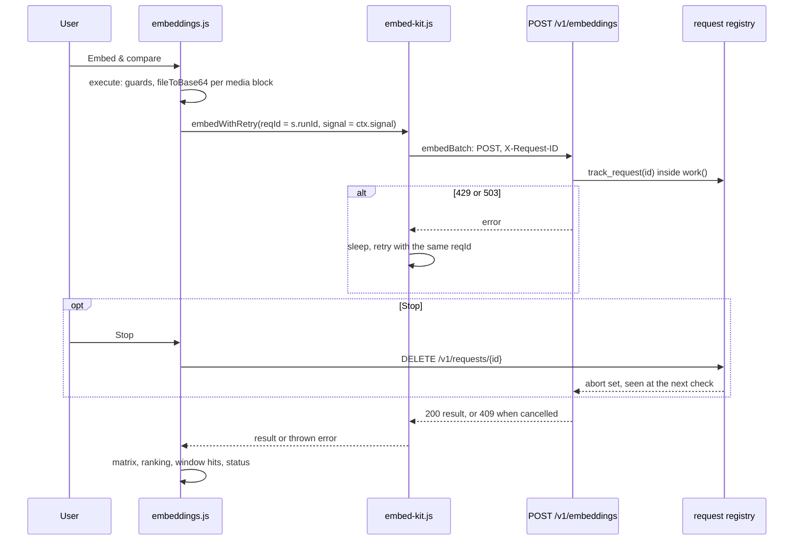

# Embeddings page

last updated: 2026-11-24

This page maps `#/embeddings` end to end: what `frontend/js/pages/embeddings.js` does from `setup` to teardown, every function of `frontend/js/embed-kit.js` it calls, and the two server routes it talks to (`POST /v1/embeddings` and `DELETE /v1/requests/{request_id}`), as far as the page relies on them. It starts where the router calls `mount` and stops at the boundary of shared code (the page lifecycle, the API layer, the settings drawer), which sibling pages map. It sits below [frontend_core.md](../frontend_core.md), which gives the one-paragraph overview of this page; the wire contract is in [docs/frontend_v3_spec.md](../../frontend_v3_spec.md) section 4, "Embeddings".

## Files and what each owns

| File | What it owns here |
|---|---|
| `frontend/js/pages/embeddings.js` | The whole page: DOM, `ctx.state`, the model list and `refreshModel`, the tabs (`switchMode`), Compare (`addItem`, `execute`), the Stop button, the video window preview dialog (`openWindowPreview`, `cleanupPreview`), the Lab (`labEmbedAll`, `runLabBenchmark`, `renderLabResults`, `importFromCompare`, the sample and folder loaders, the configuration list), the `download` helper and the teardown hook. |
| `frontend/js/embed-kit.js` | Pure and near-pure helpers shared by both modes: `maxBytesFor`, `mimeOf`, `kindOf`, `fileToBase64`, `mediaBlock`, `textBlock`, `embedBatch`, `embedWithRetry`, `planBatches`, `thumbnail`, `cosine`, `scoreItem`, `evaluateCase`, `summarize`, `buildPlan`, `buildSampleDataset`, plus `KINDS`, `EXT_MIME` and `SAMPLE_SET`. |
| `tests/e2e/embed-kit.test.mjs` | `node --test` checks for the kit's pure functions (`cosine`, `evaluateCase`, `summarize`, `buildPlan`, `scoreItem`, `maxBytesFor`, `planBatches`). It also holds a `storage.js` registry check unrelated to this page. |
| `tests/e2e/run.mjs` | The only browser check that touches this page: "every route mounts with no page error" visits `embeddings` and asserts no `#main > .error-note` and no page error. |
| `frontend/css/app.css` | The `.embeddings` and `.embeddings__*` rules. |
| `frontend/js/api.js` | Shared: `api.listModels` (through `request`), `requestId`, `httpError`. |
| `frontend/js/settings-drawer.js` | Shared: `registerSettings`, which this page calls with `{ samplers: "hidden" }`. |
| `src/heylook_llm/embeddings_api.py` | `create_embeddings`, the `POST /v1/embeddings` handler. |
| `src/heylook_llm/schema/embeddings.py` | `EmbeddingRequest`, `EmbeddingItem`, `EmbeddingText`, `EmbeddingMedia`, `EmbeddingSource`, `VideoWindows`, `EmbeddingResult`, `EmbeddingVector`, `EmbeddingWindow`; the limit constants (`MAX_ITEMS`, `MAX_BLOCKS_PER_ITEM`, `MAX_TEXT_CHARS`, `MAX_MEDIA_BYTES`, `MAX_VIDEO_BYTES`, `MAX_REQUEST_MEDIA_BYTES`, `MEDIA_BYTES_BY_TYPE`) and `request_limits`, which builds `engine.embedding.limits` from them. |
| `src/heylook_llm/embedding_models.py` | `embedding_info`, the object that becomes `engine.embedding`; `_video_windows`; `gguf_embedding_profile`. |
| `src/heylook_llm/capabilities.py`, `src/heylook_llm/providers/contract.py`, `src/heylook_llm/model_ops_api.py` | `derived_model_facts` and `describe` put `embedding` on the engine object; `list_models` serves it on each `GET /v1/models` row as `engine`. |
| `src/heylook_llm/providers/base.py` | `BaseProvider.embed`: capacity check, generation gate, `resolved_items`, engine embed, `finish`. |
| `src/heylook_llm/providers/common/embedding.py` | `check_cancel`, `resolved_items` (decodes and caps media), `finish` (truncates, L2-normalizes, attaches windows). |
| `src/heylook_llm/providers/mlx_embeddings.py`, `src/heylook_llm/providers/gguf_embeddings.py`, `src/heylook_llm/providers/video_windows.py` | The per-engine `embed`; `embed_windows` for windowed video on MLX. |
| `src/heylook_llm/requests_api.py`, `src/heylook_llm/request_registry.py` | `cancel_request` (`DELETE /v1/requests/{request_id}`), `resolve_request_id`, `track_request`, `RequestRegistry.cancel`. |
| `src/heylook_llm/busy_response.py` | `model_busy_response`, the 503 body for `ModelBusyError`. |

## State

Everything lives in the mount: `ctx.state` is fresh per mount (`page.js` `createPage`) and the closure variables die with `setup`. Nothing is written to browser storage; the page does not import `storage.js`.

| Name | Where it lives | Written by | Read by | Reset when |
|---|---|---|---|---|
| `s.mode` | `ctx.state` | `switchMode` | nothing reads it | each mount |
| `s.models` | `ctx.state`; the `/v1/models` rows that carry `engine.embedding`, MLX first | `setup` after `api.listModels` | `selected()`, `labEmbedAll` (looks up `cfg.model`) | each mount |
| `s.items` | `ctx.state`; each item is `{ blocks, name, prompt, paint, card }` (`name` is the Label input, `prompt` the Task select, `paint` the item's `paintBlocks`, `card` its section) | `addItem` (push), the item's Remove item button (splice) | `refreshModel`, `addItem` (count guard), `execute`, `importFromCompare` | each mount |
| item `blocks` | on each item; a text block is `{ kind: "text", text }`, a media block `{ kind, file, thumb, windows? }` | `addItem` (first text block), Add text, the Attach media handler, the block's textarea `input`, the Video windows select, Move up, Remove block | `paintBlocks`, `execute`, `importFromCompare` | with its item |
| `s.runId` | `ctx.state`; the `X-Request-ID` of the request in flight | `execute` before its request; `labEmbedAll` before each batch; set to `null` in the `finally` of `execute` and of `runLabBenchmark` | the Stop handler, the teardown hook | end of each run |
| `s.abort` | `ctx.state`; an `AbortController`, Lab only (Compare uses `ctx.signal`) | `runLabBenchmark` (created at start, `null` in its `finally`) | `labEmbedAll` (`s.abort.signal`), the Stop handler, the teardown hook | end of each Lab run |
| `s.labSetName` | `ctx.state` | the sample loader, the folder loader (on success), `importFromCompare` | Download benchmark JSON | replaced by the next load; each mount |
| `s.labFiles` | `ctx.state`; `Map` of relative path to `File` | the sample loader, the folder loader (before parsing), `importFromCompare` | `labEmbedAll` | replaced by the next load; each mount |
| `s.labPlan` | `ctx.state`; `{ queries, pool, cases }` from `buildPlan` | the sample loader, the folder loader (set to `null` first, then the plan on success), `importFromCompare` | `renderLabConfigs` (Run enabled), `runLabBenchmark`, `renderLabResults`, Download benchmark JSON | the folder loader nulls it at start; each mount |
| `s.labConfigs` | `ctx.state`; `{ model, dimensions, queryPrompt, docPrompt }` each | `pushLabConfig` (Add configuration, `addLabAblation`), the row's Remove | `renderLabConfigs`, `runLabBenchmark`, the sample loader and `importFromCompare` (empty check) | only by Remove; each mount |
| `s.labResults` | `ctx.state`; `{ cfg, label, cases, summary, seconds }` each | `runLabBenchmark` (emptied at start, one push per finished configuration), `resetLabResults` | `renderLabResults`, Download benchmark JSON, `labDownloadBtn.disabled` | `resetLabResults` (any set load or import), start of a run |
| `labBlocks` | closure `Map`; key is the item's `file` and `windows` joined by a pipe, value is the promise `mediaBlock` returns | `labEmbedAll` | `labEmbedAll` | cleared by the sample loader, the folder loader and `importFromCompare` |
| `previewUrl` | closure; the object URL the preview video plays | `openWindowPreview` | `cleanupPreview` | `cleanupPreview` |
| DOM-held values | `model.value`, `dimensions.value`, `labQueryPrompt.value`, `labDocPrompt.value`, each item's Label and Task values | the user; `refreshModel` and `prompts` rebuild the selects | `selected()`, `execute`, `addLabAblation`, Add configuration | each mount |
| Run chrome | `controls.disabled` (the fieldset), `stop.hidden`, `run.disabled`, `add.disabled`, `labRunBtn.disabled`, `labDownloadBtn.disabled`, `labProgress` | `execute`, `runLabBenchmark`, `refreshModel`, `addItem`, `renderLabConfigs`, `resetLabResults` | the browser | each mount |

## Entry points

| What the user or browser does | Handler, as file and function | Flow |
|---|---|---|
| Opens `#/embeddings` (desktop sidebar "Embeddings", the drawer's "Embeddings workbench" link, or the hash) | `frontend/js/app.js` `navigate` then `embeddings.js` `setup` | Mount and first paint |
| Changes Model | `embeddings.js` `refreshModel` | Model change |
| Changes Dimensions | `embeddings.js` `invalidate` | Compare: editing items and blocks |
| Clicks Compare or Embedding Lab | `embeddings.js` `switchMode` | Tabs |
| Add item, Remove item, Add text, Move up, Remove block, types in a Label or a text block, changes Task or Video windows | `embeddings.js` `addItem` and its inner handlers | Compare: editing items and blocks |
| Picks files in Attach media | `embeddings.js` the `change` listener on the item's file input | Compare: attaching media |
| Embed & compare | `embeddings.js` `execute` | Compare: Embed & compare |
| Stop | `embeddings.js` the `stop` button's handler | Stop |
| Preview on a window row; a frame time button; Close, Escape or an outside tap | `embeddings.js` `openWindowPreview`; the dialog's `close` listener `cleanupPreview` | Window preview dialog |
| Download vectors | `embeddings.js` `download` | Downloads |
| Send to Embedding Lab | `embeddings.js` `importFromCompare` | Send to Embedding Lab |
| Load sample set (8 cases) | `embeddings.js` the `labSampleBtn` handler | Lab: load the sample set |
| Choose folder (set.json), then picks a folder | `embeddings.js` the `labFolderInput` `change` listener | Lab: choose a folder |
| Add configuration, Add prompts on vs. off, Remove on a configuration | `embeddings.js` `pushLabConfig`, `addLabAblation`, `renderLabConfigs` | Lab: configurations |
| Run benchmark | `embeddings.js` `runLabBenchmark` | Lab: Run benchmark |
| Download benchmark JSON | `embeddings.js` `download` | Downloads |
| Leaves the page (any route change) | `page.js` `unmount`, then the page's `ctx.onTeardown` hooks | Teardown |

The page registers no `ctx.onHide` or `ctx.onResume` hook and no hotkeys.

## Flows

### Mount and first paint

Trigger: `app.js` `navigate` loads `pages/embeddings.js` and calls `mount(main)`; `createPage` builds `ctx` and awaits `setup(ctx)`.

Guards: none before the first await.

Steps:

1. `ctx.onTeardown(drawer.registerSettings({ samplers: "hidden" }))`. The drawer gets this page's contribution: no sampler panel. Its unregister runs at teardown.
2. State is initialised: `s.mode = "compare"`, `s.items = []`, `s.models = []`, `s.runId = null`, `s.abort = null`, `s.labSetName = ""`, `s.labFiles = new Map()`, `s.labPlan = null`, `s.labConfigs = []`, `s.labResults = []`.
3. The shared controls are built: the Model select (`aria-label` "Embedding model"), the Dimensions select ("Embedding dimensions"), the status line (`p`, `role="status"`, `aria-live="polite"`, text `Loading embedding models…`), the note line, the cards container, the results section ("Embedding results"), and the `controls` fieldset.
4. The buttons are built: `run` ("Embed & compare", calls `execute`), `sendToLab` ("Send to Embedding Lab", calls `importFromCompare`), `stop` ("Stop", hidden), `add` ("Add item", calls `addItem()` then `invalidate()`).
5. The preview dialog is built (`dialog.embeddings__dialog`, attribute `closedby="any"`, `aria-label` "Video window preview") with a title, a Close button, a `video` (`controls`, `preload="auto"`) and a frame-button row; its `close` event is bound to `cleanupPreview`.
6. The tab buttons "Compare" (`aria-pressed="true"`) and "Embedding Lab" (`aria-pressed="false"`) are built in a `role="group"` labelled "Embedding tools". The Compare pane holds the cards and a toolbar of Add item, Embed & compare and Send to Embedding Lab. The Lab pane starts `hidden`.
7. `controls` receives, in order: a toolbar with the Model and Dimensions fields, the note, the tab group, the Compare pane, the Lab pane.
8. `ctx.el` receives `div.embeddings`: the heading `Embeddings`, the line `Compare meaning across text, images, audio and video, or benchmark retrieval configurations.`, a `details` ("Ways to use this"), `controls`, `stop`, the status line, the results section and the dialog.
9. The Lab pane is built (see the Lab flows): the prompt selects, the hidden folder input, the set info line `Load the built-in 8-case multimodal sample set or choose a folder with set.json.`, the configuration list, Run benchmark and Download benchmark JSON (both disabled), the hidden `progress`, the results box.
10. Listeners: Model `change` calls `refreshModel`; Dimensions `change` calls `invalidate`. The teardown hook is registered (see Teardown).
11. `await api.listModels()`: `GET /v1/models`. Steps 1 to 10 ran synchronously, so the first paint happens here: empty Model and Dimensions selects, no items, the status `Loading embedding models…`, and Add item, Embed & compare and Send to Embedding Lab still enabled (nothing has disabled them yet).
12. If `!ctx.alive`, return.
13. `s.models` is the rows with a truthy `engine.embedding`, sorted so that rows where `isMlx` is true come first. `isMlx` is true when `engine.runtime.value === "mlx-vlm"`, `provider === "mlx"`, or `engine.embedding.video_windows` is set. The sort is stable, so server order holds within each group.
14. The Model select gets one `option` per row (value and text are the id); the browser selects the first.
15. `refreshModel()` (see Model change).
16. If there is at least one model: the selected model's prompt names are read; `q` is `"query"` if offered, else `""`; `d` is `"document"` if offered, else `""`. `addItem` runs for `"A dog playing on a beach."` with `q`, then `"A puppy running beside the ocean."` with `d`, then `"A database query joining two tables."` with `d`.
17. The status becomes `Ready. Edit the examples or attach your own media.`, or with no models `No embedding models found. Add a supported checkpoint to a scanned model folder and rescan on Models.`

Ends when: `setup` resolves; `navigate` then sets `main.dataset.mounted = "embeddings"`.

Failure paths: any throw from step 11 to 17 (a failed `GET /v1/models`, or `requireLimits` throwing inside `refreshModel` or `addItem`) lands in `setup`'s own `catch`: if `ctx.alive`, the status shows `error.message` and `run.disabled = true`. `setup` does not rethrow, so the router shows no error note.

Awaits and what is re-checked after each: `api.listModels()`, then `ctx.alive`. The list request carries no signal, so teardown does not abort it; the `ctx.alive` check discards the answer.

What the page reads off `engine.embedding` (built by `embedding_models.py` `embedding_info`):

| Field | Read by | Used for |
|---|---|---|
| `modalities` | `refreshModel` (note), `execute`, `labEmbedAll` | the note's "Inputs" list; the modality gates |
| `dimensions`, `native_dimensions` | `refreshModel` | the Dimensions options and their default |
| `max_input_tokens` | `refreshModel` | the note's token sentence only; nothing checks it |
| `prompts` | `prompts`, `refreshModel`, `addLabAblation`, `setup` | the Task and Lab prompt options; which note sentence shows |
| `video_windows` (`max_seconds`) | `paintBlocks`, `execute`, `labEmbedAll`, `isMlx` | whether the Video windows select exists and its labels; whether `windows` is sent |
| `limits.items`, `limits.blocks_per_item`, `limits.request_media_bytes` | `requireLimits` (Compare), `planBatches` (Lab, `items` and `request_media_bytes`) | the item and block caps; the request byte cap; batching |
| `limits.media_bytes[kind]` | `maxBytesFor` | the per-file cap at attach and at folder load |

Not read: `limits.text_chars`, `normalization`, `video_audio`, `video_windows.sampling`, `video_windows.default_sampling`, `provenance`, and the gguf `load_profile`.

### Model change (`refreshModel`)

Trigger: the Model select's `change`, and once from `setup`.

Guards: the Model select sits inside `controls`, so it cannot change during a run.

Steps:

1. `info = selected()?.engine.embedding`, where `selected()` finds `model.value` in `s.models`.
2. The Dimensions select is rebuilt from `info.dimensions`; with `info`, `dimensions.value = info.native_dimensions`. A model change always resets dimensions to native.
3. The note becomes `Inputs: <modalities joined by ", ">. Each item must fit <max_input_tokens, toLocaleString> tokens including media. ` followed by `Task prompts come from the checkpoint.` when `prompts` has keys, else `This checkpoint has no named prompt catalog; task instructions can be entered as text.` Without `info` it is empty.
4. For each item: `prompts(item.prompt, item.prompt.value)` rebuilds its Task options from the new model and keeps the old choice only if the new model offers it (otherwise the select falls to the empty option `No task prefix`); then `item.paint()` repaints its blocks, which adds or removes each video block's Video windows select.
5. `prompts(labQueryPrompt, "query")` and `prompts(labDocPrompt, "document")` rebuild the Lab prompt selects and reset their choice to `query` and `document` when offered.
6. `run.disabled = !info`; `add.disabled = !info || s.items.length >= requireLimits().items`.
7. `invalidate()` empties the results section.

Ends when: the steps finish; no request is made.

Failure paths: `requireLimits` throws `Missing engine.embedding.limits on selected model.` when `items`, `blocks_per_item` or `request_media_bytes` is not an integer. From the `change` listener this is an uncaught exception (nothing shows on the status line); from `setup` it is caught and shown. A video block keeps its `windows` choice when the new model has no `video_windows`; `execute` then drops it.

Awaits: none.

### Tabs (`switchMode`)

Trigger: a click on Compare or Embedding Lab; also `importFromCompare` calls `switchMode("lab")`.

Guards: both tab buttons are inside `controls`, so neither works during a run.

Steps: `s.mode = mode`; each tab's `aria-pressed` is set; the Compare pane and the results section are hidden unless the mode is `compare`; the Lab pane is hidden unless it is `lab`.

What each pane holds: above both, the Model and Dimensions fields and the note. The Compare pane holds the item cards and the Add item, Embed & compare and Send to Embedding Lab toolbar; the results section (outside `controls`) belongs to it. The Lab pane holds the Load sample set and Choose folder toolbar, the set info line, the Query prompt and Document prompt fields with Add configuration and Add prompts on vs. off, the configuration list, Run benchmark and Download benchmark JSON, the progress bar and the Lab results. Stop and the status line sit outside both panes and serve both.

Ends when: the panes are toggled. Switching does not clear either mode's results.

### Compare: editing items and blocks

Trigger: Add item; the controls inside a card; Dimensions `change`.

Guards: `addItem` returns silently when `s.items.length >= requireLimits().items`, and Add item is disabled at that count. Add text does nothing when the item already has `requireLimits().blocks_per_item` blocks. Move up does nothing on the first block. Everything here is inside `controls` and is disabled during a run.

Steps for `addItem(text = "", defaultPrompt = "")`:

1. `maxItems` and `maxBlocks` are closures over `requireLimits()`, read at each use.
2. The count guard above.
3. `item = { blocks: [] }`. `item.name` is a text input with value `Item <count + 1>`, `maxLength` 80, `aria-label` "Item label", `input` calls `invalidate`. `item.prompt` is a select ("Task prompt"), `change` calls `invalidate`, filled by `prompts(item.prompt, defaultPrompt)`.
4. `paintBlocks` is defined and stored as `item.paint`. It reads `selected()?.engine.embedding?.video_windows` and rebuilds every block row: a media block shows its thumbnail (`img.embeddings__inline-thumb`, when `thumb` is set), the text `<kind>: <file name>`, and for a video block when the model reports `video_windows`, a select ("Video windows") with `Whole video only` (value `""`), `Windows: fixed rate (<max_seconds>s)` (`fps`) and `Windows: content (<max_seconds>s)` (`content`), whose `change` writes `block.windows` and calls `invalidate`. A text block shows a textarea ("Text content", placeholder `Text, code, query or label description`) whose `input` writes `block.text` and calls `invalidate`. Each row ends with Move up (swaps with the previous block, repaints, invalidates) and Remove block (splices, repaints, invalidates).
5. The first block `{ kind: "text", text }` is pushed.
6. The file input is built (`multiple`, `accept="image/*,audio/*,video/*"`, `aria-label` "Add images, audio or video") with its `change` listener (see attaching media).
7. `item.card` is a `section.embeddings__item`: a toolbar with Label, Task and Remove item; the blocks; a toolbar with Add text and the Attach media field.
8. The item is pushed to `s.items`, the card appended, `paintBlocks()` run, and `add.disabled = s.items.length >= maxItems()`.

Remove item splices the item out of `s.items`, removes its card, sets `add.disabled = false` and calls `invalidate`. Labels are not renumbered, so a later Add item can repeat a label.

`invalidate()` is `results.replaceChildren()`. It runs on every edit above, on a Dimensions change, on Add item, and from `refreshModel`, so Compare results never describe inputs that have since changed.

Ends when: the DOM is repainted. No request is made.

Failure paths: `requireLimits` throwing inside a click handler is uncaught. Before the model list arrives (or after it failed) Add item is still enabled, and a click throws there.

Awaits: none.

### Compare: attaching media

Trigger: `change` on an item's Attach media input.

Guards, per file, in this order:

1. `kindOf(file)` is null: status `Unsupported file type: <name>`, skip the file.
2. `maxBytesFor(info, kind)` is read; if `file.size` exceeds it: status `<name> exceeds the media size limit.`, skip the file.
3. The item already has `maxBlocks()` blocks: status `An item can contain at most <blocks_per_item> blocks.`, stop processing the rest.

There is no modality gate here: a kind the model does not take is accepted and refused later by `execute`.

Steps:

1. `chosen` is a copy of the input's files; `files.value = ""` so the same file can be picked again.
2. `info = selected()?.engine.embedding`, read once.
3. For each file, the guards above, then `thumb = await thumbnail(file, kind)` and `item.blocks.push({ kind, file, thumb })`.
4. After the loop (also after a skip or the stop): `paintBlocks()` and `invalidate()`.

Ends when: the loop finishes and the item repaints. A successful attach does not clear an earlier status message.

Failure paths: a throw (for example `Missing media_bytes limit for <kind>` from `maxBytesFor`) goes to the `catch`, which shows `err.message` if `ctx.alive`. `thumbnail` never throws; a failure gives `thumb = null` and the row shows no image.

Awaits and what is re-checked after each: `thumbnail` per file, with no re-check. If the item was removed or the page torn down meanwhile, the block is pushed to a detached item and painted into a detached card, which is harmless. The file input is not disabled while thumbnails are drawn, so a run can start in that window (see the last section).

### Compare: Embed & compare (`execute`)

Trigger: Embed & compare.

Guards: `run.disabled` is set when the selected model has no `engine.embedding` and when the model list failed; the `controls` fieldset is disabled during any run. Inside `execute`, in order:

1. No items: `Add at least one item.`
2. Per block, a kind not in `info.modalities` (text included): `This model does not support <kind>.`
3. Per media block, the running total of `file.size` over `requireLimits().request_media_bytes`: `Combined media exceeds the request size limit.`
4. Per item, no content after empty text blocks are dropped: `<label> is empty.`
5. Per item, a block with `windows` and more than one block: `<label>: an item with video windows must contain only that video block.`

Steps:

1. `controls.disabled = true`; `invalidate()`; status `Preparing inputs…`.
2. `info = selected().engine.embedding`; `reqCap = requireLimits().request_media_bytes`; `labels` is each item's trimmed Label or `Item <n>`.
3. For each item, for each block in order: the modality guard; a text block with non-blank text becomes `{ type: "text", text }` (the untrimmed text) and a blank one is skipped; a media block adds `file.size` to the total, checks the request cap, then `data = await fileToBase64(file)`, then if `!ctx.alive` returns. A video block whose `windows` is set, on a model that reports `video_windows`, gets `windows: { sampling: block.windows }` (no `seconds`, so the server uses its default). The block is `{ type: kind, source: { type: "base64", media_type: mimeOf(file), data } }` plus `windows` when set. These are built inline; `execute` does not call `mediaBlock` or `textBlock`.
4. The item guards; the item is `{ content }` plus `prompt_name` when its Task select is not empty.
5. If `!ctx.alive`, return.
6. `body = { model: model.value, dimensions: Number(dimensions.value), input }`.
7. `s.runId = requestId()`; `stop.hidden = false`; status `Embedding… The model loads automatically if needed.`
8. `result = await embedWithRetry({ model, dimensions, items: input, reqId: s.runId, signal: ctx.signal })`: `POST /v1/embeddings` with `X-Request-ID: s.runId`, retried on 429 and 503.
9. If `!ctx.alive`, return.
10. `vectors` is `result.data[].embedding`. Similarity is a plain dot product (a local `dot`), which is the cosine because the server L2-normalizes every vector after truncating it (`providers/common/embedding.py` `finish`).
11. The matrix: a `table.embeddings__matrix` with caption `Cosine similarity — higher means more similar`, a header row `Item` then the labels, and one row per vector with each pair's score to three decimals. An off-diagonal cell is tinted with `color-mix(in oklch, var(--brand) <pct>%, var(--surface))`, where `pct` is the score clamped to [0, 1] times the literal `28` in `execute`, rounded; a cell whose `pct` is 0 is not tinted.
12. The ranking: every vector after the first, scored against the first, sorted high to low.
13. The window hits: for each row after the first whose `windows` is an array, every window becomes a hit with label `<item label> [m:ss–m:ss]` (`fmtSpan`, from `start` and `end`), score against the first vector, `start`, `end`, `frameTimes` (`frame_times` or `[]`) and `file` (the item's first video block's `File`, or null). Hits are sorted high to low. The first item's own windows are never listed.
14. The results section gets: `Results`; `<result.model> · <result.dimensions> dimensions · <data.length> vectors`; when there is a ranking, `Closest to <first label>` and a list of `<label>: <score>`; when there are hits, `Closest video windows to <first label>` and a list where each row shows `<label>: <score>`, `(<n> frames: <m:ss, m:ss, ...>)` when it has frame times, and a Preview button when it has a file; the matrix in a focusable scroll box (`aria-label` "Similarity table"); Download vectors; and a `details` "Inspect vectors" holding `result.data` as JSON.
15. Status: `Complete in <elapsed_ms / 1000, two decimals>s. <input_tokens> input tokens.`, with ` in ...s` left out when `elapsed_ms` is null and `Token usage unavailable.` in place of the token sentence when `input_tokens` is null.

Ends when: the `finally` runs: `s.runId = null`; if `ctx.alive`, `controls.disabled = false` and `stop.hidden = true`.

Failure paths: every guard and every request error lands in the one `catch`, which shows `error.message` if `ctx.alive`. Request errors carry the server's message through `api.js` `httpError` (see Requests). A teardown aborts `ctx.signal`; the `catch` then writes nothing.

Awaits and what is re-checked after each: each `fileToBase64`, then `ctx.alive`; after the loop, `ctx.alive` again; `embedWithRetry`, then `ctx.alive`. Nothing else is re-checked, because `controls` is disabled and no input can change. Compare does not check that `result.data` has one row per item; the server raises before answering if it does not (`finish`).



### Stop

Trigger: Stop, which is visible only while `execute` is past step 7 or `runLabBenchmark` is running. It sits outside `controls`, so it stays enabled.

Guards: after `s.abort?.abort()`, the handler returns if `s.runId` is null.

Steps:

1. `s.abort?.abort()`. In the Lab this aborts the batch request in flight; in Compare `s.abort` is null, so nothing is aborted on the client.
2. `id = s.runId`.
3. `await fetch("/v1/requests/<id, URI-encoded>", { method: "DELETE" })`.
4. On `response.ok`, if `ctx.alive` and `s.runId === id`: status `Cancellation requested. Waiting for the current operation to finish…`.

Ends when: the DELETE answers. What the user sees last depends on the run:

- Compare: the request is not aborted, so the server's answer arrives later. A run the server cancelled answers 409 and the status becomes that error's message (`Embedding request cancelled` from `check_cancel`; a run cancelled while still queued at the generation gate raises `GenerationCancelled()` with no message, so the status falls back to the response's status text). A run that finished first shows its results.
- Lab: the abort rejects the fetch with `AbortError`, `runLabBenchmark` shows `Benchmark stopped.`, and its `finally` nulls `s.runId`, so step 4's id check usually fails and the cancellation line is not shown.

Failure paths: a non-OK DELETE throws `httpError`; the `catch` shows its message if `ctx.alive`, without the `s.runId === id` check. A 404 means nothing is registered under the id: the run finished, it has not reached `track_request` yet, or it is between Lab batches, where `s.runId` still names the previous, finished batch.

Awaits and what is re-checked after each: the DELETE, then `ctx.alive` and `s.runId === id` on success, `ctx.alive` only on failure.

### Window preview dialog

Trigger: Preview on a window row (`openWindowPreview(hit)`); a frame-time button; Close; Escape or an outside tap (`closedby="any"`).

Guards: the Preview button exists only when the hit has a `file`.

Steps for `openWindowPreview(hit)`:

1. `cleanupPreview()`: pause the video, remove its `src`, empty the frame row, revoke the previous `previewUrl`.
2. The title becomes `<hit.label> (<score, three decimals>)`.
3. `previewUrl = URL.createObjectURL(hit.file)`; the video's `src` is set to it; `onloadedmetadata` seeks to `hit.start` (or 0).
4. With frame times: the row gets `Sampled frames (<n>):` and one button per time, labelled `m:ss` (`fmtSec`), each seeking the video to that time.
5. `showModal()` when the dialog supports it, otherwise the `open` attribute.

Ends when: the dialog closes. Its `close` event runs `cleanupPreview`, which revokes `previewUrl`. Playback is not stopped at the window's end.

Failure paths: none handled; a file that will not play leaves the video empty.

Awaits: none.

### Downloads

Trigger: Download vectors (Compare results) or Download benchmark JSON (Lab).

Guards: Download benchmark JSON returns unless `s.labPlan` is set and `s.labResults` is not empty; the button is also disabled until a run leaves results.

Steps: `download(value, filename)` serialises `value` with two-space indentation into a `Blob`, makes an object URL, clicks a detached `a` with `download=filename`, and revokes the URL after a `setTimeout` of `1000` in `download`. Download vectors sends `{ labels, ...result }` as `embeddings.json` (the whole response, including `request_id`, `elapsed_ms` and `input_tokens`). Download benchmark JSON sends `{ set: s.labSetName, cases: <case ids>, results: s.labResults }` as `embedding-lab-results.json`.

Ends when: the browser saves the file.

### Send to Embedding Lab (`importFromCompare`)

Trigger: Send to Embedding Lab.

Guards, in order (each throws into the `catch`, which shows the message if `ctx.alive`):

1. Fewer than two items: `Compare needs at least 2 items (1 query + 1 positive) to send to Embedding Lab.`
2. Per item, more than one media block: `<label>: Embedding Lab items support at most one media file per item.`
3. Per item, no non-blank text and no media: `<label> is empty.`
4. Per item, a video with `windows` and any text: `<label>: an item with video windows cannot also include text.`
5. Any `buildPlan` error (for example two items with the same content, which gives `<id>: the query is identical to one of its own positives.` or `<id>: the same item is both a positive and a negative.`).

Steps:

1. Each item becomes a Lab item: its non-blank text blocks, trimmed and joined with a newline, as `text`; its one media file stored in a new `files` map under `<index + 1>-<file name>` and named as `file`; a video's `windows` choice as `windows`. Block order inside the item and the item's Task choice are not carried.
2. The set is `{ name: "From Compare", cases: [{ id: <first label trimmed, or "compare-query">, query: <item 1>, positives: [<item 2>], negatives: <items 3 onward> }] }`.
3. `labBlocks.clear()`; `resetLabResults()` (empties `s.labResults` and the results box, disables Download benchmark JSON).
4. `plan = buildPlan(set, (p) => files.has(p))`.
5. `s.labSetName`, `s.labFiles`, `s.labPlan` are replaced; the set info line becomes `From Compare: 1 case, <pool length> candidate document(s), <files.size> media file(s).`
6. With no configurations and a selected model, `addLabAblation()`; otherwise `renderLabConfigs()`.
7. `switchMode("lab")`; status `Loaded Compare items into Embedding Lab.`

Ends when: the Lab tab shows the imported case.

Failure paths: a failure before step 3 changes nothing. A `buildPlan` failure at step 4 comes after step 3, so the previous Lab results are gone while the previous plan stays loaded. The page stays on Compare.

Awaits: none. No modality or size check runs here; sizes were checked at attach and modalities are checked per configuration by `labEmbedAll`.

### Lab: load the sample set

Trigger: Load sample set (8 cases).

Guards: inside `controls`, so not during a run.

Steps:

1. `labBlocks.clear()`; `resetLabResults()`.
2. `{ setName, files, plan } = await buildSampleDataset()`: the kit draws the sample PNGs on canvases and plans `SAMPLE_SET` against them.
3. `s.labSetName`, `s.labFiles`, `s.labPlan` are replaced.
4. The set info line becomes `<setName>: <cases> cases, <pool length> documents, <media> generated shape PNGs.`, where `media` adds pool entries that name a file and queries that name a file.
5. With no configurations and a selected model, `addLabAblation()`; otherwise `renderLabConfigs()`.

Ends when: the info line and the configuration list are painted; Run benchmark is enabled when there is at least one configuration.

Failure paths: a throw shows `err.message` on the status line if `ctx.alive`.

Awaits and what is re-checked after each: `buildSampleDataset`, with no re-check before writing state.

### Lab: choose a folder

Trigger: Choose folder (set.json) clicks the hidden `webkitdirectory` input; its `change` runs the loader.

Guards: the input and its button are inside `controls`.

Steps:

1. A `Map` of files is built: each key is `webkitRelativePath` without its first segment (the chosen folder's own name), or the file name.
2. The input's value is cleared.
3. `s.labPlan = null`, `s.labFiles = files`, `labBlocks.clear()`, `resetLabResults()`.
4. `setFile = files.get("set.json")`; missing: `No set.json at the top of that folder.`
5. `set = JSON.parse(await setFile.text())`.
6. `info = selected()?.engine.embedding`.
7. `plan = buildPlan(set, known)`, where `known(path)` is true only when the file is in the map, `kindOf` gives it a kind, and its size is within `maxBytesFor(info, kind)`.
8. `s.labPlan = plan`, `s.labSetName = set.name || "test set"`; the info line becomes `<name>: <cases> cases, <pool length> documents, <media> media references.`
9. `renderLabConfigs()` (after the `try`, on both paths).

Ends when: the info line is painted. Unlike the sample loader and the import, this loader adds no configuration.

Failure paths: every throw (a missing `set.json`, a JSON syntax error, any `buildPlan` message, `Missing media_bytes limit for <kind>` when no model is selected) shows on the set info line as `Cannot use that folder: <message>`, not on the status line, with no `ctx.alive` check. `s.labPlan` stays null, so Run benchmark is disabled. A file that exists but has an unknown kind or is over its cap fails `known`, and `buildPlan` reports it as `<where>: file "<path>" is not in the chosen folder.`

Awaits and what is re-checked after each: `setFile.text()`, with no re-check.

### Lab: configurations

Trigger: Add configuration; Add prompts on vs. off; Remove on a row. Also `addLabAblation` from the sample loader and the import.

Guards: `pushLabConfig` refuses silently when `c.model` is empty or a configuration with the same `labLabel` exists.

Steps:

1. Add configuration pushes `{ model: model.value, dimensions: Number(dimensions.value), queryPrompt: labQueryPrompt.value, docPrompt: labDocPrompt.value }`.
2. `addLabAblation` reads the selected model's prompt names; the query prompt is `query` if offered, else the first name, else empty; the document prompt is `document` if offered, else the first name, else empty. It pushes that configuration and one with both prompts empty. With no prompt catalog the two have the same label and the second is refused.
3. `renderLabConfigs` lists each as `<model> · <dimensions>d · query: <prompt or "none"> · doc: <prompt or "none">` with a Remove button (splices it and re-renders), and sets `labRunBtn.disabled = !s.labPlan || !s.labConfigs.length`.

Ends when: the list is painted. Removing a configuration does not clear results already shown.

Awaits: none.

### Lab: Run benchmark (`runLabBenchmark`)

Trigger: Run benchmark.

Guards: returns when there is no plan or no configuration (the button is disabled then too). Per configuration, `labEmbedAll` refuses before sending anything: `<model> does not take <kind> (<file>).` for a file kind outside `modalities`, and `<model> does not support video windows (<file>).` for an item with `windows` on a model without `video_windows`.

Steps:

1. `order` is the configurations sorted by model id (`localeCompare`; stable within a model).
2. `s.labResults = []`; `renderLabResults()` empties the box.
3. `controls.disabled = true`; `stop.hidden = false`; the progress bar is shown with `max = order.length`, `value = 0`.
4. `s.abort = new AbortController()`.
5. For each configuration `i`:
   1. Status `Running <i + 1> of <n>: <labLabel>…`.
   2. `pool = await labEmbedAll(s.labPlan.pool, cfg.docPrompt, cfg)`, then `queries = await labEmbedAll(s.labPlan.queries, cfg.queryPrompt, cfg)`.
   3. Each case is scored: `evaluateCase(queries[idx], pool, new Set(c.positives), new Set(c.excluded))`. The whole pool is the candidate set, so every pool document that is not one of the case's positives and not its excluded query copy counts as a negative; the case's own `negatives` list does not narrow it.
   4. `{ cfg, label, cases, summary: summarize(cases), seconds }` is pushed, where `seconds` is wall time from `performance.now()` across both `labEmbedAll` calls (the first configuration also pays for base64 encoding, which later ones reuse from `labBlocks`).
   5. The progress value becomes `i + 1`; `renderLabResults()` repaints, so finished configurations show while the rest run.
6. Status `Done. Evaluated <n> configuration(s).`

`labEmbedAll(items, prompt, cfg)`:

1. `info` is `cfg.model`'s `engine.embedding` from `s.models`.
2. The two refusals above, over every item.
3. `entries` pairs each item with `bytes`: the file's size, or 1 for a text-only item.
4. For each batch from `planBatches(entries, info.limits)`: each entry's content is `textBlock(text)` when it has text, then its media block when it has a file. The media block comes from `labBlocks`, keyed by file and windows choice, which stores the promise from `mediaBlock(file, win)` (`win` is `{ sampling: windows }` when the item has `windows` and the model reports `video_windows`). The item is `{ content }` plus `prompt_name: prompt` when `prompt` is not empty.
5. `s.runId = requestId()`; `res = await embedWithRetry({ model: cfg.model, dimensions: cfg.dimensions, items, reqId: s.runId, signal: s.abort.signal })`.
6. `res.data.length` must equal the batch length, else `The server returned the wrong number of vectors.`
7. Each row is kept as `{ embedding, windows }` when `windows` is a non-empty array, else as the bare `embedding`. Window rows feed `scoreItem` in the pool; a windowed query is scored by its whole-video `embedding`.

`renderLabResults` paints two tables in scroll boxes. The summary (`Summary: <cases> cases`) has columns `Configuration`, `Recall@1`, `Recall@3`, `MRR`, `Mean margin`, `Worst margin`, `Seconds`; recalls as whole percentages, MRR to three decimals, margins through `signed` (a `+` or `−` sign and three decimals, `–` for null), seconds to two decimals. In each metric column, when more than one configuration has a value, cells equal to the maximum get `embeddings__best`. The per-case table (`Per case: rank of best positive and margin over best negative`) has one row per case id and one column per configuration; a cell reads `✓ #<rank> <margin>` (class `embeddings__hit`) at rank 1, else `✗ #<rank> <margin>` (`embeddings__miss`) with a line `beaten by: <first 48 characters of the best negative's text> + <its file>`.

Ends when: the `finally` runs: `s.runId = null`, `s.abort = null`, the progress bar hidden; if `ctx.alive`, `controls.disabled = false`, `stop.hidden = true`, and Download benchmark JSON enabled when there are results.

Failure paths: the `catch` shows `Benchmark stopped.` for an `AbortError` and `Failed: <message>` for anything else, if `ctx.alive`. Configurations finished before the failure stay in `s.labResults`, on screen and downloadable.

Awaits and what is re-checked after each: each media block promise, each `embedWithRetry`, each `labEmbedAll`. None re-checks `ctx.alive`. Teardown aborts `s.abort`, and every await chain in the loop ends in a fetch on `s.abort.signal`, which then rejects at once, so the loop stops and the `catch` writes nothing.

```mermaid
sequenceDiagram
    participant P as embeddings.js
    participant K as embed-kit.js
    participant S as POST /v1/embeddings
    loop each configuration, sorted by model
        P->>K: planBatches(pool entries, limits)
        loop each batch
            P->>K: textBlock, mediaBlock (cached in labBlocks)
            P->>K: embedWithRetry(reqId = s.runId, signal = s.abort.signal)
            K->>S: POST, X-Request-ID
            S-->>K: data rows (windows when asked)
            K-->>P: result; row count checked
        end
        P->>P: the same for the queries, with the query prompt
        P->>K: evaluateCase per case, summarize
        P->>P: renderLabResults, progress
    end
```

### Teardown

Trigger: any route change; `navigate` awaits `currentPage.unmount()`.

Steps:

1. `ctx.alive = false`; `ctx.signal` is aborted. A Compare request in flight rejects with `AbortError`.
2. The `ctx.onTeardown` hooks run in reverse order of registration, so the page's hook runs first: `cleanupPreview()` (revokes `previewUrl`); `s.abort?.abort()` (aborts a Lab batch in flight); if `s.runId` is set, `fetch("/v1/requests/<id>", { method: "DELETE", keepalive: true })` with errors swallowed. `s.runId` is still set here because the runs' `finally` blocks run later, after the rejection is delivered.
3. Then the drawer's unregister: `registerSettings`'s returned function clears this page's contribution if it is still the current one.
4. There is no `teardown` in the spec.

Ends when: `unmount` resolves. The run's `catch` and `finally` then run against a dead page; the `ctx.alive` checks keep them from writing anything except `labProgress.hidden`, which is unconditional and lands on a detached node.

What teardown does not cover: a hidden or frozen tab sends nothing, because the page has no `onHide` hook. A non-streaming request whose client hangs up keeps running on the server (`requests_api.py` module docstring), so only the DELETE stops a run.

### Server: `POST /v1/embeddings` as the page relies on it

Handler: `embeddings_api.py` `create_embeddings`.

Request body (`schema/embeddings.py` `EmbeddingRequest`, `extra="forbid"` throughout): `model`, `input` (a list of `EmbeddingItem`, at least one, at most `MAX_ITEMS`), optional `dimensions` (strict positive integer). An item is `{ content, prompt_name? }`, `content` between one and `MAX_BLOCKS_PER_ITEM` blocks. A text block is `{ type: "text", text }` (`MAX_TEXT_CHARS`). A media block is `{ type: "image" | "audio" | "video", source: { type: "base64", media_type, data }, windows? }`; `media_type` must start with the block's type, the base64 length is capped from `MEDIA_BYTES_BY_TYPE`, and `windows` (`VideoWindows`: `seconds?`, `sampling` of `fps` or `content`, default `fps`) is allowed on video only. An item holding a windowed video must hold only that block (`windowed_video_stands_alone`). The page sends exactly these shapes and never `url` sources or `seconds`.

Checks after the body parses, in order: unknown model, 404 `Unknown embedding model`; not an embedding model, 400 `Model does not support embeddings`; `dimensions` not offered, 400 `Unsupported dimensions; choose [...]`; per item, an unknown `prompt_name` (400 `input[i]: unknown prompt_name`), a block type outside `modalities` (400 `input[i]: unsupported modality`), windows on a model with no `video_windows` (400 `input[i]: video windows run on MLX embedding models only`), `windows.seconds` above `max_seconds` (400).

Then the id: `resolve_request_id(X-Request-ID, prefix="emb")` keeps the page's id (a UUID from `requestId`, or its fallback, both within `_ID_SAFE`) and echoes it as `X-Request-ID`. The work runs on an executor from `_executor_pool`. Inside `work`, `track_request` registers the id, so the id becomes cancellable only from here on. `router.get_provider` loads the model if needed (the page's status says so); an eviction race raises `ModelBusyError`. `BaseProvider.embed` runs `check_capacity`, waits at the generation gate with the abort as its cancel check, then `resolved_items` decodes each media block and refuses an empty block, one over its type cap, or a request over `MAX_REQUEST_MEDIA_BYTES` in decoded bytes (400 `input[i]: empty media or media byte limit exceeded`). The engine embeds (an over-long item is 400 `input[i]: expanded input has N tokens; limit is M`), then `finish` truncates each vector to `dimensions`, L2-normalizes it, and does the same for each window.

Response (`EmbeddingResult`): `model`, `dimensions`, `data` (one `EmbeddingVector` per item, in order: `index`, `embedding`, `prompt_name`, `windows`), `input_tokens`, `request_id`, `elapsed_ms`. `windows` is null unless the item asked for them; then it is a list of `{ start, end, frame_times, embedding }`, consecutive windows of `seconds` (default `max_frames / fps` from the checkpoint's `processor_config.json`, `video_windows.py` `embed_windows`). The page uses `model`, `dimensions`, `data[].embedding`, `data[].windows[].start`, `end`, `frame_times`, `embedding`, `input_tokens` and `elapsed_ms`.

Errors the page meets: 400 (`InvalidGenerationRequest` or the checks above, `detail` string); 404; 409 (`GenerationCancelled`: `Embedding request cancelled` from `check_cancel`, or an empty detail when cancelled in the gate queue); 422 (body validation, FastAPI's list `detail`); 503 (`ModelBusyError` through `model_busy_response`, `error.message`, `Retry-After`); 500 for anything else.

### Server: `DELETE /v1/requests/{request_id}`

Handler: `requests_api.py` `cancel_request`. A malformed id is 422; an id with nothing registered is 404 (`No in-flight request with id '<id>'. It may have already finished, or it was sent without an X-Request-ID header and is tracked under a server-generated id.`); otherwise `RequestRegistry.cancel` sets every registered `AbortEvent` and the answer is `{ cancelled, request_id }`. The embedding run sees the flag at its next `check_cancel` or while waiting at the gate; a model load in progress is not interrupted. The page reads only `response.ok`.

## The kit, function by function

| Function | Inputs | Output | Throws | Called by | Held to by `tests/e2e/embed-kit.test.mjs` |
|---|---|---|---|---|---|
| `maxBytesFor(info, kind)` | an `engine.embedding` object, a kind | `info.limits.media_bytes[kind]` | `Missing media_bytes limit for <kind>` unless a positive integer | the attach handler; the folder loader's `known` | missing limits throw; a present limit is returned |
| `mimeOf(file)` | a `File` | `file.type`, else `EXT_MIME` by lowercased extension, else `""` | no | `kindOf`, `mediaBlock`, `execute` (`media_type`) | not tested |
| `kindOf(file)` | a `File` | the MIME's first segment when it is in `KINDS` (`image`, `audio`, `video`), else null | no | the attach handler, `known`, `labEmbedAll`, `mediaBlock` | not tested |
| `fileToBase64(file)` | a `File` | a promise of the data URL's payload after the first comma | rejects `Cannot read <name>` | `execute`, `mediaBlock` | not tested |
| `mediaBlock(file, windows = null)` | a `File`, a windows object | promise of `{ type, source: { type: "base64", media_type, data } }`, plus `windows` only for video | `Unsupported file type: <name>` | `labEmbedAll` | not tested |
| `textBlock(text)` | a string | `{ type: "text", text }` | no | `labEmbedAll` | not tested |
| `embedBatch({ model, dimensions, items, reqId, signal })` | the request parts; `reqId` defaults to a fresh `requestId()` | the parsed JSON response | `httpError(res)` on a non-OK answer; `AbortError` from `signal` | `embedWithRetry` | not tested |
| `embedWithRetry(args, tries = 4)` | `embedBatch`'s argument | the first successful response | rethrows unless the status is 429 or 503, `attempt < tries` and the signal is not aborted; between attempts it sleeps `1500 * (attempt + 1)` ms, not cut short by an abort, and ignores `Retry-After` | `execute`, `labEmbedAll` | not tested |
| `planBatches(entries, limits)` | `{ bytes }` entries; `limits.items`, `limits.request_media_bytes` | arrays of entries in order; a batch closes before an entry that would pass `limits.items` or `Math.floor(request_media_bytes * 0.75)` bytes; an entry over the byte budget goes alone | `Missing embedding request limits` | `labEmbedAll` | only the throw is tested |
| `thumbnail(file, kind)` | a `File`, a kind | a JPEG data URL (`toThumb`, longest side at most `THUMB`), or null for audio, other kinds, or any failure; a video gets a temporary object URL, a seek near its start and a timeout literal in `thumbnail`, and the URL is revoked in `finally` | no | the attach handler | not tested |
| `cosine(a, b)` | two vectors | the cosine, 0 when either norm is 0 | no | `scoreItem` | parallel, orthogonal and zero vectors |
| `scoreItem(query, entry)` | a vector; a vector or `{ embedding, windows }` | the cosine, or the best of the whole vector and every window | no | `evaluateCase` | a windowed entry scores its best window |
| `evaluateCase(query, pool, positives, excluded)` | a vector or `{ embedding }`; pool entries; `Set`s of indexes | `{ rank, bestPos, bestNeg, bestNegIndex, bestPosIndex, margin }`; `rank` is 1 plus the non-excluded negatives scoring above the best positive; `bestNeg` and `margin` are null with no negative | `A case needs at least one positive.` | `runLabBenchmark` | rank counts only wrong documents above the best right one; no positive throws; no negative gives a null margin; exclusion fixes the rank |
| `summarize(results)` | case results | `{ n, r1, r3, mrr, meanMargin, minMargin }`; margins ignore nulls and are null when none | no | `runLabBenchmark` | the five values on a mixed list |
| `buildPlan(set, known)` | a parsed set; a predicate for file paths | `{ queries, pool, cases }`; items are a string or `{ text, file, windows }`; the pool is deduplicated across cases by text, file and windows; queries are not pooled; a case is `{ id, query, positives, negatives, excluded }`, and `excluded` holds the pool index of an item identical to the case's query | see below | the folder loader, `importFromCompare`, `buildSampleDataset` | deduplication and indexes; exclusion only in its own case; the malformed-set messages; `fps` and `content` accepted |
| `buildSampleDataset()` | none | promise of `{ setName, files, plan }`: `drawShapePng` draws `red-circle.png`, `blue-square.png`, `green-triangle.png` and `black-cross.png`, and `SAMPLE_SET` is planned against them | `buildPlan`'s errors | the sample loader | not tested |

`buildPlan` messages: `set.json needs a non-empty "cases" array.`; `<where>: expected a string or {text, file, windows}.`; `<where>: unknown field "<name>".`; `<where>: windows must be "fps" or "content".`; `<where>: windows requires a single video file without text.`; `<where>: needs text or a file.`; `<where>: file "<path>" is not in the chosen folder.`; `Duplicate case id "<id>".`; `<id>: needs at least one positive.`; `<id>: the same item is both a positive and a negative.`; `<id>: the query is identical to one of its own positives.` Here `<where>` is `<id> query`, `<id> positives[j]` or `<id> negatives[j]`, and an id defaults to `case <n>`. In `SAMPLE_SET`, two image-to-text negatives repeat two text-to-image queries word for word, which is what `excluded` handles.

## Requests this area makes

| When | Method and path | Body | Response fields used | On failure |
|---|---|---|---|---|
| `setup`, once | `GET /v1/models` (`api.listModels`, with an `X-Request-ID`) | none | `data[].id`, `data[].engine.embedding`, `data[].engine.runtime.value`, `data[].provider` | status shows the message; Embed & compare disabled |
| Embed & compare | `POST /v1/embeddings` (`embedBatch` through `embedWithRetry`), `X-Request-ID: s.runId`, signal `ctx.signal` | `model`, `dimensions`, and `input`: one `{ content, prompt_name? }` per item, `content` holding text blocks and base64 media blocks, a video block with `windows: { sampling }` when chosen | `model`, `dimensions`, `data[].embedding`, `data[].windows[]` (`start`, `end`, `frame_times`, `embedding`), `elapsed_ms`, `input_tokens`; the whole body in Download vectors | 429 and 503 retried; then the status shows the message |
| Run benchmark, per batch, pool then queries, per configuration | `POST /v1/embeddings`, `X-Request-ID: s.runId` (fresh per batch), signal `s.abort.signal` | as above, items from `textBlock` and `mediaBlock`, `prompt_name` from the configuration | `data.length`, `data[].embedding`, `data[].windows` | 429 and 503 retried; then `Failed: <message>`, or `Benchmark stopped.` on abort |
| Stop | `DELETE /v1/requests/{s.runId}` | none | `ok` only | status shows the message |
| Teardown with a run in flight | `DELETE /v1/requests/{s.runId}`, `keepalive: true` | none | none | swallowed |

Error messages reach the page through `api.js` `httpError`: `error.message`, else `detail` when it is a string, else `error.code`, else the response's status text. FastAPI's 422 `detail` is a list, which `httpError` takes as structured and reads `.error` from, so a 422 shows only the status text.

Object URLs: `download` (revoked by its timeout), `thumbnail` for a video (revoked in its `finally`), and `openWindowPreview` (`previewUrl`, revoked by `cleanupPreview` on close, on the next open and at teardown). Thumbnails themselves are data URLs held in `block.thumb`.

## What the user sees

Status line (`p[role=status]`, one element shared by both modes; every write replaces the last, and nothing else clears it):

| String | Set by |
|---|---|
| `Loading embedding models…` | the initial DOM |
| `Ready. Edit the examples or attach your own media.` | `setup`, models found |
| `No embedding models found. Add a supported checkpoint to a scanned model folder and rescan on Models.` | `setup`, no embedding rows |
| `Missing engine.embedding.limits on selected model.` | `requireLimits`, when caught (`setup`, `execute`) |
| `Unsupported file type: <name>`, `<name> exceeds the media size limit.`, `An item can contain at most <n> blocks.`, `Missing media_bytes limit for <kind>` | the attach handler |
| `Preparing inputs…` | `execute` start |
| `Add at least one item.`, `This model does not support <kind>.`, `Combined media exceeds the request size limit.`, `<label> is empty.`, `<label>: an item with video windows must contain only that video block.` | `execute` guards |
| `Embedding… The model loads automatically if needed.` | `execute`, request sent |
| `Complete in <s>s. <n> input tokens.` (or without the time, or `Token usage unavailable.`) | `execute` success |
| `Cancellation requested. Waiting for the current operation to finish…` | Stop, DELETE accepted while the same run is current |
| `Embedding request cancelled`, or a server or HTTP message | `execute` or Stop failure paths |
| `Compare needs at least 2 items (1 query + 1 positive) to send to Embedding Lab.` and the other import messages | `importFromCompare` |
| `Loaded Compare items into Embedding Lab.` | `importFromCompare` success |
| `Running <i> of <n>: <label>…` | `runLabBenchmark`, per configuration |
| `Done. Evaluated <n> configuration(s).`, `Benchmark stopped.`, `Failed: <message>` | `runLabBenchmark` end |

Other lines:

| Where | Strings | Set by, cleared by |
|---|---|---|
| Note under Model | `Inputs: ... tokens including media. Task prompts come from the checkpoint.` or `... This checkpoint has no named prompt catalog; task instructions can be entered as text.` | `refreshModel`; empty without a model |
| Lab set info | `Load the built-in 8-case multimodal sample set or choose a folder with set.json.`; `<name>: <n> cases, <n> documents, <n> generated shape PNGs.`; `<name>: <n> cases, <n> documents, <n> media references.`; `Cannot use that folder: <message>`; `From Compare: 1 case, <n> candidate document(s), <n> media file(s).` | initial DOM; replaced by each load or import |
| Configuration rows | `<model> · <d>d · query: <p or none> · doc: <p or none>` | `renderLabConfigs` |
| Compare results | `Results`; `<model> · <d> dimensions · <n> vectors`; `Closest to <label>`; `Closest video windows to <label>`; `(<n> frames: ...)`; `Cosine similarity — higher means more similar`; `Inspect vectors` | `execute`; cleared by `invalidate` |
| Lab results | `Summary: <n> cases`; `Per case: rank of best positive and margin over best negative`; `✓ #<rank> <margin>`, `✗ #<rank> <margin>`; `beaten by: ...` | `renderLabResults`; cleared by `resetLabResults` and a new run |
| Preview dialog | `<label> (<score>)`; `Sampled frames (<n>):` | `openWindowPreview`; cleared by `cleanupPreview` |
| Drawer | no sampler panel | `registerSettings({ samplers: "hidden" })` |

## Invariants and where each is enforced

| Invariant | Enforced in |
|---|---|
| One run at a time, and no input changes during it | `execute` and `runLabBenchmark` disable the `controls` fieldset (every input, select, button and tab of both panes); Stop sits outside it |
| Every embedding request can be named for cancellation | `execute` and `labEmbedAll` set `s.runId` before the call; `embedBatch` sends it as `X-Request-ID`; the server keeps a valid client id (`resolve_request_id`) |
| Limits come from the server, never from a copy | `requireLimits`, `maxBytesFor` and `planBatches` read `engine.embedding.limits` and throw when it is missing; `request_limits` builds it from the constants the validators use |
| A windowed video stands alone in its item | `execute`, `importFromCompare`, `buildPlan`; on the server `EmbeddingItem.windowed_video_stands_alone` (422) |
| Windows go only to a model that reports `video_windows` | `execute` (drops them), `labEmbedAll` (refuses); the server answers 400 otherwise |
| Compare results never outlive their inputs | `invalidate` on every edit, a Dimensions change, Add item, and `refreshModel`; `execute` clears first |
| A Lab case is not scored against an exact copy of its own query | `buildPlan` (`excluded`), honoured by `evaluateCase` |
| The Compare dot product is a cosine | the server L2-normalizes after truncation (`finish`); the Lab uses `cosine`, which normalizes again |
| One vector per item | `labEmbedAll` checks the row count; the server's `finish` raises before answering if the engine disagrees |
| Every object URL is revoked | `download` (timeout), `thumbnail` (`finally`), `cleanupPreview` (close, next open, teardown) |
| Nothing is persisted | no `storage.js` import and no `params` writes; `tests/unit/test_frontend_storage_guard.py` refuses direct browser storage in `frontend/js/` |

## Calls into other areas

| Function | Mapped in |
|---|---|
| `page.js` `createPage` (`ctx.state`, `ctx.signal`, `ctx.alive`, `ctx.onTeardown`, `unmount`); `app.js` `navigate`, `main.dataset.mounted`, the sidebar entry | [shell-and-lifecycle.md](shell-and-lifecycle.md) |
| `settings-drawer.js` `registerSettings` and its `render` (which also draws the "Embeddings workbench" link the phone uses to reach this page) | [shell-and-lifecycle.md](shell-and-lifecycle.md); the sampler panel this page hides is in [chat-model-and-settings.md](chat-model-and-settings.md) |
| `api.js` `api.listModels` (`request`), `requestId`, `httpError`; `utils.js` `createEl` | [shell-and-lifecycle.md](shell-and-lifecycle.md) |
| The models list and rescanning that the empty-list message points to | [models-and-config.md](models-and-config.md) |

## Open bugs touching this area

From `docs/project/frontend_open_bugs.md`: FB-13 (the `.embeddings` phone padding adds the top safe area twice), FB-15 (the active `.embeddings__tab` uses brand as a fill), FB-25 (the preview dialog relies on `closedby="any"` with no fallback), FB-26 (`thumbnail` ignores EXIF orientation), FB-32 (`.claude/rules/frontend.md` lists the pages without Embeddings).

## Not mapped, or not sure

- The mapped files were unmodified against `HEAD` (`7181110f`) while this was written; `src/heylook_llm/providers/base.py` had uncommitted edits from another session that do not touch `BaseProvider.embed`. The sibling pages linked above did not exist on disk yet, so the attributions in "Calls into other areas" are by area name.
- Whether a browser abort (Lab Stop, teardown) makes the server's handler see `asyncio.CancelledError` was not determined. `create_embeddings` sets the abort when it does, and the `requests_api.py` docstring says a non-streaming request does not notice a hang-up; the page sends the DELETE either way.
- `planBatches` budgets `request_media_bytes * 0.75` for base64 expansion, but the server's `resolved_items` compares decoded bytes against `MAX_REQUEST_MEDIA_BYTES`. The client's budget is only stricter, so it is harmless.
- `max_input_tokens` is a fixed constant (`GEMMA2_CONTEXT`) on both engines, while a gguf model's `load_profile.ctx_size` can be smaller; the note under Model reads only `max_input_tokens`.
- Neither mode checks `limits.text_chars`. A longer text block gets a 422 that `httpError` reduces to the status text.
- A rejected `mediaBlock` promise stays in `labBlocks` until the next set load or import, so a file that failed to read once fails every later run.
- An attach still drawing thumbnails can overlap an Embed & compare started meanwhile: blocks added after the run's snapshot are not in that request, and the attach's closing `invalidate` can clear results the run just painted. Timing-dependent; not observed.
- In the no-`showModal` fallback, Close calls `previewDialog.close()`, which a browser without `showModal` probably lacks. Not checked on any browser.
- Suspected defects found while mapping, none of them in `docs/project/frontend_open_bugs.md`, each confirmed from the code and none observed in a browser:
  - `embeddings.js`, the Stop handler: its `catch` writes the DELETE's error without the `s.runId === id` check, so a 404 can replace the run's own last status. Between Lab batches `s.runId` still names the finished batch, so a Stop there always gets that 404.
  - `embeddings.js` `execute`: Compare's Stop aborts nothing on the client (`s.abort` is null and the request uses `ctx.signal`), so during `embedWithRetry`'s sleep the id is unregistered, the DELETE gets a 404 and the retry still goes out.
  - `embeddings.js`, the folder loader's `known`: a file that is present but over its cap or of an unknown kind is reported as `file "<path>" is not in the chosen folder.`
  - `embeddings.js`, the sample loader: the "generated shape PNGs" count adds pool and query entries, so `black-cross.png` (a document and a query) counts twice.
  - `embeddings.js`: "Load sample set (8 cases)" and the set info line hard-code the size of `embed-kit.js` `SAMPLE_SET`.
  - `embeddings.js`, `add`: enabled before the model list arrives and after it fails, when a click throws from `requireLimits` with nothing shown.
  - `api.js` `httpError`: takes FastAPI's list `detail` as structured, so every 422 shows only the status text.
  - `embed-kit.js`, the comment above `SAMPLE_SET` says it matches `embedding-lab/sample/set.json`; no such file is in the tree.
  - `docs/frontend_v3_user_guide.md`, "Embeddings workbench": describes overlapping windows with a stride; `video_windows.py` `embed_windows` steps by `seconds`, so windows are consecutive, as spec section 4 says.
- Quoted strings keep the source's punctuation (`…`, `·`, `—`, `–`, `−`).
