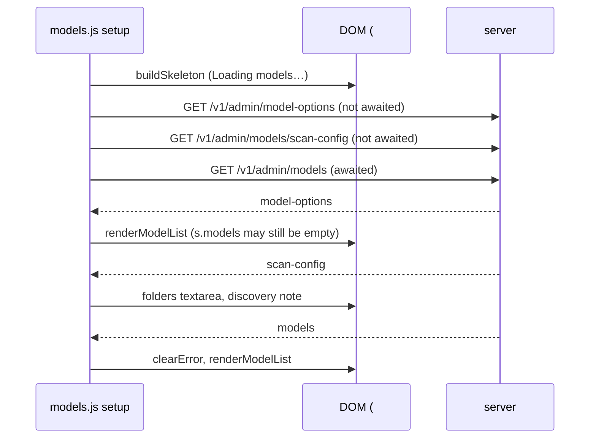
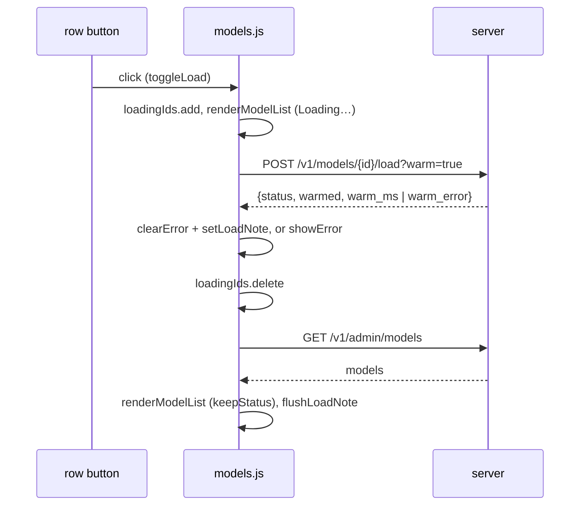
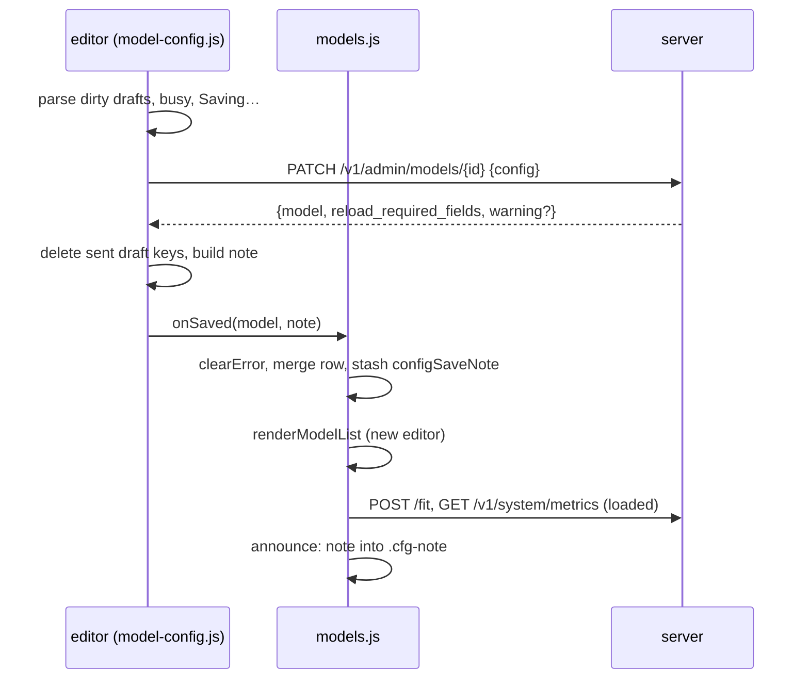

# Models page and the config editor

last updated: 2026-11-24

This page maps what runs on the Models page (`#/models`, `frontend/js/pages/models.js`) for every user action, the per-model config editor it mounts (`frontend/js/model-config.js`), and the shared components that render the engine contract and stage load settings (`frontend/js/engine.js`, `frontend/js/load-panel.js`, `frontend/js/context-select.js`). It starts at the page's `setup` and stops at the page lifecycle (`createPage`, the router, the settings drawer: [shell-and-lifecycle.md](shell-and-lifecycle.md)) and at the places chat uses the shared components ([chat-model-and-settings.md](chat-model-and-settings.md)). Server behaviour is described only as far as the client relies on it. The overview this sits below is [frontend_core.md](../frontend_core.md); why things are the way they are is in [sharp_edges.md, "Model switching and the config editor"](../../architecture/sharp_edges.md#model-switching-and-the-config-editor) and ["Config effect classes"](../../architecture/sharp_edges.md#config-effect-classes).

## Files and what each owns

- `frontend/js/pages/models.js`: page state, the skeleton, the model list and its rows, Load, Unload and Reload, which config panel is open, the per-model drafts, the fit gate on the row button, the unsaved-template unload guard, the Escape hotkey, the watch-folder editor and the danger zone. It owns the one status area (`.models__status`); the editor reports into it through `onError`.
- `frontend/js/model-config.js`: `createModelConfigEditor` (schema to controls, effect-class sections, dirty tracking, Save, Reset, Reload now), `buildFitMeter` (the "Memory fit" section), `buildChatTemplatePanel` (the "Chat template" section), `configSummary` (the row's config chip) and `hasUnsavedTemplate`.
- `frontend/js/engine.js`: `readFact`, `contextCeiling`, `contextRunning`, `engineSummary`, `renderEngine` (the full view, used by this page) and `renderEngineCompact` (the compact view, used by chat).
- `frontend/js/load-panel.js`: `createLoadPanel`, one control per `load_setting` field for the next load. Only chat mounts it.
- `frontend/js/context-select.js`: `createContextSelect` and `ctxStepsFor`, the gguf `ctx_size` control the load panel embeds.
- `frontend/js/api.js`: the `ROUTES` wrappers this area calls, `request` and `httpError` (the error's `.message`, `.status`, `.detail`).
- Server, as relied on: `src/heylook_llm/admin_api.py` (admin model routes, `/v1/admin/model-options`, scan-config), `src/heylook_llm/model_ops_api.py` (`POST /v1/models/{id}/load`, `load_and_warm`), `src/heylook_llm/monitoring_api.py` (`GET /v1/system/metrics`), `src/heylook_llm/api.py` (`POST /v1/data/clear`, the `ModelConfigReadOnly` 409 handler), `src/heylook_llm/config.py` (`AdminModelResponse`, `FitRequest`, `FitResponse`, `ChatTemplateResponse`, `ModelUpdateRequest`, `ScanConfigResponse`), `src/heylook_llm/router.py` (`stale_reload_fields`), `src/heylook_llm/chat_template_files.py` (`view`, `template_sources`, `write_override`, `remove_override`) and `src/heylook_llm/providers/contract.py` (`EngineDescription`, `Setting`, `Fact`).

## State

Page state lives on `ctx.state` (written `s` below), created fresh by `createPage` on every mount.

| Name | Where it lives | Written by | Read by | Reset when |
|---|---|---|---|---|
| `s.models` | page state | `fetchModels` (replaced with `data.models ?? []`), `onSaved` in `buildConfigPanel` (one row merged with the PATCH response's `model`) | `renderModelList`, `onSaved` | every mount; replaced on each successful list fetch |
| `s.loadingIds` (Set of ids) | page state | `toggleLoad`, `reloadModel` (add before the call, delete after it settles) | `buildModelRow` (busy label, disabled), the guards in `toggleLoad` and `reloadModel`, `onFitGate` | every mount |
| `s.pendingLoadNote` | page state | `setLoadNote`; nulled by `flushLoadNote` | `flushLoadNote` | after each flush |
| `s.optionsSchema` | page state | the schema `.then` in `setup`; `toggleConfig` | `buildModelRow` (chip fields), `buildEnginePanel` (hidden fields), `buildConfigPanel` (field list), `toggleConfig` | every mount only |
| `s.optionsPromise` | page state | `setup`; `toggleConfig` when it is null; nulled by the setup `.catch` and by `toggleConfig`'s catch | `toggleConfig` | every mount; null after a failed fetch |
| `s.configOpenId` | page state | `toggleConfig`, the `onEscape` handler | `renderModelList`, `buildModelRow` (Close label, `aria-expanded`), `onEscape` | every mount; null on Close or Escape |
| `s.configDrafts` (Map id to draft object) | page state | `buildConfigPanel` (creates an empty draft); inside a draft: the editor's `onEdit`, `save`, Reset; the template panel's `syncDirty`, `commit` and `toggle` listener | the editor (`currentRaw`, `dirtyFields`, `fitOverrides`), the template panel (`render`, `load`), `syncUnsavedGuard`, `onEscape` | every mount only; no entry is ever removed |
| draft field keys (`{fieldName: rawControlValue}`) | inside a draft | `onEdit` (on every edit, even back to the saved value) | `currentRaw`, `dirtyFields` | Reset deletes every field key; a successful Save deletes the keys it sent |
| `draft.__chat_template_body` (`TMPL_DRAFT`) | inside a draft | template `syncDirty` (set while the box differs from the server's text, deleted when it matches); `commit` deletes it before awaiting | template `render`, `load`'s failure path, `hasUnsavedTemplate` | when the box matches the server's text |
| `draft.__chat_template_open` (`TMPL_OPEN`) | inside a draft | the template section's `toggle` listener | `buildChatTemplatePanel` at build | never, within a mount |
| `s.engineOpenIds` (Set) | page state | the engine panel's `toggle` listener | `buildEnginePanel` | every mount |
| `s.setUnloadGuard` | page state (closure from `createUnloadGuard`) | `setup` | `syncUnsavedGuard` | disarmed and disposed on teardown |
| `s.fitGates` (Map id to reason) | page state | `onFitGate` (set on a reason, delete on null) | `buildModelRow`, `toggleLoad` | every mount; only `onFitGate(null)` removes an entry |
| `s.configSaveNote` (`{id, text}`) | page state | `onSaved` | `buildConfigPanel` (consumes and nulls it for that id) | the next build of that model's panel |
| `s.savingFolders` | page state | `saveWatchFolders` | `saveWatchFolders` | every mount |
| DOM refs `s.statusEl`, `s.listEl`, `s.listNoteEl`, `s.foldersInput`, `s.foldersSaveBtn`, `s.foldersNote`, `s.dangerResultEl` | page state | `buildSkeleton`, `buildScanControls`, `buildDangerZone` | the flows below | every mount |
| `saved` (baseline copy of `model.config`) | `createModelConfigEditor` closure | at build only | `savedRaw`, `dirtyFields` | every rebuild of the panel |
| `busy` (editor) | `createModelConfigEditor` closure | `save` | `syncSaveState`, `save` | every rebuild |
| `notePending` | `createModelConfigEditor` closure | `setNote` | `syncSaveState` | every rebuild |
| `staleFields` | `createModelConfigEditor` closure | at build: `model.loaded ? model.stale_reload_fields : []` | Reload now's `hidden`, the mount note | every rebuild |
| `ctl` (AbortController) and the debounce timer | `buildFitMeter` closure | `refresh`, `scheduleRefresh` | `refresh` | every rebuild (the old ones are not cancelled) |
| `loaded`, `serverText`, `busy` (template) | `buildChatTemplatePanel` closure | `load`, `render`, `commit` | `syncDirty`, `load`, `commit` | every rebuild |
| `panel.dataset.filled` | each engine `
` element | `fill` in `buildEnginePanel` | `fill` | every rebuild (new element) |
| `selects`, `extras.dataset.sig` | `createLoadPanel` closure and element | `refresh` | `changed`, `choicesToSend`, `setEnabled`, `refresh` | when the signature moves |
| `pending`, `beforeCustom`, `element.dataset.sig` | `createContextSelect` closure and element | `commitCustom`, `refresh`, the select's `mousedown`/`keydown`/`focus` | `refresh`, `commitCustom`, Escape in the custom box | `pending` on a model change or a non-gguf model |
| `unloadGuards` refcount | `frontend/js/utils.js` module | `beforeUnloadGuard.enable`/`disable` via `createUnloadGuard` | the `beforeunload` listener's presence | page reload |

## Entry points

| What the user or browser does | Handler (file and function) | Flow |
|---|---|---|
| Navigates to `#/models` | `frontend/js/app.js` `navigate`, then `models.js` `setup` | [Mount](#mount-setup-to-first-paint) |
| Leaves the page | `page.js` `unmount` | [Teardown](#teardown) |
| Clicks a row's `Load` or `Unload` | `models.js` `toggleLoad` | [Load or Unload](#load-or-unload-a-row) |
| Clicks `Configure` or `Close` | `models.js` `toggleConfig` | [Open and close](#open-and-close-a-config-panel) |
| Edits a field in the editor | the listener in `model-config.js` `buildControl`, then `onEdit` | [Edit](#edit-a-field-drafts-dirty-tracking-and-the-pending-note) |
| Clicks `Save` | `model-config.js` `save` | [Save](#save) |
| Clicks `Reset` | the `resetBtn` listener in `createModelConfigEditor` | [Reset](#reset) |
| Clicks `Reload now` twice | `armedConfirm` on `reloadBtn`, then `models.js` `reloadModel` | [Reload now](#reload-now) |
| Opens the "Chat template" section | the `toggle` listener in `buildChatTemplatePanel`, then `load` | [Template load](#chat-template-open-and-load) |
| Types in the template box, or clicks `Start an override from this` | `syncDirty`; the button listener in `renderSources` | [Template edit](#chat-template-edit-and-start-an-override-from-a-copy) |
| Clicks `Save template`, or `Revert to model default` twice | `commit` in `buildChatTemplatePanel` | [Template save and revert](#chat-template-save-and-revert) |
| Opens or closes a row's `Engine` summary | the `toggle` listener in `models.js` `buildEnginePanel` | [Engine rendering](#engine-rendering) |
| Presses Escape | `hotkeys.js` `registerPageHotkeys`, then the page's `onEscape` | [Escape](#escape-hotkey) |
| Closes or reloads the tab with unsaved template text | the `beforeunload` listener armed by `createUnloadGuard` | [Unload guard](#unsaved-template-guard) |
| Clicks `Save watch folders` | `models.js` `saveWatchFolders` | [Watch folders](#watch-folders) |
| Clicks `Clear all conversations & notebooks` twice | `armedConfirm`, then `models.js` `clearAllData` | [Danger zone](#danger-zone) |
| Chat builds or refreshes its load controls | `load-panel.js` `createLoadPanel` | [Load panel](#load-panel-component) |
| Picks a context size, or `Custom…`, in chat | `context-select.js` `createContextSelect` listeners | [Context select](#context-select-component) |

## Flows

### Mount: setup to first paint

Trigger: the hash route `models` in `app.js` `ROUTES`; `navigate` awaits `currentPage.mount(main)`, which calls `setup(ctx)`.

Guards: none.

Steps:

1. `setup` initialises the page state fields listed in the State table.
2. `createUnloadGuard(ctx)` returns the setter stored as `s.setUnloadGuard` and registers its teardown hook.
3. `buildSkeleton` builds and appends, in order: `h1` `Models`, the empty status area `.models__status`, the list section (`.models__list` holding `.empty-state` `Loading models…`, then `.models__list-note` with `role="status"`), the "Watch folders" section (`buildScanControls`) and the "Danger zone" (`buildDangerZone`). This is what the first paint shows.
4. `drawer.registerSettings({ samplers: 'hidden' })`; its unregister is passed to `ctx.onTeardown`.
5. `registerPageHotkeys(ctx, { onEscape })` (see [Escape](#escape-hotkey)).
6. `s.optionsPromise = api.adminModelOptions({ signal: ctx.signal })` sends `GET /v1/admin/model-options`. Not awaited. Its `.then` checks `ctx.alive`, sets `s.optionsSchema` and calls `renderModelList`. Its `.catch` sets `s.optionsPromise = null` and shows nothing.
7. `loadWatchFolders(ctx)` is called without `await`; it sends `GET /v1/admin/models/scan-config` (see [Watch folders](#watch-folders)).
8. `await fetchModels(ctx)` sends `GET /v1/admin/models` with `ctx.signal`. On success it checks `ctx.alive`, sets `s.models = data.models ?? []` and calls `clearError` (this is the one call without `keepStatus`). On failure it checks `ctx.alive` and calls `showError` with `Could not load models: ${err.message}`. Either way it ends with `renderModelList`.
9. `setup` resolves; `navigate` sets `main.dataset.mounted = 'models'`.

The requests leave in the order schema, watch folders, list, and run concurrently; only the list is awaited.

Ends when: the list fetch settles and the list renders.

Failure paths: a failed list fetch puts the error in the status area and leaves `s.models` empty, so the list shows the `No models yet…` empty state under the error. A failed schema fetch is silent: the row chip is absent, an engine panel opened before the schema arrives shows hidden fields, and the first `Configure` retries the fetch. A failed watch-folder read writes to `s.foldersNote` only.

Awaits and what is re-checked after each: the list fetch re-checks `ctx.alive` in both branches; the schema `.then` re-checks `ctx.alive`; `loadWatchFolders` re-checks `ctx.alive`. When the schema answers before the list, its `.then` calls `renderModelList` with `s.models` still empty and the `Loading models…` text is replaced by the `No models yet…` empty state until the list arrives (see the last section).

### The model list and what a rebuild throws away

Trigger: any call of `renderModelList(ctx)`. Its callers in `models.js`: the schema `.then` in `setup`; the end of `fetchModels` (success or failure); `toggleLoad` and `reloadModel` after marking the row busy; `toggleConfig` on close and on open; `onEscape`; and the editor callbacks `onSaved` and `onReset` passed by `buildConfigPanel`. `fetchModels` in turn is called by `setup`, `saveWatchFolders`, `toggleLoad` and `reloadModel`.

Guards: none.

Steps:

1. If `s.models` is empty, `s.listEl` is replaced by `.empty-state` `No models yet. Add a watch folder below — everything under one is served, with its settings detected at load.` and the function returns. No panel is built.
2. For each model in `s.models` order, `buildModelRow(ctx, m)`:
   - badge `.model-badge` (`.model-badge--loaded` when loaded) reading `Loaded` or `Idle`, beside the id in `<strong>`;
   - meta line from `modelMetaLine`: provider, capabilities joined by `, `, `ctx ${formatTokens(contextCeiling(model))}` when the engine reports a ceiling, tags, and `no entry` when `model.source === 'discovered'`, joined by ` · `;
   - `model.description` when present;
   - the chip `.model-row__conf` from `configSummary(model.config, schemaFields)`: null until the schema is known; skips `descriptive` and `ui:"hidden"` fields, null, arrays, objects and strings longer than the limit in `configSummary`; booleans read `name on`/`name off`, others `name value`; beyond the cap written in `configSummary` it adds `+N more`;
   - the stale marker `.model-row__stale` `config changed — reload to apply` when `model.stale_reload_fields` is non-empty;
   - the engine panel from `buildEnginePanel` (see [Engine rendering](#engine-rendering));
   - the actions cell `.model-row__actions`: first the Load/Unload button (label `Unloading…` or `Loading…` while busy, picked by `model.loaded`; otherwise `Unload` or `Load`; disabled while busy or while `s.fitGates` holds a reason for an unloaded model, whose reason becomes the `title`), then `Configure` or `Close` with `aria-expanded`.
3. If `s.configOpenId === m.id`, the row is followed by the discovered disclosure `.config-panel__note` (only when `m.source === 'discovered'`), then `buildConfigPanel(ctx, m).el`; its `announce` is kept.
4. `s.listEl.replaceChildren(...children)`.
5. If a panel was built, `setTimeout(panelAnnounce, 0)` writes its mount note after it is in the document (see [Build the editor](#build-the-editor)).

Ends when: the children are replaced and the announce timer is queued.

What a rebuild throws away: every row element and the focus inside it (the field being typed in loses focus, which closes a phone keyboard: FB-21); every engine panel's rendered body and the open state of the `
` rows inside it; armed buttons (`Reload now`, `Revert to model default`); the open state of the editor's "Advanced" `
`; the editor instance with its `saved` baseline, `busy`, `notePending` and note text; the fit meter's rows, verdict and observed line (re-requested by the new meter, while the old meter's request and debounce are not cancelled); the template panel's `loaded`, `serverText`, `busy`, its status line, and the textarea's scroll and selection (re-fetched by `GET` if the section was open). An open panel whose model is no longer in `s.models` is not rendered.

What survives: `s.configDrafts` (field drafts, `TMPL_DRAFT`, `TMPL_OPEN`), `s.configOpenId`, `s.engineOpenIds`, `s.fitGates`, `s.loadingIds`, `s.configSaveNote`, the status area and `.models__list-note` (they sit outside `s.listEl`).

Failure paths: none inside the function.

Awaits and what is re-checked after each: none; it is synchronous. Each build of an open panel sends requests (see [Build the editor](#build-the-editor)).

### Load or Unload a row

Trigger: a click on the row's first action button; `buildModelRow` binds it to `toggleLoad(ctx, model)` with the row object as it was when the row was built.

Guards:

- `s.loadingIds.has(model.id)`: returns silently (the button is also disabled).
- For an unloaded model with a reason in `s.fitGates`: `showError` with `Not loading: ${reason}` and return. This holds even from a row built before the gate was set.

Steps:

1. `wasLoaded = model.loaded`, read from the row object.
2. `s.loadingIds.add(model.id)`, then `renderModelList`: the button reads `Unloading…` or `Loading…` and is disabled. An open config panel is rebuilt.
3. Unload: `await api.adminUnloadModel(model.id)` sends `POST /v1/admin/models/{id}/unload` with no body and no signal. After it, `ctx.alive` is checked, then `clearError`. The response (`{status: "unloaded" | "not_loaded", model_id}`) is not read.
4. Load: `await api.adminLoadModel(model.id, true)` sends `POST /v1/models/{id}/load?warm=true` with no body and no signal. After it, `ctx.alive` is checked. If `result.warm_error` is set, `showError` with `Loaded, but the warm-up generation failed: ${result.warm_error}`. Otherwise `clearError` and `setLoadNote(ctx, model.id, result.warm_ms)`, which stores `${modelId} loaded and warmed in ${(warmMs / 1000).toFixed(1)}s.` in `s.pendingLoadNote`, or null when `warm_ms` is absent.
5. On a thrown error: `ctx.alive` is checked, then `showError` with `Unload failed: ${err.message}` or `Load failed: ${err.message}`.
6. `s.loadingIds.delete(model.id)`.
7. If alive, `await fetchModels(ctx, { keepStatus: true })`: the list is refetched and re-rendered without clearing the status area. The server recomputes `loaded` and `stale_reload_fields` (always `[]` for an unloaded model).
8. If alive, `flushLoadNote`: `.models__list-note` gets the pending note or `''`, and the pending note is nulled. An unload or a failed load therefore clears the previous load note.

Ends when: `flushLoadNote` has run.

Failure paths (the message is the server's, through `httpError`): unload answers 409 while the model is generating (`router.unload_model` raises). Load answers 400 for an id the router cannot resolve, 503 with the `model_overloaded` envelope and `Retry-After` when no slot can be made because another model is generating (the page does not retry; the message is `error.message`), and 500 for a failed load. A warm failure is a 200 with `warmed: false` and `warm_error`, so the model is loaded and the error is shown. If the trailing refetch fails, its `Could not load models: …` replaces whatever the action wrote.

Awaits and what is re-checked after each: after the unload or load call, `ctx.alive` (a torn-down page returns without deleting from `s.loadingIds`, which dies with the mount); after `fetchModels`, `ctx.alive` before `flushLoadNote`. Nothing re-checks whether the model's residency changed elsewhere during the call: the refetch is the answer.

### Reload now

Trigger: the editor's `Reload now` button (`reloadBtn`). It exists hidden in every panel and is shown only when `staleFields` is non-empty at build, which needs `model.loaded` and a non-empty `model.stale_reload_fields`. It is wrapped in `armedConfirm(reloadBtn, ..., 'Confirm reload?')`: the first click arms it (label `Confirm reload?`, class `btn--armed`); a second click before `armedConfirm`'s timer lapses runs `reloadBtn.hidden = true; onReload()`, and `onReload` is `reloadModel(ctx, model)` with the row object captured by `buildConfigPanel`.

Guards: `s.loadingIds.has(model.id)` returns silently.

Steps:

1. `s.loadingIds.add(model.id)`, `renderModelList`. Because `model.loaded` is true, the row button reads `Unloading…` for the whole cycle. The rebuilt panel shows `Reload now` again, unarmed, since the row still carries `stale_reload_fields`; pressing it again reaches the guard above.
2. `await api.adminReloadModel(model.id, true)` sends `POST /v1/admin/models/{id}/reload?warm=true`. The models page passes no body argument, so `request` sends no body and no `Content-Type`.
3. After it, `ctx.alive` is checked. `result.warm_error` gives `showError` with `Reloaded, but the warm-up generation failed: ${result.warm_error}`; otherwise `clearError` and `setLoadNote` (the note still reads `… loaded and warmed in …s.`).
4. On a thrown error, after the alive check: `showError` with `Reload failed: ${err.message}`.
5. `s.loadingIds.delete`, then if alive `await fetchModels(ctx, { keepStatus: true })`, then if alive `flushLoadNote`. A fresh process reports no stale fields, so the row marker, `Reload now` and the mount note go.

Server, with no body (`admin_api.py` `reload_model`): `router.reload_config()` first (500 `Config reload failed: …`); 409 when `router.is_loading(model_id)`; `router.unload_model` (409 while the model is generating); then `load_and_warm`, the same body as Load. The body branch (persist `load_setting` fields, or a plain load when nothing changed and nothing is stale) is reached only from chat's load panel.

Ends when: `flushLoadNote` has run.

Failure paths: as above; the trailing refetch's failure replaces the action's outcome in the status area.

Awaits and what is re-checked after each: the same as Load.

### Open and close a config panel

Trigger: the `Configure`/`Close` button, bound in `buildModelRow` to `toggleConfig(ctx, model)`.

Guards: none refuse the click. The panel needs the schema.

Steps:

1. If `s.configOpenId === model.id`: set it to null, `renderModelList`, return. The panel disappears; its draft, its fit gate and the unload guard state are untouched.
2. If `s.optionsSchema` is null: when `s.optionsPromise` is also null, start `GET /v1/admin/model-options` with `ctx.signal`; then `await s.optionsPromise` (a fetch already in flight from `setup` is reused, so a double click does not fetch twice).
3. After the await, `ctx.alive` is checked, and `s.optionsSchema` is set.
4. `s.configOpenId = model.id`; `renderModelList`. Any other model's panel closes (one panel at a time); the new panel is built under its row (see [Build the editor](#build-the-editor)).

Ends when: the list is rebuilt.

Failure paths: a failed schema fetch sets `s.optionsPromise = null`, checks `ctx.alive`, and shows `Could not load option schema: ${err.message}` in the status area; nothing opens.

Awaits and what is re-checked after each: the schema await re-checks `ctx.alive` on both paths. It does not re-check `s.configOpenId`, so when two rows' `Configure` are pressed during the same fetch, the last continuation to run wins.

### Build the editor

Trigger: `renderModelList` building the open model's panel through `models.js` `buildConfigPanel`.

Guards: none.

Steps (`buildConfigPanel`):

1. `fields = s.optionsSchema.providers[model.provider].fields ?? []`.
2. The draft is `s.configDrafts.get(model.id)`, created empty and stored when missing.
3. If `s.configSaveNote?.id === model.id`, its text becomes `initialNote` and `s.configSaveNote` is nulled.
4. `createModelConfigEditor({ model, fields, draft, initialNote, onError, onSaved, onDraftChange, onReload, onReset, onFitGate })`. `onError` is `showError`; `onDraftChange` is `syncUnsavedGuard`; `onReload` is `reloadModel`; `onReset` is `renderModelList`; `onSaved` and `onFitGate` are in their own flows.

Steps (`createModelConfigEditor`):

1. `fields` drops every field with `ui === 'hidden'` (`isHidden`).
2. `saved = { ...model.config }`. The admin row's `config` is the stored keys only (`exclude_unset`), so an absent key means "default".
3. `staleFields = model.loaded ? model.stale_reload_fields : []`.
4. Builds `noteEl` (`.cfg-note`, `role="status"`), `Save`, `Reset` and `Reload now` (hidden unless `staleFields` is non-empty).
5. `buildFitMeter({ model, overrides: fitOverrides, onGate: onFitGate })`, then `buildChatTemplatePanel({ model, draft, onDraftChange })`. If `draft[TMPL_OPEN]` is set, the template panel opens its section and calls `load()` now, so its `GET` leaves before the fit request.
6. The fields are partitioned (each field lands in at most one section): `fixed` = `effect === 'load_time_only'`; `advanced` = `ui === 'advanced'` and not `load_time_only`; `live` = effect in `LIVE_EFFECTS` (`per_request`, `applies_live`, `descriptive`) and not advanced; `reload` = `requires_reload` and not advanced. A field of any other effect class lands in none (FB-27; today the schema never carries `identity`, which `configurable_fields` excludes).
7. Each field becomes a row through `fieldRow(field, currentRaw(field), idPrefix, onEdit, model.engine?.settings?.[field.name] ?? null)`. `currentRaw` is the draft value when the draft has the key, otherwise `toControlValue(field, saved[name])` (`''` for null, newline-joined for arrays, `String` otherwise). How a field becomes a control:
   - `type` `boolean`, or an `enum`: a `<select>` whose first option is value `''` labelled `default (${def})` or `default`, then `on`/`off` (values `'true'`/`'false'`) or the enum values. Edits report on `change`.
   - `type` `array`: a `<textarea class="input cfg-field__lines">`, one element per line; placeholder is the default label or `default`. Edits report on `input`.
   - `integer` or `number`: `<input type="number">` with `step` `1` or `any` and `min`/`max` from `minimum`/`maximum`. Anything else: `<input type="text">`. Placeholder as above; edits report on `input`.
   - `effect === 'load_time_only'`: the control is `disabled` and the row gets `.cfg-field--fixed`.
   - The label is the field name, bound to the control's id (`${idPrefix}-${name}`, `idPrefix` being `mcfg-` plus the sanitized model id).
   - The hint line (`.cfg-field__hint`), parts joined by ` · `: the `arg` flag in `.cfg-field__arg`, `default ${def}`, the bounds (`min X`, `> X`, `max X`, `< X`), `one per line` for arrays, and the field's `reason`. The field's `description` is not rendered by the editor.
   - `defaultLabel` prefers the model's own `engine.settings[name].auto` (the server's answer for this model) over the schema `default`; booleans read `on`/`off`, arrays are joined by `, `.
8. The panel's children, in order: the fit meter ("Memory fit"); "Applies immediately" (if any live fields); "Requires reload" with the note `Saved to the model's model.heylook.toml now; the loaded model keeps running as-is until reloaded.` (loaded) or `Saved to the model's model.heylook.toml; applies when the model loads.` (unloaded); a `
` titled `Advanced (requires reload)` when every advanced field is `requires_reload`, else `Advanced`, built closed; "Fixed for this process"; `No editable options for provider "${model.provider}".` when only the fit meter was added; the "Chat template" section; the actions row (`Save`, `Reset`, `Reload now`, `noteEl`).
9. `syncSaveState()` runs once, so drafts that survived a rebuild re-enable Save and Reset and restore the pending note.
10. `fitMeter.refresh()` sends the first fit request; `fitMeter.refreshObserved()` sends the metrics request for a loaded model.
11. The mount note is `initialNote`, else `Saved changes pending reload: ${staleFields.join(', ')}.` when `staleFields` is non-empty, else nothing. The returned `announce()` writes it only when `noteEl` is still empty (a pending note from step 9 wins).

Ends when: `{ el, announce }` is returned; `renderModelList` mounts `el` and queues `announce`.

Failure paths: none synchronous; the template, fit and metrics requests each handle their own (see their flows).

Awaits and what is re-checked after each: none in the build; the requests it starts land later on this editor instance, which a later rebuild may already have detached.

### Edit a field: drafts, dirty tracking and the pending note

Trigger: `change` on a select, `input` on an input or textarea, each calling `onEdit(field.name, rawValue)`.

Guards: a `load_time_only` control is disabled and cannot fire.

Steps:

1. `draft[name] = rawValue` (raw control text, written even when it equals the saved value).
2. `syncSaveState()`:
   - `dirtyFields()` = the editor's fields whose name is an own key of the draft and whose draft value is not `savedRaw(field)` (string comparison of control forms).
   - `Save` and `Reset` are disabled when `busy` or nothing is dirty.
   - With dirty fields, `setNote(pendingNote(dirty), true)`: `requires_reload` fields read `${names} — needs a reload after save (the loaded model keeps running as-is)` on a loaded model or `${names} — applies on next load` otherwise; every other dirty field reads `${names} — applies on save`; the parts are joined by `; ` inside `Changed: ….`.
   - With nothing dirty and the current note being a pending note (`notePending`), the note is cleared; any other note is left.
3. `fitMeter.scheduleRefresh()`: the debounced `refresh` (see [Fit meter](#fit-meter-requests-debounce-and-the-observed-line)).

Ends when: the debounce timer is set.

Failure paths: none; parsing happens only at Save and in `fitOverrides`.

Awaits and what is re-checked after each: none. Schema field edits do not call `onDraftChange`, so they never arm the unload guard (the page comment in `setup` explains why).

### Save

Trigger: the `Save` button, bound to `save()`.

Guards:

- `busy` or no dirty fields: returns silently (the button is disabled in both cases).
- Any dirty field that `parseControlValue` rejects: `onError(`Not saved -- ${error}`)` writes to the page status area and returns; nothing is sent. The errors are `${name}: not a whole number`, `${name}: not a number` and `${name}: "${tok}" is not a valid ${itemType}` (numeric arrays split on newlines or commas; string arrays split on newlines only).

Steps:

1. `config` is built from every dirty field's parsed value; an empty control parses to `null`, which is sent (null means unset).
2. `busy = true`, the button text becomes `Saving…`, `syncSaveState()` disables `Save` and `Reset`. The fields stay editable.
3. `await api.adminUpdateModel(model.id, { config })` sends `PATCH /v1/admin/models/{id}` with body `{ config: { field: value | null } }`.
4. On success: `reloadNeeded = result.reload_required_fields || []`; every field that was dirty at step 1 has its draft key deleted; the outcome text is `Saved.`, then `Takes effect on reload: ${names}.` (loaded) or `Applies on next load: ${names}.` (unloaded) when `reloadNeeded` is non-empty, then `result.warning` when present.
5. `onSaved(result.model, text)` in `buildConfigPanel`: `clearError`; `s.models[idx]` becomes `{ ...s.models[idx], ...result.model }`; `s.configSaveNote = { id, text }`; `renderModelList`. The rebuilt row repaints its chip and stale marker from the response, and the rebuilt panel shows the outcome through `initialNote` and `Reload now` from the response's `stale_reload_fields`. `save` returns without touching the old editor.
6. On a thrown error: `onError(`Save failed: ${err.message}`)`, then `busy = false`, the label back to `Save`, `syncSaveState()`. The drafts are kept.

Server (`admin_api.py` `update_model_config`): `ModelUpdateRequest` forbids top-level keys other than `description`, `tags`, `capabilities` and `config`, and refuses `file_only` fields (all of which are also `ui:"hidden"`, so the editor never sends one). `ModelService.update_config` validates the whole effective config, writes the model's `model.heylook.toml` for a discovered model (null drops a key; a file left empty is deleted), and returns the changed reload-required fields. `_safe_reload_config` re-runs discovery and turns a failure into `warning`. The response is `{ model: AdminModelResponse, reload_required_fields, warning? }`; `ValueError` and `TypeError` are 400; a read-only instance answers 409 through `ModelConfigReadOnly`. The response's row is built without `written_ids`, so its `source` is `"config"` even for a discovered model (see the last section).

Ends when: the rebuilt panel's `announce` writes the note, or the failure is shown.

Failure paths: as in step 6 and the server answers above. If the panel was closed while the PATCH was in flight, `onSaved` still swaps the row and stashes `s.configSaveNote`, and that text appears the next time the panel opens.

Awaits and what is re-checked after each: the PATCH await re-checks nothing in `model-config.js`, and `onSaved` has no `ctx.alive` check: a PATCH landing after teardown rebuilds the detached list and so sends the new panel's fit and metrics requests (the same leak FB-29 names). A value typed during the PATCH into a field that was part of the save is lost, because step 4 deletes that key.

### Reset

Trigger: the `Reset` button (enabled only while something is dirty).

Guards: none in the handler.

Steps:

1. Deletes the draft key of every non-hidden field. The template keys (`TMPL_DRAFT`, `TMPL_OPEN`) are kept.
2. `onReset()` is `renderModelList`: the panel is rebuilt from `model.config`, its fit request carries no overrides, and its answer updates the fit gate.

Ends when: the list is rebuilt. Nothing is sent to the server except the rebuilt panel's own reads.

Failure paths: none.

Awaits and what is re-checked after each: none.

### Fit meter: requests, debounce and the observed line

Trigger: `fitMeter.refresh()` at the end of every editor build, and `fitMeter.scheduleRefresh()` (`debounce(refresh, …)` with the delay written in `buildFitMeter`) on every edit. `refreshObserved()` once per build.

Guards: `refreshObserved` returns at once for an unloaded model. `refresh` aborts its own previous request (`ctl?.abort()`) before sending.

Steps (`refresh`):

1. A new `AbortController` becomes `ctl`.
2. `await api.adminModelFit(model.id, { config_overrides: overrides() }, { signal: ctl.signal })` sends `POST /v1/admin/models/{id}/fit`. `overrides()` is the editor's `fitOverrides`: each dirty field's parsed value (null for an emptied control); a field that does not parse is left out, so the meter answers for the nearest well-formed candidate. `headroom_gb` is not sent, so the server uses `FitRequest`'s default.
3. `render(report)` replaces the rows in `.cfg-fit__rows`: `Weights`; each `sizing_notes` entry; `Metal working set` with `hard limit — MLX refuses above it` or `advisory — llama.cpp pages past it` (from `hard_working_set`) when `working_set_gb` is not null; `Headroom for KV` (with `.cfg-fit__row--danger` below zero) when `kv_headroom_gb` is not null; `Reclaimable RAM` with `total − anonymous − wired`; `Worker Metal working set` as `need / have` when a `worker_metal_working_set` line exists.
4. The verdict `.cfg-fit__verdict` gets the class `cfg-fit__verdict--${r.verdict}` and these pieces, in order, joined by spaces (`Fits.` when there are none): the worker overflow (`Worker slice exceeds … by … (needs …, has …).`) when that line fails; for a failing `reclaimable_ram` line, `Loaded now, so this model's own memory is excluded from the ~… reclaimable figure — unload it to see what a fresh load would find.` on a loaded model or `Won't fit: needs … (weights + headroom), ~… reclaimable.` otherwise; for a non-passing `metal_working_set` line, `Over the Metal working set by … — MLX refuses above it.` (fail) or `Over the Metal working set by … — llama.cpp will still load this; Metal stops guaranteeing residency and you degrade into paging.` (warn); for a `metal_max_buffer` line (the server emits it only when exceeded), `Weights exceed the … per-allocation cap — ${note}.`; when `headroom_thin` and `kv_headroom_gb` is set, `Thin headroom: … left for KV + compute. ` plus, on gguf, `Spawns with llama-server's own micro-batch instead of heylook's larger auto one (slower prefill); ` and then `a Metal out-of-memory at full context is possible.` When `sysctl_suggest_mb` is not null, a `.cfg-fit__sysctl` block follows: `Raise the GPU wired limit: `, the `sudo sysctl iogpu.wired_limit_mb=…` command, ` (resets at reboot; `, `scripts/gpu_wired_limit.sh install`, ` persists it). Restart the server afterwards so it sizes against the new ceiling.`
5. `onGate(r.verdict === 'fail' && !model.loaded ? 'Does not fit memory (see the Configure panel)' : null)` (see [Fit gate](#fit-gate)).

Steps (`refreshObserved`):

1. `await api.systemMetrics(true)` sends `GET /v1/system/metrics?force_refresh=true` (no signal).
2. `metrics.models[model.id].memory_mb`; a null or zero reading returns, leaving the line hidden.
3. Otherwise `.cfg-fit__observed` is filled with `Resident now`, the value in GiB and `memory_source` (or `measured after load`), and shown.

Server (`admin_api.py` `evaluate_model_fit`): 404 for an unknown model; the overrides are laid over the stored config (null pops the key); `hard_working_set` is true for every provider except gguf; a report that sizes to nothing is a 422 with `detail: {field: "model_path", error}`.

Ends when: the verdict and the gate are written.

Failure paths: an `AbortError` (a newer refresh replaced this one) returns silently. Any other failure sets the verdict class to plain `cfg-fit__verdict`, the text to `fit unavailable — ${err.detail.error}` for a 422 carrying a reason or `fit unavailable` otherwise, clears the rows, and calls `onGate(null)`: missing information never blocks Load. A metrics failure leaves the observed line hidden.

Awaits and what is re-checked after each: neither await checks the page or the editor. Only the meter's own controller is aborted, by the next `refresh` of the same meter. A rebuild creates a new meter and leaves the old one's request and debounce running; the old meter's answer still calls `onFitGate`. Teardown cancels neither (FB-29).

### Fit gate

Trigger: the fit meter calling `onGate`, which is `onFitGate` from `buildConfigPanel`.

Guards: `ctx.alive`; the button is touched only when the row's model (as captured at build) is unloaded and not busy.

Steps:

1. A reason sets `s.fitGates.set(model.id, reason)`; null deletes the entry.
2. The live row is found with `.model-row[data-model-id="${CSS.escape(model.id)}"]` and its first `.model-row__actions button` (the Load/Unload button, which `buildModelRow` keeps first for this reason).
3. If found, unloaded and not busy: `disabled = Boolean(reason)`, `title = reason || ''`. No rebuild, so the editor under the cursor is left alone.

Ends when: the button is updated in place.

Failure paths: none.

Awaits and what is re-checked after each: none. The verdict being gated is the candidate config (saved values plus the drafts), and the entry stays in `s.fitGates` after the panel closes; every row rebuild reads it, and `toggleLoad` refuses with `Not loading: Does not fit memory (see the Configure panel)`. It is lifted only by a later fit answer for that model (reopening the panel, editing, Reset) or a remount. A loaded model is never gated.

### Chat template: open and load

Trigger: opening the `
` summary `Chat template`. Its `toggle` listener writes `draft[TMPL_OPEN] = el.open` and calls `load()` when open. At build, a draft with `TMPL_OPEN` set opens the section and calls `load()` directly.

Guards: `load` returns when `loaded` is already true.

Steps:

1. `loaded = true`; status `Loading…`. The textarea (label `Template body`) and `Save template` start disabled; `Revert to model default` starts hidden.
2. `await api.adminChatTemplate(model.id)` sends `GET /v1/admin/models/{id}/chat-template` (no signal).
3. `render(view)`:
   - `serverText` is `view.override_template` when `view.override_present`, else `view.template` (or `''`): the editor shows the override's own body even when it lost the ladder.
   - The textarea value is `draft[TMPL_DRAFT] ?? serverText`; `disabled = !view.writable`; Revert is shown only with an override present.
   - The origin line `.cfg-tmpl__origin`: `In force: ${view.origin}`, `your override is on disk` when present, and, when the in-force source is `heylook override` and copies with files sit below it in the list, `it hides ${files}; Revert to use them` (or `it`), which also adds `.cfg-tmpl__origin--warn`.
   - The thinking line from `thinkingSummary`: the in-force source's `thinking` (named by its file or source) or, when no source is in force, `model.engine.thinking`. With neither it reads `Thinking controls: unknown (no template to judge).` Otherwise it is `Thinking controls${from}: ${parts}.`, where `from` is ` (from ${template})` and `thinkingParts` gives `switch ${switch}` or `no thinking switch`, then `depth ${variable}: ${values}` (with `, default ${default}` when there is one) or `no depth control`, joined by `; `.
   - `renderSources` lists every copy (next flow).
   - The status line, worst first: `view.inert_reason` (warn); not writable: `view.notes[0]` or `This model folder is not writable.` (warn); `view.stale === true`: `Edited since this model loaded. Reload it to apply.` plus the notes below (warn); otherwise, when any note applies, the notes (warn), led by `Saved.` only when there are refused shapes; otherwise empty. The notes: ` This template refuses a message shape` (or `some message shapes`) ` — requests of that shape will fail: …` from `refused_shapes`; ` llama-server cannot run part of this template, and a request that reaches it fails: ….` from `engine_gaps`; ` This template breaks multi-turn prompt caching: ${prefix_note}.` when `prefix_stable` is false.
   - `syncDirty()` (next flow).

Server (`admin_api.py` `_template_view`): reads files only, so it answers for unloaded models; `stale` is null for an unloaded model, which the panel treats as not stale; `refused_shapes` is empty on every read; `engine_gaps` is null except on gguf; `sources` come in ladder order, each `{source, file, sha256, in_force, provenance, download_commit, prefix_stable, prefix_note, thinking, template}`.

Ends when: `render` has run.

Failure paths: `loaded = false` so the next open retries; status `Could not read the template: ${e.message}` (class `cfg-tmpl__status--error`); the textarea shows `draft[TMPL_DRAFT] ?? ''` and is enabled so a parked draft can be seen and cleared; `syncDirty()` keeps `Save template` disabled because `loaded` is false.

Awaits and what is re-checked after each: the GET await re-checks nothing. A response landing after a rebuild renders into the detached panel; its `syncDirty` still writes the shared draft and calls `onDraftChange`, which after teardown is a no-op (`createUnloadGuard` is disposed).

### Chat template: edit and start an override from a copy

Trigger: `input` on the textarea, which calls `syncDirty`; or a click on `Start an override from this` in the sources list.

Guards: the `Start an override from this` button is built disabled while the textarea is disabled; it is not offered on the `heylook override` source; on the in-force copy while no override exists it is replaced by the text `shown in the editor below; edit it to make an override`.

Steps (`syncDirty`):

1. The body is `eol(area.value)` (CRLF and CR to LF).
2. `Save template` is disabled when `busy`, when not `loaded`, when the body equals `eol(serverText)`, or when the body is blank.
3. When the body equals the server's text, `draft[TMPL_DRAFT]` is deleted; otherwise it is set to `area.value`.
4. `onDraftChange()` runs `syncUnsavedGuard` (see [Unload guard](#unsaved-template-guard)).

Steps (a source row's button):

1. The textarea is set to `src.template`, then `syncDirty()`.
2. Status: `${src.source} is identical to what the editor holds; change it to save an override.` when the copy matches the server's text, else `Editing a copy of ${src.source}. Save to make it this model's override.` Nothing is written until Save.

Each source row reads `${source}` plus ` (in force)`, then `provenance` (with ` @` and the first characters of `download_commit` when present), the start of `sha256`, `breaks prompt caching: ${prefix_note}` when `prefix_stable` is false, and `thinking: …` from that copy's own controls.

Ends when: the draft and the button state are updated.

Failure paths: none.

Awaits and what is re-checked after each: none.

### Chat template: save and revert

Trigger: `Save template` calls `commit(() => api.adminSetChatTemplate(model.id, { template: area.value }), 'Saving…')`. `Revert to model default` is wrapped in `armedConfirm(revertBtn, ..., 'Discard your override?')`; the confirming click calls `commit(() => api.adminDelChatTemplate(model.id), 'Reverting…')`.

Guards: `commit` returns when `busy`; Save's own disabled rules (previous flow); Revert is hidden without an override.

Steps (`commit`):

1. `busy = true`, `syncDirty()` (Save disabled), status `Saving…` or `Reverting…`.
2. `delete draft[TMPL_DRAFT]`, then `await fn()`: `PUT /v1/admin/models/{id}/chat-template` with `{ template }`, or `DELETE` on the same path.
3. `render(view)` with the response, which is the same view a GET returns (a PUT also carries `refused_shapes`). The textarea shows the new server text unless the user typed during the request (their `syncDirty` re-set the draft key).
4. `finally`: `busy = false`, `syncDirty()`.

What the user sees on success: the origin line and Revert visibility change; the status line is whatever `render` decides, which is empty for an unloaded model with no notes (no separate "saved" line), `Edited since this model loaded. Reload it to apply.` for a loaded one, and `Saved.` plus the refused shapes when there are any.

Server: PUT validates before writing and answers 400 with the reason for a refused template (empty body, nothing renders, no folder to write to, an OS error), 404 for an unknown model; DELETE answers 404 when there is no override; both answer 409 on a read-only instance. Neither writes config. A write is live only after a reload.

Ends when: `finally` has run.

Failure paths: the status shows `e.message` verbatim (class `cfg-tmpl__status--error`); `finally`'s `syncDirty` puts the typed body back into the draft, so the guard stays armed and the text stays in the box.

Awaits and what is re-checked after each: nothing. The page is not told: on a loaded model the row's stale marker and the editor's `Reload now` (both driven by `stale_reload_fields`, which the server extends with `chat_template`) appear only after the next list fetch or config save. A commit that lands after a rebuild renders into the detached panel and writes the shared draft; on a failure that draft holds text the visible panel does not show.

### Unsaved template guard

Trigger: every template `syncDirty` call, through `onDraftChange`, which is `models.js` `syncUnsavedGuard`.

Guards: `createUnloadGuard`'s setter returns when its state would not change, and after teardown.

Steps:

1. `syncUnsavedGuard` asks every draft on the page: `[...s.configDrafts.values()].some(hasUnsavedTemplate)`. `hasUnsavedTemplate(draft)` is true when `draft[TMPL_DRAFT]` holds non-blank text, whether or not that model's panel is open.
2. `s.setUnloadGuard(answer)` enables or disables the shared `beforeunload` handler in `utils.js` (refcounted across pages).
3. While armed, closing or reloading the tab gets the browser's leave-site dialog.

Ends when: the setter has run.

Failure paths: none. Not covered by design (stated in the `TMPL_DRAFT` comment in `model-config.js`): an in-app hash navigation discards the drafts silently, and iOS Safari does not fire `beforeunload` reliably.

Awaits and what is re-checked after each: none. `commit` deletes the draft key before its request without calling `onDraftChange`, so the guard stays armed for the duration of a save.

### Engine rendering

Trigger: on this page, every `buildModelRow` builds `buildEnginePanel(ctx, model)`; opening its summary fills it. Chat calls `renderEngineCompact` (component behaviour below; when chat calls it is in [chat-model-and-settings.md](chat-model-and-settings.md)).

Guards: `fill` runs once per panel element (`panel.dataset.filled`).

Steps (`buildEnginePanel`):

1. `
` with the summary `Engine` and, muted, `engineSummary(model.engine)`.
2. If `s.engineOpenIds` has the id, `open = true` and `fill()` right away.
3. The `toggle` listener adds the id and calls `fill()` on open, removes it on close.
4. `fill()` appends `renderEngine(model.engine, { fields: schemaFields })`, with the fields as they are at that moment (absent before the schema arrives).

`engineSummary(engine)` joins with ` · `: the runtime; `ctx ${running} of ${ceiling | '?'}` when `context.running` is set, else `ctx ${ceiling}`; `template ${origin}`; `spec decode on | not in use | ready` when a drafter is reported (`specState`: `in_force` true, false, or not yet known); `pipeline …` or `rpc …` from `distributedState`.

`renderEngine(engine, { fields })`, the full view:

1. No engine: `This server reports no engine description.`
2. Every row is `factRow(label, value, provenance, reason, extra)`: a `
` whose summary holds the label, `formatValue(value)` and the provenance tag, and whose body holds the reason (or `no reason given`) and any extra line. `formatValue`: null or undefined `—`, true `on`, false `off`, arrays joined by `, ` (empty `—`), objects as JSON, a 64-hex string cut to its start, else `String`. The tag text comes from `PROVENANCE_LABEL`: `derived` reads `derived`, `configured` reads `set`, `observed` reads `live`, `observed_cached` reads `cached`, `unknown` reads `unknown`, `not_applicable` reads `n/a`.
3. Section `Engine`: `runtime`, then `context length` and `context running` (`slotRows`).
4. Section `Chat template`: every fact in `engine.template` (`origin`, `path`, `sha256`, `running_sha256`, `prefix_stable`, `caps`, with `caps` read as words or `none`), plus `running template` (`matches the file` or `differs from the file`, tagged `live`) when both hashes are present.
5. Section `Thinking` from `thinkingRows`: `switch` (the template's switch or `none`) and `depth ${variable}` with its values, default, aliases, unknown-value behaviour and whether it re-processes the conversation, or `depth` `none`; all tagged `derived`.
6. Every other slot of `engine` that is an object (in key order: `embedding`, `cache`, `image`, `decoding`, `speculative`, `steering` when present) becomes a section titled with its key, through `slotRows`: a Fact becomes a row; a nested object yields one row per Fact inside it; a plain scalar becomes a row tagged `live`; an array that is not a Fact yields nothing.
7. Settings: each `engine.settings` entry is grouped by its `effect` in the `EFFECT_GROUPS` order (`null` `Load decisions`, `requires_reload` `Applies at the next load`, `load_time_only` `Fixed at load`, `applies_live` `Applies live`, `per_request` `Per-request defaults`, `descriptive` `Descriptive`), with any other effect appended under its own name. A setting whose field is `ui:"hidden"` is skipped unless its provenance is `configured`. Entries are sorted by name. Each row shows `value` with `provenance` and `reason`; a `configured` setting adds `auto would be ${formatValue(auto)}`. `configured` itself is not read anywhere in this area: the `configured` provenance is what marks a stored value.

`renderEngineCompact(engine)`, the chat view: `runtime`, `context length`, `context running`, `template` (the origin fact), `cache reuse` (the first of `cache.reuse_class`, `cache.reuse_mode` when it has a value, `cache.reuse`), `spec decode` and the distributed row when they apply, and a link `Every setting and why: Models page` to `#/models`. No settings.

Server: the `engine` object is the same on `/v1/models` and the admin row (`providers/contract.py` `describe`): `runtime`, `context: {length, running}`, `template: {origin, path, sha256, running_sha256, prefix_stable, caps}` as Facts `{value, provenance, source}`; `settings` as `{value, configured, auto, reason, provenance, effect}` for every configurable field plus load decisions with no field (`effect` null); optional `embedding`, `cache`, `thinking`, `image`, `decoding`, `speculative`, `steering`. `auto` is the value with nothing stored; `configured` is set only when the stored value differs from what derivation gives. No absolute paths. See [sharp_edges.md, "One engine contract"](../../architecture/sharp_edges.md#one-engine-contract).

Ends when: the body is appended.

Failure paths: none.

Awaits and what is re-checked after each: none. An engine panel opened before the schema arrived shows hidden settings until the next rebuild refills it.

### Escape hotkey

Trigger: a `keydown` of Escape on `document`, handled by `hotkeys.js` `registerPageHotkeys`.

Guards: `ctx.alive`; an event already `defaultPrevented`; an open modal (`dialog[open]` or `.drawer--open`). No editable-target check, so Escape typed inside an editor field also reaches the handler.

Steps:

1. `onEscape` closes the panel when `s.configOpenId` is set and `!hasUnsavedTemplate(s.configDrafts.get(s.configOpenId))`: sets `s.configOpenId = null`, `renderModelList`, returns true; `registerPageHotkeys` then calls `preventDefault`.
2. Otherwise returns false and the event is left alone.

With template text typed and unsaved in the open panel, the condition is false and Escape leaves the panel open. Until a fix on 2026-11-24 the check was handed the whole Map of drafts, which is never an unsaved draft, so Escape always closed the panel (the text survived in the draft).

Ends when: the list is rebuilt, or nothing happens.

Failure paths: none.

Awaits and what is re-checked after each: none. History: [sharp_edges.md, "A key a handler consumes is prevented"](../../architecture/sharp_edges.md#a-key-a-handler-consumes-is-prevented).

### Watch folders

Trigger: mount (`loadWatchFolders`), and the `Save watch folders` button (`saveWatchFolders`).

Guards: `saveWatchFolders` returns while `s.savingFolders` is true.

Steps (`loadWatchFolders`):

1. `await api.adminScanConfig({ signal: ctx.signal })` sends `GET /v1/admin/models/scan-config`; `ctx.alive` is checked.
2. The textarea `#scan-folders` gets `cfg.folders` joined by newlines; `scan_interval_seconds === 0` writes `Discovery is off (scan_interval_seconds = 0).` to `s.foldersNote`.

Steps (`saveWatchFolders`):

1. `s.savingFolders = true`, the button disabled, `s.foldersNote` `Saving…`.
2. The textarea is split on newlines, trimmed, empties dropped.
3. `await api.adminSetScanConfig({ folders })` sends `PUT /v1/admin/models/scan-config` with `{ folders }` (no signal); `ctx.alive` is checked.
4. `s.foldersNote` becomes `cfg.warning` when present, else `Saved — ${cfg.models_served} models served.`; `clearError`; `await fetchModels(ctx, { keepStatus: true })`.
5. After the try, if alive: `s.savingFolders = false`, button enabled.

Server: GET returns `{folders, scan_interval_seconds, models_served}`; PUT writes heylook.toml's `[scan]`, reloads the router (a failed reload becomes `warning`) and returns `models_served`; 400 on a `ValueError`; 409 on a read-only instance.

Ends when: the button is re-enabled.

Failure paths: a failed read writes `Could not read watch folders: ${err.message}`; a failed save writes `Save failed: ${err.message}` to `s.foldersNote` (not the status area).

Awaits and what is re-checked after each: `ctx.alive` after each request and after the try.

### Danger zone

Trigger: `Clear all conversations & notebooks`, wrapped by `armedConfirm` with its default armed label `Confirm?`. The confirming click calls `clearAllData(ctx)`.

Guards: the arm.

Steps:

1. `await api.clearAllData()` sends `POST /v1/data/clear` (no body, no signal); `ctx.alive` is checked.
2. `clearError`; `.models__danger-result` gets `Deleted ${conversations_deleted} conversations, ${notebooks_deleted} notebooks.`

Ends when: the result line is written.

Failure paths: `Clear failed: ${err.message}` in the status area.

Awaits and what is re-checked after each: `ctx.alive` after the request.

### Teardown

Trigger: `navigate` calling `currentPage.unmount()` on the next route.

Steps:

1. `ctx.alive = false`; the page `AbortController` aborts, which cancels any of the list, schema and watch-folder reads still in flight.
2. Cleanups run in reverse registration order: the hotkey listener is removed, the drawer contribution is unregistered, and the unload guard is set to false and disposed.
3. Not cancelled: the fit meter's request and debounce (FB-29), the metrics read, the template GET/PUT/DELETE, the PATCH, load, unload, reload, the scan-config PUT and the clear. Their continuations in `models.js` stop at `ctx.alive` checks; `onFitGate` checks `ctx.alive`; `onSaved` and `onError` do not, so a late PATCH rebuilds the detached list (see [Save](#save)).

### Load panel component

Trigger: chat creates it with `createLoadPanel({ currentModelId, adminRow, loadFields, onChange })` and calls `refresh`, `changed`, `choicesToSend`, `describe` and `setEnabled` (when and why: [chat-model-and-settings.md](chat-model-and-settings.md)). `loadFields(provider)` returns that provider's model-options fields with `load_setting` true, or `[]` while the schema is unknown. Server side the tagged fields are `GGUFModelConfig.ctx_size` and `GGUFModelConfig.flash_attn` (`config.load_setting_fields`); MLX has none.

Structure: `` holding the context select's element and ``.

`refresh()`:

1. `ctxSelect.refresh()` (next flow).
2. The fields are the current model's load fields other than `ctx_size` that carry an `enum`.
3. The signature is the model id plus, per field, the stored `config` value, `engine.settings[name].value` and `.auto`. When it equals `extras.dataset.sig`, nothing is rebuilt, so a pick the user just made is kept.
4. Otherwise one `<select class="chat__load-select" data-field="…">` per field: the first option, value `''`, reads `${label}: default (${setting.auto})` when the engine reports an `auto`, else `${label}: default` (for gguf `flash_attn` the server always fills `auto`, so it reads `flash attn: default (on)`); then `${label}: ${value}` per enum value. The label is the field name with underscores as spaces. `aria-label` is the label; `title` is the field `description` and `Now: ${setting.value ?? 'default'} (${setting.reason})`. The stored value is preselected. A `change` calls `onChange`.

`changed()`: true when the context select says so, or any select's value differs from `String(config[name] ?? '')`.

`choicesToSend()`: `ctx_size` from `ctxSelect.choiceToSend()` when not null, with Auto (0) sent as null; each other select's value, or null for the default; the object, or null when it is empty (an MLX model: the plain load route). The context pick is sent even while the schema is unknown, because the context select gates on the provider alone.

`describe(choices)`: the non-null entries as `${formatTokens(n)} context` and `${label} ${value}`, joined by `, `; `''` when everything is the default.

`setEnabled(on)`: both context inputs and every select.

What the server does with the body (`POST /v1/admin/models/{id}/reload`): a key that is not a load setting of the model's provider is a 400 naming the ones it has; values that differ from the stored ones are written through `ModelService.update_config` (null drops the key); when nothing differs and the model is resident with nothing stale, it is a plain load with no restart; otherwise the reload described in [Reload now](#reload-now).

### Context select component

Trigger: built by `createLoadPanel`; `refresh` is called through the panel's `refresh`; the user picks from the select or types in the custom box.

Structure: `` (hidden unless the current model is gguf) holding `<select class="chat__ctx-select">` (`aria-label` `Context size`, `title` `Context size for the next load`) and a hidden `<input type="number" class="chat__ctx-custom">` (`aria-label` `Custom context size in tokens`).

`refresh()`:

1. A model that is not gguf hides the element, forgets the signature, resets the title, drops `pending` and closes the custom box.
2. For gguf, the signature is `${id}|${stored ctx_size}|${ceiling}|${running}` (`running` only while loaded). An unchanged signature returns; a different model id drops `pending`.
3. The options: `Auto`, or `Auto (${formatTokens(running)})` when running and nothing is stored; the steps from `ctxStepsFor(row)` (powers of two from `CTX_MIN` up to the ceiling, `contextCeiling(row)` or `CTX_FALLBACK_MAX`, plus the ceiling itself and an off-grid stored value) and a pending custom value, sorted, each `formatTokens(n)` with ` (max)` on the ceiling; then `Custom…`.
4. The value is the stored size, else `pending`, else Auto; the custom box closes; the title becomes `Context size for the next load — running with ${formatTokens(running)} now` while running.

Picking from the select: any value but `Custom…` closes the custom box and calls `onChange`. `Custom…` sets the box's `min` (`CTX_ABS_MIN`) and `max` (the ceiling), fills it with the stored size, else the running size while loaded, else `CTX_MIN`, shows it, focuses and selects it; no `onChange` yet. `beforeCustom` is recorded on the select's `mousedown`, `keydown` and `focus`.

`commitCustom()` (on the box's `change`, or Enter with `preventDefault`): a value that does not parse puts `beforeCustom` back and closes the box; otherwise the value is clamped to `[CTX_ABS_MIN, ceiling]`, stored as `pending`, added as a real option if missing, selected, the box closed, `onChange` called. Escape in the box puts `beforeCustom` back and closes the box without `preventDefault` (see the last section).

`changed()`: false for a non-gguf model, a hidden element or the `Custom…` sentinel; otherwise the select's value differs from the stored `ctx_size`.

`choiceToSend()`: null for a non-gguf model; while `Custom…` is selected, the stored size or 0; otherwise the chosen size, or 0 for Auto.

`setEnabled(on)`: both inputs.

## Requests this area makes

Every request goes through `api.js` `request` with an `X-Request-ID` header; errors become `httpError` objects whose `message` is `error.message`, a string `detail`, or `detail.error` (the object is kept as `err.detail`).

| When | Method and path | Body | Response fields used | On failure |
|---|---|---|---|---|
| Mount; `Configure` while the schema is unknown | `GET /v1/admin/model-options` | none | `providers[provider].fields[]`: `name`, `effect`, `type`, `default`, `minimum`, `maximum`, `exclusiveMinimum`, `exclusiveMaximum`, `enum`, `items.type`, `arg`, `ui`, `reason`; `description` and `load_setting` by the load panel | mount: silent; `Configure`: `Could not load option schema: …` |
| Mount | `GET /v1/admin/models/scan-config` | none | `folders`, `scan_interval_seconds` | `Could not read watch folders: …` in the folders note |
| Mount; after Load, Unload, Reload and a watch-folder save | `GET /v1/admin/models` | none | `models[]`: `id`, `provider`, `description`, `tags`, `capabilities`, `config`, `loaded`, `source`, `stale_reload_fields`, `engine` | `Could not load models: …` |
| `Load` | `POST /v1/models/{id}/load?warm=true` | none | `warm_error`, `warm_ms` | `Load failed: …` |
| `Unload` | `POST /v1/admin/models/{id}/unload` | none | none | `Unload failed: …` |
| `Reload now` | `POST /v1/admin/models/{id}/reload?warm=true` | none from this page | `warm_error`, `warm_ms` | `Reload failed: …` |
| Chat's load panel (component) | `POST /v1/admin/models/{id}/reload?warm=true` | `choicesToSend()`: `{ctx_size?, flash_attn?}` with null for default | chat's | chat's |
| `Save` | `PATCH /v1/admin/models/{id}` | `{config: {field: value \| null}}` | `model`, `reload_required_fields`, `warning` | `Save failed: …` |
| Editor build; debounced edit | `POST /v1/admin/models/{id}/fit` | `{config_overrides}` | `weights_gb`, `sizing_notes`, `working_set_gb`, `hard_working_set`, `kv_headroom_gb`, `reclaimable_gb`, `lines[]` (`ceiling`, `verdict`, `need_gb`, `have_gb`, `note`), `headroom_thin`, `verdict`, `sysctl_suggest_mb` | `fit unavailable`, or `fit unavailable — …` on a 422 with a reason; gate lifted |
| Editor build, loaded model | `GET /v1/system/metrics?force_refresh=true` | none | `models[id].memory_mb`, `models[id].memory_source` | silent; the line stays hidden |
| Template section opened | `GET /v1/admin/models/{id}/chat-template` | none | `template`, `override_template`, `override_present`, `origin`, `writable`, `inert_reason`, `stale`, `notes`, `sources[]`, `prefix_stable`, `prefix_note`, `engine_gaps`, `refused_shapes` | `Could not read the template: …` |
| `Save template` | `PUT /v1/admin/models/{id}/chat-template` | `{template}` | the same view | the server's message, verbatim |
| `Revert to model default` (armed) | `DELETE /v1/admin/models/{id}/chat-template` | none | the same view | the server's message, verbatim |
| `Save watch folders` | `PUT /v1/admin/models/scan-config` | `{folders}` | `warning`, `models_served` | `Save failed: …` in the folders note |
| `Clear all conversations & notebooks` (armed) | `POST /v1/data/clear` | none | `conversations_deleted`, `notebooks_deleted` | `Clear failed: …` |

## What the user sees

| String | Where | Set by | Cleared or replaced by |
|---|---|---|---|
| `Loading models…` | `.models__list` | `buildSkeleton` | the first `renderModelList` |
| `No models yet. Add a watch folder below — everything under one is served, with its settings detected at load.` | `.models__list` | `renderModelList` with no models | the next render with models |
| `Could not load models: …`, `Could not load option schema: …`, `Not loading: …`, `Load failed: …`, `Unload failed: …`, `Loaded, but the warm-up generation failed: …`, `Reload failed: …`, `Reloaded, but the warm-up generation failed: …`, `Not saved -- …`, `Save failed: …` (editor), `Clear failed: …` | `.models__status` as one `.error-note` with `role="alert"` (`showError`) | the flows named | `clearError` on: the mount list fetch, a successful Load or Unload, a warm Reload, a successful config save, a successful watch-folder save, a successful clear; or the next `showError` |
| `${modelId} loaded and warmed in ${(warmMs / 1000).toFixed(1)}s.` | `.models__list-note` (`role="status"`) | `flushLoadNote` after Load or Reload | the next `flushLoadNote` (after any Load, Unload or Reload) |
| `Loaded` / `Idle`; `no entry`; `config changed — reload to apply`; the config chip | row | `buildModelRow` | every rebuild, from `s.models` |
| `Load`, `Unload`, `Loading…`, `Unloading…`; `title` `Does not fit memory (see the Configure panel)` | row's first action button | `buildModelRow`, `onFitGate` | rebuild or the next fit answer |
| `Configure` / `Close` | row's second action button | `buildModelRow` | rebuild |
| `Found by a watch folder, with every setting detected at load. Saving a setting here writes it to model.heylook.toml in the model's folder; everything else keeps being detected.` | `.config-panel__note` above an open panel of a discovered model | `renderModelList` | rebuild |
| `Changed: ….` (pending note) | `.cfg-note` (`role="status"`) | `syncSaveState` | `syncSaveState` when nothing is dirty; a rebuild |
| `Saved.`, `Takes effect on reload: ….`, `Applies on next load: ….`, the server `warning` | `.cfg-note` of the rebuilt panel | `announce` with `initialNote` | the next `setNote` or rebuild |
| `Saved changes pending reload: ….` | `.cfg-note` | `announce` when the row is stale | as above |
| `Saving…` / `Save`, `Reset`, `Reload now` / `Confirm reload?` | editor actions | `save`, `armedConfirm` | the editor's state, rebuild |
| `Memory fit` rows, the verdict pieces, `Fits.`, `fit unavailable`, `Resident now` | `.cfg-fit` | `buildFitMeter` `render`, `refresh` failure, `refreshObserved` | the next fit answer; rebuild |
| `Loading…`, `Saving…`, `Reverting…`, `Could not read the template: …`, the inert or not-writable reason, `Edited since this model loaded. Reload it to apply.`, the refusal, gap and caching notes, the source-copy messages, a server error | `.cfg-tmpl__status` (`role="status"`) | `say` in `buildChatTemplatePanel` | the next `say`; rebuild |
| `In force: …`, `your override is on disk`, `it hides …; Revert to use …`; `Thinking controls …` | `.cfg-tmpl__origin`, `.cfg-tmpl__thinking` | `render` | the next `render`; rebuild |
| `Discard your override?` | `Revert to model default` while armed | `armedConfirm` | its timer, the click, a rebuild |
| `Discovery is off (scan_interval_seconds = 0).`, `Could not read watch folders: …`, `Saving…`, `Saved — ${cfg.models_served} models served.`, the server `warning`, `Save failed: …` | folders note (`role="status"`) | `loadWatchFolders`, `saveWatchFolders` | the next write to it |
| `Confirm?` | the clear button while armed | `armedConfirm` | its timer or the click |
| `Deleted ${result.conversations_deleted} conversations, ${result.notebooks_deleted} notebooks.` | `.models__danger-result` | `clearAllData` | the next clear |
| `This server reports no engine description.`, `no reason given`, `auto would be …`, provenance tags | engine panel | `renderEngine` | rebuild |

## Invariants and where each is enforced

- Errors have one home, the status area; success notes have their own elements. `models.js` `showError`/`clearError` and the header comment; the editor reaches it only through `onError`.
- An internal refetch never clears an error the triggering action just wrote. `fetchModels`'s `keepStatus`, passed by `toggleLoad`, `reloadModel` and `saveWatchFolders`.
- Busy is per row. `s.loadingIds` and the guards at the top of `toggleLoad` and `reloadModel`.
- Load/Unload is the first button in `.model-row__actions`. `buildModelRow` order; `onFitGate` and the E2E helpers address it by position.
- The client never computes fit. `buildFitMeter` renders the `/fit` response and says `fit unavailable` on any failure.
- Only a fit FAIL gates Load, never for a loaded model, and missing information lifts the gate. `buildFitMeter` `render` and the failure branch of `refresh`; `buildModelRow` and `toggleLoad` read the gate only for unloaded models.
- `stale_reload_fields` is server-derived and never rebuilt client-side (owner rule in `.claude/rules/registry-config.md`). The row marker and `Reload now` read only the row; the editor reads it only when `model.loaded`.
- An absent key means the default, and an emptied control sends null. `parseControlValue` returns null for `''`; the server pops null keys.
- `ui:"hidden"` keeps a field out of the editor and the chip; the engine view still shows it when it is configured. `isHidden` in `createModelConfigEditor` and `configSummary`; the `hidden` set in `renderEngine`.
- A field renders at most once. The partition filters in `createModelConfigEditor` (`fixed` wins over `advanced`).
- The pending note never claims a reload for a live field. `pendingNote` splits on `requires_reload`.
- The template Save is never enabled before a successful load, nor for a blank body or the server's own text. `syncDirty`'s disabled rule.
- `TMPL_DRAFT` exists only while the box differs from the server. `syncDirty`.
- The unload guard counts template drafts only, across every draft on the page. `syncUnsavedGuard`; `createUnloadGuard` refuses to re-arm after teardown.
- Live-region text is written after mount. `announce` via `setTimeout` in `renderModelList`.
- The load panel and the context select rebuild only when their signature moves. `extras.dataset.sig` and `element.dataset.sig`.
- The `Custom…` sentinel is never a choice, and a custom value is clamped to what the server accepts. `changed`, `choiceToSend` and `commitCustom` in `context-select.js` (`CTX_ABS_MIN` mirrors `GGUFModelConfig.ctx_size`'s lower bound).
- Every post-await write in `models.js` is behind `ctx.alive`. Each handler; `model-config.js` relies on its callbacks instead, and only `onFitGate` checks.

## Calls into other areas

| Function | What it is used for | Mapped in |
|---|---|---|
| `page.js` `createPage` (`ctx.state`, `ctx.signal`, `ctx.alive`, `ctx.onTeardown`) | the page lifecycle | [shell-and-lifecycle.md](shell-and-lifecycle.md) |
| `app.js` `navigate` | mounting and unmounting the page | [shell-and-lifecycle.md](shell-and-lifecycle.md) |
| `settings-drawer.js` `registerSettings` | the drawer offers no sampler panel on this page | [shell-and-lifecycle.md](shell-and-lifecycle.md) |
| `hotkeys.js` `registerPageHotkeys` | the Escape handler | [shell-and-lifecycle.md](shell-and-lifecycle.md) |
| `api.js` `request`, `httpError` | the wire and the error shape | [shell-and-lifecycle.md](shell-and-lifecycle.md) |
| `utils.js` `createUnloadGuard`, `armedConfirm`, `debounce`, `createEl`, `formatTokens`, `formatBytes` | shared primitives; their behaviour as used is described in the flows above | no sibling page owns them |
| chat's use of `createLoadPanel`, `renderEngineCompact`, `contextCeiling`, `contextRunning`, `readFact` | the load controls beside the model select and the engine chip | [chat-model-and-settings.md](chat-model-and-settings.md) |
| `GET /v1/system/metrics` read by the Perf page | same route, different consumer | [presets-and-perf.md](presets-and-perf.md) |

## Open bugs touching this area

From `docs/project/frontend_open_bugs.md`:

- FB-13: the Models page adds the top safe area twice on a phone (`.models` padding in `app.css`).
- FB-21: any action rebuilds every row and the open editor, re-posting the fit check, forcing a metrics read and dropping focus.
- FB-27: a field whose effect class is none of the editor's groups is not shown.
- FB-29: the fit meter's request and debounce are not tied to the page.

## Not mapped, or not sure

Not mapped here: the drawer's own contents, the router, and chat's decisions about when it refreshes or sends the load panel (sibling pages above). The e2e suites that cover this page were not read: `tests/e2e/suites/` held no suite files when this page was written (another session is reworking `tests/e2e/`).

Not sure:

- The comment in `buildChatTemplatePanel` says assigning `el.open` does not fire `toggle`; the HTML spec queues a `toggle` event for a programmatic change to a `
`. Both places that set `open` before or after binding (`buildChatTemplatePanel`, `buildEnginePanel`) are guarded (`loaded`, `dataset.filled`), so the outcome is the same either way. Not tested in a browser.
- Whether hiding the custom context box after an Enter commit makes the browser fire a `change` on it with an empty value. If it does, `commitCustom`'s unparseable branch would put `beforeCustom` back over the committed pick. Not tested.
- Whether Escape reaches `document` while a native `<select>` popup is open, which would close the panel from inside an open dropdown.
- A FastAPI validation 422 carries `detail` as a list; `httpError` reads `.error` off it and so falls back to the HTTP status text. The editor cannot send a body that produces one today.
- With `HEYLOOK_ADMIN_TOKEN` set, the admin routes require a header the web frontend never sends (`.claude/rules/api-and-store.md`), so every admin call on this page fails; not traced further.
- `FitLineResponse.ceiling`'s comment in `config.py` lists three ceilings; `ram_fit` also emits `worker_metal_working_set`, which the meter handles. When `ram_fit` emits it was not traced.
- Files under edit while this was written: `src/heylook_llm/config.py` had an uncommitted change by another session, inside `ChatRequest`, outside the models this page relies on. No file in scope changed.

Found while mapping, not in the open-bugs file (each confirmed by reading the code, none run):

- `models.js` `setup`: when the option schema answers before the list, its `.then` renders the `No models yet…` empty state over `Loading models…` until the list arrives.
- `models.js` `buildModelRow` during `reloadModel`: the row reads `Unloading…` for the whole reload, because the label is picked by `model.loaded`; `reloadModel`'s comment says it reads `Loading…`.
- `admin_api.py` `update_model_config`: the PATCH response's row is built without `written_ids`, so its `source` is `"config"` for a discovered model; `onSaved` merges it and the row loses `no entry` and the discovered note until the next list fetch.
- `model-config.js` `buildChatTemplatePanel`: a template save or revert does not tell the page, so on a loaded model the row's stale marker and `Reload now` appear only after the next list fetch, while the panel says `Reload it to apply.`
- `models.js` `onFitGate`: the gate is judged on the candidate (saved values plus drafts) and outlives the panel, so Load stays disabled for the saved config after the panel closes.
- `model-config.js` `buildFitMeter`: a rebuild does not abort the discarded meter's request or pending debounce, and its late answer still calls `onFitGate`, so the gate can reflect a candidate that was already reset (the rebuild case, separate from FB-29's teardown).
- `model-config.js` `save`: deletes the draft key of every field dirty when the save began, so a value typed into one of them while the PATCH is in flight is dropped by the rebuild.
- `engine.js` `slotRows`: a plain scalar is tagged `live` and a non-Fact array is skipped; the `engine.embedding` slot is plain metadata, so an embedding model's panel would label file-derived values `live` and omit its modalities and dimensions. Not seen rendered.
- Text that says something false: `admin_api.py` `reload_model`'s description says a null `flash_attn` means flash attention off, while `GGUFModelConfig.flash_attn` says unset means on; `model-config.js` `createModelConfigEditor` says `saved` is updated on each save because the panel is not rebuilt, and the panel is rebuilt; the `load-panel.js` header says the select's title carries provenance, and it carries the value and the reason.
