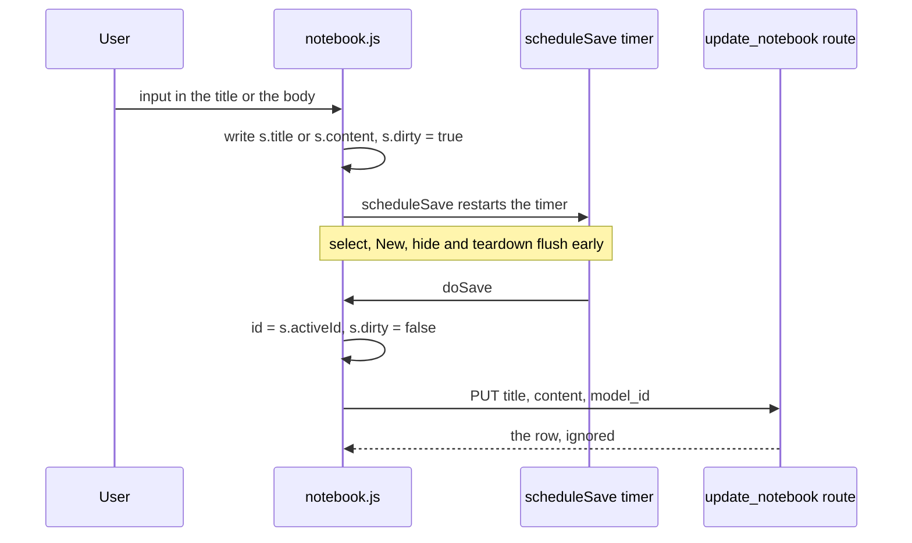
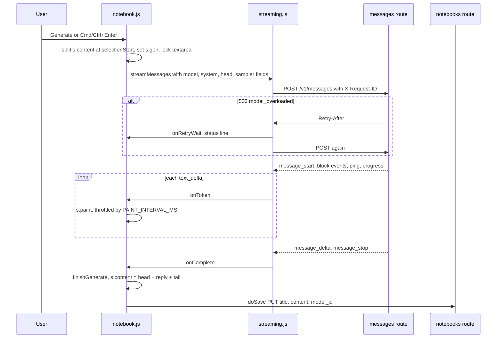
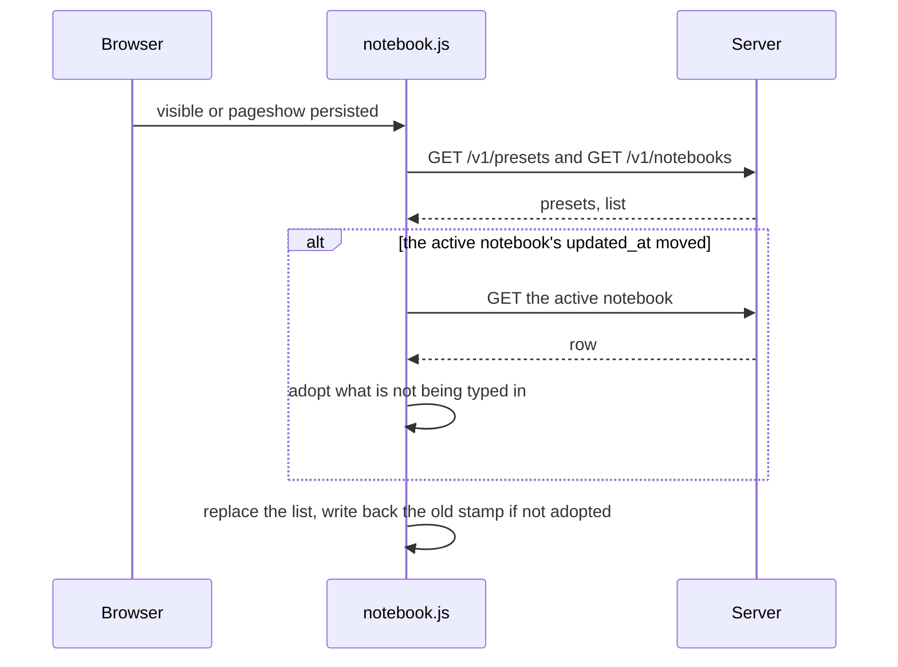

# Notebook page

last updated: 2026-11-24

This page maps `#/notebook` (`frontend/js/pages/notebook.js`) from mount to teardown: the notebook list, the editor and its debounced save, what the page puts in the settings drawer, generate-at-cursor over `POST /v1/messages`, and resume. It follows each flow into the shared modules the page calls and into the server handlers it relies on (`src/heylook_llm/notebook_api.py`, `src/heylook_llm/messages_api.py`). It stops at the router, the drawer shell and the preset section's sheets, which sibling pages map. The overview this sits under is `docs/wiki/frontend_core.md`; this page does not repeat it.

## Files and what each owns

| File | What it owns for this page |
|---|---|
| `frontend/js/pages/notebook.js` | Page state, `buildSkeleton`, `renderList`, `selectNotebook`, `newNotebook`, `deleteNotebook`, `populateFields`, `scheduleSave` / `doSave`, the generate path (`startGenerate`, `paintGen`, `stopGenerate`, `releaseGen`, `finishGenerate`, `handleGenerateError`), `refreshAfterResume`, the drawer contribution and the hotkey wiring. `PAINT_INTERVAL_MS` lives here. |
| `frontend/js/page.js` | `createPage`: `ctx.state`, `ctx.signal`, `ctx.alive`, `ctx.guard`, `ctx.throttleTime`, `ctx.linkedController`, `ctx.onTeardown`, `ctx.onHide`, `ctx.onResume`. |
| `frontend/js/streaming.js` | `streamMessages` on top of `streamTypedSSE`: the POST, the busy retry (`MAX_BUSY_RETRIES`), SSE parsing and event dispatch. |
| `frontend/js/settings.js` | The module-level sampler `cache` shared with chat, and the functions the page calls on it: `hydrateDocParams`, `snapshotSettings`, `reconcileSettings`, `droppedNote`, `unrepresentableNote`, `messagesParams`, `rowModel`, `rowThinking`, `bindDocumentParams`, `documentScopeNote`, `buildSettingsPanel`. |
| `frontend/js/preset-bar.js` | `createPresetBar` (provenance, the Apply and Save sheets, `presetForNewDoc`, `syncIndicator`, `refresh`) and `paintPresetChip`. |
| `frontend/js/prompt-section.js` | `createPromptSection`: the drawer's system-prompt box, its per-keystroke commit, its debounced persist and its flushes. |
| `frontend/js/document-writer.js` | `createDocumentWriter`: the chained `system_prompt` PUT and the unchained `applied_preset_id` PUT. |
| `frontend/js/settings-drawer.js` | The drawer singleton: `registerSettings`, `openSettings`, `requestRebuild`, and its own Escape and `hashchange` close. |
| `frontend/js/hotkeys.js` | `registerPageHotkeys`: Cmd/Ctrl+Enter and Escape on `document`, skipped while a modal is open. |
| `frontend/js/utils.js` | `createEl`, `debounce`, `throttleToInterval`, `autoGrow`, `armedConfirm`, `setStatus`, `fillOptions`, `dismissPaneOnOutsideClick`. |
| `frontend/js/api.js` | The `api.*` wrappers generated from `ROUTES`, `request` (the `keepalive` option), `httpError`. |
| `frontend/css/app.css` | The `==== page: notebook ====` block; its `(max-width: 767px)` rules turn the list pane into a slide-in opened by `.notebook--list-open` and show `.notebook__toolbar` and `.notebook__list-toggle`, which are `display: none` otherwise. |
| `src/heylook_llm/notebook_api.py` | `notebook_router` (`/v1/notebooks`): `list_notebooks`, `create_notebook`, `get_notebook`, `update_notebook`, `delete_notebook`, and the `NotebookCreate` / `NotebookUpdate` bodies. |
| `src/heylook_llm/db.py` | The store functions of the same names, `_NB_LIST_NAMES` (the list omits `content` and `params`), `_UPDATABLE_NOTEBOOK_FIELDS`. |
| `src/heylook_llm/schema/sampler_params.py` | `SamplerParams`, the validator on every `params` write. |
| `src/heylook_llm/messages_api.py` | `create_message`, `_create_message`, `_stream_messages`, `translate_stream`, `StreamingEventTranslator`. |
| `src/heylook_llm/schema/messages.py` | `MessageCreateRequest`, the request body the page sends. |
| `src/heylook_llm/busy_response.py` | `model_busy_response`, the 503 the client retries on. |
| `src/heylook_llm/streaming_utils.py` | `async_generator_with_abort` (a disconnect stops a `/v1/messages` run), `KEEPALIVE_FRAME`, `control_frame`. |

## State

Everything below `s.` is a field of `ctx.state`, which is fresh per mount.

| Name | Where it lives | Written by | Read by | Reset when |
|---|---|---|---|---|
| `s.notebooks` | `ctx.state` | `setup` (list GET), `newNotebook` (`unshift` of the create response), `deleteNotebook` (filter), `refreshAfterResume` (replaced; the active entry's `updated_at` may be written back), the title `input` listener (`nb.title`) | `renderList`, the title listener, `refreshAfterResume` (`held` stamp), `setup` and `deleteNotebook` (first id) | Never cleared; replaced on resume |
| `s.models` | `ctx.state` | `setup` only: `/v1/models` `data` without rows whose `engine.embedding` is set | `fillModelSelect`, `notebookCaps`, `notebookThinking`, `notebookModel`, the drawer contribution's getters, `populateFields`, `refreshAfterResume` | Not refetched during a mount |
| `s.activeId` | `ctx.state` | `selectNotebook` (before its GET), its failure path (null), `deleteNotebook` (null) | Nearly every function; `docId` and `owner` adapters | Delete of the active notebook, a failed load |
| `s.title` | `ctx.state` | Title `input`, `selectNotebook`, `refreshAfterResume`, `deleteNotebook` (`''`) | `doSave`, `populateFields` | Delete of the active notebook |
| `s.content` | `ctx.state` | Body `input`, `selectNotebook`, `finishGenerate` (target branch), `refreshAfterResume`, `deleteNotebook` (`''`) | `doSave`, `startGenerate`, `populateFields` | Delete of the active notebook |
| `s.systemPrompt` | `ctx.state` (`''` means none) | The prompt section's `set` adapter (trimmed text or `''`), `setSystemPrompt`, `selectNotebook`, `refreshAfterResume`, `deleteNotebook` | `startGenerate` (`system`), the preset bar's `getPrompt` (as `s.systemPrompt \|\| null`), `newNotebook` (draft), `populateFields` | Delete of the active notebook |
| `s.appliedPresetId` | `ctx.state` | `setAppliedPreset`, `selectNotebook` (and null on its failure), `refreshAfterResume`, `deleteNotebook` (null when none remain) | The preset bar's `getStamp`, `newNotebook` (draft) | Failed load; delete leaving no notebooks |
| `s.modelId` | `ctx.state` | Model select `change`, `selectNotebook`, `populateFields` (set to what the select landed on), `refreshAfterResume`, `deleteNotebook` | `doSave` (`model_id`), `populateFields` | Delete of the active notebook |
| `s.dirty` | `ctx.state` | Title, body and model listeners (true), `doSave` (false before its PUT, true again on a failure it reports), `selectNotebook` (false), `deleteNotebook` (false), `finishGenerate` (true) | `doSave`, `refreshAfterResume` (`typingDoc`) | Select, delete |
| `s.gen` | `ctx.state`: `{ controller, targetId, head, tail, content }` | `startGenerate`; `releaseGen` sets null; `gen.content` is written by `onToken` | `paintGen`, the `startGenerate` guard, `onSubmit`, `onEscape`, the Generate button, `selectNotebook`, `deleteNotebook`, `refreshAfterResume` (`typingDoc`) | `releaseGen` |
| `s.resumeSync` | `ctx.state` (not initialised; undefined reads as false) | `refreshAfterResume` (latch, cleared in `finally`) | `refreshAfterResume` | End of each resume pass |
| `s.scheduleSave`, `s.presetBar`, `s.promptSection`, `s.docWriter`, `s.paint` | `ctx.state` | Built once in `setup` | The flows below | Per mount |
| DOM refs (`listEl`, `listToggleBtn`, `titleInput`, `modelSelect`, `presetChip`, `contentTextarea`, `generateBtn`, `formEl`, `emptyEl`, `editorBody`, `statusEl`, `rootEl`) | `ctx.state` | `buildSkeleton` | Everything | Per mount |
| `.notebook--list-open` | Class on `s.rootEl` | List toggle, `dismissPaneOnOutsideClick`, row click, `newNotebook` | `app.css` phone rules | Each of those removes it |
| Sampler `cache` | `settings.js` module scope, shared with chat | `hydrateDocParams` (silent), `applySettings` (preset Apply), the panel's `setSetting` / `setSettings`, `reconcileSettings` | `snapshotSettings`, `messagesParams`, `buildSettingsPanel`, the preset bar's drift check | `hydrateDocParams(null)` in `setup` with no notebooks and in `deleteNotebook` when none remain; not on a failed load |
| `pending`, `timer` | `bindDocumentParams` closure | Its settings-change listener | Its `flush` | Each flush |
| `builtFor`, persist timer | `createPromptSection` closure | Creation (`owner()`, null here at mount) and every `setValue` | `edited`, the persist, the Clear arm target | Each `setValue` |
| `chain` | `createDocumentWriter` closure | `putSystemPrompt` | `putSystemPrompt` | Per mount |
| `presets`, `provEl`, `syncUpdate` | `createPresetBar` closure | `load` / `refresh`, `buildSection`, `saveAsNew`, `updateStamped` | Provenance, the chip, the sheets | Per mount |
| `current`, `isOpen` | `settings-drawer.js` module scope | `registerSettings` and its unsubscribe, `open`, `close` | `render`, `requestRebuild` | Unregister at teardown |
| Browser storage | none | The page reads and writes nothing through `storage.js` | | |

## Entry points

| What the user or browser does | Handler (file and function) | Flow |
|---|---|---|
| Opens `#/notebook` | `app.js` `navigate` -> `page.js` `mount` -> `notebook.js` `setup` | Mount |
| Clicks a row in the list | `notebook.js` `renderList`, the row's `click` listener -> `selectNotebook` | Select a notebook |
| Clicks "New" | `notebook.js` `buildSkeleton` -> `newNotebook` | New notebook |
| Clicks "Del", then "Confirm?" | `utils.js` `armedConfirm` -> `notebook.js` `deleteNotebook` | Delete a notebook |
| Taps "Notebooks" in the phone toolbar, or taps outside the open pane | `buildSkeleton` toggle listener; `utils.js` `dismissPaneOnOutsideClick` | Phone list pane |
| Types in the title | `buildSkeleton`, title `input` listener | Typing in the title |
| Types in the body | `buildSkeleton`, textarea `input` listener | Typing in the body |
| A save timer fires, the tab hides, the page unmounts | `debounce` timer -> `doSave`; `ctx.onHide` -> `scheduleSave.flush({ keepalive: true })`; `ctx.onTeardown` -> `scheduleSave.flush()` | The debounced save |
| Types in, blurs or clears the drawer's system prompt box | `prompt-section.js` `edited`, its `change` listener, the Clear button | System prompt |
| Applies a preset, saves one, clicks the preset chip | `preset-bar.js` `apply`, `saveAsNew`, `updateStamped`; the chip's `click` -> `settings-drawer.js` `openSettings` | Presets as this page wires them |
| Opens the drawer, edits a sampler control | `settings-drawer.js` `open` -> `render`; `settings.js` `setSetting` -> `bindDocumentParams` listener | The drawer contribution and sampler edits |
| Changes the model select | `buildSkeleton`, model select `change` listener | Model select |
| Clicks "Generate", or presses Cmd/Ctrl+Enter | `generateBtn` `click` -> `startGenerate`; `hotkeys.js` `registerPageHotkeys` -> `onSubmit` | Generate |
| Clicks "Stop", presses Escape, switches or deletes the notebook mid-run, leaves the page | `stopGenerate`, `onEscape`, `selectNotebook`, `deleteNotebook`, `ctx.signal` abort | Stop |
| The stream fails | `streamMessages` `onError` -> `handleGenerateError` | Generation error |
| The tab becomes visible again, or a bfcache `pageshow` | `ctx.onResume` -> `refreshAfterResume` | Resume |
| Navigates to another page | `app.js` `navigate` -> `page.js` `unmount` | Teardown |

## Flows

### Mount: setup to first paint

Trigger: `app.js` `navigate` imports `pages/notebook.js` and awaits `currentPage.mount(main)`, which calls `setup(ctx)`.

Guards: none in `setup`. A navigation that supersedes this one is the router's concern (`navToken`).

Steps:

1. `setup` initialises `s.notebooks`, `s.models`, `s.activeId`, `s.title`, `s.content`, `s.systemPrompt`, `s.appliedPresetId`, `s.modelId`, `s.dirty` and `s.gen`.
2. `buildSkeleton` builds the list pane (heading "Notebooks", button "New", an empty `.notebook__list`), the toolbar holding the "Notebooks" toggle, the title input (placeholder "Untitled"), the model select (title "Model"), the hidden preset chip, the body textarea (placeholder "Start writing…"), the "Generate" button, the form, the empty-state element, an empty `.notebook__body`, and the `.notebook__status` line (`role="status"`). It wires `dismissPaneOnOutsideClick` on the root and appends the root to `ctx.el`. This is the first paint: list heading and New, an empty list, an empty editor body and an empty status line; on a phone, the toolbar with its toggle.
3. `s.scheduleSave = debounce(...)` wraps `doSave`; `ctx.onTeardown` registers its flush and `ctx.onHide` its `keepalive` flush.
4. `createPresetBar` builds the bar with this page's adapter (see "Presets as this page wires them") and registers its own sampler-change listener. `s.presetBar.refresh()` sends `GET /v1/presets` with `ctx.signal`; its `.then` calls `syncIndicator` if the page is still alive.
5. `createPromptSection` builds the one prompt box for the mount, with `builtFor` taken from `owner()`, which is null here.
6. `drawer.registerSettings` installs the contribution; `ctx.onTeardown` registers its unsubscribe.
7. `bindDocumentParams` binds the sampler panel to the active notebook's `params`; `ctx.onTeardown` registers the returned teardown.
8. `ctx.onResume(ctx.guard(() => refreshAfterResume(ctx)))`.
9. `registerPageHotkeys` wires `onSubmit` and `onEscape`.
10. `createDocumentWriter({ update: api.updateNotebook, onError })` becomes `s.docWriter`.
11. `s.paint = ctx.throttleTime(() => paintGen(ctx), PAINT_INTERVAL_MS)`: one throttle for the mount.
12. `await Promise.all` of `GET /v1/models` and `GET /v1/notebooks`, both with `ctx.signal`.
13. If `ctx.alive` is false, return.
14. `s.models` takes `data` without embedding rows; `s.notebooks` takes `notebooks`.
15. `fillModelSelect` puts one option per model id (no residency); the select lands on the first option, or is empty.
16. `renderList` paints the rows, or "No notebooks yet.".
17. With notebooks, `await selectNotebook(ctx, s.notebooks[0].id)`: the first row, which the server orders by `updated_at` descending. With none, `hydrateDocParams(null)` clears the shared sampler cache (chat may have left values in it) and `renderEditor` shows the empty state.

Ends when: `setup` resolves. `app.js` then sets `main.dataset.mounted = 'notebook'`; with notebooks present that is after the first notebook's GET has settled.

Failure paths:

- `/v1/models` fails: caught silently as `{ data: [] }`. The select is empty and Generate later says "No models available.".
- `/v1/notebooks` fails: if alive, "Could not load notebooks: ${err.message}" in the error colour, and the page continues as if there were none.
- `/v1/presets` fails: "Could not load presets: ${err.message}" (`preset-bar.js` `refresh`). It races the notebook load, so it may land before or after `selectNotebook` clears the status line.
- The first notebook's GET fails: the failure path of "Select a notebook".
- A throw inside `setup`: `createPage` unmounts and rethrows; `app.js` shows its failure note (shell-and-lifecycle.md).

Awaits and what is re-checked:

- `Promise.all`: `ctx.alive`.
- `selectNotebook`: its own checks.

### Render the list

Trigger: `renderList` is called by `setup`, the title listener, `selectNotebook` (before and after its GET), `newNotebook`, `deleteNotebook`, `populateFields` and `refreshAfterResume`.

Guards: none.

Steps:

1. No notebooks: the list becomes one `.empty-state` reading "No notebooks yet.".
2. Otherwise every row is rebuilt from `s.notebooks`, in its current order: a `.notebook-item__title` span (text and `title` attribute are `nb.title || 'Untitled'`), and a "Del" button wrapped by `armedConfirm` around `deleteNotebook`. The row has `.notebook-item--active` when its id is `s.activeId`.
3. Each row's `click` calls `selectNotebook(ctx, nb.id)` without awaiting it, then removes `.notebook--list-open` from the root.

Ends when: the list is replaced. Every call replaces every row, so a Del that was armed goes back to "Del" (FB-23).

Order: the server's `updated_at` order at the last list fetch, with notebooks created in this mount prepended. `doSave` ignores the PUT response, so editing does not reorder the list until a resume replaces it.

Failure paths: none.

Awaits: none.

### Select a notebook

This is also what "opening a notebook" means: the only place a notebook's stored fields are adopted, apart from resume.

Trigger: a row click; `setup` (first row); `deleteNotebook` (first remaining row); `newNotebook` (the row just created).

Guards: `s.activeId === id` returns at once. Re-clicking the open notebook never refetches it.

Steps:

1. If `s.gen` is set, `stopGenerate`. The run ends later through `finishGenerate`, which sees the notebook has changed and writes the partial text to its own notebook in the background (see "Stop").
2. `s.scheduleSave.flush()`: a pending title, body or model save runs now, while `s.activeId` still names the previous notebook.
3. `s.promptSection.flush()`: a pending prompt write goes to `builtFor`, the previous notebook.
4. `s.activeId = id`; `showStatus(ctx, '')` clears the status line; `renderList` moves the highlight.
5. `await api.getNotebook(id, { signal: ctx.signal })`: `GET /v1/notebooks/{id}`.
6. If `ctx.alive` is false or `s.activeId !== id` (a later select won), return.
7. Adopt from the row: `s.title = nb.title ?? ''`, `s.content = nb.content ?? ''`, `s.systemPrompt = nb.system_prompt ?? ''`, `s.appliedPresetId = nb.applied_preset_id ?? null`, `s.modelId = nb.model_id ?? ''`.
8. `hydrateDocParams(nb)` loads `nb.params` into the shared cache without firing listeners, so nothing is written back. Its report goes through `unrepresentableNote(..., 'notebook')`; anything lost is shown in the error colour.
9. `s.dirty = false`.
10. `populateFields`: the title input's value; `s.promptSection.setValue(s.systemPrompt)`, which repaints the box, disarms Clear, re-anchors `builtFor` to this notebook and cancels any pending prompt write; the textarea's value and `autoGrow`; the model select moves to `s.modelId` only if that id is in `s.models`; `s.modelId` is then set to whatever the select shows; `s.presetBar.syncIndicator()` repaints the chip; `renderEditor` shows the form; `renderList`.
11. `reconcileParams`: `reconcileSettings(notebookModel(ctx))` removes from the cache what the selected model cannot use. If anything went, it fires the settings-change listeners (so `bindDocumentParams` schedules a `params` PUT to this notebook and the preset bar repaints provenance) and the status line shows the `droppedNote` text in the normal colour, replacing step 8's note if both applied.
12. `drawer.requestRebuild({ force: true })`: repaints the drawer if it is open; a no-op when closed.

Ends when: the form shows the notebook and every adopted field is in state and the DOM.

What is adopted: title, content, system prompt, preset stamp, model (only when the model is listed), sampler params. The list entry's `updated_at` is not touched; it stays the one from the last list fetch.

Failure paths:

- GET rejects while alive and still on this id: "Could not load notebook: ${err.message}" in the error colour; `s.activeId = null`, `s.appliedPresetId = null`; `renderEditor` shows the empty state; `renderList`; `syncIndicator` clears the chip. Re-clicking the row retries, because the guard no longer matches. Not reset on this path: `s.title`, `s.content`, `s.systemPrompt`, the prompt box (still showing the previous notebook's prompt and still anchored to it) and the sampler cache (still the previous notebook's). The drawer's scope line then reads as the draft for the next notebook, and New would create from those values. See the last section.
- GET aborted by teardown: `ctx.alive` is false, nothing happens.

Awaits and what is re-checked:

- `getNotebook`: `ctx.alive` and `s.activeId === id`.
- Window during that await: the form still shows the previous notebook's title and body and accepts input, while `s.activeId` already names the new one. See the last section.

### New notebook

Trigger: "New" in the list head.

Guards: none. Nothing stops a second click while the first create is in flight.

Steps:

1. `s.scheduleSave.flush()`.
2. `draft = !s.activeId`; `preset = s.presetBar.presetForNewDoc()`, which is the open notebook's stamped preset from the bar's cached list, or null (and always null with no notebook open).
3. `await api.createNotebook(body)`: `POST /v1/notebooks` with `title: 'Untitled'`, `content: ''`, and:
   - with no notebook open (the draft): `system_prompt: s.systemPrompt || undefined`, `params: snapshotSettings()`, `applied_preset_id: s.appliedPresetId || undefined`;
   - from an open notebook: `system_prompt: preset?.system_prompt || undefined`, `params: { ...(preset?.params ?? {}) }`, `applied_preset_id: preset?.id || undefined`.
   `undefined` fields are dropped by `JSON.stringify`. No `model_id` is sent.
4. If `ctx.alive` is false, return.
5. `s.notebooks.unshift(nb)` with the create response; `renderList`.
6. `await selectNotebook(ctx, nb.id)`: the full select flow, which fetches the row again and reconciles its params against the selected model.
7. Remove `.notebook--list-open`; focus the title input and select its text, so typing replaces "Untitled".

Server: `notebook_api.create_notebook` validates `params` through `SamplerParams` (422 on an unknown key or a bad value), calls `db.create_notebook` and answers 201 with the row, `model_id` null.

Ends when: the new notebook is open with its title selected. Its stored `model_id` stays null until the first `doSave`, which sends the select's value.

Failure paths:

- Create rejects while alive: "Create failed: ${err.message}" in the error colour. A phone's list pane stays open.
- The select fails: its own failure path; step 7 then focuses a detached input, which does nothing.

Awaits and what is re-checked:

- Create: `ctx.alive`.
- `selectNotebook`: its own checks; nothing is re-checked after it.

### Delete a notebook

Trigger: "Del" in a row arms it ("Confirm?", class `btn--armed`); a second click before the arm clears runs `deleteNotebook`. `armedConfirm` calls `stopPropagation`, so neither click selects the row or dismisses the phone pane. The arm clears on the timer in `armedConfirm`'s `arm`, or when `renderList` rebuilds the row.

Guards: the arm.

Steps:

1. `await api.deleteNotebook(id)`: `DELETE /v1/notebooks/{id}`, no signal.
2. If `ctx.alive` is false, return.
3. `s.notebooks` drops the row.
4. If it was the active notebook: `stopGenerate` if a run is going (its partial still goes to its own notebook, where the PUT will now 404); `s.scheduleSave.cancel()` drops unsaved edits to it; `s.dirty = false`; `s.activeId`, `s.title`, `s.content`, `s.systemPrompt` and `s.modelId` are cleared. Then:
   - notebooks remain: `await selectNotebook(ctx, s.notebooks[0].id)`;
   - none remain: `s.appliedPresetId = null`, `hydrateDocParams(null)`, `syncIndicator`, `s.promptSection.setValue('')` (re-anchors the box to no notebook), `renderEditor` (empty state).
5. If alive, `renderList`.

Server: `notebook_api.delete_notebook` answers `{ status: "deleted", id }`, or 404 "Notebook not found".

Ends when: the list no longer shows the row and, if it was open, the next notebook (or the empty state) is shown.

Failure paths: the DELETE rejects while alive: "Delete failed: ${err.message}" in the error colour; nothing local changes.

Awaits and what is re-checked:

- DELETE: `ctx.alive`.
- `selectNotebook`: its own checks; `ctx.alive` again before the final `renderList`.

### Phone list pane

Trigger: the "Notebooks" button in `.notebook__toolbar`, which `app.css` shows only under `(max-width: 767px)`. On wider screens the class it toggles has no visible effect.

Guards: none.

Steps:

1. The toggle's `click` toggles `.notebook--list-open` on `s.rootEl`. The phone rules then show the pane as a fixed slide-in and a scrim drawn by the root's `::before`.
2. Dismissal, any of:
   - the toggle again;
   - a click anywhere on the root whose target is not inside `.notebook__list-pane` or `.notebook__list-toggle` (`dismissPaneOnOutsideClick`); a tap on the scrim lands on the root itself, so it dismisses;
   - a row click, which removes the class right after starting the select (without waiting for it);
   - `newNotebook`, which removes it only after the create and the select have both resolved.

Ends when: the class is removed.

Failure paths: a failed create leaves the pane open.

Awaits: none in the pane logic.

### Typing in the title

Trigger: `input` on `.notebook__title`. The input is in the form, which is attached only while a notebook is open (`renderEditor`).

Guards: none.

Steps:

1. `s.title = s.titleInput.value`; `s.dirty = true`.
2. The `s.notebooks` entry for `s.activeId` gets the new title, and `renderList` rebuilds every row (FB-23).
3. `s.scheduleSave()` restarts the save timer.

Ends when: the debounced save runs.

Failure paths: see "The debounced save".

Awaits: none.

### Typing in the body

Trigger: `input` on `.notebook__content`. Plain text only: the page reads and writes `textarea.value`, never markup.

Guards: none in the listener. While a generation runs the textarea is `readOnly`, so no `input` fires.

Steps:

1. `s.content = s.contentTextarea.value`; `s.dirty = true`.
2. `autoGrow(s.contentTextarea, Infinity)`, which returns at once where CSS `field-sizing: content` is supported (`app.css` lists `.notebook__content` in that `@supports` block).
3. `s.scheduleSave()`.

Ends when: the debounced save runs.

Failure paths: see "The debounced save".

Awaits: none.

### The debounced save

Trigger: `s.scheduleSave` is `debounce((opts) => { doSave(ctx, opts); }, ...)` with the delay literal in `setup`. Each call restarts the timer and the timer calls `doSave(ctx, undefined)`. Flushes run it early:

- `selectNotebook` and `newNotebook` flush before the open notebook changes;
- `ctx.onHide` flushes with `{ keepalive: true }` (`visibilitychange` to hidden, or `pagehide`);
- `ctx.onTeardown` flushes with no options;
- `deleteNotebook` cancels instead, for the notebook being deleted;
- `finishGenerate` calls `doSave` directly rather than through the timer.

`debounce`'s `flush` runs only when a timer is pending; with none it does nothing, even if `s.dirty` is true.

Guards (in `doSave`): no `s.activeId`, or `s.dirty` false, returns.

Steps:

1. `id = s.activeId`, read when `doSave` runs, not when the save was scheduled. The page relies on every change of the open notebook being preceded by a flush.
2. `s.dirty = false`.
3. `await api.updateNotebook(id, { title: s.title, content: s.content, model_id: s.modelId || null }, { keepalive })`: `PUT /v1/notebooks/{id}`. No `system_prompt`, `params` or `applied_preset_id`: those have their own writers, and the server updates only the fields present in the body (`model_fields_set`).
4. The response row is ignored.

Server: `notebook_api.update_notebook` validates the body (`NotebookUpdate`), refuses an empty one with 400 "No fields to update", and calls `db.update_notebook`, which writes the given columns and `updated_at` and returns the row; 404 "Notebook not found" when the id is gone.

Ends when: the PUT settles.

Failure paths:

- The PUT rejects while alive and still on the same notebook: `s.dirty = true` and "Save failed: ${err.message}" in the error colour. Nothing reschedules the save; the next edit does.
- The PUT rejects after the open notebook changed, or after teardown: silent.
- A hide-time body over the browser's `keepalive` size cap (noted beside `api.js` `request`) is not sent (FB-24).

Awaits and what is re-checked: the PUT; after it, `ctx.alive` and `s.activeId === id`, only on the failure path.

### System prompt

The box is `prompt-section.js` `createPromptSection`, wired with this adapter:

- `owner: () => s.activeId`
- `get: () => s.systemPrompt`
- `set: (v) => { s.systemPrompt = v ?? ''; }`
- `persist: (v, id, opts) => putSystemPrompt(ctx, id, v, opts)`, which is `s.docWriter.putSystemPrompt`
- `onEdit: () => s.presetBar.updateProvenance()`
- `label: 'System prompt for this notebook'`

Trigger: `input`, `change` (blur) or the Clear button on `.sysprompt-input` in the drawer.

Guards: the edit commits to page state only while `owner() === builtFor`; a stale box never writes onto a different notebook.

Steps, per keystroke (`edited`):

1. `autoGrow(input, 480)`.
2. The value is trimmed; empty becomes null.
3. If `owner() === builtFor`, `set(value)` writes `s.systemPrompt`.
4. The persist timer restarts (the delay literal in `createPromptSection`).
5. `onEdit` repaints the provenance line, the preset chip and the Save sheet's Overwrite offer.
6. Clear is disabled while the box is empty.

When the persist runs: with `builtFor` set, `putSystemPrompt(builtFor, value)` queues `PUT /v1/notebooks/{id}` with `{ system_prompt: value }` on the writer's chain (null clears it). With `builtFor` null (no notebook exists yet) nothing is written; the text lives only in `s.systemPrompt` until "New" sends it (FB-22).

Other edges:

- Blur (`change`) flushes the persist now. So does the drawer's `close`, which blurs the focused field first.
- Clear arms ("Clear prompt?", target `builtFor`); the confirming click empties the box, runs `edited` and flushes a null write.
- `setValue` (from `populateFields`, `setSystemPrompt`, `deleteNotebook`, `refreshAfterResume`) repaints, re-anchors `builtFor` to `owner()` and cancels any pending persist.
- `selectNotebook` flushes before `s.activeId` moves; `ctx.onHide` flushes with `keepalive`; teardown flushes.
- `document-writer.js` `putSystemPrompt` chains ordinary writes behind the previous one; a `keepalive` write is sent at once and the chain waits on it (FB-35).

Generate reads `s.systemPrompt` straight from state, so it never waits on this write.

Differs from chat:

- Chat builds a section per drawer render and `release()`s the one it replaces; notebook keeps one instance for the mount and reuses its `element` in every render, re-anchoring it through `setValue`.
- Chat's `set` parks a no-conversation draft in browser storage; notebook's does not.
- Chat's `getPrompt` for the preset bar is `s.systemPrompt`; notebook's is `s.systemPrompt || null`, because this page stores "no prompt" as `''`.

Ends when: the PUT settles.

Failure paths: a rejected PUT shows "System prompt save failed: ${err.message}" in the error colour. The writer's `onError` has no `ctx.alive` check.

Awaits: none in the page; the chain lives in `document-writer.js`.

### Presets as this page wires them

The adapter passed to `createPresetBar`: `noun: 'notebook'`, `getPrompt: () => s.systemPrompt || null`, `setPrompt: (v) => setSystemPrompt(ctx, v)`, `onStatus` to the notebook status line, `docId: () => s.activeId`, `onIndicator` to `paintPresetChip(s.presetChip, info)`, `getStamp: () => s.appliedPresetId`, `setStamp: (id) => setAppliedPreset(ctx, id)`, `model: () => notebookModel(ctx)`.

Trigger: Apply, "Save as a new preset" or "Overwrite X" in the drawer's preset section; the chip.

Guards: those of `preset-bar.js` (the Replace-prompt arm, the name check, the Overwrite arm and its `updated_at` check), mapped from chat's side in chat-model-and-settings.md.

Steps for Apply (`preset-bar.js` `apply`), as they land here:

1. `applySettings(preset.params ?? {})` replaces the cache and fires the listeners: with a notebook open, `bindDocumentParams` schedules a `params` PUT; the preset bar repaints provenance.
2. `reconcileSettings(model())` removes what the selected model cannot use.
3. If the preset carries a prompt, `setPrompt` -> `setSystemPrompt`: `s.systemPrompt` takes it, `s.promptSection.setValue` repaints and cancels any pending typed write, and with a notebook open and the value changed, `putSystemPrompt` writes it now (chained).
4. `setStamp` -> `setAppliedPreset`: `s.appliedPresetId` takes the id; with a notebook open, `s.docWriter.setAppliedPreset` sends `PUT /v1/notebooks/{id}` with `{ applied_preset_id }`, unchained. With none open the stamp rides in state until New sends it.
5. The status line shows `Preset "${preset.name}" applied.` or `Preset "${preset.name}" applied. It carries no system prompt, so this one is unchanged.`, followed by any removal note.
6. `drawer.requestRebuild({ force: true })`, then `syncIndicator`.

Save as a new preset and Overwrite read `getPrompt` and `samplerParams(notebookModel(ctx))`; "Save as a new preset" also stamps through `setStamp`. Their status lines land on the notebook status line.

The chip: `paintPresetChip` runs on every `syncIndicator` and every `updateProvenance` (each prompt keystroke and each sampler change). It is hidden with no notebook open or no stamped preset in the list, and reads the preset's name, or `${name} (modified)`. Its `title` is "Preset applied to this notebook -- open settings"; a click calls `drawer.openSettings(s.presetChip)`.

Differs from chat: chat's `onIndicator` also paints a system-prompt chip; the notebook has none.

Ends when: the writes settle.

Failure paths: "Preset stamp save failed: ${err.message}" (`document-writer.js`), "System prompt save failed: ${err.message}", "Settings save failed: ${err.message}", plus the preset bar's own messages (listed under "What the user sees"). The notebook status line sits inside `#app`, which the open drawer makes inert and, on a phone, covers.

Awaits: inside `preset-bar.js`, mapped by its sibling page.

### The drawer contribution and sampler edits

Trigger: the drawer opens (`settings-drawer.js` `open` -> `render`), or a control in its Generation panel changes.

Guards: `requestRebuild` without `force` skips while focus is inside the drawer body.

What `render` builds from the notebook's contribution, top to bottom:

1. `sections()`: `s.presetBar.buildSection()` (a new node each render) and `s.promptSection.element` (the same node every render).
2. `samplers: 'enabled'`, so `buildSettingsPanel` runs with, all read off the `s.models` row whose id is `s.modelSelect.value` at render time: `caps` (`notebookCaps`: `capabilities`), `thinking` (`notebookThinking`: `rowThinking(row)`), `requestFields` (`engine.decoding.request_fields.value`), `modelDefaults` (`{ enable_thinking: row.thinking_default }`), `samplerDefaults` (`sampler_defaults`), `samplerSources` (`sampler_sources`), and `scope`: `documentScopeNote('notebook', Boolean(s.activeId))`.
3. No `extras`. Then the shell's "Embeddings workbench" link, and "Sign out" when a session is active.
4. `onOpen: s.presetBar.onDrawerOpen` refetches `/v1/presets` and repaints if the list changed.

Steps for a sampler edit:

1. The control calls `setSetting` or `setSettings`, which writes the cache and fires the listeners.
2. The preset bar's listener repaints provenance and the chip.
3. `bindDocumentParams`'s listener: with no notebook open it does nothing (the cache is the draft "New" sends as `params`). With one open, a write still owed to a different notebook is flushed first; then `pending = { id, params: snapshotSettings() }` is captured and the timer restarts (its `delay` default).
4. The timer, a hide (`keepalive`) or teardown sends `PUT /v1/notebooks/{id}` with `{ params }`, the id and bag captured in step 3.

Server: `params` is validated by `SamplerParams` (422 on an unknown key or a bad value; nulls are not stored).

Ends when: the PUT settles.

Failure paths: "Settings save failed: ${err.message}" in the error colour, with no `ctx.alive` check.

Awaits: none in the page.

### Model select

Trigger: `change` on `.notebook__model`. The select is in the form, so it can change only with a notebook open, and only with the drawer closed (the drawer seals `#app`).

Guards: none.

Steps:

1. `s.modelId = s.modelSelect.value`; `s.dirty = true`; `s.scheduleSave()` (the model is saved with the title and body).
2. `reconcileParams`: settings the new model cannot use are removed from the cache, which schedules a `params` PUT; the status line names them.
3. `drawer.requestRebuild({ force: true })`, a no-op while the drawer is closed.

A generation in flight is not touched: its request named its model at launch. The list carries no residency and the page has no Load control; the server loads a cold model inside `POST /v1/messages` (`router.get_provider` in `_create_message`).

Ends when: the save settles.

Failure paths: those of the debounced save.

Awaits: none.

### Generate

Trigger: the "Generate" button while `s.gen` is null, or Cmd/Ctrl+Enter (`onSubmit`, which checks `!s.gen && s.activeId` first).

Guards:

- `s.gen` set, or no `s.activeId`: returns silently.
- `s.modelSelect.value` empty: "No models available." in the error colour.

Steps:

1. `insertPos = s.contentTextarea.selectionStart ?? s.content.length`; `head = s.content.slice(0, insertPos)`, `tail = s.content.slice(insertPos)`. The cursor comes from the DOM, the text from state. The selection's end is ignored: selected text stays in `tail`.
2. `controller = ctx.linkedController()`, chained to the page signal.
3. `s.gen = { controller, targetId: s.activeId, head, tail, content: '' }`.
4. The button reads "Stop"; the textarea becomes `readOnly`; the status line is cleared.
5. `streamMessages(body, callbacks)`, not awaited. `body`:
   - `model: s.modelSelect.value`;
   - `system: s.systemPrompt || undefined`;
   - `messages: [{ role: 'user', content: head.trim() ? head : 'Continue writing.' }]`: the text before the cursor goes as a user turn (not as an assistant prefill), and `tail` is never sent;
   - `...messagesParams(notebookModel(ctx))`: every non-null cache value the model can use, zeros included, with `enable_thinking` and `thinking_budget_tokens` folded into `thinking` (a bool, or `{ budget_tokens, type? }`) and `reasoning_effort` as is;
   - `stream: true`, added by `streamMessages`.
6. `streamTypedSSE` sends `POST /v1/messages` with `Content-Type: application/json`, `X-Request-ID: requestId()` and the controller's signal.
7. A non-ok answer becomes `httpError(res)`. A 503 whose `error.code` is `model_overloaded`, up to `MAX_BUSY_RETRIES` times: `onRetryWait(wait)` shows `Server busy -- retrying in ${wait}s…` (only while alive and this run is still `s.gen`), then waits `Retry-After` seconds (a fallback literal in `streamTypedSSE` when absent) and posts again. Anything else throws to `onError`.
8. The body is read and split into events on blank lines; `event:` and `data:` lines are parsed; a block without both is dropped.
9. Each `content_block_delta` whose `delta.type` is `text_delta` appends `delta.text` to `content` and calls `onToken(delta, content)`, which sets `gen.content` and, if alive, calls `s.paint()`.
10. `paintGen`, at most once per `PAINT_INTERVAL_MS` and on an animation frame (`throttleToInterval`, leading edge): returns unless `s.gen` is set and `s.activeId === gen.targetId`; writes `head + content + tail` into the textarea; if the textarea has focus, moves the caret to the end of the generated text; `autoGrow`.
11. The body ends: `{ aborted: false }`; `onComplete({ content, thinking, usage, performance, aborted })` calls `finishGenerate`.
12. `finishGenerate` -> `releaseGen`: `gen.controller.abort()` (drops the chain listener); if `s.gen !== gen`, stop here; `s.gen = null`; if alive, the button reads "Generate" and `readOnly` is lifted.
13. `full = head + content + tail`. If the run's notebook is still open and the page alive: `s.content = full`, `s.dirty = true`, the textarea's value, `autoGrow`, and `doSave(ctx)` straight away (title, content, model). Otherwise, if `content` is not empty, `await api.updateNotebook(gen.targetId, { content: full })`; a failure goes to `console.warn('background notebook save failed', err)`.

Ignored by this page: thinking deltas (no `onThinking`), `heylook_progress` (no `onProgress`), `usage`, `performance`, `ping`, `tool_use` blocks. During prefill and thinking the textarea does not change.

Server (`messages_api.py`), as the page relies on it:

- `create_message` resolves the id from `X-Request-ID` (`resolve_request_id`, prefix `msg`) and tracks the run under it. The page never uses the id to cancel.
- `_create_message`: `to_chat_request`; `_refuse_unoffered_depth` (400 when `reasoning_effort` is a depth the model's template does not offer); `router.get_provider` (loads the model if needed; 400 on an unknown model, 500 on a load failure); `check_capacity` and `create_chat_completion` (503 from `model_busy_response`: `error.code` `model_overloaded`, a `Retry-After` header). Schema failures are FastAPI's 422.
- Then a `text/event-stream` response with an `X-Request-ID` header: `message_start`; per block `content_block_start`, `content_block_delta`, `content_block_stop`; `event: ping` keepalives (`KEEPALIVE_FRAME`); `heylook_progress` during prefill; `message_delta` (stop reason, usage); `message_stop` (`performance`).
- A failure after the headers is an in-band `error` event (`error.type` `invalid_request_error` or `api_error`) and the stream ends with no `message_delta` or `message_stop`.
- Nothing is persisted on this route. The notebook's own PUT is the only save.

Ends when: `finishGenerate`'s save has been sent.

Failure paths: see "Stop" and "Generation error".

Awaits and what is re-checked:

- `streamMessages` is not awaited by the page; its callbacks check `ctx.alive` (`onToken`) and `ctx.alive && s.gen === gen` (`onRetryWait`).
- `paintGen` re-checks `s.gen` and `s.activeId === gen.targetId` on every run.
- `finishGenerate` re-checks `s.gen === gen` (in `releaseGen`), `s.activeId === gen.targetId` and `ctx.alive`.

### Stop

Trigger: "Stop" (the Generate button while `s.gen` is set); Escape while `s.gen` is set; `selectNotebook` and `deleteNotebook` (active) during a run; teardown, whose `ctx.signal` abort reaches the run's linked controller.

Guards: `stopGenerate` is `ctx.state.gen?.controller.abort()`, a no-op without a run.

Steps:

1. The controller aborts. In `streamTypedSSE`, an abort during the fetch or the read raises `AbortError`, the reader is cancelled and the call returns `{ aborted: true }`; an abort during a busy wait ends the wait and returns `{ aborted: true }` before any retry.
2. `onComplete({ ..., aborted: true })` -> `finishGenerate`, as in Generate steps 12 and 13.
3. Still on the run's notebook and mounted: the status line reads "Stopped -- partial text kept." when text arrived, "Stopped." when none did. The save runs either way, so a stop with no text still sends a PUT.
4. Switched away or unmounted: no status; a non-empty partial is PUT to its own notebook.

Server: the dropped connection is noticed by `async_generator_with_abort` (`abort_on_disconnect` is true for this route), which sets the run's abort event and the generation ends. The page does not call `DELETE /v1/requests/{id}`, and this `stopGenerate` is not `streaming.js`'s function of the same name (a conversation route).

Ends when: the save after `finishGenerate` has been sent.

Failure paths: a failed background PUT is only logged.

Awaits: the background PUT; nothing is re-checked after it.

### Generation error

Trigger: `streamMessages` `onError`: a non-ok answer that is not retried (or a 503 past `MAX_BUSY_RETRIES`), a network failure, or an in-band `error` event (thrown inside `onEvent`).

Guards: none.

Steps:

1. `handleGenerateError` -> `releaseGen` (as in Generate step 12).
2. If alive and still on the run's notebook: "Generation failed: ${err.message}" in the error colour.

The message comes from `api.js` `httpError`: `error.message` when the body has one (the 503), a string `detail` (the 400s and 500s above), else the response's status text (FastAPI's 422 carries a `detail` array, which `httpError` does not read).

Not done: nothing is saved, on either branch. Text already painted stays in the textarea but is not in `s.content`; on another notebook the partial is dropped. See the last section.

Ends when: the button reads "Generate" again.

Failure paths: none further.

Awaits: none.

### Resume

Trigger: `ctx.onResume`: `visibilitychange` to visible, or a `pageshow` from the bfcache. `ctx.guard` makes it a no-op after teardown.

Guards: `s.resumeSync` drops a resume that arrives while a pass is running (it is not queued).

Steps:

1. `nbId = s.activeId`.
2. `await Promise.all([s.presetBar.refresh(), api.listNotebooks({ signal })])`; a failed list resolves as null.
3. If not alive, return.
4. With a list: `held` is the active entry's `updated_at` in `s.notebooks`, `fresh` the one in the new list; `unchanged` only when both exist and match. `adopted` starts as `unchanged`.
5. With `nbId` and not `unchanged`: `await api.getNotebook(nbId, { signal })` (a failure resolves as null). If not alive, return. If a row came back and `s.activeId === nbId`:
   - `typingPrompt`: focus is in a `.sysprompt-input`;
   - `typingDoc`: `s.dirty`, a run in `s.gen`, or focus in the body or title;
   - unless `typingDoc`: title, content and model are adopted into state and the DOM (the select moves only to a listed model, and `s.modelId` follows the select);
   - unless `typingPrompt`: `s.systemPrompt` and `s.promptSection.setValue`;
   - always: `s.appliedPresetId`, `hydrateDocParams(nb)` (its report is not shown here) and `reconcileParams`;
   - `adopted = !typingPrompt && !typingDoc`.
6. `s.notebooks = list.notebooks`; `renderList`.
7. If not `adopted` and a notebook is open, its new list entry gets `held` written back, so the next resume still sees it as changed. The fresh stamp is kept only once the body has been adopted.
8. If the presets changed or the body was refetched: `syncIndicator` and `drawer.requestRebuild()` (not forced).
9. `finally` clears `s.resumeSync`.

Because `doSave` ignores the PUT response, `held` predates the page's own last save, so a resume after any edit refetches the body.

Ends when: the latch clears.

Failure paths:

- The list GET fails: nothing about the notebook changes; the preset half still repaints if it moved.
- The body GET fails: nothing is adopted and the old stamp is written back, so the next resume retries.
- The open notebook was deleted elsewhere: the body GET 404s, the new list no longer shows it, and the editor keeps it open. See the last section.

Awaits and what is re-checked:

- `Promise.all`: `ctx.alive`.
- The body GET: `ctx.alive`, then `s.activeId === nbId` before adopting.

### Hotkeys: submit and Escape

Trigger: `keydown` on `document` (`hotkeys.js` `registerPageHotkeys`; removed on teardown).

Guards: the handler skips when `ctx.alive` is false or the event is already `defaultPrevented`. Both keys are ignored while a modal is open: a `dialog[open]` (for example the `?` shortcuts sheet) or `.drawer--open`.

Steps:

1. Cmd/Ctrl+Enter: `preventDefault`, then `onSubmit`, which calls `startGenerate` only when `!s.gen && s.activeId`. It is not scoped to the textarea: it fires with focus in the title, on a button or nowhere. During a run the key is consumed and does nothing.
2. Escape: `onEscape` stops a run and returns true (the event is then prevented); with no run it returns false and the event passes on.
3. With the drawer open, its own Escape listener (registered at boot, so it runs first) closes it and prevents the event; the page handler then skips it, so that Escape does not also stop a run. History: [sharp_edges.md, "A key a handler consumes is prevented"](../../architecture/sharp_edges.md#a-key-a-handler-consumes-is-prevented).

Ends when: the handler returns.

Failure paths: none.

Awaits: none.

### Teardown

Trigger: `app.js` `navigate` awaits `currentPage.unmount()`.

Guards: none.

Steps (`page.js` `unmount`):

1. `ctx.alive = false`; the page controller aborts. That cancels the GETs that carry `ctx.signal`, the run's linked controller, and the `onHide` and `onResume` listeners.
2. The `onTeardown` cleanups run in reverse order of registration: the paint throttle is cancelled; the `keydown` listener is removed; the `bindDocumentParams` teardown drops its hide hook, unsubscribes and flushes a pending `params` PUT; the drawer contribution is unregistered; the prompt section flushes a pending write; the preset bar's sampler listener is removed; `s.scheduleSave.flush()` runs a pending `doSave` (no `keepalive`).
3. There is no `teardown` function in this page's spec.
4. Later, the aborted run's `onComplete` reaches `finishGenerate` with `ctx.alive` false, and a non-empty partial is PUT to its own notebook.

Requests without a signal (saves, create, delete, the writer's PUTs) keep going after teardown. Their failure handlers check `ctx.alive`, except `bindDocumentParams`'s `onError` and the writer's `onError`, which write to the detached status element.

Ends when: the cleanups have run.

Failure paths: a cleanup that throws is logged and the rest still run (`unmount`).

Awaits: none in the page's cleanups.

## Requests this area makes

| When | Method and path | Body | Response fields used | On failure |
|---|---|---|---|---|
| Mount | `GET /v1/models` | none | `data[]`: `id`, `engine.embedding`, `capabilities`, `engine.thinking`, `engine.template.origin.value`, `engine.decoding.request_fields.value`, `thinking_default`, `sampler_defaults`, `sampler_sources` | Treated as no models, silently |
| Mount, resume | `GET /v1/notebooks` | none | `notebooks[]`: `id`, `title`, `updated_at` (the list carries no `content` or `params`) | Mount: "Could not load notebooks: …"; resume: ignored |
| Mount, drawer open, Apply sheet open, save as new, resume | `GET /v1/presets` | none | `presets[]`: `id`, `name`, `updated_at`, `system_prompt`, `params` | "Could not load presets: …" (`refresh`) |
| Select, resume | `GET /v1/notebooks/{id}` | none | `title`, `content`, `system_prompt`, `applied_preset_id`, `model_id`, `params` | Select: "Could not load notebook: …" and the no-notebook state; resume: ignored |
| New | `POST /v1/notebooks` | `title`, `content`, and when set `system_prompt`, `params`, `applied_preset_id` | The row: `id`, `title`, `updated_at` (then fetched again by the select) | "Create failed: …" |
| Del confirmed | `DELETE /v1/notebooks/{id}` | none | none | "Delete failed: …" |
| `doSave` (timer, flushes, end of a run) | `PUT /v1/notebooks/{id}` | `title`, `content`, `model_id` (`keepalive` on hide) | none | "Save failed: …" and `s.dirty = true`, only while alive and on the same notebook |
| End of a run on a notebook no longer open | `PUT /v1/notebooks/{id}` | `content` | none | `console.warn` |
| Prompt persist, preset Apply | `PUT /v1/notebooks/{id}` | `system_prompt` (chained; `keepalive` on hide) | none | "System prompt save failed: …" |
| Preset Apply, save as new | `PUT /v1/notebooks/{id}` | `applied_preset_id` | none | "Preset stamp save failed: …" |
| Sampler change, reconcile | `PUT /v1/notebooks/{id}` | `params` (`keepalive` on hide) | none | "Settings save failed: …" |
| Generate | `POST /v1/messages`, header `X-Request-ID` | `model`, `system`, `messages`, the sampler fields, `thinking`, `reasoning_effort`, `stream: true` | SSE `content_block_delta` with `delta.type` `text_delta` (`delta.text`), in-band `error` (`error.message`, `error.type`); on a 503, `error.code` and `Retry-After` | Retried on 503 `model_overloaded`; otherwise "Generation failed: …" |
| Save as a new preset | `POST /v1/presets` | `name`, `system_prompt`, `params` | The row | `preset-bar.js` messages |
| Overwrite X | `GET /v1/presets`, then `PUT /v1/presets/{id}` | `system_prompt`, `params` | The rows | `preset-bar.js` messages |

## What the user sees

The status line is `.notebook__status`, written only through `showStatus` -> `utils.js` `setStatus`, which sets the text and, for errors, the `--danger` colour. It is cleared only by `selectNotebook` and `startGenerate` (both write `''`); every other message stays until the next message replaces it.

| Text | Where it is set | What clears or replaces it |
|---|---|---|
| "Could not load notebooks: ${err.message}" (error) | `setup` | The next message |
| "Could not load notebook: ${err.message}" (error) | `selectNotebook` failure | Next select or generate |
| "Create failed: ${err.message}" (error) | `newNotebook` | The next message |
| "Delete failed: ${err.message}" (error) | `deleteNotebook` | The next message |
| "Save failed: ${err.message}" (error) | `doSave` | The next message; a select clears it |
| "No models available." (error) | `startGenerate` | The next message |
| `Server busy -- retrying in ${wait}s…` | `startGenerate`, `onRetryWait` | Not cleared when the run then succeeds (see the last section) |
| "Stopped -- partial text kept." / "Stopped." | `finishGenerate`, aborted on the open notebook | Next select or generate |
| "Generation failed: ${err.message}" (error) | `handleGenerateError` | Next select or generate |
| `This notebook stores settings this panel cannot show (${keys}). Changing a setting here will drop them.` (error) | `selectNotebook`, from `settings.js` `unrepresentableNote` | The removal note below, if both apply |
| `Removed settings this model can't use: ${items}.` (each item `${label} "${value}" (${why})`) | `reconcileParams`, from `settings.js` `droppedNote` | The next message |
| "System prompt save failed: …", "Preset stamp save failed: …" (error) | `document-writer.js` | The next message |
| "Settings save failed: ${err.message}" (error) | `bindDocumentParams` `onError` | The next message |
| "Could not load presets: …" (error), `Preset "${name}" applied.` and its no-prompt variant, `Preset "${name}" saved.`, the name-taken note, "Preset save failed: …", the deleted-elsewhere and changed-elsewhere refusals, `Preset "${name}" updated from this one.` and its no-prompt variant, "Preset update failed: …" | `preset-bar.js` through `onStatus` | The next message |

Other text the page shows:

| Text | Where |
|---|---|
| "Notebooks" (list heading and phone toggle), "New" | `buildSkeleton` |
| "No notebooks yet." | `renderList`, empty list |
| Row title, or "Untitled"; "Del", armed "Confirm?" | `renderList`, `armedConfirm` default label |
| `Create a notebook to draft with the model — Generate continues from your cursor.` | `buildSkeleton` `s.emptyEl`, shown by `renderEditor` with no notebook open |
| Placeholders "Untitled" (title) and "Start writing…" (body); select title "Model" | `buildSkeleton` |
| "Generate", "Stop" | `buildSkeleton`, `startGenerate`, `releaseGen` |
| Preset chip: the preset's name or `${name} (modified)`; title "Preset applied to this notebook -- open settings" | `paintPresetChip`, `buildSkeleton` |
| Drawer: "System prompt for this notebook" (summary), "Optional system prompt for this document…" (placeholder), "Clear", armed "Clear prompt?" | `prompt-section.js` |
| Drawer scope line: `Applies to this notebook — changes save as you make them.` with a notebook open, `The next notebook you start is created with these. Not saved until then.` without | `settings.js` `documentScopeNote` |

## Invariants and where each is enforced

| Invariant | Where |
|---|---|
| A run belongs to the notebook it started in: it paints only there, and its text is saved there even after a switch or teardown | `s.gen.targetId`; the guard in `paintGen`; the two branches of `finishGenerate` |
| Stop is a normal ending: the partial text is kept and saved | `streamTypedSSE` returns `{ aborted: true }` on `AbortError`; `streamMessages` calls `onComplete`; `finishGenerate` |
| One run at a time | `startGenerate`'s `s.gen` guard; `onSubmit`; the button's toggle |
| The body cannot be typed into during a run (the painter overwrites it) | `readOnly` set in `startGenerate`, lifted in `releaseGen` |
| Painting is rate-limited, not per frame | `ctx.throttleTime` with `PAINT_INTERVAL_MS`; history in [sharp_edges.md, "Incremental streaming render"](../../architecture/sharp_edges.md#incremental-streaming-render) |
| The whole-document save never writes the system prompt, params or stamp | The `doSave` body; the server's `model_fields_set` filter in `update_notebook` |
| System-prompt writes land in order; a hide-time write goes first | `document-writer.js` `putSystemPrompt` (FB-35 questions the second half) |
| Every debounced writer flushes on hide with `keepalive` and on teardown | `setup` (`scheduleSave`), `createPromptSection` (`offHide`, `offTeardown`), `bindDocumentParams` (`onHide`, `teardown`); history in [sharp_edges.md, "Store mirror and resume"](../../architecture/sharp_edges.md#store-mirror-and-resume) |
| A params write carries the notebook and bag of the moment it was made | `bindDocumentParams` `pending`; history in [sharp_edges.md, "A typed value and a debounced write each belong to one moment"](../../architecture/sharp_edges.md#a-typed-value-and-a-debounced-write-each-belong-to-one-moment) |
| A stale prompt box never writes onto another notebook | `prompt-section.js` `edited` (`owner() === builtFor`) and `setValue` |
| Loading a notebook never writes its params back | `hydrateDocParams` (silent `applySettings`) |
| The page mirrors the store and refetches only on select and resume; re-clicking the open notebook does not refetch | `selectNotebook`'s first guard; `refreshAfterResume` |
| Resume keeps the old stamp until it has adopted the body, and never overwrites what is being typed | `refreshAfterResume` (`adopted`, `typingDoc`, `typingPrompt`, the `held` write-back) |
| Settings the model cannot use are removed and named | `reconcileParams` at select, model change and resume; `preset-bar.js` `apply`; history in [sharp_edges.md, "Settings a model cannot use are removed, not kept"](../../architecture/sharp_edges.md#settings-a-model-cannot-use-are-removed-not-kept) |
| A new notebook made from an open one starts from its stamped preset or blank; with none open it is made from exactly what the drawer shows | `newNotebook`, `presetForNewDoc`; history in [sharp_edges.md, "Presets and the system prompt"](../../architecture/sharp_edges.md#presets-and-the-system-prompt) |
| Entering the no-notebook state clears the sampler cache and the stamp | `setup` (no notebooks) and `deleteNotebook` (none left); not the failed-load path in `selectNotebook` |
| A preset with no prompt leaves the notebook's prompt alone | `preset-bar.js` `presetPrompt` and `apply` |
| Content is plain text | `textarea.value` only, everywhere in `notebook.js` |

## Calls into other areas

| Function | Sibling page |
|---|---|
| `app.js` `navigate` (mount, unmount, `main.dataset.mounted`, the failure note); `page.js` `createPage` | [shell-and-lifecycle.md](shell-and-lifecycle.md) |
| `settings-drawer.js` `open`, `close`, `render`, its Escape and `hashchange` listeners, the "Embeddings workbench" link and "Sign out" | [shell-and-lifecycle.md](shell-and-lifecycle.md) |
| `hotkeys.js` `mountHotkeysModal` (the `?` sheet) | [shell-and-lifecycle.md](shell-and-lifecycle.md) |
| `api.js` `request`, `httpError` (including the 401 redirect to `/login`) | [shell-and-lifecycle.md](shell-and-lifecycle.md) |
| `preset-bar.js` `buildSection`, `apply`, `saveAsNew`, `updateStamped`, `provenance`; `settings.js` `buildSettingsPanel` and its controls | [chat-model-and-settings.md](chat-model-and-settings.md) |
| `pages/presets.js`, reached by "Manage presets" | [presets-and-perf.md](presets-and-perf.md) |
| `streaming.js` `streamGenerate` and its `stopGenerate` (conversation routes, not used here); chat's `refreshAfterResume`, which this page's copy follows | [chat-generation.md](chat-generation.md), [chat-documents.md](chat-documents.md) |
| The `/v1/models` row (`derived_model_facts`, the engine contract) | [models-and-config.md](models-and-config.md) |
| `#/embeddings` | [embeddings.md](embeddings.md) |

## Open bugs touching this area

From `docs/project/frontend_open_bugs.md`:

- FB-22: a system prompt typed with no notebook is held only in page state and lost on reload.
- FB-23: each title keystroke rebuilds the whole list and resets an armed Del.
- FB-24: the hide-time save sends the whole body with `keepalive`, which browsers cap.
- FB-35 (not re-checked): a hide-time prompt write sent ahead of the chain could be overtaken by an older write in flight (`document-writer.js`).
- FB-18: the drawer's system prompt box has no accessible name (`prompt-section.js`, shared).
- FB-02 is filed against chat; the notebook has the same shape, since the preset bar's `onStatus` writes to `.notebook__status`, inside the `#app` the drawer makes inert.
- FB-12 and FB-19 are page-wide phone issues (overscroll reload mid-run, landscape layout) and reach this page too.

## Not mapped, or not sure

Possible defects found while mapping, not in the open-bugs file:

- `notebook.js` `selectNotebook`: between `s.activeId = id` and the GET's answer, the form still shows the previous notebook and accepts input. A title keystroke renames the new notebook's row, and a `doSave` that fires in that window sends the previous notebook's title and body to the new id. Chat marks the same window with `s.loadingId` and refuses actions in it (`refuseWhileStreaming`); the notebook has no equivalent.
- `notebook.js` `selectNotebook`, failure path: it enters the no-notebook state without `hydrateDocParams(null)` or `s.promptSection.setValue`. The drawer keeps the previous notebook's samplers and prompt, the box stays anchored to the previous notebook (an edit there writes to it), and New then creates from those values.
- `notebook.js` `doSave`: a failure sets `s.dirty = true` but schedules nothing, and `debounce`'s `flush` runs only a pending timer, so hide, teardown and select flushes never retry it; a select then sets `s.dirty = false`. The comment "retry on the next edit/flush" overstates it. A save flushed by `selectNotebook` or `newNotebook` that fails is silent, because `s.activeId` has already moved when its catch checks it.
- `notebook.js` `handleGenerateError`: painted text stays in the textarea but not in `s.content`. The next Generate splits `s.content` at a cursor read from the longer DOM value and its first paint removes that text; a resume while not typing replaces it with the stored copy.
- `notebook.js` `finishGenerate`: a successful run after a busy retry leaves `Server busy -- retrying in ${wait}s…` on the status line.
- `notebook.js` `refreshAfterResume`: a notebook deleted on another device stays open and unlisted; each later save fails with "Save failed: Notebook not found".
- `api.js` `httpError`: a 422's `detail` array becomes the status text, so the per-key reason `schema/sampler_params.py` `_validate` writes for a person never reaches a status line.
- Stale comments: `settings.js` `buildSettingsPanel` (`sync`) says `samplerParams` drops a top-k or presence penalty of 0, which it no longer does; `messages_api.py` `_block_delta` says dropping `text` would blank the notebook's reasoning pane, but the notebook has none and ignores thinking deltas.

Not sure:

- Where the cursor sits when Generate is pressed without clicking into the body: HTML moves the selection to the end when `value` is set to a different string, so a freshly loaded notebook continues from the end. After a run, the caret follows the generated text only while the textarea has focus; Chrome moves focus to a clicked button and WebKit does not, so a second Generate may continue from the end of the document in one browser and at the generation point in the other. Not checked in a browser.
- Leaving the page mid-run with a pending title or model edit: the teardown `doSave` (carrying the text from before the run) is sent before the background PUT of the run's text. They are separate, unchained requests; which lands last was not checked.
- A resume immediately after a hide, while the hide-time `doSave` is still in flight, could adopt the stored body from before that save. Not reproduced.
- A pending prompt or params write for a notebook that is then deleted is not cancelled and would 404; with the drawer modal over the list this looks unreachable, but it was not traced through every path.
- `tests/e2e/run.mjs` only checks that `#/notebook` mounts without a page error; no browser check drives any flow on this page.
- The sibling pages linked above did not exist when this page was written; which of them maps the preset section and the drawer shell is assumed from their names.
- Another session was editing the server while this was mapped. `src/heylook_llm/db.py` had uncommitted changes (its header now describes an SQLite store; HEAD's says DuckDB), none of them in the notebook functions. `src/heylook_llm/messages_api.py` changed on disk during the read (tool-call extraction in `StreamingEventTranslator`); the event types and delta shapes the page reads were re-checked after the change. The frontend files were unmodified against HEAD.
