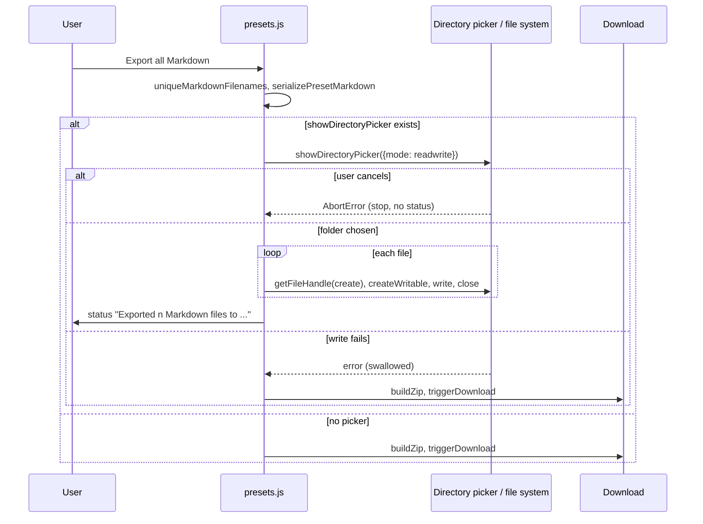
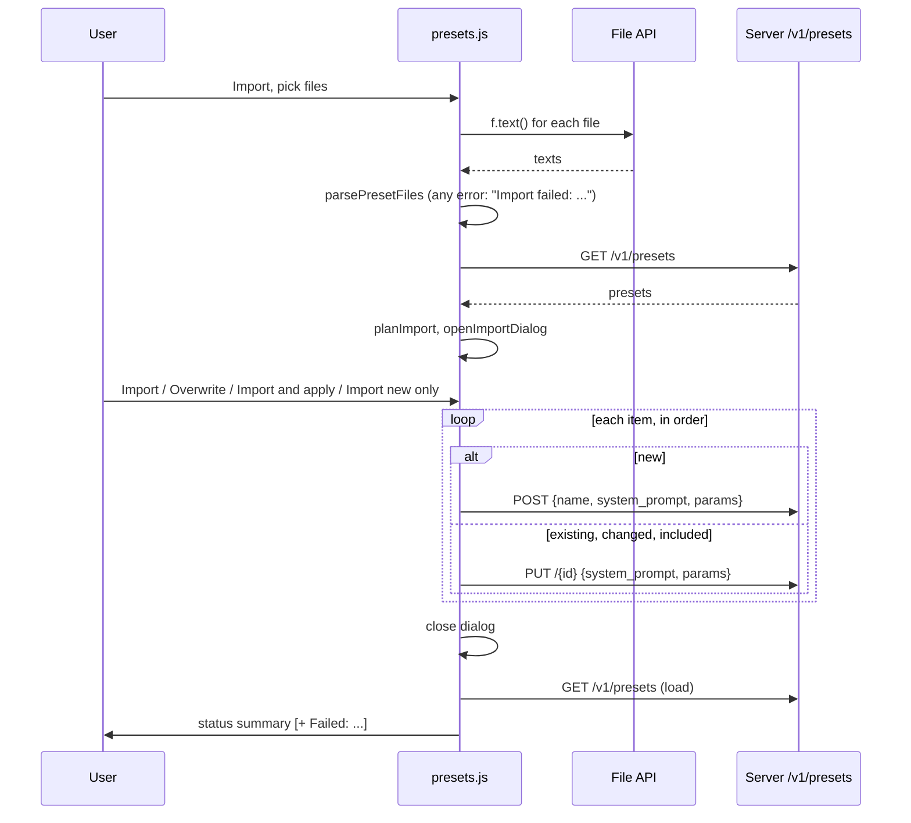

# Presets page and Perf page

last updated: 2026-11-24

This page maps two pages end to end: the Presets page (`#/presets`, `frontend/js/pages/presets.js`, with import and export in `frontend/js/preset-io.js`) and the Perf page (`#/perf`, `frontend/js/pages/perf.js`). It starts where the router calls `mount` and stops at the shared primitives each page calls (`createPage`, `armedConfirm`, `request`, the settings drawer), which other pages map. How the drawer applies a preset to a document and saves a document to a preset belongs to [chat-model-and-settings.md](chat-model-and-settings.md). The overview this page goes below is [docs/wiki/frontend_core.md](../frontend_core.md) section 3 (the preset system; its last paragraph is the Presets page) and section 2 (the Perf row); why presets work the way they do is [sharp_edges.md "Presets and the system prompt"](../../architecture/sharp_edges.md#presets-and-the-system-prompt).

## Files and what each owns

| File | What it owns here |
|---|---|
| `frontend/js/pages/presets.js` | The Presets page: list, cards, the knob editor, rename, duplicate, delete, export, the import review dialog, the Escape hotkey, the resume reload. Holds no module-level state. |
| `frontend/js/preset-io.js` | Pure functions with no DOM at import time: `normalizePreset`, `slugifyPresetName`, `uniqueMarkdownFilenames`, the JSON and Markdown serializers and parsers, `parsePresetFiles`, `diffPreset`, `unifiedLineDiff`, `planImport`, and `buildZip` (an uncompressed STORE zip). Its header says it mirrors `src/heylook_llm/preset_io.py`; `tests/unit/test_preset_io_cli.py` `test_js_and_python_markdown_and_zip_parity` runs both. |
| `frontend/js/settings.js` | Only `PARAM_META`, which the knob editor and the card summary read (`label`, `type`, `min`, `max`, `step`, `options`). Nothing else from `settings.js` is imported, so the editor never touches the shared sampler cache. |
| `frontend/js/pages/perf.js` | The Perf page: system metrics, per-model rows, the profile tables, the access gate readout, the observability controls and the log viewer. |
| `frontend/js/utils.js` | Shared primitives both pages call: `createEl`, `setStatus`, `armedConfirm`, `createUnloadGuard`, `autoGrow`, `formatBytes`, `formatTokens`, `causeWords`. |
| `frontend/js/hotkeys.js` | `registerPageHotkeys` (the Presets Escape handler is wired through it) and `isModalOpen`. |
| `frontend/js/api.js` | The `ROUTES` entries both pages call, `request` and `httpError`, and the session pair `hasActiveSession` / `logoutSession` that Perf's Sign out uses. |
| `frontend/js/settings-drawer.js` | `registerSettings`, which Perf calls with `{ samplers: 'hidden' }`. Presets does not register. |
| `frontend/css/app.css` | The `presets__*`, `preset-*` and `perf*` classes, `.btn--armed`, and the global `[hidden]` rule both pages rely on to hide `actions` and the diffs block. |
| `src/heylook_llm/preset_api.py`, `src/heylook_llm/db.py` (`create_preset`, `update_preset`, `delete_preset`, `list_presets`, `_preset_name_taken`), `src/heylook_llm/schema/sampler_params.py` | The presets routes, the store and the `params` validation. |
| `src/heylook_llm/monitoring_api.py`, `src/heylook_llm/system_metrics.py`, `src/heylook_llm/perf_collector.py` | `GET /v1/system/metrics` and `GET /v1/performance/profile/{time_range}`. |
| `src/heylook_llm/config_api.py`, `src/heylook_llm/settings.py` (`SettingsSchema`), `src/heylook_llm/auth.py` (`access_config_view`, `require_admin_token`), `src/heylook_llm/auth_api.py` (`logout_submit`), `src/heylook_llm/observability.py` | The config, logs and logout routes Perf calls. |

## State

Presets page (`ctx.state`, called `s` in the code; a fresh object per mount):

| Name | Where it lives | Written by | Read by | Reset when |
|---|---|---|---|---|
| `s.presets` | `ctx.state`, array of server rows | `setup` (`[]`), `load`, `replaceCard` (one slot), `duplicate` (push), `remove` (filter) | `updateToolbar`, `replaceCard`, `exportAllJson`, `exportAllMarkdown` | every `load`; a new mount |
| `s.cards` | `ctx.state`, `Map` id to `article.preset-card` | `buildCard` (set), `load` (clear), `remove` (delete) | `replaceCard`, `duplicate` (insertion point), `remove` | every `load` |
| `s.openEditors` | `ctx.state`, `Set` of ids with an editor or rename box open | `setEditing` (Edit, Rename add; `buildCard` and `remove` delete), `load` (clear) | `setEditing` (the unload guard), the `onResume` hook, the Escape handler | every `load`, including the one after an import |
| `s.setUnloadGuard` | `ctx.state`, the setter from `createUnloadGuard(ctx)` | `setup` | `setEditing`, `load` | disarmed and disposed on teardown by `createUnloadGuard` |
| `s.importInput`, `s.importBtn`, `s.exportAllJsonBtn`, `s.exportAllMdBtn`, `s.toolbarEl`, `s.importDialog`, `s.statusEl`, `s.listEl` | `ctx.state`, DOM refs | `setup`; the two export buttons' `disabled` by `updateToolbar` | their handlers | a new mount |
| the card's `preset` | closure of `buildCard`, `buildEditor`, `buildRename` | the row the card was built from | Edit, Rename, Duplicate (fallback), Export, Delete, Cancel, `save` | replaced only when `replaceCard` is called with a different row |
| `openedAt`, `stored`, `readers`, `touched` | closure of `buildEditor` | `buildEditor`; `touched` by each control's `input` and `change` | `paramsValue`, the Save button's `when`, `save` | the editor is dropped with its card |
| arm state (`armed`, `armedFor`, timer) | closure of `armedConfirm`, one per Delete and per Save button | `arm`, `disarm` | the button's click handler | `disarm`, the timer set in `arm`, or the card being rebuilt |
| `plan`, `footerBtns`, `diffsWrap` | closure of `openImportDialog` | `handleImportFiles` (the plan), `openImportDialog` | `runApply`, the diffs toggle | the next `openImportDialog` replaces the dialog's children |

Perf page:

| Name | Where it lives | Written by | Read by | Reset when |
|---|---|---|---|---|
| `s.modelRows` | `ctx.state`, `Map` model id to `{ root, memEl, fillEl, ctxEl, reqsEl }` | `updateModels` | `updateModels` | a new mount |
| `s.activeRange` | `ctx.state` | `setup` (`DEFAULT_RANGE`), `loadProfile` | range button guard, `loadProfile` after its await | a new mount |
| `s.activeStream` | `ctx.state` | `setup` (`'events'`), `loadLogs` | stream button guard, `loadObservability` (the stream it asks for), `loadLogs` after its await, `renderObsLogs` (empty note and Event fallback), `updateObsSetting` | a new mount |
| DOM refs (`s.errorEl`, `s.updatedEl`, `s.refreshBtn`, `s.ramUsedEl`, `s.ramAvailEl`, `s.ramTotalEl`, `s.cpuEl`, `s.modelsEl`, `s.rangeButtons`, `s.profileBody`, `s.obsLevelSelect`, `s.obsRetentionInput`, `s.obsStatusEl`, `s.streamButtons`, `s.obsLogsBody`, `s.accessGateEl`, `s.accessSourceEl`, `s.accessAdminEl`, `s.accessErrorEl`, `s.logoutBtn`) | `ctx.state` | `buildSkeleton`; text by the appliers below | the appliers | a new mount |
| `activeSession` | module state in `api.js` | `markSession` from `request` (a response with `X-Heylook-Session: 1`), `httpError` (a 401 `auth_required`), `logoutSession` | `hasActiveSession`, read by `buildSkeleton` and `applyObsConfig` for `s.logoutBtn.hidden` | a page load |
| the drawer contribution | `current` in `settings-drawer.js` | `registerSettings({ samplers: 'hidden' })` in Perf `setup` | the drawer's `render` | Perf teardown (the returned unsubscribe) |
| server: the metrics cache | `SystemMetricsCollector` in `system_metrics.py`, TTL from `cache_ttl_seconds` in `monitoring_api.get_metrics_collector` | `collect` | `GET /v1/system/metrics` without `force_refresh` | its TTL, or `force_refresh=true` |
| server: the profile buffer | `PerfCollector` in `perf_collector.py`, in memory | request telemetry | `build_profile` | a server restart |

## Entry points

| What the user or browser does | Handler (file and function) | Flow |
|---|---|---|
| Navigates to `#/presets` (nav link, or the drawer's "Manage presets" link in `preset-bar.js`) | `app.js` `navigate`, then `presets.js` `setup` | [Presets: setup to first paint](#presets-setup-to-first-paint) |
| Clicks Edit on a card | `buildCard` Edit listener | [Presets: edit](#presets-edit) |
| Types in the editor, changes a knob | `buildEditor` listeners | [Presets: edit](#presets-edit) |
| Clicks Save in the editor | `armedConfirm` wrapper, then `save` | [Presets: edit](#presets-edit) |
| Clicks Cancel in the editor | `buildEditor` Cancel listener, `replaceCard` | [Presets: edit](#presets-edit) |
| Reloads or closes the tab with an editor open | `beforeunload` handler in `utils.js` | [Presets: edit](#presets-edit) |
| Clicks Rename, presses Enter or Escape in the name box, clicks Save name or Cancel | `buildCard` Rename listener, `buildRename` | [Presets: rename](#presets-rename) |
| Clicks Duplicate | `duplicate` | [Presets: duplicate](#presets-duplicate) |
| Clicks Delete, then Delete? | `armedConfirm` wrapper, then `remove` | [Presets: delete](#presets-delete) |
| Tab comes back (visible, or a bfcache `pageshow`) | the `ctx.onResume` hook in `setup` | [Presets: resume](#presets-resume) |
| Presses Escape | `onEscape` passed to `registerPageHotkeys` | [Presets: the Escape hotkey](#presets-the-escape-hotkey) |
| Opens a card's Export menu, clicks JSON (.json) or Markdown (.md); clicks elsewhere | `buildCard` export listeners, `exportSingle`; `closeExportMenus` on `document` | [Presets: export one preset](#presets-export-one-preset) |
| Clicks Export all JSON | `exportAllJson` | [Presets: export all as JSON](#presets-export-all-as-json) |
| Clicks Export all Markdown | `exportAllMarkdown` | [Presets: export all as Markdown](#presets-export-all-as-markdown) |
| Clicks Import, picks files | `s.importInput` `change`, `handleImportFiles` | [Presets: import](#presets-import) |
| Presses a footer button in the import dialog; closes it | `runApply`, `applyImportPlan`; `close`, `closeDialogOnHash`, the `closedby` fallback | [Presets: import](#presets-import) |
| Navigates to `#/perf` | `app.js` `navigate`, then `perf.js` `setup` | [Perf: setup to first paint](#perf-setup-to-first-paint) |
| Clicks Refresh | `setup` Refresh listener | [Perf: Refresh](#perf-refresh) |
| Clicks a range button | `setup` range listener, `loadProfile` | [Perf: time ranges and the profile](#perf-time-ranges-and-the-profile) |
| Changes Level or Retention (days) | `updateObsSetting` | [Perf: observability settings](#perf-observability-settings) |
| Clicks the events or metrics button | `loadLogs` | [Perf: the log viewer](#perf-the-log-viewer) |
| Clicks Sign out | `buildSkeleton` logout listener, `api.js` `logoutSession` | [Perf: sign out](#perf-sign-out) |

## Flows

### Presets: setup to first paint

Trigger: the router mounts the page (`app.js` `navigate` calls `mount`, which calls `setup`).

Guards: none before the first paint.

Steps:

1. `setup` initialises `s.presets = []`, `s.cards`, `s.openEditors`, and `s.setUnloadGuard = createUnloadGuard(ctx)`.
2. It builds the hidden file input `s.importInput` (`multiple`, `accept` `.json,.md,.markdown,application/json,text/markdown,text/plain`, `aria-label` "Import preset files") and its `change` listener (see [import](#presets-import)).
3. It builds the toolbar `div.presets__toolbar`: Import (title "Import one or more presets from JSON or Markdown file(s)"), Export all JSON (title "Export all presets into one JSON file") and Export all Markdown (title "Export all presets as individual Markdown files (one per preset)"). Both export buttons start `disabled`.
4. `buildImportDialog` creates the empty `dialog.preset-import-dialog` with the `closedby="any"` attribute, and, where `HTMLDialogElement.prototype` has no `closedBy`, a click listener that closes it on a click outside its box.
5. It appends to `ctx.el`: `h1` "Presets", the lede "Edit, rename, duplicate, import, export and delete presets here. A conversation or notebook keeps a copy of the preset it was started from, so nothing done here changes one that is already running.", the toolbar, the status line `div.presets__status[role=status]`, the list `div.presets__list` holding "Loading presets…", and the dialog. This is the first paint.
6. It adds `closeExportMenus` on `document` `click` and `closeDialogOnHash` on `window` `hashchange`, both removed through `ctx.onTeardown`.
7. It registers the resume hook ([resume](#presets-resume)) and the Escape hotkey ([Escape](#presets-the-escape-hotkey)).
8. `await load(ctx)`: `fetchPresets` sends `GET /v1/presets` with `ctx.signal` and returns `res.presets ?? []`.
9. After the await: if `!ctx.alive`, return. Otherwise clear `s.cards` and `s.openEditors`, call `s.setUnloadGuard(false)`, `updateToolbar` (export buttons enabled when the list is not empty).
10. Empty list: the list becomes "No presets yet. Open the settings drawer on a chat or a notebook and use Save, or use Import above to load JSON or Markdown preset files." Otherwise the list becomes one `buildCard` per row, in the server's order (`ORDER BY name` in `db.list_presets`).

Each card (`buildCard`) is `article.preset-card` with `data-id`, `data-name` and `aria-label` "Preset <name>":

- head: `h2.preset-card__name`, and `span.preset-card__tag` "settings only" when `carriesPrompt` is false (no `system_prompt`);
- actions (`div.preset-card__actions`): Edit (title "Edit this preset's prompt and settings"), Rename, Duplicate (title "Make a copy under a new name"), `details.preset-export` (summary Export, title "Export this preset to JSON or Markdown"; items "JSON (.json)" and "Markdown (.md)"), and Delete wrapped by `armedConfirm`;
- body (`buildReadout`): `div.preset-card__knobs` with `knobSummary(params)`, then either the prompt text in `div.preset-card__prompt` or "Carries no system prompt. Applying it changes the settings and leaves the prompt as it is." in `.preset-card__prompt--none`.

`knobSummary` lists `PARAM_META` keys first, in `PARAM_META` order, then any other non-null key, each as `knobText`: the label lowercased and the value, with `on`/`off` for the `thinking` type, joined by " · ". With nothing set it reads "No settings pinned: the model's own defaults apply." `buildCard` also calls `setEditing(ctx, id, false)`, so building a card always closes that id's editor state.

Ends when: the list holds the cards or the empty note.

Failure paths: a failed `GET` shows "Could not load presets: <message>" (error colour) and returns before touching the list, so the list keeps "Loading presets…" and the export buttons stay disabled. Import still works. A teardown during the await aborts the request (`ctx.signal`) and the error is not shown (`ctx.alive` is false).

Awaits: `load`'s `GET`, then `ctx.alive`.

### Presets: edit

Trigger: Edit on a card.

Guards: none to open. Save is refused client-side when the row is gone or its `updated_at` moved, and arms when it would empty a stored prompt.

Steps:

1. The Edit listener calls `delBtn.disarm()`, `setEditing(ctx, id, true)` (adds the id to `s.openEditors` and arms the unload guard through `s.setUnloadGuard(true)`), hides `actions`, and replaces the card body with `buildEditor(ctx, preset)`.
2. `buildEditor` records `openedAt = preset.updated_at` and `stored = preset.system_prompt || null`.
3. It builds the prompt box: `textarea#preset-prompt-<id>.preset-edit__prompt` (`rows: 6`), the stored prompt as its value, placeholder "No system prompt: this preset would carry settings only.", labelled "System prompt". `autoGrow(prompt, 480)` runs on each `input` and once in a microtask.
4. It builds one row per `PARAM_META` key (`div.preset-edit__row`, a `label` for `preset-<id>-<key>` with `meta.label`, and the control from `knobControl`):
   - `thinking` (and `checkbox`): a select with "not set", "on", "off"; reads `null`, `true` or `false`.
   - `select`: "not set" plus `meta.options`; reads the option or `null`.
   - `number`: `input[type=number]` with `meta.min`, `meta.max`, `meta.step`, placeholder "not set"; reads `null` for an empty field, else `Number(value)`.
   - anything else (today only `depth`, `reasoning_effort`): a text input, placeholder "not set", `maxLength` matching the shape `valid` in `settings.js` accepts; reads the trimmed text or `null`.
   Every key is offered, including `reasoning_effort` and `thinking_budget_tokens`, which the drawer folds or nests. Each control adds its key to `touched` on `input` and on `change`.
5. `paramsValue` starts from the stored `params` (non-null values only, including keys with no control here) and, for each touched key only, writes the control's value or deletes the key when it reads `null`. An editor saved untouched sends the stored bag back.
6. `promptValue` is `prompt.value.trim() || null`, so a saved prompt is always trimmed, touched or not.
7. Save is `armedConfirm(button "Save", action, 'Remove prompt?', when, target)`, with `when` true only when `stored` is set and `promptValue()` is `null`, and `target` `JSON.stringify([preset.id, promptValue()])`. Every `input` on the prompt box calls `saveBtn.disarm()`.
8. The editor shows two notes: "Empty means this preset carries no prompt: applying it leaves a prompt as it is." and "Every setting is offered here. One a model cannot use is removed when the preset is applied to it, and named."
9. Save, when `when` is false: the first click runs the action. When `when` is true: the first click arms (label "Remove prompt?", class `btn--armed`), and a second click within the timer set in `armedConfirm` `arm` runs it; a click whose `target()` moved re-arms instead.
10. The action calls `save(ctx, preset, { openedAt, system_prompt: promptValue(), params: paramsValue() })`, with both values read at the click.
11. `save` re-reads first: `fetchPresets` (`GET /v1/presets`, `ctx.signal`), then finds the row by id.
12. After the await: if `!ctx.alive`, return.
13. No row: status (error) `"<name>" no longer exists: it was deleted elsewhere. Copy anything you need out of the editor, then Cancel.` The editor stays open.
14. `fresh.updated_at !== openedAt`: status (error) `"<name>" changed elsewhere since you opened it. Nothing was saved: copy anything you need out of the editor, then Cancel and Edit again.` The editor stays open.
15. Otherwise `PUT /v1/presets/<id>` with `{ system_prompt, params }` and no `name` (a cached name would revert a rename made elsewhere). No signal is passed.
16. After the await: if `!ctx.alive`, return. `replaceCard(ctx, saved)` puts the server's row into `s.presets`, builds a new read-mode card (which calls `setEditing(..., false)` and so disarms the unload guard when no other editor is open) and swaps it in. Status `Preset "<name>" saved.`
17. Cancel calls `replaceCard(ctx, preset)` with the card's own `preset` object: the read-mode card comes back and typed edits are dropped without confirmation.

The unload guard: while `s.openEditors` is not empty, `createUnloadGuard` holds the `beforeunload` handler in `utils.js`, so a reload or tab close shows the browser's own leave-page dialog. In-app navigation (a hash change) is not covered: `app.js` `navigate` unmounts the page and the editor is gone.

Ends when: the card is back in read mode (Save or Cancel), or the editor stays open with an error on the status line.

Failure paths: a failed `GET` or `PUT` shows `Preset save failed: <message>`. The server's refusals are a 404 "Preset not found" (deleted between the re-read and the `PUT`), a 400 for a `params` that is not an object, and a 422 from `SamplerParams` for an unknown key or a value outside `ChatRequest`'s range. A 422's `detail` is a list, which `httpError` does not turn into text, so the message is the response's status text (see the last section). Save is not disabled while `save` runs; a second press starts a second re-read, which refuses with "changed elsewhere" if the first `PUT` has already landed.

Awaits: the re-read `GET` (then `ctx.alive`, row present, `updated_at` equal), the `PUT` (then `ctx.alive`). Nothing re-checks the row between the re-read and the `PUT`; the server does not compare `updated_at`.

### Presets: rename

Trigger: Rename on a card.

Guards: the name must be non-empty and different from the card's name; the server refuses a name in use.

Steps:

1. The Rename listener calls `delBtn.disarm()`, `setEditing(ctx, id, true)`, hides `actions`, and replaces `div.preset-card__title` with `buildRename(ctx, preset)`.
2. `buildRename` builds `input.preset-card__rename` (value the current name, `aria-label` "New name for <name>"), Save name and Cancel in `div.preset-card__rename-row`, and focuses and selects the input in a microtask.
3. Enter in the input, or Save name, runs `commit`. Escape in the input calls `preventDefault()` and `replaceCard(ctx, preset)`; the prevented event is skipped by `registerPageHotkeys`, so the page Escape does not also click a Cancel ([sharp_edges.md "A key a handler consumes is prevented"](../../architecture/sharp_edges.md#a-key-a-handler-consumes-is-prevented)). Cancel runs `replaceCard(ctx, preset)`.
4. `commit` trims the value. Empty or unchanged: `replaceCard(ctx, preset)` and nothing is sent.
5. Otherwise `PUT /v1/presets/<id>` with `{ name }`, no signal.
6. After the await: if `!ctx.alive`, return. `replaceCard(ctx, saved)` rebuilds the card from the server's row (so its other fields are fresh too) and the status reads `Renamed to "<name>".` The list is not re-sorted.

Ends when: the card is back in read mode, or the box stays with an error.

Failure paths: a 409 (`db.PresetNameTaken`, "Preset name already exists") shows `A preset named "<name>" already exists. Pick another name.`; anything else shows `Rename failed: <message>`. The box stays with what was typed.

Awaits: the `PUT`, then `ctx.alive`.

### Presets: duplicate

Trigger: Duplicate on a card.

Guards: none on the client beyond naming against a fresh list; the server's 409 is the backstop. The button is not disabled while it runs.

Steps:

1. `duplicate` sends `GET /v1/presets` (`ctx.signal`).
2. After the await: if `!ctx.alive`, return. `source` is the fresh row with this id, or the card's `preset` if the row is gone.
3. `copyName(source.name, taken)` picks "<name> copy", then "<name> copy 2" and upward, the first not in the fresh list's names.
4. `POST /v1/presets` with `{ name, system_prompt: source.system_prompt ?? null, params: { ...source.params } }`, no signal.
5. After the await: if `!ctx.alive`, return. Push the row onto `s.presets`, `updateToolbar`, build its card and insert it after the source's card (or after the list's last child).
6. Status `Duplicated "<source name>" as "<new name>".`

Ends when: the new card is on screen.

Failure paths: `Duplicate failed: <message>`, including a 409 when another create took the name between the read and the write.

Awaits: the `GET` (then `ctx.alive`), the `POST` (then `ctx.alive`).

### Presets: delete

Trigger: Delete on a card.

Guards: two presses. `armedConfirm` with no `when`, so the first press always arms ("Delete?", `btn--armed`); a second press within the timer set in `arm` fires. `target` is `preset.id`, which cannot move. Edit and Rename on the same card call `delBtn.disarm()`, and the Delete button is hidden while that card's editor or rename box is open.

Steps:

1. The confirming press calls `remove(ctx, preset)`.
2. `DELETE /v1/presets/<id>`, no signal.
3. After the await: if `!ctx.alive`, return. `setEditing(ctx, id, false)`, drop the row from `s.presets`, `updateToolbar`, remove the card and its `s.cards` entry.
4. Status `Deleted "<name>". Anything started from it keeps its own copy.` A document stamped with it now reads "No preset" through `provenance()` (see [chat-model-and-settings.md](chat-model-and-settings.md)).
5. If no presets are left, `load(ctx)` runs (not awaited) and paints the empty note.

Ends when: the card is gone.

Failure paths: `Delete failed: <message>`, for example a 404 "Preset not found" when it was deleted elsewhere. The card stays.

Awaits: the `DELETE`, then `ctx.alive`.

Note: `armedConfirm`'s click handler calls `stopPropagation()`, so a press on Delete or on Save does not reach `closeExportMenus` and leaves another card's open Export menu open.

### Presets: resume

Trigger: `ctx.onResume` (the tab becomes visible, or a bfcache `pageshow` with `persisted`).

Guards: runs only when `s.openEditors` is empty. An open editor or rename box blocks it, so typed text is never replaced; Save's own re-read is what protects the store.

Steps:

1. `load(ctx)`: `GET /v1/presets`, then the same steps as setup: clear `s.cards` and `s.openEditors`, disarm the unload guard, `updateToolbar`, rebuild every card.

Ends when: the list matches the store. Armed Delete buttons and open Export menus are lost with the old cards. The import dialog, if open, is untouched.

Failure paths: "Could not load presets: <message>" and the old cards stay.

Awaits: the `GET`, then `ctx.alive`. Nothing checks again for an editor opened while the `GET` was in flight, and `load` clears it.

### Presets: the Escape hotkey

Trigger: Escape anywhere on the page (a `keydown` listener on `document` from `registerPageHotkeys`).

Guards: `registerPageHotkeys` skips the event when `!ctx.alive`, when it is already `defaultPrevented` (the rename box's own Escape), or when `isModalOpen()` finds a `dialog[open]` (the import dialog, the shortcuts sheet) or `.drawer--open`. It does not skip editable targets, so Escape typed in the editor's prompt box counts.

Steps:

1. If a `details.preset-export[open]` exists, close the first one and return `true` (the event is prevented).
2. If `s.openEditors` is empty, return `false`.
3. Otherwise collect `.preset-edit__buttons .btn, .preset-card__rename-row .btn` in document order, take the first whose text is exactly "Cancel", click it and return `true`. That is the first open editor or rename box on the page, which need not be the one with focus, and an editor's Cancel drops its typed edits with no confirmation (FB-34).

Ends when: one menu or one editor is closed, or nothing happens.

### Presets: export one preset

Trigger: Export on a card opens the `details` menu; "JSON (.json)" or "Markdown (.md)" in it.

Guards: none. The menu closes on any `document` click outside it (`closeExportMenus`) and on Escape.

Steps:

1. The item's listener closes the menu and calls `exportSingle(ctx, preset, 'json' | 'md')` with the card's own `preset` (no re-read).
2. `slugifyPresetName(name)`: runs of characters outside `A-Za-z0-9._-` become `-`, repeated `-` collapse, leading and trailing `-` or `.` go, and an empty result is `preset`.
3. JSON: `serializePresetJson` normalises with `normalizePreset` (name trimmed, `system_prompt` with line endings made `\n` and a whitespace-only prompt made `null`, `params` without null values) and writes `{ name, system_prompt, params }` as two-space JSON with a trailing newline. No `id` or timestamps.
4. Markdown: `serializePresetMarkdown` writes a `---` block with `name:` and, when there are params, `params:` with one indented `key: value` per key in sorted order, values quoted by `formatYamlScalar` where YAML would misread them; then `---`; then, when there is a prompt, a blank line, the prompt and a final newline.
5. `triggerDownload` builds a `Blob` (`application/json;charset=utf-8` or `text/markdown;charset=utf-8`), an object URL and a temporary `a[download]`, clicks it, removes it, and revokes the URL on a timer set in `triggerDownload`.
6. Status `Exported "<name>" as <slug>.json.` or `Exported "<name>" as <slug>.md.`

Failure paths: none caught. A serializer that throws (a row that fails `normalizePreset`) throws out of the click handler and nothing is shown.

### Presets: export all as JSON

Trigger: Export all JSON (disabled while `s.presets` is empty).

Steps:

1. `exportAllJson` returns if `s.presets` is empty.
2. `serializePresetsJson` writes `{ "presets": [ ... ] }`, each entry through `normalizePreset`, two-space JSON, trailing newline.
3. `triggerDownload('heylook-presets.json', ...)`.
4. Status `Exported <n> preset(s) to heylook-presets.json.` (the plural `s` is added when the count is not one).

It exports `s.presets`, the page's copy, with no re-read.

### Presets: export all as Markdown

Trigger: Export all Markdown (disabled while `s.presets` is empty).

Guards: an empty list returns; a single preset goes to `exportSingle(..., 'md')` instead.

Steps:

1. `uniqueMarkdownFilenames(presets)` names each file `<slug>.md`, and a name already used (compared case-insensitively) gets `-2`, `-3` and upward.
2. Each file's text is `serializePresetMarkdown(p)`.
3. Where `window.showDirectoryPicker` exists: `await showDirectoryPicker({ mode: 'readwrite' })`, then for each file `getFileHandle(name, { create: true })`, `createWritable`, `write`, `close`, each awaited in turn. A file of the same name in the chosen folder is overwritten without a prompt. Then, if `ctx.alive`, status `Exported <n> Markdown files to "<folder name>".` and return.
4. An `AbortError` (the picker cancelled) returns with nothing shown.
5. Any other error, or no picker: `buildZip(files)` builds an uncompressed zip (STORE, the UTF-8 name flag, CRC-32, zero time and date) and `triggerDownload('heylook-presets-markdown.zip', ...)` downloads it. Status `Exported <n> Markdown files in heylook-presets-markdown.zip.`

Failure paths: a folder write that fails part-way falls through to the zip without saying so; the files already written stay in the folder. The zip branch does not check `ctx.alive`.

Awaits: the picker and each file operation. Only the success status checks `ctx.alive`.

### Presets: import

Trigger: Import clicks the hidden `s.importInput`; the user picks one or more files.

Guards: a parse error in any one file refuses the whole selection; a name used twice across the selection refuses it; nothing is written until a footer button is pressed in the review dialog.

Steps:

1. The `change` listener copies `files`, clears the input's value (so the same file can be picked again) and, when there are files, calls `handleImportFiles(ctx, files)`.
2. `handleImportFiles` reads every file with `await f.text()` (in parallel) and calls `parsePresetFiles(entries)`.
3. `parsePresetFiles`, per file, by extension (lowercased): `.json` goes to `parsePresetsJson`; `.md` or `.markdown` to `parsePresetMarkdown(text, fileStem(name))`; anything else is sniffed: text starting with `{` or `[` (after a BOM and leading space) is JSON, the rest Markdown. An error is re-thrown as `<filename>: <message>`.
4. `parsePresetsJson` accepts a list, `{ "presets": [ ... ] }`, or one object with `name`; each entry goes through `normalizePreset`, which ignores fields other than `name`, `system_prompt` and `params` (so a `GET /v1/presets` response imports as is).
5. `parsePresetMarkdown` strips a BOM and normalises line endings. With a leading `---` line it reads up to the next `---`: top-level `name:` (a string scalar) and `params:` (an indented block of `key: scalar`, or inline JSON starting with `{`); blank lines and `#` lines are skipped; other top-level keys are ignored. The body after the block, minus one leading and one trailing empty line, is the prompt. With no leading `---`, the whole text minus trailing newlines is the prompt and the name is the file stem. `parseYamlScalar` reads double-quoted strings as JSON, single-quoted strings, `true`/`false`/`null`/`~`, integers and floats; anything else is a string.
6. Across files, a name seen twice throws `Duplicate preset name "<name>" in selected files (<file a> and <file b>)`; no records at all throws "No presets found in selected file(s)".
7. Back in `handleImportFiles`: `GET /v1/presets` (`ctx.signal`) for the current store. After the await: if `!ctx.alive`, return.
8. `planImport(incoming, fresh)` matches by exact name. A new name is an item with `existing: null`. An existing one gets `diffPreset(existing, incoming)`: both bags normalised, then per key `added`, `removed` or `changed` (strict equality), in sorted key order; both prompts normalised, `promptChanged` by strict equality, and `promptDiff` from `unifiedLineDiff(old, new)`, an LCS line diff with `context` lines kept around each change and `@@ ... @@` where lines were skipped. Past the size check `m * n > 400_000` in `unifiedLineDiff` it shows every old line removed and every new line added. The plan also carries `newItems` and `existingItems`.
9. `openImportDialog(ctx, plan)` fills the dialog and calls `showModal()` (or sets `open`). Title: one new item "Import preset"; one existing item "Preset already exists"; several `Import <n> presets`. The head holds Close (`aria-label` "Close import dialog").
   - One new item: `New preset "<name>".`, its `knobSummary`, its prompt or "Carries no system prompt (settings only)."; footer Import preset and Cancel.
   - One existing item, changed: `"<name>" already exists. Review the before/after diff below before overwriting.` and its diff block; footer Overwrite preset and Cancel.
   - One existing item, unchanged: `"<name>" already exists and has no differences.` and its diff block; footer Close only.
   - Several, with existing ones: a "New (<n>)" list (badge "new") when there are new ones, an "Already exist (<n>)" list (tag "exists · changed" or "exists · unchanged"), the note "Inspect all existing preset diffs in a combined view below, or import and apply now.", a hidden `div.preset-import__diffs` with a diff block per existing item, and the footer View combined diffs (toggles to "Hide combined diffs" and `aria-expanded`), Import and apply, Import new only (only when there are new ones), Cancel.
   - Several, all new: the "New (<n>)" list and the footer `Import <n> presets` and Cancel.
10. A diff block (`buildDiffBlock`): the name and a tag "changed" or "unchanged"; for unchanged, "No differences from the stored preset."; under "Settings", `+ key: value` for added, `- key: value` for removed, and a `-` then `+` pair for changed; under the prompt label ("System prompt (added)" when the stored one is empty, `System prompt (removed — becomes settings only)` when the incoming one is empty, else "System prompt"), the diff lines prefixed `+ `, `- ` or two spaces.
11. A footer button calls `runApply(includeExisting, button)`: every footer button is disabled, the pressed one reads "Importing…". Import new only passes `includeExisting` false; every other apply button passes true.
12. `applyImportPlan` walks `plan.items` in order, one request at a time, checking `ctx.alive` before each:
    - new: `POST /v1/presets` with `{ name, system_prompt, params }` (created);
    - existing and `includeExisting` false: no request (skipped);
    - existing and unchanged: no request (unchanged);
    - existing and changed: `PUT /v1/presets/<existing.id>` with `{ system_prompt, params }` and no name (updated).
    Each failure is caught and kept as `<name>: <message>`. No signal is passed.
13. The summary is `Import complete: ` plus the non-zero parts of `<n> created`, `<n> updated`, `<n> unchanged`, `<n> skipped`, joined by ", ", and a full stop; with every part zero it is "Nothing imported."
14. Back in `runApply`: if `!ctx.alive`, return. Close the dialog, then `await load(ctx)` (rebuilds every card and clears `s.openEditors`). If `!ctx.alive`, return. Status: the summary, or (error colour) the summary followed by ` Failed: <errors joined by "; ">`.

Ends when: the dialog is closed and the status line carries the summary; or the user closes the dialog with Cancel, Close, Escape, an outside click (`closedby="any"` or the fallback) or a hash change (`closeDialogOnHash`), and nothing is written.

Failure paths:

- reading or parsing: `Import failed: <message>`, for example `<file>: Invalid JSON: ...`, `<file>: Unclosed frontmatter block (missing closing '---')`, `<file>: Markdown preset is missing 'name' in frontmatter`, `<file>: Preset 'params' must be an object`.
- the store read: `Could not check existing presets: <message>`.
- per item, kept in the error list: a 409 `Preset name already exists: <name>` when a name planned as new was created elsewhere after the review opened; a 404 `Preset not found` when an existing one was deleted; a 422 from `SamplerParams` for an unknown key or bad value, whose message is the status text (see the last section). The client does not check params against `PARAM_META` before sending.
- an existing preset changed elsewhere after the review opened is overwritten: the `PUT` carries no `updated_at` check. An import that empties a stored prompt does not arm.
- closing the dialog does not stop `applyImportPlan`; it runs to the end and the status still lands.
- the post-import `load` failing shows "Could not load presets: ..." and the summary then replaces it.

Awaits: the file reads (no `ctx.alive` check; the status is guarded), the store `GET` (then `ctx.alive`), each item's request (`ctx.alive` before the next), `applyImportPlan` (then `ctx.alive`), `load` (then `ctx.alive`).

### Perf: setup to first paint

Trigger: the router mounts the page.

Steps:

1. `setup` sets `s.modelRows = new Map()`, `s.activeRange = DEFAULT_RANGE` (`'1h'`) and `s.activeStream = 'events'`.
2. `buildSkeleton` builds and appends, in this order: `s.errorEl` (`div.error-note[role=alert]`, hidden); the header (`h1` "Performance", `s.updatedEl` empty, Refresh); System (rows "RAM used", "RAM available", "RAM total", "CPU", each "--", and the empty `div.perf__models`); Profile (one button per `RANGES` entry, `DEFAULT_RANGE` pressed, and the empty `div.perf__profile-body`); Access gate (Sign out, hidden unless `hasActiveSession()`; `s.accessErrorEl` hidden; rows "Gate", "Key source", "Admin token", each "--"; the note "Read-only: the API key comes from HEYLOOK_API_KEY or a mode-600 ~/.heylook/api_key file and is never stored in heylook.toml or returned by the API."); Observability (one button per `OBS_STREAMS` entry, `events` pressed; Level, a select over `OBS_LEVELS`, showing `off`; Retention (days), a number input with `min: '0'` and `value: '30'` written in `buildSkeleton`; `s.obsStatusEl[role=status]` empty; the empty `div.perf__obs-logs`). This is the first paint.
3. `ctx.onTeardown(drawer.registerSettings({ samplers: 'hidden' }))`: the drawer shows no sampler panel on this page (see [shell-and-lifecycle.md](shell-and-lifecycle.md)).
4. It wires Refresh, the range buttons, the stream buttons, the Level `change` and the Retention `change`.
5. `await Promise.all([loadMetrics(ctx, false), loadProfile(ctx, '1h'), loadObservability(ctx)])`, which sends, in parallel: `GET /v1/system/metrics`, `GET /v1/performance/profile/1h`, `GET /v1/admin/config` and `GET /v1/admin/config/logs?stream=events&limit=50`, all with `ctx.signal`. Each loader catches its own failure, so `setup` resolves either way.

Nothing on this page polls: `perf.js` has no timer and no `onResume` hook. Data moves only on mount, Refresh, a range button, a stream button and an observability save.

#### System metrics (`loadMetrics`, `applyMetrics`, `updateModels`)

1. `loadMetrics(ctx, force)` sends `GET /v1/system/metrics` (with `?force_refresh=true` when `force`). Without it the server may answer from the collector's cache (`cache_ttl_seconds` in `monitoring_api.get_metrics_collector`).
2. After the await: if `!ctx.alive`, return. `setError(ctx, '')` hides the error note, then `applyMetrics`.
3. `applyMetrics` writes the system rows in place: `fmtGb` gives `<n.n> GB` or "--"; CPU is `<n.n>%` or "--"; `s.updatedEl` becomes `Updated <local time>` from `timestamp`, or empty.
4. `updateModels(models)`: removes the row of every id no longer in `models`. With no models, the block becomes "No models loaded right now." Otherwise it clears that note if present, builds a row for each new id (`buildModelRow`, appended at the end) and calls `applyModelData` on every row. Existing rows are updated, never rebuilt.
5. `applyModelData` writes: memory `formatBytes(memory_mb * 1024 * 1024)` or "memory --", with `memory_source` as the element's `title` (gguf measures its own llama-server process; MLX the whole server's Metal memory); the bar width `context_percent` clamped to 0..100 (0 when unknown); `ctx <used> / <capacity>` plus ` (<n.n>%)` when known, "--" for an unknown count; `<n> active · <n> queued`.

Failure: `Could not load metrics: <message>` in `s.errorEl`, which stays until a later successful `loadMetrics`. The last values stay on screen.

#### Profile

See [Perf: time ranges and the profile](#perf-time-ranges-and-the-profile).

#### Observability and access (`loadObservability`, `applyObsConfig`)

1. `loadObservability` sends `GET /v1/admin/config` and `GET /v1/admin/config/logs?stream=<s.activeStream>&limit=50` together; each has `.catch(() => null)`.
2. After the await: if `!ctx.alive`, return. If the config has `effective`, `applyObsConfig`. Then `renderObsLogs(logs)`.
3. `applyObsConfig` sets the Level select to `effective.observability_level` and the Retention input to `effective.observability_retention_days` when present. From `access`: Gate "Misconfigured (refusing requests)" when `access.error` is set, else "On" or "Off"; Key source `env (<source_detail>)` for an env key, `<source_detail> (mode 0600)` for a file key, "unset" when the gate is off; Admin token "Set (X-Heylook-Admin-Token required on admin routes)" or "Unset"; `s.accessErrorEl` shows `access.error` or hides. Last, `s.logoutBtn.hidden = !hasActiveSession()`.

Failure: a refused config read leaves the controls at the skeleton's values and the access rows at "--", with nothing on screen saying so; a refused logs read renders as `renderObsLogs(null)`. The config router depends on `require_admin_token`, which answers 401 when `HEYLOOK_ADMIN_TOKEN` is set, and this page never sends `X-Heylook-Admin-Token`.

Ends when: all four reads have settled.

### Perf: Refresh

Trigger: Refresh.

Steps: `loadMetrics(ctx, true)` and `loadObservability(ctx)`, not awaited, as in setup. The profile is not reloaded, and the pressed range button is a no-op, so the profile for the current range is refreshed only by choosing another range and coming back.

### Perf: time ranges and the profile

Trigger: a range button (`RANGES` in `perf.js`: 1h, 6h, 24h, 7d), or setup.

Guards: a press on the active range returns at once.

Steps:

1. `loadProfile(ctx, range)` sets `s.activeRange`, moves `perf__range-btn--active` and `aria-pressed` to that button, and puts "Loading…" in the profile body.
2. `api.perfProfile(range)`: `GET /v1/performance/profile/<range>` with `ctx.signal`. The server checks the range (400 otherwise) and returns `PerfCollector.build_profile`.
3. After the await: if `!ctx.alive` or `s.activeRange !== range` (a later press won), return without painting.
4. `renderProfile`: when `timing_breakdown`, `trends` and `cache` are all empty, `renderProfileEmpty`. Otherwise the body is replaced with, in this order and each only when its list is not empty: "Timing breakdown" (`buildTimingTable`: Operation, Avg ms, Count, % with a bar from `percentage` times 100), "Cache" (`buildCacheTable`: Model, Requests, Prompt reused as `<cache_share>% of <formatTokens(prompt_tokens)>`, Outcomes and Why as `name count` pairs joined by " · " or "--", causes spelled by `causeWords`), "Recent trends" (`buildTrendsTable` on `rows.slice(-8)`: Hour, Resp ms, Tok/s, Requests, plus a column from `TREND_RATIOS` (Cache, Draft acc, Draft share) only when one of the shown rows has that ratio). This full replace is the one the module header expects.

Failure paths: any failure (after the same two checks) calls `renderProfileEmpty`, which shows `No profiling data yet — it accumulates in memory while the server handles requests, and resets on restart.` A healthy server never sends an empty `timing_breakdown`: `PerfCollector._timing_breakdown` answers an empty range with a row each for `model_load`, `token_generation` and `other`, all zeros, so an idle range paints a table of zeros and the note above is in practice the failure path.

Awaits: the `GET`, then `ctx.alive` and the range identity. A superseded request is not aborted; its answer is dropped.

### Perf: observability settings

Trigger: a `change` on Level, or on Retention (days).

Guards: Retention is parsed with `Number.parseInt`; `NaN` or a negative number returns with nothing sent and nothing shown. The server validates with `SettingsSchema` (`observability_level` one of off, minimal, standard, debug; `observability_retention_days` an integer `ge=0`; unknown keys forbidden).

Steps:

1. `updateObsSetting(ctx, { observability_level })` or `updateObsSetting(ctx, { observability_retention_days })`.
2. `s.obsStatusEl` reads "Saving…".
3. `api.adminSetConfig(patch, { signal: ctx.signal })`: `PUT /v1/admin/config` with the one-key body. The server validates the body, writes it through `config_api._write` (held in `_MEMORY_ONLY` on a read-only instance, otherwise written to heylook.toml's `[settings]`), re-applies `apply_runtime_settings` and returns the `_snapshot` (`effective`, `stored`, `access`, and `memory_only` or `error` when they apply).
4. After the await: if `!ctx.alive`, return. `applyObsConfig(ctx, cfg)`, then "Saved", then `loadLogs(ctx, s.activeStream)` (not awaited) so the viewer reflects the new level.

Ends when: "Saved" shows; it stays until the next save.

Failure paths: `Save failed: <message>`; the control keeps the value the user chose although the server refused it. A 422 carries a list `detail`, so the message is the status text. Leaving the page mid-save aborts the write (FB-28).

Awaits: the `PUT`, then `ctx.alive`.

### Perf: the log viewer

Trigger: the events or metrics button (`OBS_STREAMS`); also the end of setup, Refresh and every observability save.

Guards: a press on the active stream returns at once.

Steps:

1. `loadLogs(ctx, stream)` sets `s.activeStream` and moves `perf__range-btn--active` and `aria-pressed`. The old table stays until the answer arrives.
2. `GET /v1/admin/config/logs?stream=<stream>&limit=50` (`ctx.signal`). The server reads the tail of `<logs dir>/<stream>.jsonl` (`HEYLOOK_LOGS_DIR`, default `logs`) and returns `{ stream, level, records }`, newest first, skipping lines that do not parse.
3. After the await: if `!ctx.alive` or `s.activeStream !== stream`, return. `renderObsLogs(ctx, data)`.
4. `renderObsLogs`: with no records, the note is `Observability is off — choose minimal, standard, or debug above to record structured JSONL telemetry.` when the level (`data.level`, else the select's value) is `off`, else `No <stream> records written yet.` With records, `records.slice(0, 25)` become rows: Time (`formatClock(ts ?? timestamp)`, local, or "--:--:--"), Event (`event_type ?? type ?? stream`), Details (`summarizeRecord`: model, endpoint, `HTTP <code>`, `<n.n> tok/s`, `<n> ms`, `RAM <n.n> GB`, error, joined by " · ", or the record as JSON when none apply).

Failure paths: a failure, if still the active stream, renders `renderObsLogs(null)`, which reads as "off" or "no records" rather than an error. `loadObservability` renders its logs answer without checking that `s.activeStream` is still the stream it asked for, so a stream press while a setup or Refresh read is in flight can be overwritten by the older stream's records.

Awaits: the `GET`, then `ctx.alive` and the stream identity.

### Perf: sign out

Trigger: Sign out (visible only when `hasActiveSession()` was true at skeleton time or at the last `applyObsConfig`).

Steps:

1. The button is disabled and `logoutSession()` runs (not awaited).
2. `logoutSession` sends a raw `fetch` `POST /logout` with `Accept: application/json` and an `X-Request-ID` (not through `request`, no signal). The server (`auth_api.logout_submit`) revokes the session tokens in the cookie, clears the cookie and, because the request carries `x-request-id`, answers JSON `{"status": "logged_out"}`.
3. Whatever the answer, or a network error, `markSession(false)` and `window.location.assign('/login')`.

Ends when: the browser is on `/login`. The drawer has its own Sign out with the same two calls (`settings-drawer.js` `render`).

## Requests this area makes

| When | Method and path | Body | Response fields used | On failure |
|---|---|---|---|---|
| Presets setup, resume, after import, after the last delete (`load`) | `GET /v1/presets` (signal) | none | `presets[]`: `id`, `name`, `system_prompt`, `params`, `updated_at` | "Could not load presets: <message>" |
| Edit Save, re-read (`save`) | `GET /v1/presets` (signal) | none | the row's `updated_at` | "Preset save failed: <message>" |
| Edit Save (`save`) | `PUT /v1/presets/{id}` | `{ system_prompt, params }` | the whole row, into `replaceCard` | "Preset save failed: <message>" |
| Rename (`buildRename` `commit`) | `PUT /v1/presets/{id}` | `{ name }` | the whole row | 409: "A preset named ... already exists. Pick another name."; else "Rename failed: <message>" |
| Duplicate (`duplicate`) | `GET /v1/presets` (signal), then `POST /v1/presets` | `{ name, system_prompt, params }` | the new row | "Duplicate failed: <message>" |
| Delete (`remove`) | `DELETE /v1/presets/{id}` | none | none | "Delete failed: <message>" |
| Import, planning (`handleImportFiles`) | `GET /v1/presets` (signal) | none | `name`, `id`, `system_prompt`, `params` | "Could not check existing presets: <message>" |
| Import, apply (`applyImportPlan`), per new item | `POST /v1/presets` | `{ name, system_prompt, params }` | none | kept as "<name>: <message>" |
| Import, apply, per changed existing item | `PUT /v1/presets/{existing.id}` | `{ system_prompt, params }` | none | kept as "<name>: <message>" |
| Perf setup (`loadMetrics(false)`); Refresh (`loadMetrics(true)`) | `GET /v1/system/metrics`, `GET /v1/system/metrics?force_refresh=true` (signal) | none | `timestamp`; `system.ram_used_gb`, `ram_available_gb`, `ram_total_gb`, `cpu_percent`; `models{id}`: `memory_mb`, `memory_source`, `context_used`, `context_capacity`, `context_percent`, `requests_active`, `requests_queued` | "Could not load metrics: <message>" |
| Perf setup, a range press (`loadProfile`) | `GET /v1/performance/profile/{range}` (signal) | none | `timing_breakdown[]` (`operation`, `avg_time_ms`, `count`, `percentage`), `cache[]` (`model`, `requests`, `cache_share`, `prompt_tokens`, `outcomes`, `causes`), `trends[]` (`hour`, `response_time_ms`, `tokens_per_second`, `requests`, `cache_share`, `draft_acceptance`, `draft_share`). Unused: `time_range`, `resource_timeline`, `bottlenecks`, `cached_tokens`, `errors`, the change fields | the empty-profile note |
| Perf setup, Refresh (`loadObservability`) | `GET /v1/admin/config` (signal) | none | `effective.observability_level`, `effective.observability_retention_days`, `access.enabled`, `access.source`, `access.source_detail`, `access.admin_token_enabled`, `access.error` | swallowed (`.catch(() => null)`) |
| Perf setup, Refresh (`loadObservability`); a stream press, after a save (`loadLogs`) | `GET /v1/admin/config/logs?stream={events,metrics}&limit=50` (signal) | none | `records[]` (`ts`, `timestamp`, `type`, `event_type`, and the `summarizeRecord` fields), `level` | the empty note |
| Level or Retention change (`updateObsSetting`) | `PUT /v1/admin/config` (signal) | `{ observability_level }` or `{ observability_retention_days }` | the snapshot, into `applyObsConfig` | "Save failed: <message>" |
| Sign out (`logoutSession`) | `POST /logout` (raw `fetch`) | none | none | ignored; goes to `/login` anyway |

Every call through `request` sends `X-Request-ID`, and `Content-Type: application/json` when it has a body. A 401 with `code: 'auth_required'` makes `httpError` send the browser to `/login` (see [shell-and-lifecycle.md](shell-and-lifecycle.md)).

What the server refuses, as the pages rely on it:

- `POST /v1/presets`: 409 `Preset name already exists: <name>` (`db.PresetNameTaken`, an exact-match name lookup in `_preset_name_taken`); 400 for a blank name or a `params` that is not an object; 422 from `SamplerParams` (unknown key, wrong type, out of `ChatRequest`'s range). Nulls are not stored. Answers 201 with the row.
- `PUT /v1/presets/{id}`: patches only the fields sent (`body.model_fields_set`); a sent `params` replaces the stored bag; `updated_at` is always set to now. 409 for a name another row holds, 404 "Preset not found", 400 for an empty or invalid update, 422 as above. It does not compare `updated_at`: the "row moved" refusal exists only in `presets.js` `save`.
- `DELETE /v1/presets/{id}`: 404 "Preset not found"; otherwise `{ status: "deleted", id }`.
- `GET /v1/performance/profile/{time_range}`: 400 for a range outside 1h, 6h, 24h, 7d.
- `/v1/admin/config` and `/logs`: 401 "Admin endpoint requires X-Heylook-Admin-Token header." when `HEYLOOK_ADMIN_TOKEN` is set (`require_admin_token`); `PUT` 422 on an invalid body, 400 when the write fails. `/logs` limits `limit` to 1..500 and `stream` to events or metrics.

## What the user sees

Presets page. Everything below goes to `s.statusEl` through `status` (`setStatus`, error colour `var(--danger)` when flagged) unless stated; nothing clears the line except the next write to it.

| String | Set by | Cleared by |
|---|---|---|
| "Loading presets…" (list) | `setup` | `load` success |
| "No presets yet. Open the settings drawer on a chat or a notebook and use Save, or use Import above to load JSON or Markdown preset files." (list) | `load` with an empty list | the next `load` with rows |
| "Could not load presets: <message>" (error) | `load` | next status write |
| "settings only" (card tag) | `buildCard` | card rebuild |
| "No settings pinned: the model's own defaults apply." (card) | `knobSummary` | card rebuild |
| "Carries no system prompt. Applying it changes the settings and leaves the prompt as it is." (card) | `buildReadout` | card rebuild |
| "Delete?" (button, armed) | `armedConfirm` `arm` | `disarm`: its timer, Edit or Rename on the card, the confirming press |
| "Remove prompt?" (button, armed) | `armedConfirm` `arm` in the editor | its timer, any prompt `input`, the confirming press |
| `"<name>" no longer exists: it was deleted elsewhere. Copy anything you need out of the editor, then Cancel.` (error) | `save` | next status write |
| `"<name>" changed elsewhere since you opened it. Nothing was saved: copy anything you need out of the editor, then Cancel and Edit again.` (error) | `save` | next status write |
| `Preset "<name>" saved.` | `save` | next status write |
| "Preset save failed: <message>" (error) | `save` | next status write |
| `Renamed to "<name>".` | `buildRename` `commit` | next status write |
| `A preset named "<name>" already exists. Pick another name.` (error) | `commit`, on 409 | next status write |
| "Rename failed: <message>" (error) | `commit` | next status write |
| `Duplicated "<source>" as "<copy>".` | `duplicate` | next status write |
| "Duplicate failed: <message>" (error) | `duplicate` | next status write |
| `Deleted "<name>". Anything started from it keeps its own copy.` | `remove` | next status write |
| "Delete failed: <message>" (error) | `remove` | next status write |
| `Exported "<name>" as <slug>.json.` / `Exported "<name>" as <slug>.md.` | `exportSingle` | next status write |
| `Exported <n> preset(s) to heylook-presets.json.` | `exportAllJson` | next status write |
| `Exported <n> Markdown files to "<folder>".` | `exportAllMarkdown`, folder branch | next status write |
| `Exported <n> Markdown files in heylook-presets-markdown.zip.` | `exportAllMarkdown`, zip branch | next status write |
| "Import failed: <message>" (error) | `handleImportFiles` | next status write |
| "Could not check existing presets: <message>" (error) | `handleImportFiles` | next status write |
| Dialog titles "Import preset", "Preset already exists", `Import <n> presets`; notes and buttons as listed in [import](#presets-import) | `openImportDialog` | the dialog closing, or the next `openImportDialog` |
| "Importing…" (the pressed footer button) | `runApply` | the dialog closing |
| `Import complete: <parts>.` or "Nothing imported.", optionally followed by ` Failed: <name>: <message>; ...` (error) | `runApply` | next status write |

Perf page:

| String | Set by | Cleared by |
|---|---|---|
| "--" in every system and access row | `buildSkeleton` | `applyMetrics`, `applyObsConfig` |
| `Updated <local time>` | `applyMetrics` | the next `applyMetrics` |
| "Could not load metrics: <message>" (`s.errorEl`, `role=alert`) | `loadMetrics` | the next successful `loadMetrics` |
| "No models loaded right now." | `updateModels` | `updateModels` with a model |
| "memory --", `ctx -- / --`, `<n> active · <n> queued` (model rows) | `applyModelData` | the next `applyModelData` |
| "Loading…" (profile) | `loadProfile` | `renderProfile` or `renderProfileEmpty` |
| `No profiling data yet — it accumulates in memory while the server handles requests, and resets on restart.` | `renderProfileEmpty` | the next profile paint |
| "Timing breakdown", "Cache", "Recent trends" and their column headers | `renderProfile` | the next profile paint |
| "On", "Off", "Misconfigured (refusing requests)"; `env (<detail>)`, `<detail> (mode 0600)`, "unset"; "Set (X-Heylook-Admin-Token required on admin routes)", "Unset"; `access.error` | `applyObsConfig` | the next `applyObsConfig` |
| "Saving…", "Saved", "Save failed: <message>" (`s.obsStatusEl`, `role=status`) | `updateObsSetting` | the next `updateObsSetting` |
| `Observability is off — choose minimal, standard, or debug above to record structured JSONL telemetry.` / `No <stream> records written yet.` | `renderObsLogs` | the next `renderObsLogs` |

The Hour column in "Recent trends" is the server's UTC hour string cut by `formatHour`, while the log viewer's Time column is local time (`formatClock`).

## Invariants and where each is enforced

| Invariant | Where |
|---|---|
| A preset is a copy: the Presets page reads and writes only `/v1/presets`, never a conversation or a notebook. | `presets.js` calls only `listPresets`, `createPreset`, `updatePreset`, `deletePreset` |
| The knob editor is bound to the preset's own bag, never to the shared sampler cache. | `presets.js` imports only `PARAM_META` from `settings.js`; `buildEditor` `paramsValue` |
| An editor saved untouched writes the stored params back; only a touched control changes a key. | `buildEditor` `touched` and `paramsValue` |
| Save never lands on a row that moved or vanished after the editor opened. | client only, `save` (re-read then compare `updated_at`); the server does not check, and the window between the re-read and the `PUT` is open |
| Save never re-sends the name. | `save` body |
| Emptying a stored prompt arms; a moved target re-arms instead of firing. | `buildEditor` `when` and `target`; `armedConfirm` |
| Delete takes two presses. | `armedConfirm` in `buildCard` |
| Names are unique. | server `_preset_name_taken` in `db.create_preset` and `db.update_preset` (409); `copyName` against a fresh list; `parsePresetFiles` within one selection |
| Nothing is imported before the review dialog's button is pressed. | `handleImportFiles` only plans; writes are in `applyImportPlan`, called from `runApply` |
| Resume never replaces an open editor or rename box. | the `onResume` hook's `s.openEditors.size` check |
| A reload or tab close with an editor open asks first; the guard is disarmed on teardown. | `setEditing` with `createUnloadGuard` |
| Escape in the rename box closes only that box. | `buildRename` keydown `preventDefault`; `registerPageHotkeys` skips `defaultPrevented` |
| Stored `params` hold only request sampler fields with valid values. | `schema/sampler_params.py` `SamplerParams` on `PresetCreate` and `PresetUpdate` |
| Perf never polls. | no timer and no `onResume` in `perf.js` |
| System rows are updated in place; model rows are added and removed by id. | `applyMetrics`, `updateModels` |
| An unknown reading shows "--", never 0. | `fmtGb`, `fmtInt`, `formatMs`, `fmtPct`, `applyModelData` (server sends null, `config.ModelMetrics`) |
| A superseded profile or log answer is not painted. | the `s.activeRange` check in `loadProfile`, the `s.activeStream` check in `loadLogs` (not in `loadObservability`) |
| The API key is never shown. | server `auth.access_config_view` returns gate state and source only |

## Calls into other areas

| Function | Mapped in |
|---|---|
| `createPage`, `ctx.onResume`, `ctx.onTeardown`, `ctx.signal`, `ctx.alive` (`page.js`); `app.js` `navigate` | [shell-and-lifecycle.md](shell-and-lifecycle.md) |
| `registerPageHotkeys`, `isModalOpen`, the `?` shortcuts sheet (`hotkeys.js`) | [shell-and-lifecycle.md](shell-and-lifecycle.md) |
| `armedConfirm`, `createUnloadGuard`, `setStatus`, `autoGrow`, `createEl` (`utils.js`) | [shell-and-lifecycle.md](shell-and-lifecycle.md) |
| `request`, `httpError` (the 401 redirect), `hasActiveSession`, `logoutSession` (`api.js`) | [shell-and-lifecycle.md](shell-and-lifecycle.md) |
| `registerSettings` and the drawer's own Sign out (`settings-drawer.js`) | [shell-and-lifecycle.md](shell-and-lifecycle.md) |
| `PARAM_META` (`settings.js`); the drawer's "Manage presets" link, Apply, Save as a new preset, Overwrite X and `provenance()` (`preset-bar.js`) | [chat-model-and-settings.md](chat-model-and-settings.md) |
| The Models page's own `buildModelRow` (`pages/models.js`) and the fit meter's forced `systemMetrics` read (`model-config.js`) | [models-and-config.md](models-and-config.md) |

## Open bugs touching this area

From `docs/project/frontend_open_bugs.md`:

- FB-13: the Presets and Perf pages add the top safe area twice on a phone (`.presets`, `.perf` padding in `app.css`).
- FB-28: Perf's observability save passes the page's abort signal (`updateObsSetting`).
- FB-32: `.claude/rules/frontend.md` lists the pages without Presets.
- FB-34: the Presets Escape hotkey clicks the first Cancel on the page. Listed there as not re-checked; the code as read for this page does exactly that (see [the Escape hotkey](#presets-the-escape-hotkey)).

## Not mapped, or not sure

- `src/heylook_llm/db.py` had uncommitted edits from another session while this page was written (the store's engine is being changed). The preset functions this page cites (`list_presets`, `create_preset`, `update_preset`, `delete_preset`, `_preset_name_taken`) are outside that diff. `presets.js`, `preset-io.js` and `perf.js` did not change while this page was written.
- The 422 message: there is no `RequestValidationError` handler in `src/heylook_llm/api.py`, so a 422 body is `{ detail: [ ... ] }`; `api.js` `httpError` treats any object `detail` as `structured`, reads `structured.error` (absent on a list) and falls back to `res.statusText`. Read, not run; the exact status text depends on the server.
- The prompt box's growth: `autoGrow` returns early where `field-sizing: content` is supported, and `.preset-edit__prompt` is not in app.css's `@supports (field-sizing: content)` block, so on such a browser the box should not grow and the cap `autoGrow(prompt, 480)` names never applies. Not rendered.
- The `select` and `checkbox` branches of `knobControl` match no key in today's `PARAM_META`.
- The `perf.js` `setup` comment says the drawer "still offers the global Display prefs"; `settings-drawer.js` `render` has no such section (the same removal FB-33 names for the user guide).
- Found while mapping, not in `docs/project/frontend_open_bugs.md`, confirmed by reading only:
  - After a "changed elsewhere" refusal, Cancel rebuilds the card from the card's own `preset` (`buildEditor`, `replaceCard`), so Edit reopens with the old `updated_at` and Save refuses again; the advised "Cancel and Edit again" cannot succeed until a `load` (a remount, a resume with no editor open) or a rename refreshes the row.
  - `runApply`'s `load` after an import clears `s.openEditors` and rebuilds every card, so an editor or rename box open on another card is discarded with its typed text; the resume path checks for this and this path does not.
  - `applyImportPlan` overwrites an existing preset with no `updated_at` re-check, and does not arm when the file removes a stored prompt.
  - The empty-profile note is reached on a healthy server only through the failure path (`_timing_breakdown` never returns an empty list), so a failed profile read reads as "no data yet".
  - `loadObservability` swallows both reads, so a refused config read shows the skeleton's `off` and the default retention as if they were in force, and the "Admin token" row cannot read "Set" from this page, which never sends the header that route then requires.
  - Refresh does not reload the profile, and the pressed range is a no-op.
