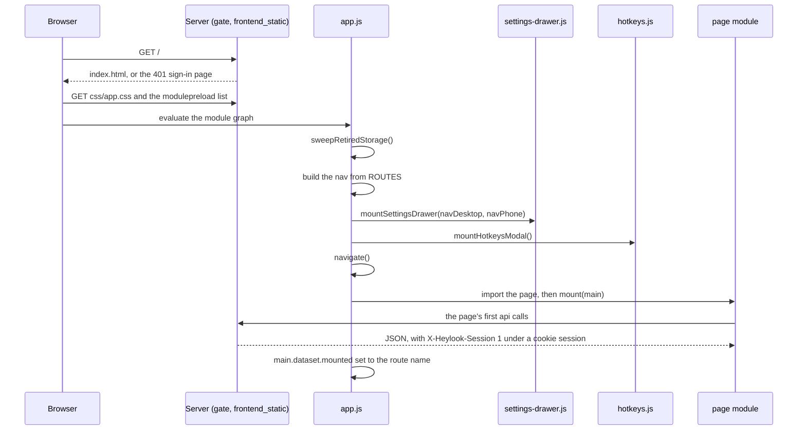
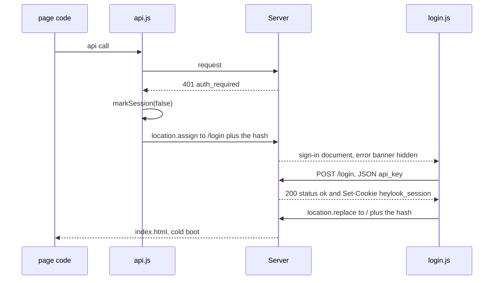

# The app shell and page lifecycle

last updated: 2026-11-24

This page maps what every page stands on: the document and how it is served, the boot of `frontend/js/app.js`, the hash router, the `createPage` lifecycle in `frontend/js/page.js`, the JSON API layer in `frontend/js/api.js`, sign in and sign out, browser storage, the settings drawer shell, the hotkeys and the shared primitives in `frontend/js/utils.js`. It starts at the browser's first request for `/` and stops at each page's `setup(ctx)`: what a page does inside its setup, and what it puts inside the drawer, is mapped on that page's own sheet. The overview this goes below is [frontend_core.md](../frontend_core.md); the history behind the rules is in [sharp_edges.md](../../architecture/sharp_edges.md), section "Frontend".

## Files and what each owns

| File | Owns |
|---|---|
| `frontend/index.html` | The document: color-scheme and theme-color metas before the stylesheet, `<base href="/">`, icon, manifest and Home Screen links, the `modulepreload` list, and the empty shell (`#app` holding `aside#sidebar` with `nav#nav-desktop`, `nav#phone-nav`, `main#main`). Loads `js/app.js` as a module. |
| `frontend/login.html` | The sign-in document, served by the server with `<!--LOGIN_ERROR-->` replaced. Loads `css/app.css`, `icon.svg` and `js/login.js` only. |
| `frontend/manifest.json` | The Home Screen app: `start_url` `/#/chat`, `display` `standalone`, fixed colours, `/apple-touch-icon.png`. |
| `frontend/js/app.js` | `ROUTES` (the route table), the boot sweep call, nav building, the two shell singletons' mount calls, `navigate`, `staleModuleHint`, the `heylook:chat-activity` listener. |
| `frontend/js/page.js` | `createPage`: the one lifecycle implementation (`mount`, `unmount`, the `ctx` object). |
| `frontend/js/api.js` | `request`, `httpError`, `requestId`, the route table `ROUTES` and the generated `api` object (`makeCall`, `pathArity`), the session flag (`markSession`, `hasActiveSession`, `onSessionChange`) and `logoutSession`. |
| `frontend/js/storage.js` | `STORAGE_KEYS`, `STORAGE_REGISTRY`, `lsRead`, `lsWrite`, `RETIRED_KEYS`, `MOVED_KEYS`, `RETIRED_DATABASES`, `sweepRetiredStorage`. The only module allowed to touch browser storage. |
| `frontend/js/hotkeys.js` | The keyboard shortcuts dialog (`mountHotkeysModal`, `SHORTCUT_ROWS`) and the per-page Escape and submit chord (`registerPageHotkeys`, `isModalOpen`, `isEditableTarget`). |
| `frontend/js/settings-drawer.js` | The drawer singleton: `mountSettingsDrawer`, `registerSettings`, `openSettings` (exported `open`), `requestRebuild`, `close`, `render`, the focus guard `isEditingInDrawer`. |
| `frontend/js/utils.js` | `createEl`, `throttleToFrame`, `throttleToInterval`, the unload guard (`createUnloadGuard`, private `beforeUnloadGuard`), `setStatus`, `fillOptions`, `causeWords`, `formatBytes`, `formatTokens`, `debounce`, `autoGrow`, `dismissPaneOnOutsideClick`, `armedConfirm`; re-exports `lsRead`, `lsWrite`, `sweepRetiredStorage` from `storage.js`. |
| `frontend/js/login.js` | Progressive enhancement of the sign-in form: Show/Hide, error clearing, JSON submit that keeps the hash. |
| `src/heylook_llm/frontend_static.py` | `mount_frontend` (the explicit routes), `_serve` (path guard, 404), `_file_response` (no-cache, etag, gzip, 304). |
| `src/heylook_llm/auth.py` | `AccessGateMiddleware` (origin check, credentials, `x-heylook-session`, the 401 shapes), `EXEMPT_ROUTES`, `SessionStore`, `render_login_html`, `_wants_html_login`, cookie formatting. |
| `src/heylook_llm/auth_api.py` | `GET`/`HEAD /login` (`login_page`), `POST /login` (`login_submit`), `POST /logout` (`logout_submit`), `_prefers_json`. |

## State

| Name | Where it lives | Written by | Read by | Reset when |
|---|---|---|---|---|
| `navToken` | `app.js` module | `navigate`, incremented at its start | `navigate`, after each await | Never; it only grows. |
| `currentPage` | `app.js` module | `navigate`, set to `mod.default` before `mount` | `navigate`, to unmount it | Set to null after each unmount, and on a mount failure. |
| `navLinks` | `app.js` module | the boot nav loop | `navigate` (active marks), the `heylook:chat-activity` listener | Never. |
| `data-mounted` on `#main` | DOM | `navigate`, after `mount` resolves for the current token | `tests/e2e/run.mjs` `route` | Deleted by every `navigate` before the old page's DOM is cleared. |
| `nav-item--active`, `aria-current="page"` | nav links | `navigate` | CSS, assistive tech | Moved by every `navigate`. |
| `nav-item--busy` and `title` | the Chat nav links | the `heylook:chat-activity` listener | CSS `.nav-item--busy::after` | Only by an event with `busy: false` (see FB-07). |
| `document.title` | document | `navigate` | the browser | Every `navigate`. |
| `current` | `page.js`, one per page object | `mount` | `unmount` | Null at the start of `unmount`. |
| `ctx` (`alive`, `signal`, `state`) and `cleanups` | one per mount | `mount`, `ctx.onTeardown`, `ctx.throttle`, `ctx.throttleTime` | page code, `ctx.guard`, the page hotkeys listener | `alive` false and `signal` aborted at `unmount`; the next mount gets a new `ctx`. |
| `activeSession` | `api.js` module | `markSession`: true from `request`, false from `httpError` (401 `auth_required`) and `logoutSession` | `hasActiveSession` (drawer `render`, `pages/perf.js`) | False at every document load. A response without the header never sets it false. |
| `sessionListeners` | `api.js` module | `onSessionChange` (the drawer, once at mount) | `markSession` | Never. |
| `mounted` and the element refs | `settings-drawer.js` module | `mountSettingsDrawer` | every drawer function | Never. |
| `isOpen` | `settings-drawer.js` | `open`, `close` | `requestRebuild`, `registerSettings`, the drawer's keydown and hashchange listeners | `close`. |
| `lastOpener` | `settings-drawer.js` | `open` (the opener, or the desktop gear) | `close`, to restore focus | Overwritten by the next `open`. |
| `current` (the contribution) | `settings-drawer.js` | `registerSettings` | `render`, `open` (`onOpen`) | By the unregister function, only while it is still the registered contribution. |
| `inert` on `#app` and on the drawer `aside` | DOM | `open`, `close` | the browser | `close`. |
| drawer body children | DOM, `div.drawer__body` | `render` | the user | `close` empties it. |
| `dialogEl` | `hotkeys.js` module | `mountHotkeysModal` | the `?` listener, the hashchange listener | Never. |
| `unloadGuards` | `utils.js` module | `beforeUnloadGuard.enable` and `disable` | the same | Reaches zero when every guard is disarmed. |
| `armed`, `disposed` | one `createUnloadGuard` closure | its `set`, its teardown cleanup | its `set` | Teardown runs `set(false)` then sets `disposed`. |
| `armed`, `armedFor`, `timer` | one `armedConfirm` button | its click handler, `arm`, `disarm` | its click handler | `disarm`: on confirm, timer, moved target, or a consumer's `btn.disarm()`. |
| `heylook.chat.draft-prompt`, `heylook.chat.last-conversation` | `localStorage` | `pages/chat.js` through `lsWrite` | `pages/chat.js` through `lsRead` | `lsWrite` with `null`, `undefined` or `''` removes the key; the browser may evict it. |
| retired keys and databases | `localStorage`, IndexedDB | older versions of the app | nothing | `sweepRetiredStorage` at every boot. |
| `heylook_session` cookie | the browser's cookie jar, `HttpOnly` (invisible to JS) | `POST /login` (`Set-Cookie`) | the gate, on every request | `POST /logout`, or a gate 401 that received an invalid cookie (`Max-Age=0`); expiry is `SESSION_TTL_SECONDS` in `auth.py`. |
| a session entry | server memory, `auth.py` `SessionStore` | `create` at sign in | `verify` on each request | `revoke` at sign out, expiry, eviction past `MAX_ACTIVE_SESSIONS`, a key rotation, and a server restart (the store is in memory). |
| `submitBtn.disabled`, the error banner | the sign-in document | `login.js` submit handler, `showError` | the user | `finally` re-enables; typing clears the banner. |

## Entry points

| What the user or browser does | Handler (file, function) | Flow |
|---|---|---|
| Loads `/` or `/index.html` | `frontend_static.py` `serve_frontend_index`, behind `auth.py` `AccessGateMiddleware` | Cold boot; Static asset requests |
| Requests `/js/...`, `/css/...`, `/icon.svg`, `/favicon.ico`, `/manifest.json`, `/apple-touch-icon.png` | `frontend_static.py` `serve_frontend_js`, `serve_frontend_css`, `serve_frontend_icon`, `serve_frontend_manifest`, `serve_frontend_touch_icon` | Static asset requests |
| The module `js/app.js` evaluates | `app.js` module body | Cold boot |
| Changes the hash (nav link, drawer link, back or forward, typed URL) | `app.js` `navigate`; also the drawer's and the dialog's `hashchange` listeners | Route change |
| A page module is mounted or unmounted | `page.js` `mount`, `unmount` | Page mount; Page unmount |
| The tab is hidden, closed, shown, or restored from the back-forward cache | listeners added by `page.js` `ctx.onHide`, `ctx.onResume` | Hide and resume |
| Any page calls `api.<name>(...)` | `api.js` `makeCall`, `request` | One API call |
| A response is not ok | `api.js` `httpError` | Error responses and a 401 |
| Submits the sign-in form, presses Show/Hide, types in the key field | `login.js` submit, click and input listeners | Sign in |
| Presses Sign out (drawer or Perf page) | `api.js` `logoutSession` | Sign out |
| Clicks `⚙ Settings` (desktop) or `⚙` (phone), or a page opener | `settings-drawer.js` `open` (exported as `openSettings`) | Drawer open, render and close |
| Clicks the backdrop or Close, presses Escape with the drawer open | `settings-drawer.js` `close` | Drawer open, render and close |
| Presses `?` outside an editable field | the keydown listener in `hotkeys.js` `mountHotkeysModal` | Shortcuts dialog |
| Presses Cmd or Ctrl + Enter, or Escape | the listener added by `hotkeys.js` `registerPageHotkeys` | Page Escape and submit chord |
| Clicks an `armedConfirm` button | its click listener in `utils.js` `armedConfirm` | Two-tap confirm |
| Reloads, closes or leaves the document while a guard is armed | `utils.js` `beforeUnloadHandler` | Leave-page guard |
| Chat dispatches `heylook:chat-activity` | the listener in `app.js` | Nav busy dot |
| Launches the Home Screen app | the browser reads `manifest.json` `start_url` | Cold boot |

## Flows

### Static asset requests

Trigger: any `GET` or `HEAD` for the document or an asset.

Guards: `AccessGateMiddleware` runs first on every request (see Cold boot step 1). `mount_frontend` registers nothing when `FRONTEND_DIR` is not a directory; it logs a warning and every frontend path 404s.

Steps:
1. The route handler builds a path under `FRONTEND_DIR` and calls `_serve`.
2. `_serve` resolves the path (following symlinks) and serves it only if the resolved path `is_relative_to(FRONTEND_DIR)` and `is_file()`.
3. `_file_response` stats the file and computes the base etag with `_asset_etag` (the same formula as starlette's `FileResponse`).
4. It decides on gzip: the suffix is in `_GZIP_TYPES`, the size is at least `_GZIP_MIN`, and the request's `accept-encoding` contains `gzip`. A gzip answer gets its own etag (the base etag with `-gzip` before the closing quote).
5. Every exit carries `Cache-Control: no-cache`, the etag, and `vary: accept-encoding`.
6. If `if-none-match` lists the etag (a `W/` prefix is stripped), it answers 304 with no body.
7. Otherwise it answers 200: a gzip body compressed per request (no cache), or a `FileResponse`.

Ends when: the response is sent.

Failure paths: any resolve or stat error, a NUL byte (`ValueError`), a path outside the tree, or a missing file is `HTTPException(404, "Not found")`. A path with no registered route (no catch-all exists) is the app's ordinary 404. History: [Static serving: no fallback, no catch-all](../../architecture/sharp_edges.md#static-serving-no-fallback-no-catch-all).

Awaits: none; the handlers are sync and run in the threadpool.

### Cold boot: the document to the first mounted page

Trigger: the browser loads `/` (or `/index.html`, or the manifest's `start_url` `/#/chat`).

Guards: the access gate. With no key configured it passes everything. With a key configured, the request needs a credential; the browser's is the `heylook_session` cookie.

Steps:
1. `AccessGateMiddleware.__call__` adds `content-security-policy: frame-ancestors 'self'` and `x-frame-options: SAMEORIGIN` to every response. A `GET` is not state-changing, so the origin check is skipped. `resolve_access_key()`:
   - not enabled: the request goes to `serve_frontend_index`;
   - enabled with an error (bad file mode, empty file, missing explicit file): 503 JSON, `error.code` `auth_misconfigured`, for every path except `/health`;
   - enabled: `x-api-key`, then `Authorization: Bearer`, then the `heylook_session` cookie(s) are checked. A cookie that `SessionStore.verify` accepts passes, and the response also gets `x-heylook-session: 1`. With no valid credential, the gate logs `auth_failed`, adds a clearing `set-cookie` if a cookie was sent, and, because the document request accepts `text/html` and is not under `/v1/` (`_wants_html_login`), answers 401 with `render_login_html()`. The URL stays as typed; the Sign in flow takes over.
2. The parser reads `<head>`: `color-scheme` and the `theme-color` pair come before the stylesheet (checked by `tests/unit/test_css_token_contrast.py` `test_theme_color_meta_is_the_surface_token`, for both documents), then `<base href="/">`, `icon.svg`, `manifest.json`, `apple-touch-icon.png`, the `apple-mobile-web-app-title` meta, `css/app.css`, and `modulepreload` links for `app.js`, `page.js`, `api.js`, `settings.js`, `settings-drawer.js`, `utils.js`, `pages/chat.js`, `streaming.js`, `markdown.js`, `markdown-stream.js`, `image-prep.js`, `preset-bar.js`, `prompt-section.js`, `vendor/marked.esm.js`, `vendor/purify.es.mjs`. Modules on chat's static import graph that are not on that list (`storage.js`, `hotkeys.js`, `document-writer.js`, `load-panel.js`, `context-select.js`, `engine.js`, `prompt-preview.js`) are fetched when the module loader reaches their imports.
3. The body is parsed: `#app` with `aside#sidebar` (the `.brand` wordmark and an empty `nav#nav-desktop`), an empty `nav#phone-nav`, an empty `main#main`. The module script runs after parsing.
4. The module graph evaluates dependencies first: `storage.js` (re-exported by `utils.js`), `utils.js`, `settings.js`, `api.js`, `settings-drawer.js`, `hotkeys.js`, then `app.js`. While `api.js` evaluates, `Object.fromEntries` over its `ROUTES` calls `makeCall` and so `pathArity` for every route; a path builder with a default parameter throws `api route "<name>": a path builder cannot take default parameters` here, and nothing in `app.js` runs (history: [API routes: no default parameters in a path builder](../../architecture/sharp_edges.md#api-routes-no-default-parameters-in-a-path-builder)). Module state starts as `activeSession = false`, drawer `mounted = false`, `dialogEl = null`, `unloadGuards = 0`.
5. `app.js` body: `sweepRetiredStorage()` (Browser storage flow) runs before anything reads storage.
6. It looks up `#main`, `#nav-desktop`, `#phone-nav`, creates `div.phone-nav__seg` and appends it to `#phone-nav`.
7. Nav loop over `ROUTES` in declaration order (`chat`, `notebook`, `embeddings`, `presets`, `models`, `perf`):
   - before the first route with `admin: true`, it appends `div.nav-sep` to `#nav-desktop` (`admin` places the separator and gates nothing);
   - it appends `a.nav-item` with `href="#/<name>"`, `data-route="<name>"` and the text `route.title` to `#nav-desktop`, and pushes it to `navLinks`;
   - unless `phoneNav === false` (`embeddings`, `presets`), it appends a second `a.nav-item` with the text `route.short` to `.phone-nav__seg` and pushes that too.
8. `mountSettingsDrawer(navDesktop, navPhone)` (Drawer mount flow). The desktop gear lands after the desktop links, the phone gear after `.phone-nav__seg`.
9. `mountHotkeysModal()` (Shortcuts dialog flow).
10. `app.js` adds `hashchange` -> `navigate`, after the drawer's and the dialog's own `hashchange` listeners, and the `heylook:chat-activity` listener.
11. `navigate()` is called directly (Route change flow, with no current page). An empty hash resolves to `chat`; the URL is not rewritten.
12. The page's setup starts its first requests through `api.*`. The first response that carries `X-Heylook-Session: 1` calls `markSession(true)`; until then `hasActiveSession()` is false.

Ends when: `#main` carries `data-mounted` set to the route name, or the mount failure note is in `#main`.

Failure paths:
- 401 sign-in page instead of the app: Sign in flow.
- 503 `auth_misconfigured`: the browser shows the JSON body; nothing of the app loads.
- A module in the static graph fails to fetch or evaluate (including the `pathArity` throw): `app.js` never runs. The shell stays empty (brand only, no nav) and the error is only in the console. No failure note is shown, because the note is written by `navigate`.
- A page module fails to import or mount: Route change failure path.

Awaits: none in the boot itself before `navigate`; the module loader's fetches complete before evaluation.

### Route change

Trigger: `hashchange` on `window`: a nav link, the drawer's `Embeddings workbench` link, the preset section's `Manage presets` link (`preset-bar.js`), back or forward, a typed hash. The boot calls `navigate` once directly. A click on the link of the page already shown does not change the hash and runs nothing.

Guards: nothing refuses a navigation. An unknown name mounts the chat route under the hash as typed.

Steps:
1. Listeners registered earlier on `window` run first, in registration order: the drawer's (`close()` if `isOpen`, which un-seals `#app` and empties the drawer body before the next page mounts), then the dialog's (`dialogEl.close()` if open). Then `navigate`.
2. `navigate` parses the name: strips `#` and one optional `/`, defaults to `chat`, keeps the part before the first `/`. `route = ROUTES[name] || ROUTES.chat`; `routeName` is the name if known, else `chat`.
3. `token = ++navToken`.
4. `await currentPage?.unmount()` (Page unmount flow). Unmount runs synchronously up to its teardown-hook await, so the old page's cleanups (listener removal, aborts, its drawer unregister, its hotkeys removal) run inside this `hashchange` dispatch, while its DOM is still in `#main`.
5. If `token !== navToken`, return: a newer navigation owns the DOM.
6. `currentPage = null`; `main.replaceChildren()`; `delete main.dataset.mounted`.
7. `document.title = `${route.title} · heylook``; for each link in `navLinks`, `nav-item--active` and `aria-current="page"` are set where `data-route === routeName` and removed elsewhere. The nav shows the target while `#main` is empty.
8. `mod = await route.load()`: a dynamic `import('./pages/<name>.js')`. The first time in a document it fetches `GET /js/pages/<name>.js` and any uncached imports; afterwards the module map answers.
9. If superseded, return.
10. `currentPage = mod.default`; `await currentPage.mount(main)` (Page mount flow).
11. If `token === navToken`, `main.dataset.mounted = routeName`. A superseded mount that resolves writes nothing.

Ends when: `data-mounted` is set, the failure note is shown, or a newer navigation superseded this one (it returns without a trace).

Failure paths: `route.load()` rejects (network, 404, a 401 on the module, a syntax error) or `mount` rejects (setup threw; `page.js` has already torn it down):
- superseded: return; the error is not logged;
- current: `console.error(`page "${routeName}" failed to mount`, err)`, `currentPage = null`, and `#main` is replaced by `div.error-note` with `role="alert"` reading `This page failed to load (<err.message>). ` followed by either the `staleModuleHint` text (when the message matches `is not a (function|constructor)`, `undefined is not an object`, `dynamically imported module`, `Importing a module script failed` or `Failed to load module`) or `Navigation still works -- pick another page or reload.` The nav and `hashchange` keep working. The previous page's drawer contribution was unregistered in step 4, so the drawer shows only the shell's own items.

Awaits and what is re-checked:

| Await | Re-checked after |
|---|---|
| `currentPage?.unmount()` | `token !== navToken` |
| `route.load()` | `token !== navToken` |
| `currentPage.mount(main)` | `token === navToken` before marking; in the catch, `token !== navToken` before writing the note |

### Page mount (`createPage`)

Trigger: `navigate` calls `page.mount(main)` on a page's default export, which every page builds with `createPage({ setup })`.

Guards: none.

Steps:
1. A new `AbortController` and an empty `cleanups` list.
2. `ctx` is built (table below) and `current = { ctx, controller, cleanups }` is set before setup runs.
3. `await spec.setup(ctx)`. Pages build their skeleton before their first await, then fetch; they check `ctx.alive` after awaits.
4. On a throw: if this mount is still the current one (`current === mine`), `await page.unmount()` (so listeners, hooks and the drawer contribution registered before the throw are removed and `ctx.alive` turns false); then the error is rethrown to `navigate`. A mount that was already unmounted, and possibly replaced by a newer mount of the same page, is left alone.

What `ctx` offers:

| Member | Behaviour | At teardown |
|---|---|---|
| `el` | the mount root (`#main`) | removed by `navigate` after unmount |
| `state` | a fresh object per mount | dropped with `ctx` |
| `signal` | the controller's `AbortSignal`; pass to `fetch` and the streaming helpers | aborted |
| `alive` | true until teardown | set false first |
| `onTeardown(fn)` | pushes `fn` to `cleanups`; returns an unsubscribe that removes it | runs, newest first |
| `guard(fn)` | a wrapper that calls `fn` only while `ctx.alive` | the wrapper becomes a no-op |
| `throttle(fn)` | `throttleToFrame(fn)`; its `cancel` is pushed to `cleanups` (no page uses it today) | pending frame cancelled |
| `throttleTime(fn, ms)` | `throttleToInterval(fn, ms)`; its `cancel` is pushed to `cleanups` (chat and notebook painters, `PAINT_INTERVAL_MS` in each page) | pending timer and frame cancelled |
| `linkedController()` | a new `AbortController` that aborts when `ctx.signal` aborts; the chaining listener is registered with the new controller's own signal, so it removes itself when that controller aborts. Callers abort it when the operation ends. | aborted through the chain |
| `onHide(fn)` | Hide and resume flow; returns an unsubscribe | listeners removed (linked controller aborts) |
| `onResume(fn)` | Hide and resume flow; returns an unsubscribe | listeners removed |

Ends when: setup resolves (then `navigate` marks `data-mounted`) or throws after the teardown above.

Failure paths: a throw in setup, after teardown, reaches `navigate`'s failure path.

Awaits: `spec.setup(ctx)`; on a throw, `page.unmount()`, after re-checking that this mount is still the current one.

### Page unmount (teardown)

Trigger: `navigate` step 4, or `mount` after a throwing setup.

Guards: `if (!current) return`, so a second call is a no-op.

Steps:
1. Take `current` and set it to null.
2. `ctx.alive = false`.
3. `controller.abort()`: `ctx.signal`'s abort event fires; every linked controller aborts (which removes the `onHide` and `onResume` listeners); every fetch given `ctx.signal` or a linked signal rejects with an `AbortError` in its caller.
4. `cleanups` run in reverse registration order, each in its own try/catch that logs `teardown cleanup failed`. Typical entries: the drawer unregister, the page hotkeys' `removeEventListener`, the unload guard's disarm, throttle cancels, debounced writers' teardown flushes.
5. `await spec.teardown?.(ctx)` in a try/catch that logs `teardown failed`. No page passes a `teardown` today; all cleanup goes through `ctx.onTeardown`.

Ends when: the teardown hook settles. Nothing throws out of `unmount`.

Failure paths: a failing cleanup or hook is logged and the rest still run.

Awaits: the teardown hook only.

### Hide and resume (`ctx.onHide`, `ctx.onResume`)

Trigger: `visibilitychange` (hidden or visible), `pagehide`, or `pageshow` with `persisted` (a back-forward cache restore).

Guards: `onHide` acts on `visibilitychange` only when `document.visibilityState === 'hidden'`; `onResume` only when `'visible'`, and on `pageshow` only when `e.persisted`.

Steps:
1. Each `onHide(fn)` call makes a `linkedController()` and adds a `document` `visibilitychange` listener and a `window` `pagehide` listener, both with that controller's signal.
2. Each `onResume(fn)` call does the same with `visibilitychange` and `pageshow`.
3. On the event, `fn()` runs. Consumers flush debounced writes on hide with `keepalive` (the comment beside `api.js` `request` names the browser's body cap) and re-adopt server state on resume. Which consumers, and what each does: [chat-documents.md](chat-documents.md), [chat-model-and-settings.md](chat-model-and-settings.md), [notebook.md](notebook.md), [presets-and-perf.md](presets-and-perf.md). History: [Store mirror and resume](../../architecture/sharp_edges.md#store-mirror-and-resume).
4. The returned unsubscribe aborts the controller; teardown aborts it through the chain.

Ends when: `fn` returns. `page.js` does not await it.

Failure paths: none in `page.js`; an exception in `fn` surfaces as an uncaught error from the listener.

Awaits: none. One moment can deliver more than one of the bound events (see the last section), so `fn` must tolerate running twice; the debounced flushes are no-ops when nothing is pending.

### One API call: `api.<name>` through `makeCall` and `request`

Trigger: a page or module calls `api.<name>(...args)`.

Guards: `pathArity` at import (Cold boot step 4).

Steps:
1. `makeCall` closed over `[method, buildPath, hasBody]` from `ROUTES` and the builder's declared arity (`buildPath.length`). The arguments are split by position: the first `arity` are path arguments; if `hasBody`, the next one is the JSON body; the next one is the options object (`|| {}`). For example `updateConversation(id, body, opts)`, `getConversation(id, opts)`, `adminLoadModel(id, warm, opts)` (no body), `adminReloadModel(id, warm, body, opts)`.
2. `request(method, buildPath(...pathArgs), body, opts)`. `opts` may carry `signal` and `keepalive` (default false).
3. Headers: `X-Request-ID` from `requestId()` (`crypto.randomUUID()`, or a `req-<random>-<time>` fallback where that throws). `Content-Type: application/json` only when `body !== undefined`. No `Accept` header and no `credentials` option, so the same-origin cookie is sent by default.
4. `await fetch(path, { method, headers, body: JSON.stringify(body) or undefined, signal, keepalive })`.
5. Server side, for a state-changing method the gate runs the origin check before anything else (`check_request_origin`); a same-origin browser fetch passes. Under a cookie session the response gets `x-heylook-session: 1`.
6. If the response header `X-Heylook-Session` is `1`, `markSession(true)` (before the status is looked at). `markSession` only notifies listeners when the value changes; the drawer's listener is `requestRebuild()`.
7. Not ok: `throw await httpError(res)` (next flow).
8. 204: resolves `null`. Any other ok status: resolves `res.json()`.

Ends when: the promise resolves with the parsed body or `null`, or rejects.

Failure paths:
- network failure or abort: `fetch` rejects with its own error (`TypeError`, or an `AbortError` `DOMException`); `httpError` is not involved and the session flag is untouched;
- a non-ok status: the normalized error from `httpError`;
- an ok response whose body is not JSON: `res.json()` rejects with a parse error.

Awaits: `fetch`, then `httpError` on failure. Nothing is re-checked here; callers re-check `ctx.alive` or their own identity after awaiting the call.

`streaming.js` (`streamTypedSSE`, `stopGenerate`, `endReasoningGenerate`), `embed-kit.js` `embedBatch` and `pages/embeddings.js` call `fetch` themselves with `requestId()` and use `httpError`; they never read `X-Heylook-Session`, so only `request` marks the session.

### Error responses and a 401: `httpError`

Trigger: `request`, `streaming.js` or `embed-kit.js` got a non-ok response.

Guards: none.

Steps:
1. Defaults: message `res.statusText`, `code` null, `structured` null.
2. `await res.json()` inside a try (a non-JSON body keeps the defaults):
   - when `data.detail` is an array (a validation refusal, `[{loc, msg, type}]`), `invalid` is each entry's `loc` (without `body`, `query` and `path`) joined by dots, a colon and its `msg`, the entries joined by `; `;
   - `structured = data.detail` when it is a non-null object that is not an array;
   - the message is the first truthy of `data.error.message`, then (`invalid` when there is one, else `structured.error` when structured, else `data.detail`), then `data.error.code`, then `statusText`;
   - `code = data.error.code ?? null`.
3. `err = new Error(message)` with `err.status`, `err.detail` (the structured object), `err.code`, `err.retryAfter` (`Number(Retry-After)` or null).
4. If `res.status === 401`, `code === 'auth_required'`, and the page is not at `/login`: `markSession(false)` and `window.location.assign(`/login${window.location.hash}`)`.
5. Returns `err` (the caller throws it).

Ends when: the error is returned. On the 401 branch the document then navigates to `/login`; an armed unload guard shows the browser's leave-page dialog first.

Failure paths: none of its own.

Awaits: `res.json()`. Nothing is re-checked. On the 401 branch the caller still receives the error, and may paint its message (`Authentication required. Send x-api-key, Authorization: Bearer, or sign in at /login.`) on its status line before the navigation completes.

Error shapes a page sees from the shell's server side: 401 `auth_required` (the gate, JSON for every path that is not an HTML navigation), 403 `csrf_rejected` (the always-on origin check, message `Cross-origin state-changing request refused (Origin must match Host; Sec-Fetch-Site must be same-origin or none).`), 503 `auth_misconfigured` (message `Server access key is misconfigured: <reason>`).

### Sign in

Trigger: the browser shows the sign-in document, by one of two ways:
- a navigation to any non-`/v1/` path that accepts `text/html` without a valid credential: the gate answers 401 with the sign-in document at that same URL (for example `/#/models`);
- `httpError` sends the document to `/login<hash>`: `GET /login` is exempt; `login_page` answers 303 to `/` when the gate is off or the cookie is valid, otherwise 200 with `render_login_html()`.

Guards: `EXEMPT_ROUTES` in `auth.py` lets `/login` (`GET`, `HEAD`, `POST`), `/css/app.css`, `/js/login.js`, `/icon.svg`, `/favicon.ico` and `/health` through without credentials. The always-on origin check applies to `POST /login`; `login_submit` repeats it requiring at least one browser signal (`check_cookie_csrf`).

Steps:
1. `render_login_html` reads `frontend/login.html` (a minimal inline form if the file cannot be read) and replaces `<!--LOGIN_ERROR-->` with `div#login-error.error-note` (`role="alert"`), `hidden` when there is no message, otherwise holding the escaped message.
2. The document loads `css/app.css` and `js/login.js`. The key field has `autofocus`, `required`, `type="password"` and `aria-describedby="login-help login-error"`.
3. Show/Hide (`#toggle-key`): toggles the field between `password` and `text`, sets `aria-pressed`, the `aria-label` (`Show API key` or `Hide API key`) and the text (`Show` or `Hide`).
4. Typing in the field: `setCustomValidity('')`, and if the banner is visible, `showError('')` hides it and removes `aria-invalid`.
5. Submit. The browser's own `required` check runs before the submit event, so `form.reportValidity()` returning false does not happen in practice; when it would, the handler returns without `preventDefault`. Then `preventDefault()`; if the button is already disabled, return. The button is disabled and reads `Signing in…`; the banner is cleared.
6. `await fetch('/login', POST, Content-Type and Accept application/json, body {"api_key": value})`.
7. Server, `login_submit`: origin check; key state; a bounded read of the body (`_MAX_LOGIN_BODY_BYTES`); `api_key` from JSON (or the form body); `verify_api_key(submitted.strip(), key)` in constant time; on success `SessionStore.create`, a `Set-Cookie` from `format_session_cookie` (`Path=/`, `Max-Age=SESSION_TTL_SECONDS`, `HttpOnly`, `SameSite=Strict`, `Secure` when `is_https_scope`), an `auth_login` event, and JSON `{"status": "ok"}`. With the gate off it answers `{"status": "ok", "gate": "off"}`.
8. `res.ok`: at `/login`, `location.replace(`/${hash}`)`; anywhere else (the inline 401 document), `location.reload()`. The browser now loads `/` with the cookie: Cold boot.
9. Not ok: the message is `body.error.message`, else `body.detail`, else `Invalid API key.`; `showError(message)` shows the banner and sets `aria-invalid="true"`; the field is focused and selected.
10. `finally`: the button is enabled again and reads `Sign in`, also on the success path while the navigation is under way.

Ends when: the document navigates (success) or the banner shows the reason.

Failure paths:

| Server answer | Message shown |
|---|---|
| 401 `invalid_api_key` | `Invalid API key.` |
| 403 `csrf_rejected` from `login_submit` | `Cross-origin login request refused (Origin must match Host).` |
| 403 from the gate's always-on check | `Cross-origin state-changing request refused (Origin must match Host; Sec-Fetch-Site must be same-origin or none).` |
| 413 | `Login payload too large.` |
| 503 misconfigured key | `Server access key is misconfigured: <reason>` (from the gate's JSON; see the last section) |
| `fetch` rejects | `Could not reach the server. Check your connection and try again.` (the field is focused, not selected) |

Without JavaScript the form posts `api_key` form-encoded to `/login`: success is a 303 to `/` with the cookie (the hash is lost); a wrong key is a 401 sign-in document with the banner `Invalid API key.`; a refused origin is a 403 document with `Cross-origin login request refused.`

Awaits: `fetch`, then `res.json()` on failure. Nothing is re-checked; the button's disabled state is the only re-entry guard.

### Sign out

Trigger: the drawer's `Sign out` button (rendered only while `hasActiveSession()`), or the Perf page's `Sign out` button (`pages/perf.js`, hidden unless `hasActiveSession()`; [presets-and-perf.md](presets-and-perf.md)).

Guards: the button is disabled on the first click.

Steps:
1. The click handler sets `disabled = true` and calls `logoutSession()` (not awaited).
2. `await fetch('/logout', POST, Accept application/json, X-Request-ID)`, no body. A rejection is swallowed.
3. Server: with the gate on, `POST /logout` is not exempt, so the gate authenticates the cookie and runs the cookie origin check; then `logout_submit` revokes every `heylook_session` token sent, records `auth_logout`, and, because `X-Request-ID` is present, answers JSON `{"status": "logged_out"}` with a clearing `Set-Cookie`. With an already invalid cookie the gate answers 401 and clears the cookie itself. The client reads neither answer.
4. `markSession(false)`: the drawer's listener calls `requestRebuild()`, which does nothing while focus is on the button inside the drawer body.
5. `window.location.assign('/login')`. The hash is not carried. An armed unload guard shows the browser's leave-page dialog first.
6. `GET /login` answers the sign-in document (or a 303 to `/` when the gate is off).

Ends when: the sign-in document loads.

Failure paths: none reach the user; the navigation happens whatever the server said.

Awaits: the `/logout` fetch. Nothing is re-checked. The page's hide flushes run during the unload that follows, after the session was revoked (see the last section).

### Browser storage: read, write, the registry, the boot sweep

Trigger: `app.js` calls `sweepRetiredStorage()` once per document, before nav building and the first `navigate`. Reads and writes come from `pages/chat.js` ([chat-documents.md](chat-documents.md)).

Guards: `assertRegisteredKey` throws `Unregistered browser storage key "<key>"; add it to STORAGE_REGISTRY in storage.js.` for a key not in `STORAGE_REGISTRY` (only entries with `kind: 'localStorage'` count). `tests/unit/test_frontend_storage_guard.py` fails any other module in `frontend/js/` (vendor excluded) that references `localStorage`, `sessionStorage` or `indexedDB`.

Steps:
1. Sweep, `MOVED_KEYS`: for each `[from, to]`, if `from` holds a value and `to` is empty, copy it; then remove `from` if it held a value.
2. Sweep, `RETIRED_KEYS`: `localStorage.removeItem` for each.
3. Sweep, `RETIRED_DATABASES`: `indexedDB.deleteDatabase(name)` for each, when `indexedDB` exists. The request is not awaited and has no handlers.
4. Read: `lsRead(key)` asserts the key, then `localStorage.getItem('heylook.' + key)`; any throw reads as `null`.
5. Write: `lsWrite(key, value)` asserts the key; `null`, `undefined` or `''` removes the item, anything else is set; a throw (private mode, quota) is swallowed and the value lives only in page memory.

Ends when: each call returns. Every step is synchronous.

Failure paths: each sweep step has its own try/catch; storage that is unavailable is skipped silently. A registry miss is the only throw, and it is synchronous at the call site.

The registry's `fullKey`, `feature` and `holds` fields are declarations only; no code in `frontend/js/` reads them. History: [Browser storage: one wrapper, eviction, one sweep](../../architecture/sharp_edges.md#browser-storage-one-wrapper-eviction-one-sweep).

### Drawer mount

Trigger: `app.js` calls `mountSettingsDrawer(navDesktop, navPhone)` once at boot.

Guards: `if (mounted) return`.

Steps:
1. `appEl = #app`.
2. Desktop gear: `button.nav-item.drawer-gear`, `title="Settings"`, `aria-label="Open settings"`, text `⚙ Settings`; click -> `open(gearBtn)`; appended to `#nav-desktop`.
3. Phone gear: `button.nav-item.drawer-gear.drawer-gear-phone`, same title and label, text `⚙`; click -> `open(phoneGearBtn)`; appended to `#phone-nav` (inside `#app`, so the seal covers it).
4. `div.drawer-backdrop`; click -> `close()`.
5. `div.drawer__body` (the only thing `render` replaces) and the Close button (`button.btn.btn--ghost.btn--sm.drawer__close`, `aria-label="Close settings"`, text `Close`; click -> `close()`).
6. `aside.drawer` with `role="dialog"`, `aria-label="Settings"`, `aria-modal="true"`, holding `header.drawer__head` (an `h2` `Settings` and the Close button) and the body. `inert = true` while closed.
7. Backdrop and panel are appended to `body`, outside `#app`.
8. A `document` `keydown` listener: when `isOpen` and the key is `Escape`, `preventDefault()` then `close()`. It is registered before any page hotkeys, so it runs first (history: [A key a handler consumes is prevented](../../architecture/sharp_edges.md#a-key-a-handler-consumes-is-prevented)).
9. A `window` `hashchange` listener: `if (isOpen) close()`. It is registered before `app.js`'s `navigate` listener.
10. `onSessionChange(() => requestRebuild())`.

Ends when: the function returns.

Failure paths: none.

Awaits: none.

### Drawer open, render and close

Trigger: open from a gear, or from a page opener through `openSettings(button)` (chat's bar gear, chat's and notebook's preset chip, chat's system-prompt chip). Close from the backdrop, the Close button, Escape, or a hash change.

Guards: `open` returns when not mounted or already open. `close` returns when not open.

Steps, open:
1. `isOpen = true`; `lastOpener = opener ?? gearBtn`.
2. `render()` (below).
3. `panelEl.inert = false`; `appEl.inert = true` (Tab cannot leave the drawer; the page behind receives no clicks or focus).
4. Classes `drawer--open` and `drawer-backdrop--open` are added (closed, CSS gives both `display: none`).
5. `closeBtn.focus()`: the header is outside `drawer__body`, so this focus does not count as editing.
6. `current?.onOpen?.()`: the page's lazy refresh (for chat and notebook, `preset-bar.js` `onDrawerOpen`, which calls `requestRebuild()` when its list changed).

Steps, render (replaces only the body's children):
1. `current.sections()` if present (chat and notebook: the preset section and the system-prompt section).
2. Unless `samplers` is `'hidden'` (the default): `buildSettingsPanel({ caps, scope, modelDefaults, samplerDefaults, samplerSources, thinking, requestFields })`, each read from the contribution's function or a default. With `'disabled'`, every `input` and `button` in it is disabled and `Sampling is fixed (greedy) here.` is appended; no page passes `'disabled'` today.
3. `current.extras()` if present (no page passes it today).
4. Always: `a.btn.btn--sm` to `#/embeddings` reading `Embeddings workbench`.
5. When `hasActiveSession()`: `button.btn.btn--sm.drawer__logout` reading `Sign out` (Sign out flow).
6. `bodyEl.replaceChildren(...children)`.

Steps, close:
1. If focus is inside the body, `document.activeElement.blur()`, which fires `change` on a field that commits on change before it is removed.
2. `isOpen = false`; the open classes are removed; `panelEl.inert = true`; `appEl.inert = false` (before focus moves, because the opener is inside `#app`).
3. `bodyEl.replaceChildren()`: a closed drawer holds nothing, so a page's contributed nodes cannot outlive it.
4. `lastOpener?.focus?.()`.

Ends when: the drawer is open with a fresh body, or closed and empty.

Failure paths: an exception in a contribution's function propagates out of `render` (and out of `open` before the seal is applied, leaving `isOpen` true). Nothing catches it.

Awaits: none. `onOpen` may start async work; it repaints only through `requestRebuild`.

### Drawer registration and rebuild

Trigger: a page's setup calls `registerSettings(contribution)` and passes the returned unregister to `ctx.onTeardown`; page code calls `requestRebuild()` or `requestRebuild({ force: true })`.

Guards: `requestRebuild` returns when not mounted or not open, and, unless `force`, when `isEditingInDrawer()` (focus is inside `drawer__body`).

Steps:
1. `registerSettings`: `current = contribution`; if open, `render()`. Returns a function that, only if `current` is still this contribution, sets `current = null` and renders if open.
2. Who registers: chat and notebook (`samplers: 'enabled'` with sections, `onOpen` and the model readers; [chat-model-and-settings.md](chat-model-and-settings.md), [notebook.md](notebook.md)); models, perf and embeddings (`samplers: 'hidden'`, which renders only the shell's items). The Presets page does not register; after the previous page's unregister, its drawer shows only the shell's items.
3. `requestRebuild`: after the guards, `render()`. A forced render while a field in the body has focus removes that field, so focus falls to `body`.

Ends when: the call returns.

Failure paths: as for render.

Awaits: none.

### Shortcuts dialog

Trigger: `?` without Meta, Ctrl or Alt.

Guards: the listener skips an event already `defaultPrevented`, and returns when `document.activeElement` is an `INPUT`, `TEXTAREA`, `SELECT` or content-editable element. `mountHotkeysModal` returns the existing dialog when called again.

Steps, mount (once at boot):
1. A `dl.hotkeys-dialog__list` from `SHORTCUT_ROWS`: per row a `dt.hotkeys-dialog__keys` with one `kbd.hotkeys-dialog__kbd` per key and a `dd.hotkeys-dialog__desc`.
2. `form.hotkeys-dialog__box` with `method="dialog"`, holding a header (`h2#hotkeys-dialog-title` `Keyboard shortcuts`; a submit button `Close` with `aria-label="Close keyboard shortcuts"`) and the list.
3. `dialog.hotkeys-dialog` with the attribute `closedby="any"` and `aria-labelledby="hotkeys-dialog-title"`.
4. Where `HTMLDialogElement.prototype` has no `closedBy`, a click listener closes the dialog when the click's target is the dialog itself and its point lies outside the dialog's rectangle (the backdrop).
5. Appended to `body`; the `?` keydown listener on `document`; a `hashchange` listener that closes it.

Steps, toggle: `preventDefault()`; if open, `close()`; else `showModal()` when it exists.

Ends when: the dialog is open or closed. Close also happens through the form's submit button, Escape (the browser's), an outside click, or a hash change.

Failure paths: none.

Awaits: none. The dialog can open over the open drawer, since that check is not made here.

### Page Escape and submit chord

Trigger: `keydown` on `document`, after the drawer's and the `?` listeners. Pages call `registerPageHotkeys(ctx, { onSubmit, onEscape })` in setup: chat and notebook pass both, models and presets pass `onEscape`, perf and embeddings register nothing.

Guards and order of checks, per keydown:
1. `!ctx.alive` or `e.defaultPrevented`: return. An Escape the drawer consumed stops here.
2. Submit chord: `(e.metaKey || e.ctrlKey) && e.key === 'Enter'` and `onSubmit` is a function:
   1. `isModalOpen()` (any `dialog[open]`, or `.drawer--open`): return, without `preventDefault`;
   2. `preventDefault()`; `onSubmit(e)`; return.
3. Escape: `e.key === 'Escape'` and `onEscape` is a function:
   1. `isModalOpen()`: return;
   2. `onEscape(e)`; only if it returns `true`, `preventDefault()`.

Steps: the page callbacks decide (chat: stop the local stream, stop a remote run, close the engine panel or the prompt preview; notebook: stop the generation; models: close the open config editor when `hasUnsavedTemplate` says no template edit is pending; presets: close an export menu or press the first `Cancel`). Mapped in [chat-generation.md](chat-generation.md), [notebook.md](notebook.md), [models-and-config.md](models-and-config.md), [presets-and-perf.md](presets-and-perf.md).

Ends when: the callback returns. Teardown removes the listener (`ctx.onTeardown`).

Failure paths: none in `hotkeys.js`.

Awaits: none. Element-level listeners (the chat composer's own Enter handling) run before this document listener; when they call `preventDefault`, step 1 stops here.

### Two-tap confirm: `armedConfirm`

Trigger: a click on a button wired with `armedConfirm(btn, action, armedLabel = 'Confirm?', when = null, target = null)`.

Guards: `when()`, when given and false, means nothing is at stake, and the action runs on the first click. `target()`, when given, describes the destination and payload and must return a value comparable with `!==` (a primitive).

Steps, per click:
1. `e.stopPropagation()` (so an outside-click dismisser on an ancestor does not see the click).
2. If armed, a `target` exists and `target()` no longer equals `armedFor`: `disarm()`.
3. If still armed, or `when` exists and returns false: `disarm()`, then `action()`; return.
4. Otherwise `arm()`: `armed = true`; `armedFor = target?.() ?? null`; class `btn--armed`; `textContent = armedLabel`; a timer (the literal in `arm`) calls `disarm`.
5. `disarm()`: clears the timer, `armed` and `armedFor`, removes `btn--armed`, restores the `innerHTML` captured when `armedConfirm` was called (so an icon button comes back as its icon). It is exposed as `btn.disarm` for consumers that re-aim or withdraw the action.

Ends when: the action ran, or the button is armed.

Failure paths: an exception in `action` propagates from the click listener after the button has been disarmed.

Awaits: none; `action` is not awaited. History: [Presets and the system prompt](../../architecture/sharp_edges.md#presets-and-the-system-prompt).

### Leave-page guard: `createUnloadGuard`

Trigger: a page calls `const set = createUnloadGuard(ctx)` in setup (chat, models, presets) and later `set(unsaved)`.

Guards: `set` returns when the guard is disposed or `Boolean(unsaved)` equals the current `armed`.

Steps:
1. A change flips `armed`. Arming calls `beforeUnloadGuard.enable()`: the refcount `unloadGuards` goes up and, on its first holder, `beforeUnloadHandler` is added to `window` `beforeunload`. Disarming calls `disable()`: the refcount goes down and, at zero, the handler is removed.
2. `beforeUnloadHandler` calls `e.preventDefault()` and sets `e.returnValue = ''`, which makes the browser ask before a reload, close or document navigation (including the `location.assign` calls in Sign out and the 401 branch). A hash route change is not a document navigation and is not guarded; the page's teardown disarms instead.
3. The guard's teardown cleanup runs `set(false)` and then sets `disposed`, so a late async tail cannot re-arm a guard nobody owns.

Ends when: `set` returns.

Failure paths: none.

Awaits: none.

### Timing primitives: `debounce`, `throttleToFrame`, `throttleToInterval`

Trigger: a call to the returned wrapper.

Steps, `debounce(fn, ms)`:
1. Each call clears the timer and starts a new one; when it fires, `fn` runs with that call's arguments (trailing edge).
2. `flush(...args)`: if a timer is pending, clears it and returns `fn(...args)` with the flush's own arguments (the scheduled call's arguments are dropped); with nothing pending it returns `undefined` and runs nothing.
3. `cancel()`: clears the timer.

Steps, `throttleToFrame(fn)`:
1. Each call stores its arguments; if no frame is pending, it requests one.
2. In the frame, `fn` runs once with the latest arguments.
3. `cancel()` drops a pending frame.

Steps, `throttleToInterval(fn, ms)`:
1. Each call stores its arguments and marks pending; if a timer or a frame is pending, it returns.
2. Otherwise it sets a timer for what remains of `ms` since the last run (zero on the first call, so the first call runs at the next frame after a zero timeout).
3. The timer requests a frame; in the frame, if still pending, `fn` runs with the latest arguments and the run time is recorded.
4. `cancel()` clears the timer, the frame and the pending mark.

Ends when: the wrapper returns; `fn` runs later.

Failure paths: an exception in `fn` surfaces from the timer or frame callback.

Awaits: none. `createPage` cancels the two throttles it creates at teardown; a `debounce` belongs to its consumer, which flushes or cancels it on hide and teardown.

### DOM primitives: `createEl`, `autoGrow`, `setStatus`, `dismissPaneOnOutsideClick`

Steps, `createEl(tag, props, children)`:
1. For each prop: `class` sets `className`; `dataset` is merged into `el.dataset`; a key starting with `on` whose value is a function becomes `addEventListener(<rest of the key, lowercased>)`; a key that exists as a property on the element is assigned as a property (`hidden`, `disabled`, `href`, `method`, `type`); anything else is `setAttribute` (`aria-*`, `role` where not a property, `closedby`, `for`).
2. Children: `null` and `undefined` are skipped, a `Node` is appended, anything else becomes a text node.

Steps, `autoGrow(textarea, maxPx = 200)`: returns at once where `CSS.supports('field-sizing', 'content')` (CSS sizes the field, including any cap, which must then also be in `app.css`); otherwise sets the height to `auto`, then to the smaller of `scrollHeight` and `maxPx`.

Steps, `setStatus(el, text, isError = false)`: `textContent = text`; colour `var(--danger)` for an error, else cleared. It sets no ARIA; the element passed in must be the live region.

Steps, `dismissPaneOnOutsideClick(root, openClass, ...insideSelectors)`: a click listener on `root`; when `root` has `openClass` and the click target is not inside any of the selectors, `openClass` is removed. Used for chat's conversation pane (`chat--convs-open`) and notebook's list pane (`notebook--list-open`). The listener lives as long as `root`.

Ends when: each call returns.

Failure paths: none.

Awaits: none.

### Nav busy dot

Trigger: chat dispatches `heylook:chat-activity` on `window` with `detail.busy` (`pages/chat.js` `notifyChatActivity`, and `releaseStream` when a stream is abandoned by teardown; [chat-generation.md](chat-generation.md)).

Guards: none.

Steps:
1. `busy = Boolean(e.detail?.busy)`.
2. For every link in `navLinks` with `data-route="chat"` (the desktop and the phone link): toggle `nav-item--busy`; when busy, set `title` to `Chat · generation running on server`, else remove `title`.

Ends when: the listener returns. The mark stays until the next event.

Failure paths: none.

Awaits: none. Nothing but chat sends the event, so after Chat is unmounted mid-run the dot stays on (FB-07).

## Requests this area makes

| When | Method and path | Body | Response fields used | On failure |
|---|---|---|---|---|
| Document load | `GET /` (or `/index.html`) | none | the HTML; status 401 means the sign-in document | 503 JSON shown raw; 404 when no frontend directory |
| Document load | `GET /css/app.css`, `GET /js/<module>` (preloads and the static graph), `GET /icon.svg`, `GET /manifest.json`, `GET /apple-touch-icon.png` | none | the file; 304 on a matching etag | a static-graph module failure leaves the shell empty |
| First visit of a route in a document | `GET /js/pages/<name>.js` and its uncached imports | none | the module | the route's failure note |
| Every `api.<name>` call | the method and path from `api.js` `ROUTES` | the JSON body when the route has one | the parsed JSON (or `null` on 204); the `X-Heylook-Session` header | `httpError`; a 401 `auth_required` goes to `/login<hash>` |
| Sign in (JS) | `POST /login` | `{"api_key": <value>}` | `ok`, then `error.message` or `detail` on failure | the banner messages in the Sign in table |
| Sign in (no JS) | `POST /login`, form-encoded | `api_key` | the 303 or the re-rendered document | banner in the document |
| Sign-in page | `GET /login` | none | the document, or a 303 to `/` | 503 JSON when the key is misconfigured |
| Sign out | `POST /logout` with `Accept: application/json` and `X-Request-ID` | none | nothing | ignored; the document goes to `/login` anyway |

## What the user sees

| String | Where it is set | What clears it |
|---|---|---|
| `Chat · heylook`, `Notebook · heylook`, `Embeddings · heylook`, `Presets · heylook`, `Models · heylook`, `Performance · heylook` | `navigate`, `document.title` | the next `navigate` |
| Desktop nav `Chat`, `Notebook`, `Embeddings`, `Presets`, `Models`, `Performance`; phone nav `Chat`, `Notes`, `Models`, `Perf` | the boot nav loop, from `ROUTES` `title` and `short` | never |
| `This page failed to load (<message>). ` plus `Navigation still works -- pick another page or reload.` | `navigate` catch, `div.error-note` in `#main` | the next `navigate` |
| `This usually means the browser is serving a stale cached copy of one of the frontend modules. A normal reload will not clear it -- hard-reload the page (Cmd-Shift-R / Ctrl-Shift-R). If it survives that, it is a real bug.` | `staleModuleHint`, in place of the second sentence | the next `navigate` |
| `Chat · generation running on server` (link title) | the `heylook:chat-activity` listener | an event with `busy: false` |
| `⚙ Settings`, `⚙` (`aria-label` `Open settings`, title `Settings`) | `mountSettingsDrawer` | never |
| `Settings` (heading), `Close` (`aria-label` `Close settings`) | `mountSettingsDrawer` | never |
| `Sampling is fixed (greedy) here.` | `render`, `samplers: 'disabled'` (unused today) | the next render or close |
| `Embeddings workbench` | `render`, always | close |
| `Sign out` | drawer `render` when `hasActiveSession()`; `pages/perf.js` | close; the Perf button hides when the flag is false |
| `Keyboard shortcuts`, `Close` (`aria-label` `Close keyboard shortcuts`) and the rows `Send message (Chat) or Generate continuation (Notebook)`, `Send message in Chat composer (Shift + Enter for newline)`, `Stop active generation or close open drawer / panel / dialog`, `Toggle this keyboard shortcuts sheet` | `mountHotkeysModal` | dialog close |
| `Confirm?` (default armed label), or the consumer's label | `armedConfirm` `arm` | `disarm` |
| The browser's own leave-page dialog | `beforeUnloadHandler` while a guard is armed | the user's answer |
| `Sign in · heylook` (title), `Enter the server API key to start a browser session.`, `API key`, `Show` / `Hide`, `Sign in` | `frontend/login.html`, `login.js` toggle | never |
| `Signing in…` | `login.js` submit | `finally` restores `Sign in` |
| `Invalid API key.`, `Could not reach the server. Check your connection and try again.`, and the server messages in the Sign in table | `login.js` `showError`, or the server's banner in the document | typing in the field |
| `Authentication required. Send x-api-key, Authorization: Bearer, or sign in at /login.` | the gate's 401; becomes `err.message`, and whichever page status line shows it | the navigation to `/login` |

## Invariants and where each is enforced

| Invariant | Enforced in |
|---|---|
| One page is mounted at a time, and the old one is torn down before the new one's module is loaded. | `app.js` `navigate` |
| A superseded navigation writes nothing to the DOM after any of its awaits. | `app.js` `navigate`, the `navToken` checks |
| `data-mounted` means the current route's setup resolved. | `app.js` `navigate`; read by `tests/e2e/run.mjs` `route` |
| A page that fails to load or mount never breaks the router. | `app.js` `navigate` catch; `page.js` `mount` tears down before rethrowing |
| After teardown `ctx.alive` is false, the signal is aborted, cleanups have run newest first, and lifecycle listeners are gone. | `page.js` `unmount`, `linkedController` |
| Each lifecycle hook binds both event spellings for its moment. | `page.js` `onHide`, `onResume` |
| Throttles made through `ctx` cannot fire after teardown. | `page.js` `throttle`, `throttleTime` |
| No path builder takes a default parameter. | `api.js` `pathArity`, at import |
| Only `storage.js` touches browser storage, and only registered keys. | `tests/unit/test_frontend_storage_guard.py`; `storage.js` `assertRegisteredKey` |
| Retired keys and databases are swept before any page reads storage. | `app.js`, the `sweepRetiredStorage()` call before `navigate` |
| While the drawer is open, `#app` is inert; while closed, the drawer is inert and empty. | `settings-drawer.js` `open`, `close` |
| A route change closes the drawer and the shortcuts dialog before the next page mounts. | listener registration order in `mountSettingsDrawer`, `mountHotkeysModal`, then `app.js` |
| An Escape the drawer handles does not also run the page's Escape. | `settings-drawer.js` keydown listener (`preventDefault`); `hotkeys.js` `registerPageHotkeys` (`defaultPrevented`) |
| A background repaint never replaces a field being edited in the drawer. | `settings-drawer.js` `requestRebuild` and `isEditingInDrawer` |
| The leave-page handler is attached exactly while some page's guard is armed; teardown disarms; a disposed guard cannot re-arm. | `utils.js` `createUnloadGuard`, `beforeUnloadGuard` |
| A confirm fires only for the target it was armed for. | `utils.js` `armedConfirm` |
| Every asset revalidates, and the 304 and identity answers carry `vary`. | `frontend_static.py` `_file_response` |
| No catch-all route; a new top-level asset needs a route. | `frontend_static.py` `mount_frontend`; `tests/contract/test_frontend_mounts.py` |
| The sign-in document and its assets load without credentials; nothing else does. | `auth.py` `EXEMPT_ROUTES`; `tests/contract/test_access_gate.py` |
| The browser never holds the key after sign in; the session cookie is `HttpOnly`, `SameSite=Strict`. | `auth.py` `format_session_cookie`, `SessionStore` (stores digests only) |
| Sign out is offered only after the server confirmed a cookie session on a response. | `auth.py` (`x-heylook-session` on cookie-authenticated responses); `api.js` `request` |
| Both documents declare `color-scheme` before the stylesheet and a `theme-color` equal to `--surface`. | `tests/unit/test_css_token_contrast.py` |

## Calls into other areas

| Call | Mapped on |
|---|---|
| `settings.js` `buildSettingsPanel`, called by drawer `render` | [chat-model-and-settings.md](chat-model-and-settings.md) |
| `settings.js` `documentScopeNote`, `bindDocumentParams` (given `ctx.onHide`) | [chat-model-and-settings.md](chat-model-and-settings.md) |
| `preset-bar.js` `buildSection`, `onDrawerOpen` (a contribution's `sections` and `onOpen`; `requestRebuild` callers) | [chat-model-and-settings.md](chat-model-and-settings.md), [notebook.md](notebook.md) |
| `prompt-section.js` `createPromptSection` (uses `ctx.onHide`, `debounce`, `armedConfirm`, `autoGrow`) | [chat-model-and-settings.md](chat-model-and-settings.md), [notebook.md](notebook.md) |
| `pages/chat.js` setup: first fetches, `selectConversation`, `refreshAfterResume`, the storage keys, the conversation pane | [chat-documents.md](chat-documents.md) |
| `pages/chat.js` `notifyChatActivity`, `releaseStream`, `send`, `stopStream`, `stopRemote`, `s.setUnloadGuard` | [chat-generation.md](chat-generation.md) |
| `pages/chat.js` `setBarPanelOpen`, the prompt preview, the drawer openers | [chat-model-and-settings.md](chat-model-and-settings.md) |
| `pages/chat.js` `clearPendingAttachments` (a teardown cleanup) | [chat-attachments.md](chat-attachments.md) |
| `pages/notebook.js` setup, hotkeys, `scheduleSave.flush`, the list pane | [notebook.md](notebook.md) |
| `pages/models.js`, `model-config.js` (`armedConfirm`, `createUnloadGuard`, `onEscape`) | [models-and-config.md](models-and-config.md) |
| `pages/presets.js` (`onEscape`, `armedConfirm`, `createUnloadGuard`, `onResume`); `pages/perf.js` (`registerSettings`, Sign out) | [presets-and-perf.md](presets-and-perf.md) |
| `pages/embeddings.js`, `embed-kit.js` `embedBatch` (`requestId`, `httpError`) | [embeddings.md](embeddings.md) |
| `streaming.js` `streamTypedSSE`, `stopGenerate`, `endReasoningGenerate` (`requestId`, `httpError`) | [chat-generation.md](chat-generation.md), [notebook.md](notebook.md) |

## Open bugs touching this area

From [frontend_open_bugs.md](../../project/frontend_open_bugs.md):

- FB-02: drawer messages go to the chat status line, inside the `#app` the drawer makes inert.
- FB-07: the nav busy dot stays on after leaving Chat mid-run; only chat sends `heylook:chat-activity`.
- FB-12: no `overscroll-behavior` on `html` or the drawer.
- FB-13: the top safe area is added on `#phone-nav` and again by four pages.
- FB-16: `.nav-item--busy` sets `display: inline-flex` on the nav link.
- FB-17: `manifest.json` hard-codes the dark colours.
- FB-19: the phone breakpoint, which decides between `#sidebar` and `#phone-nav`.
- FB-24: a hide-time `keepalive` body past the browser cap that `api.js` names beside `request`.
- FB-25: the Embeddings dialog lacks the `closedby` fallback that `hotkeys.js` has.
- FB-28: Perf passes `ctx.signal` to a write, so teardown's abort cancels it.
- FB-32: `.claude/rules/frontend.md` lists fewer pages than `app.js` `ROUTES`.
- FB-34: the Presets `onEscape` passed to `registerPageHotkeys` presses `Cancel` without a confirm.

## Not mapped, or not sure

Not mapped here: the CSS of the shell (`frontend/css/app.css`), what each contribution renders inside the drawer, and every page's setup beyond its calls into the shell.

Looked like defects, not in the open-bugs file:
- `page.js` `linkedController`: called after teardown it returns a controller that never aborts, because `ctx.signal`'s abort event has already fired; `onHide` or `onResume` registered by a setup that kept running after teardown stay live for the document, and a late `onTeardown` entry never runs. The contract relies on callers checking `ctx.alive`.
- `api.js` `logoutSession`: the session is revoked and the cookie cleared before `location.assign` unloads the page, so the page's hide flushes (a debounced prompt or params write still pending at Sign out) go out without a valid cookie and are refused with 401. Read from the order of the code; not observed.
- `auth_api.py` `login_page` and `login_submit`: their misconfigured-key branches (a 503 sign-in document with the banner) are unreachable through the app, because `AccessGateMiddleware` answers 503 JSON for every path except `/health` before it looks at `EXEMPT_ROUTES`. The browser shows raw JSON. (`log_startup_access_state` refuses to start with such a key, so this needs the key file to go bad while the server runs.)
- `app.js` `staleModuleHint`: any dynamic-import fetch failure (a 401 after the session expired, the server down) gets the stale-cache text.
- `hotkeys.js` `SHORTCUT_ROWS`: the `Enter` row says Shift + Enter makes a newline, which is wrong where `(hover: none)` matches and Return is the newline (`pages/chat.js`).
- `pages/models.js` and `pages/perf.js`: the comment above `registerSettings` says the drawer still offers "the global Display prefs"; `render` has no such section.

Not sure:
- Whether a browser fires both `visibilitychange` and `pagehide` (or `pageshow` and `visibilitychange`) for one moment, so an `onHide` or `onResume` callback runs twice. `page.js` does nothing to de-duplicate.
- `/manifest.json` and `/apple-touch-icon.png` are not in `EXEMPT_ROUTES`, and the manifest link has no `crossorigin` attribute. Browsers commonly fetch a manifest without credentials, which would make it a 401 under the gate. Not checked on a device.
- Which `Accept` header a module request sends, and so whether an expired session's module request gets the JSON 401 (as assumed above) or the HTML sign-in document.
- Whether the hash survives `GET /login`'s 303 to `/`; the server sends `Location: /` with no fragment.
- Nav links resolve against `<base href="/">`, so on a document loaded as `/index.html` a nav click should be a document load of `/#/<name>` rather than a hash change. Not checked in a browser.
- Escape with the shortcuts dialog open above the open drawer: the drawer's listener closes the drawer and calls `preventDefault`; whether the dialog also closes depends on the browser.
- File state: every file in this page's scope matched commit `7181110f` while it was read. `tests/e2e/run.mjs` had uncommitted changes from another session; its `route` helper was read from the working copy.
